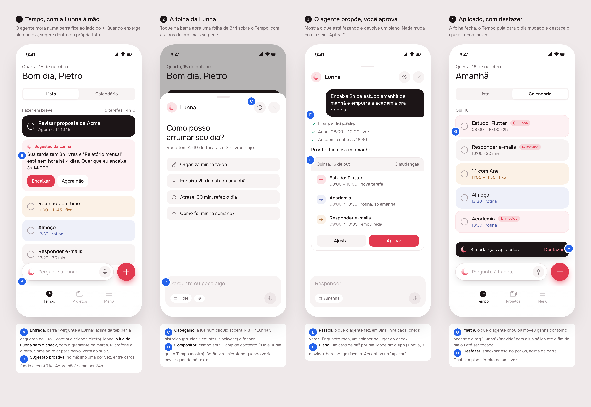
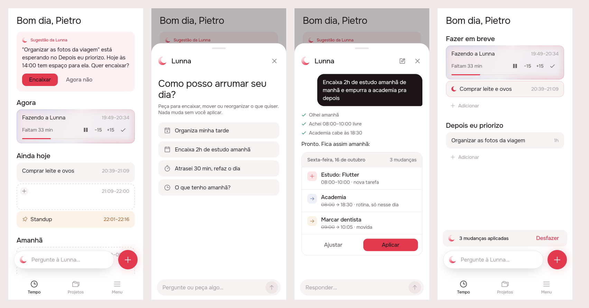
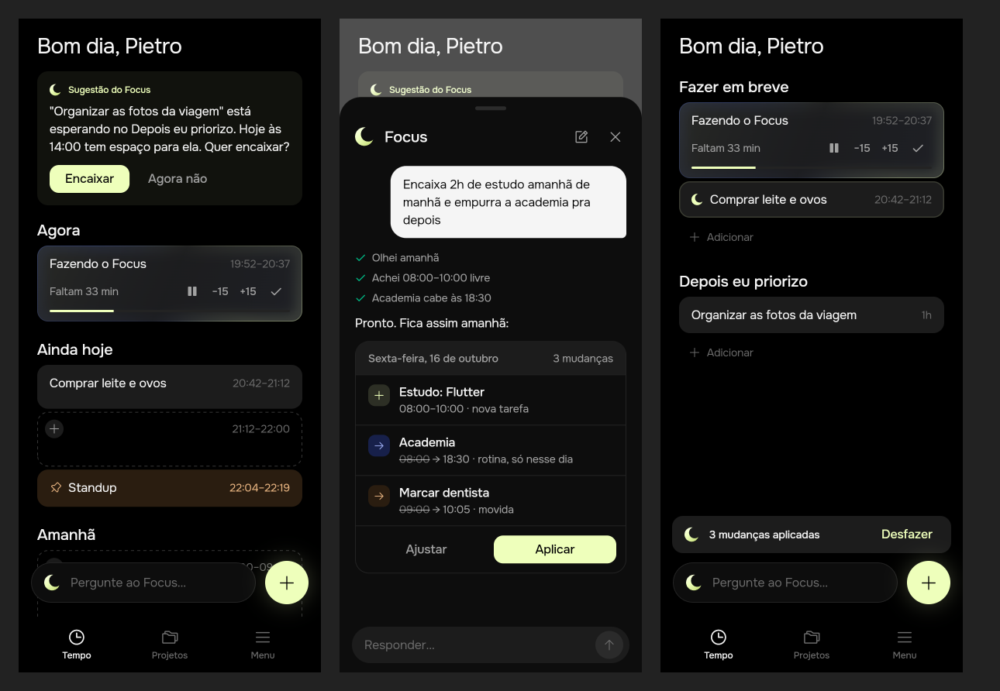

# Agentic experience

Delivered 2026-10-15. Covers both brands: "Pergunte à Lunna" on Lunna, "Pergunte ao Focus" on Focus.

## 1. The prompt

The request came in steps, in this order (verbatim):

1. "Create a simple design to add agentic experience. Do just a mockup and send me the prints. Do it ASAP. Get inspirations from Mobbin and use mocked data."
2. "button location, icon, etc. etc."
3. "transform this to a design proposal skill"
4. "that's great. Remove that ugly icon sparkles generic ai. let-s have a modified version of Lunna icon, without the check. Can you do this version for me?"
5. "great. Now make the changes for this. Also record this in some sort of "delivery" folder, that has the information of my prompt, the design, and the implementation details, inside a single md document."
6. "you can base off ../focus"
7. Asked which model provider to use, the answer was: **"OpenRouter, like Focus"**.

## 2. The design

The mockup source is [`mockup.html`](./mockup.html). The `design-proposal` skill in `.claude/skills/design-proposal/` renders boards like this one.

**References.** The design borrows patterns from ChatGPT (a text box with the mic beside it), Notion AI (suggestions shown inside the page) and Motion (change the plan, then confirm). Mobbin itself wasn't browsed, because it needs a login, so the board draws on these patterns as known rather than on Mobbin screens.

**Decisions** (the letters match the markers on the board):

| | Decision |
|---|---|
| A | **Entry point.** A pill reading "Pergunte à Lunna…" floats above the tab bar, to the left of the red **+**. The + still creates a task in one tap. It shows on Tempo only. |
| B | **Suggestion.** One at a time, drawn above the list on a 7% accent wash. "Agora não" hides suggestions for 24 hours. |
| C | **Sheet header.** The crescent, the brand name, a "Nova conversa" button and a close button. |
| D | **Composer.** A borderless field on `fill`. The send button turns accent once there is text. |
| E | **Steps.** One line per thing the agent did, each with a green check. |
| F | **Plan.** One card per day. The mark says the kind of change (+ for new, → for a move) and the colour says the card type (sand for fixed blocks, blue for routines). The old hour is struck through. The accent is used only on **Aplicar**. |
| G | **Changed cards.** Cards the agent added or moved get the crescent as their mark and a 1.5px accent edge. |
| H | **Undo.** A snackbar shows "N mudanças aplicadas · Desfazer" for 8 seconds, and Desfazer undoes the whole plan. |

**Icon.** The icon is Lunna's crescent from `app/brands/lunna/mark.svg` without the check, in the same pink-to-red gradient. It replaces the generic AI sparkle. Focus uses the same crescent in a lime gradient.

## 3. What was built

These screenshots come from the real Flutter build with a fake agent and the demo day. Lunna:

Focus, from the same code:

### The contract

Focus's rule is "reads run, writes are proposed". Lunna makes it stricter: **the model has no tool that writes.**

- `read_timeline` reads the day: tasks, events and the backlog, with ids and wall-clock hours in the person's zone.
- `propose_plan` checks each change against the day and stores a **plan** in server memory: the id must exist, nothing that has started can move, and no hour can be in the past. If a change fails these checks, it goes back to the model as an error for it to answer.
- When the user taps **Aplicar**, the server makes the changes itself through `EventLayoutService`, the same path the app's own buttons use, and records how to undo each one. A plan is applied in full or not at all: if one change fails, the ones already made are rolled back.
- A change is `add_task`, `move_task`, `add_event` or `move_event`. The agent never removes anything.

The suggestion uses no model. It takes the first backlog task that fits in the free time left today and offers it as a one-change plan, so it is applied and undone the same way.

### Server (`server/src/agent/`)

| File | What it holds |
|---|---|
| `openrouter.client.ts` | Focus's OpenRouter client, ported into Nest. Reads `OPENROUTER_API_KEY` and `OPENROUTER_MODEL`. |
| `agent.prompt.ts` | The system prompt, the per-turn context line (now, weekday, zone, working day, the day on screen) and the two tool schemas. |
| `agent.service.ts` | The tool loop (at most 6 round-trips, then a forced answer with no tools), reading, checking proposals, apply, undo and the suggestion. |
| `plan.ts` | `Plan`, `PlanChange`, `Undo` and `PlanStore` (in memory, 2h TTL, like the calendar cache). |
| `agent.controller.ts` | The routes below. Validates the conversation (at most 40 messages, the last one from the user). |
| `agent.controller.spec.ts` | End-to-end tests with a scripted model and the in-memory stores. |

| Route | Answer |
|---|---|
| `POST /api/agent/turn` `{ messages, day? }` | `{ reply, steps, plan? }`. Changes nothing. Returns 503 when no model is configured. |
| `GET /api/agent/suggestion` | `{ suggestion: { text, plan } \| null }` |
| `POST /api/agent/plans/:id/apply?days=` | The timeline plus `touched` (the ids it changed). 409 if already applied, 404 if expired. |
| `POST /api/agent/plans/:id/undo?days=` | The timeline. The plan can then be applied again. |

Other server changes: `createTask` and `createEvent` now return the new id, which undo needs. `AgentModule` is registered in `app.module.ts`. The OpenRouter variables are documented in `.env.example` and `SETUP.md`.

### App

- **New `packages/agent`:**
  - models
  - `AgentRepository`
  - `AgentCubit` (one conversation per session)
  - `SuggestionCubit` (the 24h rest is stored in `shared_preferences`)
  - views: `AskBar`, `showAgentSheet` / `AgentSheet`, `PlanCard`, `SuggestionCard`, and `applyAgentPlan` (applies the plan, replaces the day, shows the undo snackbar)
- **`timeline`:** a `TimelineReplaced` event, `TimelineState.touched`, and an `EventTile.touched` flag for the crescent mark and accent edge.
- **`app_ui`:** `AppIcons.agent` (`agent_lunna.svg` / `agent_focus.svg`, chosen by brand), `newConversation`, `arrowRight` and `close` icons, and an `accentWash` colour token.
- **`l10n`:** 28 `agent*` strings. Strings that name the app select on the brand ("à Lunna" / "ao Focus").
- **Wiring:**
  - `main.dart` provides `AgentRepository` and `AgentCubit`.
  - `ShellPage` puts the bar beside the + on Tempo.
  - `HomePage` draws the `SuggestionCard` above the list.

### Tests

- Server: 9 new specs in `agent.controller.spec.ts`. The full suite is 191 tests. One existing test is flaky on `main` with or without this change: `the day › routines › gives a flexible day another hour from the detail screen`.
- App: 9 tests in `packages/agent`, and 2 new `TimelineReplaced` tests in `timeline`. `timeline` passes (103) under both `BRAND=focus` and `BRAND=lunna`. `flutter analyze` is clean.
- Not tested against a real OpenRouter model yet. The tests use a scripted model.

### Where the build differs from the mockup

- **No microphone.** Voice input isn't built, so the bar and composer have no mic.
- **No conversation history.** The history icon became "Nova conversa", because conversations aren't stored on the server. They last for the app session.
- **The suggestion sits above the list,** not between cards. Putting it inside the list would have meant changing the list's drag and layout code.
- **Applying doesn't jump to the changed day.** The changed cards are marked instead.
- **The undo snackbar uses the app's own snackbar style** (`fill`), not the dark one in the mockup.

## 4. How to turn it on

1. Set `OPENROUTER_API_KEY` and `OPENROUTER_MODEL` in `server/.env.local`, or in `/opt/lunna/.env` on the Pi. The model must support tool calls. Whether the one Focus uses works here hasn't been checked.
2. `npm run start:local`, then run the app as usual. The bar appears on Tempo.
3. Without a key the bar still opens, and a turn answers "A Lunna ainda não está conectada a um modelo." The suggestion works without a key, since it uses no model.
