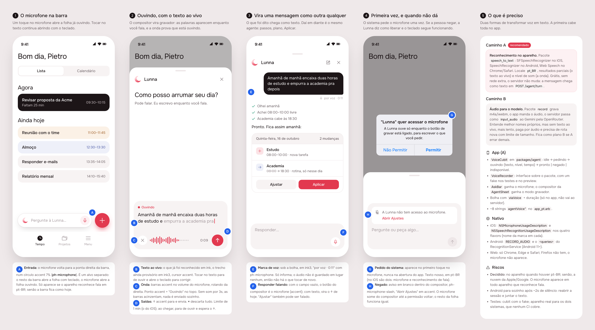
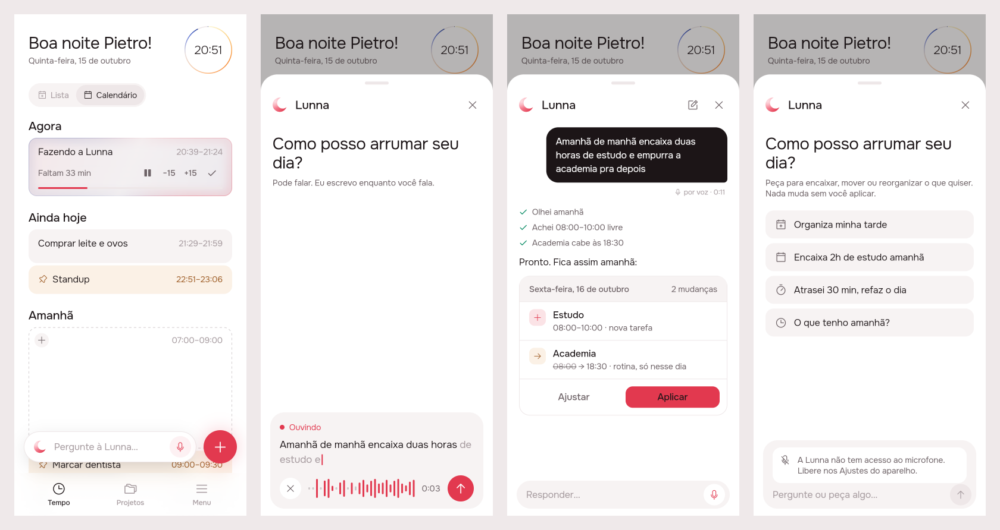
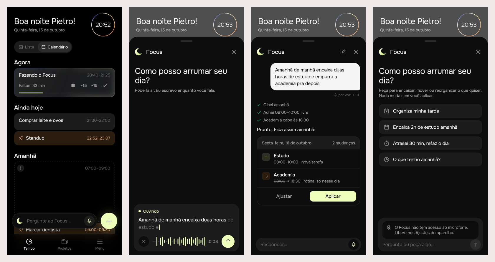

# Voice input for the agent

Delivered 2026-10-15. Covers both brands. You can speak to the agent instead of typing: the phone turns speech into text as you talk, and the agent reads that text like any typed message.

## 1. The prompt

Verbatim, in order:

1. "based on last delivery now design what it would take to have a recording of live voice /design-proposal"
2. "ok and just using gemini live is not enough?"
3. "I dont need Lunna to talk, just to read and have the device"
4. "yeah cloud fallback"
5. "one thing, can you track $ consumption while you build?"
6. "ok please include in this skill that claude to run /cost or create a skill mod to be able to do that."
7. "I want to know how much it costs from now to the end and track it on the md document."

Decisions taken along the way:

- **No Gemini Live.** Lunna doesn't need to speak. The phone turns speech into text, and the agent reads it as any typed message.
- **Cloud fallback.** On-device recognition where the phone has pt-BR, the platform's cloud recognition otherwise.

## 2. The design

The source is [`mockup.html`](./mockup.html).

**References.** ChatGPT's dictation (the composer turns into a recorder with a waveform, and ↑ sends), Google Keep's live transcript, and the iOS keyboard's dictation (the words still being worked out are drawn lighter). Drawn from known patterns; Mobbin wasn't browsed.

**Decisions** (the letters match the markers on the board):

| | Decision |
|---|---|
| A | **Entry point.** A microphone (`ph-microphone`) at the right end of the "Pergunte à Lunna" bar, in a 7% accent circle. It is a separate tap target: it opens the sheet already recording. Tapping the rest of the bar opens it with the keyboard, as before. |
| B | **Live transcript.** Words appear in the composer as they are heard: settled words in ink, the part the recognizer may still revise in ink3, with an accent cursor. Tapping the words stops recording and puts them in the field to correct. |
| C | **Waveform.** Accent bars follow the microphone's level, newest on the right; quiet bars are grey. A dot and "Ouvindo" sit above. Silence never sends anything. |
| D | **Exits.** ↑ stops and sends. × throws the recording away. Recording stops at 1 minute (iOS's own limit) and waits for ↑. |
| E | **Voice mark.** "por voz · 0:11" under the message. The audio isn't kept anywhere. |
| F | **Reply by voice.** In the conversation, an empty composer offers the microphone; once there is text, the button becomes ↑. |
| G | **Permission.** The system asks on the first tap of the microphone, never at launch. The wording is ours, in Portuguese. |
| H | **Refused.** A notice inside the composer, and the microphone is no longer offered. Typing works as before. |

**Icon.** Phosphor's `microphone`, and `microphone-slash` for the refusal. No new brand asset.

## 3. What was built

These screenshots come from the real Flutter build, with a scripted recognizer, a fake agent and the demo day. Scenes: Tempo, recording, the sent message with the plan, the refused microphone. Lunna:

Focus, from the same code:

### The contract

**Speech becomes text on the phone, and only the text reaches Lunna.** The server, the model and the OpenRouter call didn't change: a spoken request reaches `POST /api/agent/turn` like a typed one. The audio never goes to our server.

- Recognition is the platform's own: Apple's on iOS, Google's on Android, the Web Speech API in Chrome, Edge and Safari. It runs on the phone where pt-BR is available there, and in the platform's cloud otherwise (decision 4). So Apple or Google may hear the audio; we never do.
- A recording ends only when the user says so (↑, ×, or tapping the words) or at 1 minute. Android stops listening after a short silence; the app starts a new session at once and joins the words, so a pause doesn't cut the request in two.
- How long the user spoke (`UserEntry.voice`) stays in the app. Only the text is sent.

### App

- **`packages/agent/lib/src/voice/`, new:**
  - `voice_recognizer.dart`: `VoiceRecognizer` (`prepare`, `listen`, `stop`, `cancel`) and `SpeechVoiceRecognizer`, built on `speech_to_text` 7.5 (locale `pt_BR`, `pt-BR` on the web; dictation mode; partial results; sound level).
  - `voice_cubit.dart`: `VoiceCubit`. Statuses: idle, preparing, listening, stopped (hit the limit), denied, unavailable. It keeps the settled words (`heard`) apart from the ones still open to revision (`hearing`), the last 28 levels (scaled between the quietest and loudest heard so far, since every platform measures differently) and the elapsed time. It joins sessions when the platform ends one on its own, and drops any late words from a session already over. `take()` returns the text and its length; `cancel()` discards.
- **`AgentSheet`:** `showAgentSheet(…, listen: true)` opens it already recording. While recording, the composer is replaced by `_Recorder`: label, live text, the ×, `_Wave`, the clock and ↑. Otherwise the composer offers the microphone when the field is empty, and shows the refusal notice when the microphone was refused or there is no recognizer. The greeting reads "Pode falar…" while recording, and the suggestion chips are hidden.
- **`AskBar`:** the microphone button.
- **`AgentCubit.send(…, voice:)` and `UserEntry.voice`:** the bubble's "por voz · m:ss".
- **`app_ui`:** `AppIcons.microphone` and `AppIcons.microphoneSlash`.
- **`l10n`:** 9 `agentVoice*` strings. The refusal names the brand ("A Lunna" / "O Focus").
- **Wiring:** `main.dart` provides a `SpeechVoiceRecognizer` as a `RepositoryProvider<VoiceRecognizer>`, which the sheet is handed.
- **Native:**
  - iOS `Info.plist`: `NSMicrophoneUsageDescription` and `NSSpeechRecognitionUsageDescription`. The wording names no brand, so it holds in all four flavors.
  - Android manifest: `RECORD_AUDIO`, `INTERNET` (the recognizer's cloud fallback; the main manifest didn't declare it before), and a `<queries>` entry for `android.speech.RecognitionService` (needed from Android 11).

No server changes.

### Tests

- `packages/agent/test/voice_test.dart`, 13 new tests, on a fake recognizer and fake time:
  - the cubit: live and settled words; a pause joins the next session; take returns the text and length; take with nothing said; the 1-minute limit; cancel, and late words after it; denied and unavailable; level scaling;
  - the sheet: the mic records into the composer and sends with "por voz"; opening already recording; tapping the words puts them in the field; discarding; a refused microphone.
- `packages/agent`: 22 tests pass under both `BRAND=focus` and `BRAND=lunna`. `app_ui` passes (7) under both. `flutter analyze` is clean for the whole app.
- **Not tested on a real phone.** The tests and the screenshots use a scripted recognizer. Before shipping, the real permission prompts, the Android session restart and pt-BR accuracy need checking on a real iPhone and a real Android phone, and in Chrome and Safari.

### Where the build differs from the mockup

- **No "Abrir Ajustes" link.** The refusal notice says to allow the microphone in Settings but doesn't open them, because that needs another plugin (`app_settings` or `permission_handler`). Easy to add.
- **The microphone shows on every device.** Checking whether a device can recognize speech triggers the permission prompt, which must wait for the first tap. So a browser without speech recognition (Firefox) still shows the mic, and the first tap explains that this device can't recognize Portuguese speech; after that the mic is gone.
- **The "silence" grey is per bar**, as the wave scrolls, not the whole wave after 3 seconds. A pause still shows as a run of grey.

## 4. How to turn it on

Nothing to configure, and no new env vars:

1. Get dependencies: `cd app && flutter pub get` (adds `speech_to_text`). On iOS, `pod install` runs on the next build.
2. Run the app as usual. The microphone is on the ask bar on Tempo and in the sheet's composer.
3. The first tap asks for the microphone (on iOS, also for speech recognition). If refused, typing works as before. If the device can't recognize speech, the composer says so.

## 5. Cost and time

Counted from message 7 ("from now to the end"), and time from message 9 ("also track time please"). The figures are this Claude Code session's running cost in USD, read with the `usage-bars` mod's `session_cost` tool, so they include the conversation around the work. Times are UTC; wall-clock time includes pauses between messages.

| Phase | Start | End | Duration | Cost at start | Cost at end | Spent |
|---|---|---|---|---|---|---|
| Cost tracking set up (mod tool, skill update) | (not read; tool not loaded yet) | 23:36:41 | n/a | n/a | $1.96 | n/a |
| Build and verify (phase 3: code, tests, screenshots in both brands) | 23:36:41 | 23:53:30 | 16 min 49 s | $1.96 | $5.73 | $3.77 |
| Delivery docs (this README, AGENTS.md) | 23:53:30 | 23:54:13 | 43 s | $5.73 | $6.04 | $0.31 |
| **Total, from the start of the build** | 23:36:41 | 23:54:13 | **17 min 32 s** | | | **$4.08** |

The setup phase has no reading of its own: the mod's tool first answered at the start of the build, so its cost is folded into the $1.96 the build started from. The last edit to this table came after the final reading and isn't counted.

Outside Claude: $0. Dictation runs on the phone, and the tests and screenshots use a scripted recognizer and a fake agent, so OpenRouter was never called.
