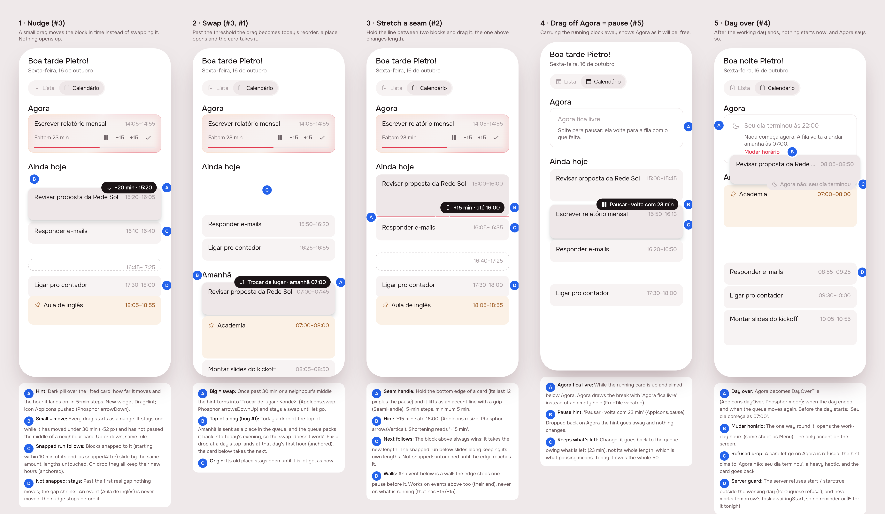
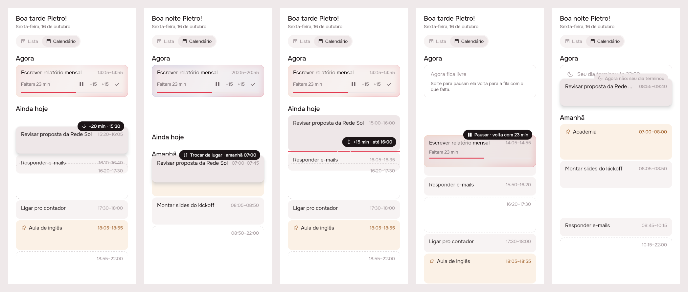
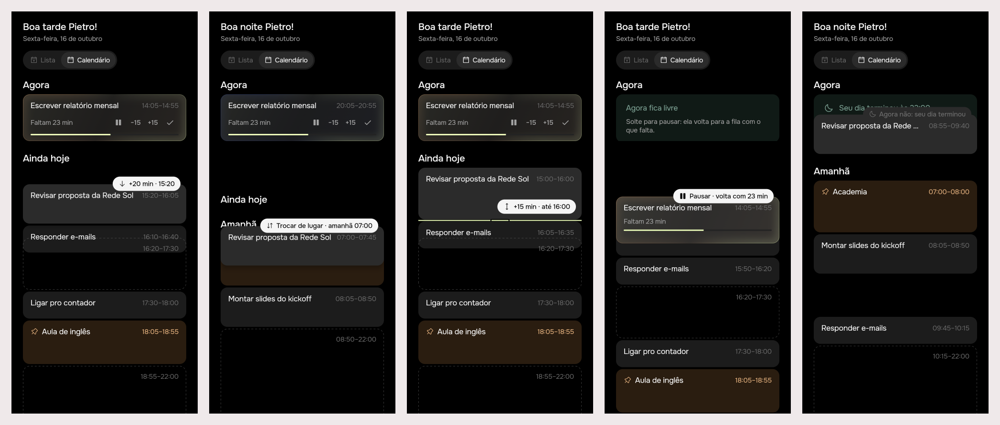

# Day gestures: nudge, swap, seam, pause by drag, day over

## 1. The prompt

> fix, rearch some annoying things:
>
> 1. When trying to switch tasks, specially if I move it at the top of a section, it usually dont work. Not sure why
> 2. I cant have a way to simply expand a task or diminish it without just making the next snapped going along. It would be good to be able to drag the division between tasks. In this sense, we always must take priority over the last task (meaning the one before the division) to be changed the time, and the next just follows along without changing the time. Only if they are snapped, of course. If not, it will not affect the other task.
> 3. Similarly, I would love in the calendar mode to drag some task more 15 or 20 min, and it should also drag the others. I think for the sake of diferentation, how we differ that from switching places with a task? Simple: if we start moving small, it just needs to move. If we move big, it means a switch.
> 4. Also, the now section sometimes start playing things that are just for tomorrow. I think if it is beyond the day limit, we should kind of block it from adding any task now and let the user now about this.
> 5. Also sometimes I fell I could drag the now task to ainda hoje which is equivalent to pause. But I would love to see that visually, so I dont worry that there is a "now" task there.

After the board:

> it is always calendar you are right. Day over... not sure what you meant. nudge hours yeah. Threshold lets test and I will tell you. Can start building.

After trying it:

> ok testing. when changing places, it actually is moving all the other tasks further, instead of just switching

A drop between two cards was an insertion, so everything after it moved down. A long drag let go *on* a task is now a real swap: `POST /tasks/:id/swap { with }`. Each task takes the other's turn in the queue, or its hour if it had one, so only what lies between them moves, and only by the difference in their lengths. Headings and the gaps between cards still insert, which keeps the day-top fix. The card underneath is highlighted with the hour it would take, and the hint reads "Trocar com <título>". Tests: 4 server (238 in all), 2 app (115 per brand).

So: the gestures are calendar-only; nudged blocks keep their new hours; the 30-minute threshold stays as proposed until it has been tried. "Day over" was built as proposed (hard block, with *Mudar horário* as the way round it). The decision is explained under "Where the build differs" below.

## 2. The design

`board.json` holds the pins. Its `png` paths point at the shots in the session scratchpad, which were not kept.

References (from known patterns, not browsed): Apple Calendar and Google Calendar for pulling an event's bottom edge to resize it; Structured for the hour sliding under the finger; Sunsama/Motion for the snapped run that comes along.

| Screen | Pin | Decision |
|---|---|---|
| 1 Nudge | A | Dark pill over the lifted card: `+20 min · 15:20`. `DragHint`, icon `AppIcons.pushed` |
| | B | Every calendar drag starts as a nudge; under 30 min of travel it only slides, in 5-min steps |
| | C | The run snapped to its end (start ≤ 10 min after the previous end) slides by as much and keeps its lengths. On drop, all of them keep their new hours (anchored) |
| | D | Nothing past the first real gap moves. Events never move |
| 2 Swap | A | Past 30 min it becomes a swap and stays one: `Trocar de lugar · amanhã 07:00` (`AppIcons.swap`, Phosphor arrowsDownUp) |
| | B | Bug #1: a drop at the top of a day asks for that day's first hour |
| 3 Seam | A | Holding a card's bottom 14 px lifts the seam (`SeamHandle`, accent line + grip) |
| | B | `+15 min · até 16:00` (`AppIcons.resize`, Phosphor arrowsVertical) |
| | C | The block above always takes the change; the snapped run below slides, lengths untouched; one that is not snapped is left alone |
| | D | Not on what is running (it has −15/+15) |
| 4 Pause by drag | A | Agora draws the break, "Agora fica livre", while the running card is carried below it (`FreeTile(vacated:)`) |
| | B | `Pausar · volta com 23 min` (`AppIcons.pause`) |
| | C | It goes back to the queue owing what it had left, not its whole length |
| 5 Day over | A | Agora becomes `DayOverTile` (`AppIcons.dayOver`, Phosphor moon): "Seu dia terminou às 22:00" / "Seu dia começa às 07:00" |
| | B | *Mudar horário*, the one accent: takes you to Menu |
| | C | A drop on it is refused: dimmed hint "Agora não: seu dia terminou", heavy haptic |
| | D | The server refuses beginning anything outside the working day |

## 3. What was built

Real build, held mid-gesture (scenes 1–5: nudge, swap to the top of tomorrow, seam, running block off Agora, day over), Lunna then Focus:

### The contract

- **Small = move, big = swap.** On the calendar, a drag of a task that has not begun stays a nudge under 30 minutes of travel (`_nudgeReach`). Once past that it is a swap until it is let go. A nudge posts `POST /tasks/:id/shift { minutes }`.
- **The block above a seam wins.** `POST /tasks/:id/resize { minutes }` and `POST /events/:id/resize { minutes }` set the new length. The run snapped to its end slides by the difference, each block keeping its own length. Blocks not snapped are untouched until the block reaches them, and then they are pushed like anything else.
- **The run** is `snappedAfter(day, id, end, queued = true)`: every task starting within 10 minutes of the previous end, stopping at the first gap, at an event and at anything begun. Each block in it is anchored at its new hour (`_carry`), so a queued one cannot slip back into the room the move left.
- **Top of a day is that day's first hour.** On the calendar, a drop above the first card of a day that is later than the card above it (or later than today) sends `after` = that day's work-day start (or the card's start, if earlier).
- **Pausing by drag owes what is left.** A begun task moved off the top, shelved, or postponed by the guard goes back owing `owedMinutes(event, now)` (minimum 5), not its whole length.
- **Nothing begins outside the working day.** `POST /tasks/:id/start` and `start: true` moves are refused in Portuguese before the day opens and after it ends (`refuseOutsideWorkDay`).

### Bug #1: why the switch "didn't work"

Two causes, both in `timeline_list.dart`:

1. A drop is a place in the list. When the last card of today was let go above the first card of tomorrow, it landed in the *same index* it already had, so `target == origin` read it as "put back" and nothing was sent. The real build's screenshot caught this one. `_stays` now counts a change of day as a move.
2. Even when sent, the drop went as a bare queue index. The queue packs as close to now as it can, so the task flowed back into tonight's free room. A drop at the top of a day now carries `after` = that day's first hour.

### Server

- `events/event-layout.service.ts`: `shiftTask`, `resizeTask`, `resizeEvent`, `_carry`, `snappedAfter(…, queued)`, `owedMinutes`, `refuseOutsideWorkDay`. `moveTask`, `startTask` and `_shelve` were changed to use them.
- `events/tasks.controller.ts`: `POST /tasks/:id/shift`, `POST /tasks/:id/resize`. `events/events.controller.ts`: `POST /events/:id/resize`. `events/request.ts`: `requireLength` (5–1440).

### App

- `packages/timeline`: `TimelineList` (nudge, seam, vacated Agora, day-over Agora, day-top drop, hints), new `DragHint`, `SeamHandle` and `DayOverTile`, `FreeTile(vacated:)`, `TimelinePlan.snap`, `TimelineRepository.shiftTask` / `resize`, bloc events `EventShifted` / `EventResized`.
- `app_ui`: icons `dayOver`, `swap`, `resize`.
- `l10n`: `dayOver*`, `dayNotYet*`, `dayClosed*`, `vacated*`, `dragHint*`, `minutesDelta`.
- Shell/Home: `OpenDayHours`. Agora's *Mudar horário* brings the Menu tab forward.

### Tests

- Server: `npm test` passes, 16 suites and 234 tests. 14 are new under "the calendar's gestures": shift (5), seam (5), pause owes what is left (1), top of a day (1), outside the working day (2).
- App: `flutter analyze` is clean. `packages/timeline` passes 113 tests under both `BRAND=focus` and `BRAND=lunna`. New: 2 bloc tests, plus widget tests for the nudge (later and earlier), the seam, vacated Agora with the pause hint, a drop at the top of tomorrow, the last card of today going to tomorrow (the bug), and the day-over tile refusing a start. `app_ui` passes 7 under both brands. No flaky tests seen.

### Where the build differs from the mockup

- **Swap, scene 2:** the place under the finger does not open up when the drop is the same index on another day. The hint and the landing hours (07:00–07:45) say where it goes instead.
- **Run tiles during a nudge or seam:** they read their new hours while sliding. The free stretch after them is not redrawn until the drop, so it is overlapped a little.
- **Seam:** works on fixed events above a seam too. The design pin said so; the mockup only showed a task.
- **"Day over":** you weren't sure what this meant. It is a hard block. After the end of your day (or before its start), Agora says so and nothing can start: not by dropping on Agora, not by ▶, not by the reminder's *Começar agora*. The only way round it is changing the hours. This also covers the likely source of "tomorrow's task playing": the break under Agora used to be drawn and accept drops even after the day was over, and a drop there began the task.

## 4. How to turn it on

Nothing to configure: no env vars, no migrations. Deploy the server and the app together. An old app against the new server works but has no nudge or seam. A new app against an old server gets 404s on `shift`/`resize`, which show as the usual failure line.

The threshold is `_TimelineListState._nudgeReach` (30 minutes), pending your test.

## 5. Cost and time

| Phase | Start (UTC) | End (UTC) | Duration | Start reading | End reading | Spent | Tokens in | Tokens out |
|---|---|---|---|---|---|---|---|---|
| 1 Mockup and prints | 23:11:17 | 23:22:22 | 11 min | $0.00 | $2.79 | $2.79 | not reported | not reported |
| Your review (pause) | 23:22:22 | 23:42:32 | 20 min | $2.79 | $3.15 | $0.36 | — | — |
| 3+4 Build, prints, delivery | 23:42:32 | 00:00:21 | 18 min | $3.15 | $7.62 | $4.47 | not reported | not reported |
| **Total** | | | **49 min** | | | **$7.62** | ≥ 5.5M | ≥ 40k |

Figures come from `mcp__usage-bars__session_cost`. Its token counts stayed at zero for the first reading and stopped updating after the second (5.52M in, 40.4k out at 23:42), so the token totals are a lower bound. Wall-clock time includes your pause between messages, and the dollars include the talk around the work. Nothing outside Claude was spent: no model calls and no OpenRouter.
