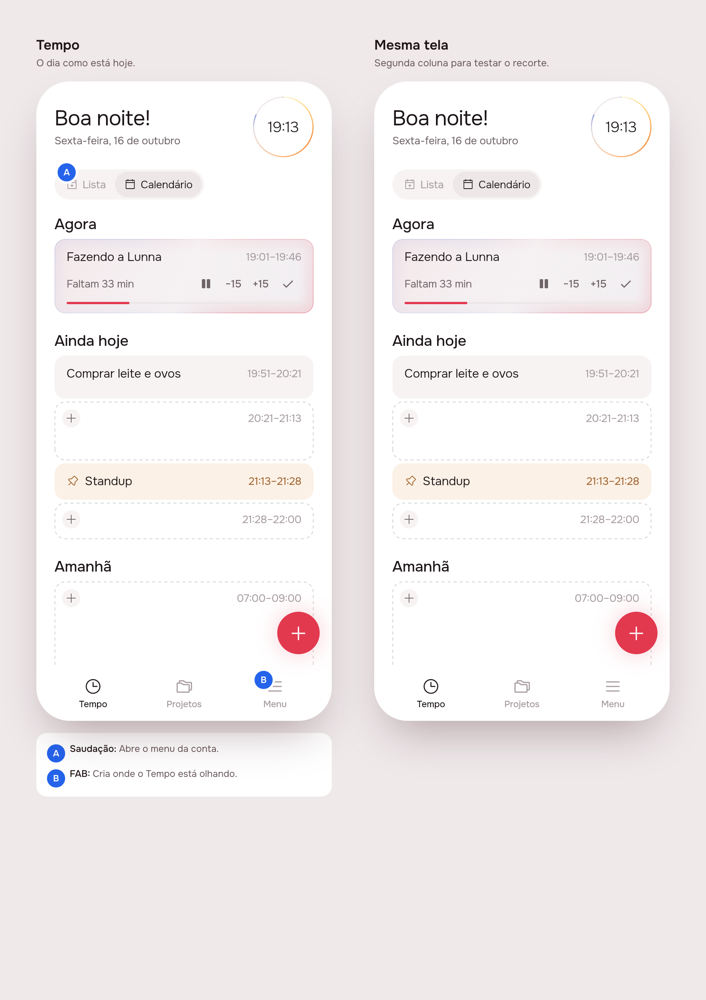

# The `/feature` skill

Delivered 2026-10-16. This is a milestone for the tooling, not a product change. The `design-proposal` skill is renamed `/feature`. Its mockups are now drawn by the real Flutter app instead of a hand-built HTML copy, it reports tokens as well as dollars, and it has explicit rules for working fast. The app and the server are untouched.

## 1. The prompt

Verbatim, in order:

1. "improvements to the design-proposal skill:
   1. Rename it to /feature skill
   2. Also report the amount of tokens besides the cost
   3. Also I noticed the design proposal is not using the real flutter code. Why? What is the effort to change that.
   4. Make it faster and more effective by adding words on how it should be faster and achieve in less time as possible while keeping quality."
2. "always flutter for consistency."
3. "can you create a delivery out of this just to mark this milestone"

Decisions taken along the way:

- **Why the mockup wasn't Flutter:** the skill told it to copy an HTML template. Rendering that template took about 3 s, pins were easy to place, and it could show UI that didn't exist yet. The cost was drift: the mockup imitated the widgets instead of using them.
- **Always Flutter** (message 2). Every mockup comes from the real widgets, for consistency, even though each change now takes a build of about 50 s.

## 2. What changed

### The skill: `.claude/skills/feature/`

| File | Change |
|---|---|
| `SKILL.md` | Renamed (`name: feature`). New **Speed** section. **Cost and time** now records tokens. Phases 1, 2 and 4 rewritten around the Flutter preview. |
| `board.mjs` | **New.** Builds the annotated board (title, why, lettered pins, notes) from real screenshots and a `board.json`, and renders `board.png` plus `screen1..n.png` at 2x. |
| `shoot-flutter.sh`, `shoot.mjs` | Moved only. They screenshot a Flutter web build as a 390×844 phone, one scene per `?s=<n>`. |
| `render.sh`, `assets/example-agent.html` | **Removed.** They were the HTML mockup path. |

### The mockup now comes from the app

1. The skill writes new UI as real widgets in the package where they will live, using `app_ui`, the colour tokens, `AppIcons` and strings in `app_pt.arb`. That is the start of Phase 3's screens.
2. The preview entry point `app/lib/<slug>_preview.dart` is shaped like `lib/preview.dart` and uses fake repositories. `?s=<n>` picks each scene, and each scene sets up its state directly instead of replaying taps.
3. `flutter build web` runs in the background (about 50 s) while the skill writes `board.json`. Then `shoot-flutter.sh` screenshots the scenes and `board.mjs` lays out the board.
4. Phase 4 reuses the same entry point, now running the finished code, built for both brands at once.

Test run, using the existing `lib/preview.dart` built for Lunna, with two test pins:

Source: [`board-test.json`](./board-test.json). Pin coordinates are the pin's centre, in logical pixels on the screenshot.

### Tokens: the `usage-bars` mod

The mod lives in `~/.claude/mods/usage-bars`, outside this repo.

- It now adds up the token counts every turn reports (`turn.complete`), for the main loop and for subagents.
- `mcp__usage-bars__session_cost` returns `{ usd, tokens: { input, output, cacheRead, cacheWrite, total }, at }`.
- The count restarts at `session.start`.
- One new test. All 4 mod tests pass (`claude plugin test .`) and `tsc --noEmit` is clean.
- **Not counted:** model calls that aren't turns, such as compaction. The dollar figure does include them.

### Speed rules (in `SKILL.md`)

- Go straight to the paths and commands the skill and `AGENTS.md` already give.
- Batch independent calls. Never re-read a file you just wrote.
- Run builds and tests in the background, both brands at once.
- Check only what you touched while iterating; run the full matrix once at the end.
- No subagents unless asked. Keep messages short. One fix pass per render.
- Quality stays the same: pins still state every decision, specs still cover the rules, and both brands are still checked.

## 3. How to turn it on

- Type `/feature`. The skill is picked up from `.claude/skills/feature/`.
- Run `/reload-plugins` (or start a new session) so the mod's token count is live.
- The board needs Google Chrome in `/Applications` and Node ≥ 22, as the screenshot script already did.

## 4. Cost and time

The figures come from the `usage-bars` mod's `session_cost` tool and are this session's running totals, including the conversation around the work. Times are UTC. Wall-clock time includes pauses between messages.

| Phase | Start | End | Duration | Cost at start | Cost at end | Spent | Tokens in | Tokens out |
|---|---|---|---|---|---|---|---|---|
| Messages 1–3: rename, tokens, speed, Flutter mockups, this README | 22:08:33 | 22:16:58 | 8 min 25 s | $0.42 | $1.91 | $1.49 | 974k | 9.7k |

The first reading came after the opening reads of message 1, so the $0.42 before it isn't in "Spent". **Total for the session: $1.91.**

**Tokens** are from the last reading: in is everything the model read (input plus cache), out is everything it wrote. They count only from the moment the edited mod loaded, partway through this session, so they cover less than the dollar figure does. From the next session on, both figures count from the start.

Outside Claude: $0. Nothing called OpenRouter.
