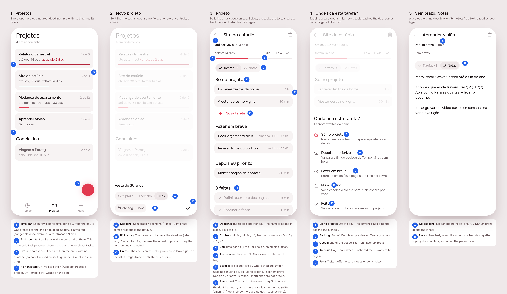
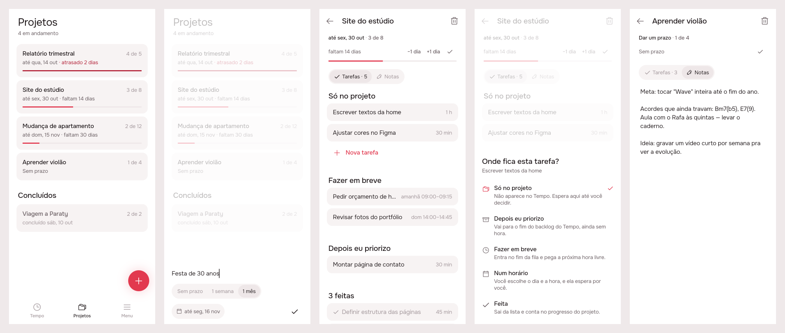
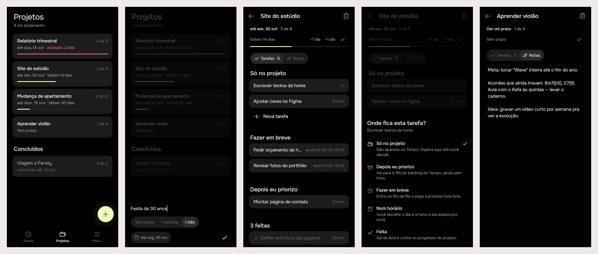

# Projetos

Delivered 2026-10-16, in both brands. The second tab, which was a placeholder, is now **Projetos**.

## 1. The prompt

The request came in steps, in this order (verbatim):

1. `/feature` "in the second tab, let's be able to create projects. Projects are short term or long-term subjects and they will be tied to tasks, etc. On the second tab, a user can create a new project and set a duration for it or not (like a deadline). With that, we have a list of projects. When clicking in a project, the user will see a similar content to the task. A title, a progress bar (related to the total deadline of project), and control to extend/remove it one day, mark as done, etc. And below there will be a free text so user can write anything on the project. Because projects needs to hold tasks, there should be a space exclusive to adding tasks, and the cycle for adding tasks is the same. Because not every task in a project is suitable to go to backlog (because that would be overwhelming!), we should be able to somehow change their status inside each project and move them to backlog or directly to a time for example."
2. "can we have consistency of cards inside the project?"
3. "I loved the idea to bring things in the same structure! Also notes how it is is perfect. Yep, about your open question. Do it. Now you can proceed building this."

The open question that message 3 answers was: *"Should dragging a card between stages work in the build too, as it does in Lista, with the sheet still there for a tap?"* The answer was yes.

## 2. The design

The board was drawn by the real Flutter app (Lunna) and is the version approved after message 2. Its pins and notes are in [`board.json`](./board.json), and each screen is also in `img/mockup-screen1..5.png`.

**References.** The design follows known patterns from Things 3 (projects that have deadlines), Linear (where each item stands) and Sunsama (pulling work onto the day). Mobbin wasn't browsed.

**Decisions** (the letters match the pins):

| Screen | Pin | Decision |
|---|---|---|
| 1 Projetos | A | Each row's bar shows how much time has gone by, from the day the project was created to the end of its deadline day. It turns red (`dangerInk`) once overdue, with "atrasado N dias". |
| | B | "3 de 8" is the count of done tasks out of all of them. It is the only task progress shown; the bar is never about tasks. |
| | C | Nearest deadline first, then projects with no deadline (and no bar). Finished projects sit under **Concluídos**, in grey. |
| | D | On Projetos the **+** (`AppFab`) creates a project. On Tempo it still adds to the day. |
| 2 Novo projeto | A | *Sem prazo / 1 semana / 1 mês*. Sem prazo comes first and is the default. |
| | B | The calendar pill shows the deadline and opens a wheel to pick any day. |
| | C | The check creates the project. It stays dimmed until there is a name. |
| 3 Projeto | A | The deadline opens a picker when tapped, and the name is edited in place, as on a task's page. |
| | B | **−1 dia / +1 dia / ✓**, in the same quiet style as the running card's −15 / +15 / ✓. |
| | C | The bar is the same 3px line a running block uses. |
| | D | **Tarefas · N \| Notas**: a switch that gives each one the full height of the page. |
| | E | Tasks are filed by where they are, under headings styled like Lista's: *Só no projeto, Fazer em breve, Depois eu priorizo, N feitas*. |
| | F | The card is the same one Lista draws, with the length on the right, or the hours once the task is on the day ("amanhã 09:00–09:15"). |
| | G | **Nova tarefa** opens the same name + length sheet used everywhere, and the new task lands in *Só no projeto*. |
| | H | Done tasks keep the card shape, greyed, with a check where Tempo puts its pin and repeat marks. |
| 4 Onde fica? | A–E | Tapping a card opens this sheet: Só no projeto, Depois eu priorizo, Fazer em breve, Num horário (a day + hour wheel, anchored), Feita. The task's current place has the accent and a check. |
| 5 Notas | A | A project with no deadline has no bar and no ±1 dia. "Dar um prazo" opens the wheel. |
| | B | Free-text notes, saved like a task's notes. |

**Icons.** No new icon. The tab keeps `AppIcons.things` (folders). The place sheet uses `things`, `archive`, `time`, `calendar` and `check`.

## 3. What was built

These are the real widgets, shot through a preview entry point that has since been deleted, with canned projects behind the real `ProjectsCubit`.

### The contract

**A project's task is an ordinary task that points at the project, and it starts out *parked*, out of the day's sight.**

- New columns on `task`: `project_id` (set to null if the project is deleted) and `parked`. `TaskStore.pending` leaves parked tasks out, so the queue, the backlog, the layout, the reminders and the agent never see them. Nothing in `relayout` changed.
- Taking a task out of the project puts it at the end of the backlog. For the queue or an hour, `EventLayoutService` then moves it the way a drag would (`moveTask`, or `editTask` with `startTime` for an hour), so every time rule still holds.
- Putting a task back in the project takes it off the day. A **task that has begun cannot go back**: its hour has already happened. The server refuses with *"Esta tarefa já começou. Pare ou termine antes de devolvê-la ao projeto."*
- Ticking off a task that is on the day goes through `doneTask`, which pulls the snapped tasks after it earlier. A parked task is just marked done. A done task taken back is parked again.
- Deleting a project deletes the tasks only it could see. Tasks that were on the day, or done, stay and simply belong to no project.
- A deadline is a day (`date`, `YYYY-MM-DD`), due by the end of that day. The bar is time from `created_at` to the deadline.
- A task's hour in a project is the one the timeline works out on the same read (`day.placed` or the hour it began), so the project and Tempo always agree.

### Server (`server/src/projects/`)

| Route | What it does |
|---|---|
| `GET /api/projects` | `{ projects: [{ id, title, notes, deadline, createdAt, doneAt, tasks: [{ id, title, minutes, place, at?, doneAt? }] }] }` |
| `POST /api/projects` | `{ title, deadline? }` |
| `PATCH /api/projects/:id` | `{ title?, notes?, deadline? (day or null), done? }` |
| `DELETE /api/projects/:id` | deletes the parked tasks and keeps the rest |
| `POST /api/projects/:id/tasks` | `{ title, minutes }`: parked, at the end |
| `POST /api/projects/:id/tasks/:taskId/place` | `{ place: project\|backlog\|queue\|scheduled\|done, at?, index? }`. `index` sets the order among parked tasks. |

Every route answers with every project. The files are `project.types.ts`, `project.store.ts` (abstract class + memory store), `pg-project.store.ts`, `projects.service.ts`, `projects.controller.ts`, `request.ts` (refuses bad input, never guesses), `dto/` and `projects.module.ts`. The task store gained `ofProjects`, `projectId` and `parked`. The migration is `drizzle/0006_projects.sql`.

### App (`app/packages/projects/`)

- **Models:** `Project` (`progressAt`, `daysLeftAt`, JSON) and `ProjectTask` (`TaskPlace`).
- **Data:** `ProjectsRepository` (Dio) and `ProjectsFailure` (shows the server's Portuguese message).
- **State:** `ProjectsCubit`. After a task moves it calls `onDayChanged`, and `main.dart` hooks that to `TimelineRequested`, so Tempo reloads.
- **Screens:**
  - `ProjectsPage`: the tab's list.
  - `ProjectPage`: the summary, Tarefas/Notas, the stages and the drag between them.
  - `showProjectSheet`: the new-project sheet.
  - `showPlaceSheet`: the "where does this task go" sheet.
  - `confirmProjectDelete`: asks before deleting.
  - `ProjectsFailureListener`: shows refusals in a snackbar.
- **Shell:** the second tab is `ProjectsPage`. It reloads each time it's shown, since the hours of its tasks move with the day. On that tab the + opens the new-project sheet.
- **Strings:** all in `app_pt.arb`. The unused `shellComingSoon` was removed.

### Tests

- **Server:** `projects.controller.spec.ts` (15 end-to-end specs: frozen clock, Sao Paulo zone, memory stores, with the timeline routes beside them) and `pg-project.store.spec.ts` (3 PGlite specs). `npm test` passes: **16 suites, 220 tests**, 18 of them new. `tsc --noEmit` and eslint pass.
- **App:** the `projects` package has 11 tests (model, cubit, and widget tests for the stages, the tap-to-place sheet, dragging across stages and reordering within the project). They pass under `BRAND=focus` and `BRAND=lunna`. `timeline` (104) and `agent` (34) pass under both too. `flutter analyze` reports no issues.
- No flaky tests.

### Where the build differs from the mockup

- **Drag** (agreed in message 3): hold a card and drop it in another stage. The stage it's over gets the accent wash, and an empty stage opens up while a card is in the air. Dropping it on a card in *Só no projeto* takes that card's place, and an accent line shows where it will land. Choosing an hour still goes through the sheet (*Num horário*), because a stage has no hours to drop onto.
- **The project card copies Lista's look but isn't Lista's widget.** `EventTile` is built around `TimelineEvent`. A shared card in `app_ui` is the next step if the two ever drift apart.
- **Picking a deadline uses the day + hour wheel and keeps only the day.** There is no date-only wheel yet.
- **Deleting asks first.** The mockup didn't show this. It warns that the tasks only in the project are deleted with it.
- **Tempo doesn't show a task's project yet.** This was raised as an open question and left out of the build.

## 4. How to turn it on

Nothing to configure. No new env vars. The migration runs on server boot (`migrateDatabase`). Deploy the server and the web images as usual; without the new server, the Projetos tab shows nothing and its writes fail with the "Não consegui falar com o servidor" snackbar.

## 5. Cost and time

The session figures come from the `usage-bars` tool (`mcp__usage-bars__session_cost`). They include the conversation around the work.

| Phase | Start | End | Duration | Start → end reading | Spent | Tokens in | Tokens out |
|---|---|---|---|---|---|---|---|
| 1 Mockup and prints | 22:27:59 | 22:35:55 | 8 min | $0.00 → $2.54 | $2.54 | ≈2.9M* | ≈45k* |
| 2 Iterate (card consistency) | 22:40:48 | 22:43:10 | 2.5 min | $2.74 → $3.20 | $0.46 | n/a | n/a |
| 3 Build (server + app) | 22:47:55 | 22:56:14 | 8.5 min | $3.40 → $6.81 | $3.41 | n/a | n/a |
| 4 Prints and delivery | 22:56:14 | 23:00:13 | 4 min | $6.81 → $7.73 | $0.92 | n/a | n/a |
| **Total** | 22:27:59 | 23:00:13 | **32 min** | | **$7.73** | ≥4.3M | ≥54k |

\* The token readings stopped updating at 22:47 (4.32M in, 54k out, at the start of Phase 3), even though the USD kept rising, so tokens can't be split by phase after that. The Phase 1 figure is the reading taken at the start of Phase 2. The totals are lower bounds. A `/cost` pasted from the session would give exact figures.

Wall-clock time includes the user's pauses between messages (22:36→22:40 and 22:43→22:47). The build caused no spend outside Claude: no model calls and no paid services.
