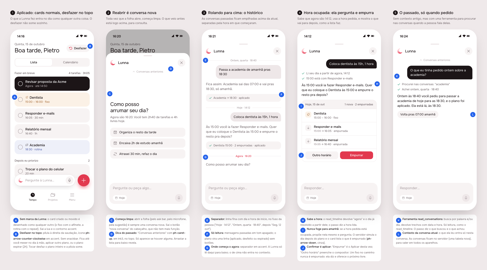
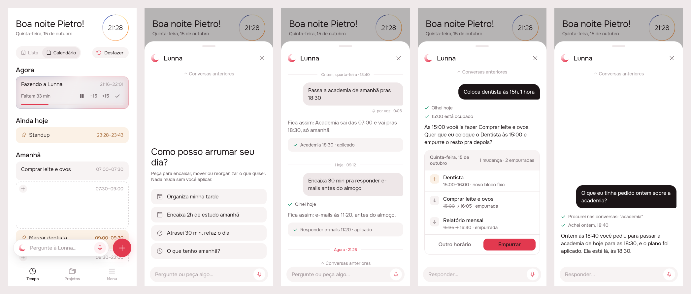
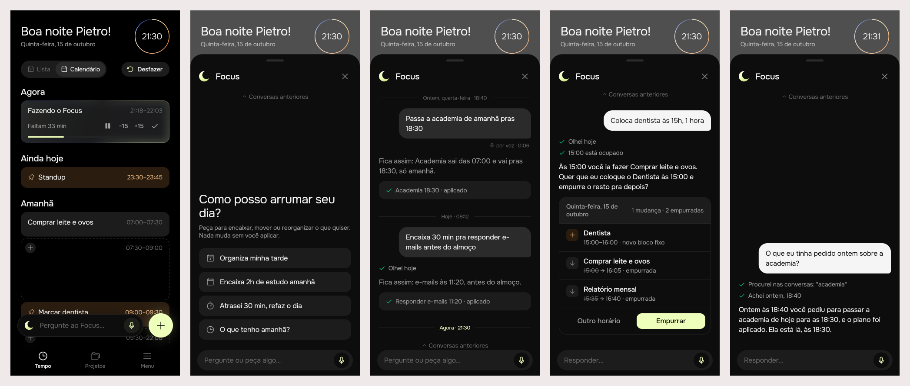

# Agent fixes: plain cards, a lasting undo, separate conversations, kept hours

Delivered 2026-10-15. Covers both brands. Six fixes to the agent shipped the same day (`product/delivery/2026-10-15-agent`).

## 1. The prompt

Verbatim, in order:

1. "now fix those things:
   1. When asking to lunna, it add events with icon. events should be normal.
   2. The snackbar is too sticky, dont leave the screen. I think we could have a undo button always on the top
   3. when reopening, there should be a new conversation. Past conversations can be accessed scrolling to the top for example, but at first should be clear. They have to have some separation by timezone
   4. Also, regardless threadwise, i don't think we should have context of the previous conversations. It's just for the user to consult.
   5. It could have access to past conversations via a tool call
   6. Also I noticed that it doesn't know when it's now precisely, or it proposes a time for tomorrow maybe because there is another event already. The agent should know about that and ask the person if they want to confirm the change and push the event to later (with the rest, as we always do in the UI)" (`/design-proposal`)
2. "ok do that"

The open questions from the board got no answer, so the build took the board's defaults:

- **"Separation by timezone"** was read as separating conversations by time: a divider with the day and hour each conversation began, in the device's zone.
- **Every opening of the sheet is a new conversation.** A reply sent to a reopened sheet has no context, but a plan above it can still be applied by tapping it.
- **Point 1** was read as the crescent mark on changed cards. The prompt now also asks the agent to create tasks rather than fixed events, unless the person asks for something fixed.

## 2. The design

The source is [`mockup.html`](./mockup.html).

**References.** ChatGPT and iMessage (history above the conversation, scrolled up to reach, with time dividers), Gmail's undo (one action, kept in reach), and Motion and Sunsama (a conflict is asked about, not resolved on its own). These were drawn from known patterns; Mobbin wasn't browsed.

**Decisions** (the letters match the pins on the board):

| | Decision |
|---|---|
| A | Cards created or moved by the agent look like any other card. The crescent and the accent edge are gone. |
| B | **Desfazer** is a pill (`ph-arrow-counter-clockwise` in accent). There is no snackbar. It stays until you change the day by hand, apply another plan, or the plan expires. |
| C | Opening the sheet always starts a new, empty conversation. The "nova conversa" button is gone. |
| D | "Conversas anteriores" (`ph-caret-up`, ink3) at the top shows there is history above. |
| E | Each past conversation starts with a divider showing its day and hour: "Hoje · 14:12", "Ontem, quarta-feira · 18:40". |
| F | Past conversations are dimmed and read only, and each plan is one line: aplicado, desfeito, or não aplicado. |
| G | An accent "Agora · hh:mm" divider marks where the current conversation starts. The agent only sees what is below it. |
| H | `read_timeline` returns `now`. |
| I | The agent keeps the hour you asked for. The plan lists what gets pushed later (`ph-arrow-down`, grey). |
| J | When something gets pushed, the buttons are **Outro horário** / **Empurrar**. An event is never pushed. |
| K | New `read_conversations` tool: read-only, searches by word or day. |
| L | Conversations are stored on the server, so they show on every device. |

**Icons.** Phosphor `arrowCounterClockwise` (already `AppIcons.undo`), `caretUp` (`AppIcons.earlier`) and `arrowDown` (`AppIcons.pushed`). No new brand asset. `AppIcons.newConversation` was removed because nothing uses it any more.

## 3. What was built

These screenshots come from the real Flutter build, with a fake agent repository and the demo day. The scenes are: Tempo after applying a plan; the sheet reopened; the sheet scrolled up to the history; a plan that pushes tasks; a question answered from a past conversation. Lunna:

Focus, from the same code:

### The contract

- **A turn's context is its own conversation.** The app sends only the messages of the conversation being had. Earlier conversations reach the model only when it calls `read_conversations`.
- **An hour asked for is kept, and what it pushes is asked about.** `propose_plan` lays the day out again as if the plan had been made: `rehearse` runs the same `relayout` the timeline uses. The plan carries the tasks that would start later (`pushed`).
  - A change that wouldn't get its own hour is refused, and the model is told to ask. That covers an anchored task landing behind one already at that hour, and anything placed on top of an event.
  - So a plan never promises an hour the layout wouldn't give.
- **Undo lasts as long as it can be exact.** Undoing a plan restores the cards to how they were before it. So any change made by hand forgets the plan (`TimelineState.undoable` is cleared in `_land` and in the guard). The pill itself never times out.

### Server

- `src/db/schema.ts`: new `agent_message` table (conversation id, role, text, steps, plan JSON, plan id and status, voice seconds). Migration `drizzle/0005_agent_messages.sql`.
- `src/agent/conversation.store.ts`: `ConversationStore` (`append`, `markPlan`, `recent`, `search`) and `MemoryConversationStore`. `pg-conversation.store.ts` is the Postgres version; search uses ILIKE with the wildcards escaped.
- `src/agent/agent.service.ts`:
  - `turn` takes a `conversationId` and writes the user message and the reply down.
  - `history` lists past conversations.
  - New `read_conversations` tool, and `now` in `read_timeline`.
  - `_rehearse` works out the pushed tasks and refuses changes that wouldn't land at their hour.
  - Apply and undo record the plan's status on the conversation.
- `src/events/timeline.service.ts`: `rehearse(day, blocks, events)`, the layout without writing anything.
- `src/agent/plan.ts`: `Pushed`, and `Plan.pushed`.
- `src/agent/agent.prompt.ts`: rules for "now", task vs event, keeping the asked hour and asking about pushes, and when to use `read_conversations`.
- Routes:
  - `POST /agent/turn` now takes `conversationId` and answers with it. A message's `voice` (in seconds) is stored.
  - New `GET /agent/conversations?before=&limit=` (1–20, default 10).

### App

- **timeline:** `TimelineState.touched` is replaced by `undoable` (a plan id). `TimelineReplaced(timeline, undoable:)` sets it, and every write made by hand clears it. `EventTile` no longer draws the agent mark.
- **agent:**
  - `AgentCubit` holds `conversationId`, `startedAt`, `past` and `pastStatus`.
    - `open()` archives the current conversation and starts a new one.
    - `loadPast()` pages back 10 at a time from the oldest conversation it holds.
    - `markPlan` also updates plans in past conversations.
  - Models: `PushedTask`, `AgentPlan.pushed`, `PastConversation`, and `PlanStatus.undone`.
  - The sheet is a reversed list. The current conversation is at least as tall as the sheet (hint at the top, conversation at the bottom), with past conversations above it, loaded as you scroll.
  - `PlanCard` shows the pushed rows and the Outro horário / Empurrar buttons. "Outro horário" puts "Prefiro outro horário: " in the composer.
  - New `PlanLine` for past plans, and `UndoChip`.
- **app:** `UndoChip` sits at the right end of the Lista/Calendário row.
- **l10n:** 15 new strings. `agentAppliedToast` and `agentNewConversation` were removed.

### Tests

- **Server, `npm test`:** 202 passing in 14 suites (tsc and eslint clean).
  - `agent.controller.spec.ts` has 7 new specs:
    - each turn is stored, and the model is told only its own conversation;
    - history pages back;
    - plan status goes proposed → applied → undone;
    - `read_conversations` finds a past message and leaves out the current conversation;
    - `now` is in reads;
    - pushes are shown, and applying lands exactly on them;
    - a task on an event's hour is refused.
  - `pg-conversation.store.spec.ts` (PGlite) has 4 new specs.
  - One run of `events.controller.spec.ts` ("brings one along behind a fixed block cut short") failed when jest ran without `NODE_OPTIONS` alongside other suites. It passed under `npm test` every time after. It's in a file this work doesn't touch.
- **App:** `flutter analyze` is clean across the app and every touched package. Tests pass under both `BRAND=focus` and `BRAND=lunna`: agent 32 (11 new: the cubit's conversations and paging, past parsing, the sheet's history, the push card, the undo pill), timeline 104 (the `undoable` tests replace the `touched` ones), app_ui 7.

### Where the build differs from the mockup

- **The undo pill is on the Lista/Calendário row, not beside the greeting.** The real header has the day clock on the right, and the pill pushed the greeting onto two lines (seen in the first prints).
- **The welcome sits at the bottom of the sheet, by the composer.** The mockup had it near the top. The reversed list keeps the newest content at the bottom.
- **The welcome hint is unchanged.** The mockup's "Agora são 16:20. Você tem 2h40…" line wasn't built.
- **Answers from the past don't get quick replies.** The mockup's "Volta pras 07:00 amanhã" chip doesn't exist yet.
- **Dividers use the device's zone, through `DateTime.toLocal()`, like the rest of the app.** The server stores the instant.

## 4. How to turn it on

Nothing new to set. The migration runs at server boot (`migrateDatabase`). Without `OPENROUTER_API_KEY` the agent still answers 503, and nothing is stored. Older app builds keep working: a turn without `conversationId` starts a new conversation each time, and older builds ignore `pushed`.

## 5. Cost and time

From the `usage-bars` tool (`mcp__usage-bars__session_cost`). The readings are for the whole session, so they include the conversation around the work. Wall-clock time includes the user's pause between messages.

| Phase | Start (UTC) | End (UTC) | Duration | Reading at start | Reading at end | Spent |
|---|---|---|---|---|---|---|
| 1. Mockup and prints | 00:03:08 | 00:05:25 | 2m 17s | $0.00 | $1.04 | $1.04 |
| (waiting for the go-ahead) | 00:05:25 | 00:07:21 | 1m 56s | $1.04 | $1.17 | $0.13 |
| 3. Build (server, app, tests) | 00:07:21 | 00:21:16 | 13m 55s | $1.17 | $6.07 | $4.90 |
| 4. Prints of the build, delivery | 00:21:16 | 00:33:13 | 11m 57s | $6.07 | $7.55 | $1.48 |
| **Total** | 00:03:08 | 00:33:13 | 30m 05s | | | **$7.55** |

Nothing outside Claude was spent: no OpenRouter calls were made, since every agent test uses a scripted model.
