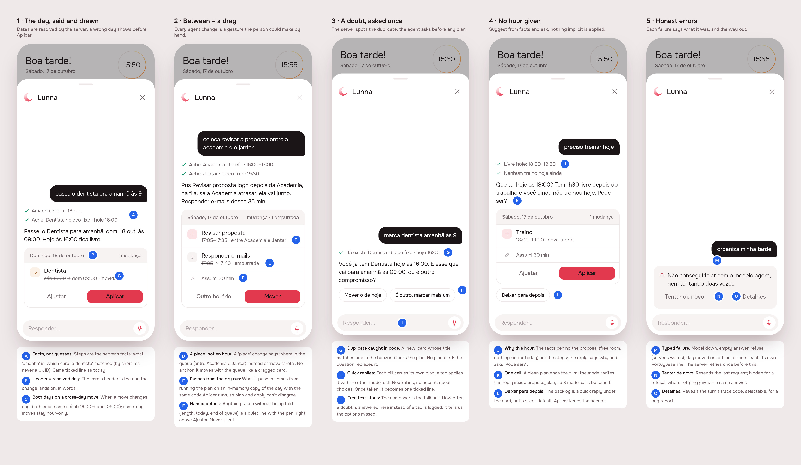
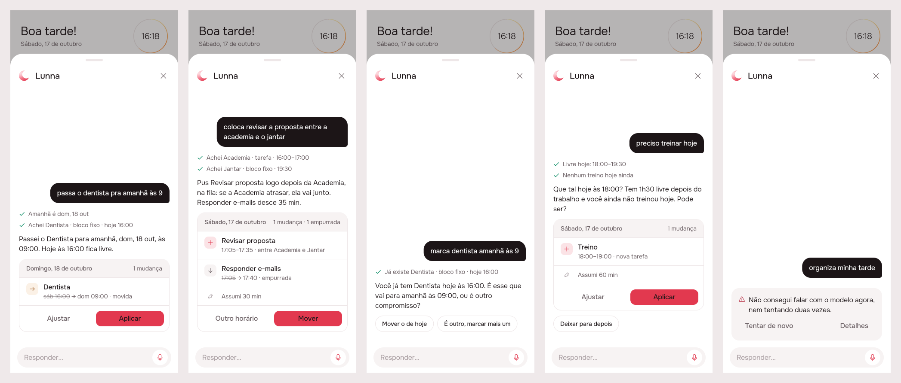
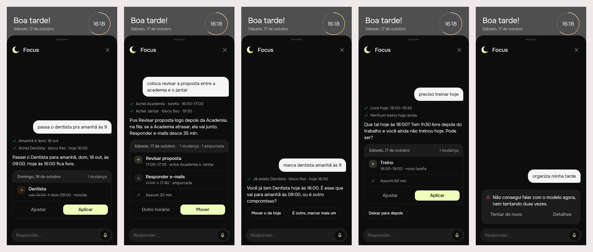

# A reliable agent

2026-10-17 · `/create` from the RFC
[2026-10-16-agent-reliability](../../research/2026-10-16-agent-reliability/README.md),
phases 0–4 · server `server/src/agent/`, app `app/packages/agent/`

## 1. The prompt

Design session (`4ccf0415`):

> /create based on the conclusions on the lunna agentic research improvements.

> change empurrar by mover, and the error card is too vibecoded looking, i think because of the border on "try again"

The design session ended without its hand-off; the build session started
from the RFC, the board and the uncommitted widgets.

Build session (`489ca453`):

> /create build

Answers given to the questions asked in the build:

| Question | Answer |
|---|---|
| Tapping a quick-reply pill | Apply at once (Desfazer on Tempo, as after any plan) |
| "Deixar para depois" placement | A pill under the plan card |
| The paid model comparison (phase 4) | Build the harness **and run it**, $0.50 per model |

The RFC's own decisions (2026-10-17) stand: an in-memory dry run; "between"
is a place in the queue with no anchor; the model writes the reply inside
`propose_plan`; nothing implicit is applied silently; doubts are quick
replies, with free text as the fallback.

## 2. The design

The pins are in [board.json](board.json). Drawn by the real app, Lunna.

| Screen | Decision |
|---|---|
| 1 · The day, said and drawn | Steps are the server's facts ("Amanhã é sáb 17/10", "Achei Dentista · bloco fixo · hoje 16:00"). The card's header is the day the change lands on. A move across days names both ends (sáb 16:00 → dom 09:00). |
| 2 · Between = a drag | A `place` change says where in the queue ("entre Academia e Jantar") and has no anchor. What it pushes comes from the dry run. Anything assumed is a quiet line with the pen ("Assumi 30 min"). |
| 3 · A doubt, asked once | A new card named like one already there makes a question instead of a plan. Each pill carries its own plan and a tap applies it. The pills use neutral ink, not the accent. |
| 4 · No hour given | The agent proposes an hour from the free room and says why. "Deixar para depois" is a pill. One model call. |
| 5 · Honest errors | Each kind has its own line. Tentar de novo is hidden after a refusal. Detalhes shows the trace code. The card has a grey fill and no borders (round 2). |

The references are known patterns, not browsed: Intercom's and ChatGPT's
suggestion pills, and Linear's quiet secondary metadata. No new icon was
added. The agent stays the crescent, the assumption line reuses
`AppIcons.pen` and failures reuse `AppIcons.warning`.

## 3. What was built

The real widgets in both brands, against canned replies shaped like the
server's.

### The contract

**Every change the agent proposes is a gesture the person could have made
by hand, and leaves the day as that gesture would.** The model says what
the person meant, by card refs and days as they were said. The server
resolves them, makes the gestures on a sandbox copy of the day with the
same code Aplicar runs, and asks about the doubts it can see itself. The
full rules are in [product/spec/agent.md](../../spec/agent.md).

### Server (`server/src/agent/`)

| File | What it is |
|---|---|
| `board.ts` | New. The day as the model sees it: short refs (`t1`, `e1`, `b1`), the date table, day words (`hoje`, `amanhã`, weekdays, ISO dates within 14 days), free stretches, the context text, and title matching (normalized, whole-word containment, trigrams). |
| `gestures.ts` | New. `make` (place, at_hour, to_backlog, swap) over `Hands`, the real services or a `sandbox`. `takeBack` undoes. `placeOf` is the drop rule: a place in the list, or the end of a card that keeps its hour plus the pause. |
| `agent.service.ts` | Rewritten. One read per turn, with the context last. Drafts resolve the model's changes and refuse in the model's terms. The doubt for duplicates returns quick replies. `_rehearse` is the dry run (hours, pushed, refusal of an hour that is not kept). The fast path ends the turn when nothing is pushed. Apply runs the same gestures; on failure it takes them back and answers `drift`. Logs `agent.turn` (calls, tokens, cached, cost, ms) and `agent.doubtAnswered` (option or text). |
| `agent.prompt.ts` | Rewritten for the gesture vocabulary. Byte-identical between turns. |
| `agent.errors.ts` | New. `AgentError` and `failure()`: every route answers `{ message, kind, traceId }`. |
| `openrouter.client.ts` | 20 s timeout and one retry (5xx, 429, network, empty reply). `provider.sort: latency`, `reasoning.effort` (default low), optional fallback `models`, and usage with cost and cached tokens. |
| `plan.ts` | `Gesture`, `Assumption`, `to_backlog`, `place`, groups of answers (`answered`). |
| `evals/` | New. 24 cases and the runner (`npm run eval:agent`), excluded from the build. |
| `events/timeline.service.ts` | `rehearse` is removed: it was the second code path. |
| `tasks/task.store.ts` | `MemoryTaskStore.seed`, so the sandbox keeps the real ids. |

The routes are unchanged. `POST /agent/turn` now also answers `options`.
`POST /agent/plans/:id/apply` applies a quick reply's plan like any other,
and refuses a second answer to the same question.

### App (`app/packages/agent/`)

- `PlanChange.place`, `PlanChangeKind.toBacklog` (no hour), `AgentPlan.assumed`, `AgentReply.options` (`QuickReply`), `ReplyEntry.chosen`.
- `QuickReplies` pills apply their plan at once, and the taken one becomes a ticked line.
- `PlanCard`: the place line, both days on a move across days, the assumption line, the backlog row, and "Mover".
- `FailureNote` and `agentFailureText` (also used by the Aplicar snackbar). `AgentCubit.retry`.
- `AgentFailure` reads `kind` and `traceId`. `api_client` also exports `RequestOptions` (for tests).
- Strings are in `app_pt.arb`: failure kinds, places, assumptions, Tentar de novo, Detalhes, and Código.

### Tests

- Server, agent: **31** (22 end to end through the controller with the scripted model and a frozen clock, 9 for the board). They pass under `TZ=UTC`, `Asia/Tokyo` and `America/Los_Angeles`. New cases cover: a place between two tasks (no anchor, what it pushes, applied as shown), moving an event across days (one call, the day said), the duplicate doubt (one call, two options, the second refused), no hour (assumed, Deixar para depois), typed `model_down` and `drift`, an event refused on top of another, the date table, and reading a day by weekday.
- App, agent: **40**, under both brands. New tests cover doubts and quick replies, `to_backlog` with no hour, ignoring unknown assumptions, place, failure kinds (drift, offline, unknown), and retry.
- `.tool/check`: all ✓ (server eslint, tsc, tests; `flutter analyze`; every touched package under Focus and Lunna). The overlap refusal and its spec came after that run; the agent specs (31) and eslint were rerun on it.
- No flaky test was seen.

### The model comparison (phase 4)

24 cases (the five reported bugs first), graded on the day after Aplicar,
`--budget 0.5` per model. Raw summaries in [data/](data/).

| Model | pass^k | pass@1 | p50 | p95 | calls/turn | tokens in/turn | cost |
|---|---|---|---|---|---|---|---|
| **anthropic/claude-haiku-5.5** (k=4) | **24/24 (100%)** | 100% | 3.0 s | 5.8 s | 1.18 | 3689 | **$0.051** |
| google/gemini-3.1-flash-lite (k=4, today's model) | 22/24 (92%) | 97% | 1.3 s | 4.6 s | 1.27 | 2724 | $0.116 |
| google/gemini-3.5-flash-lite (k=4) | 22/24 (92%) | 96% | 1.8 s | 3.6 s | 1.23 | 2600 | $0.172 |
| google/gemini-3.8-flash (k=2) | 23/24 (96%) | 98% | 2.2 s | 4.8 s | 1.17 | 2476 | $0.107 |

- **Recommendation: `OPENROUTER_MODEL=anthropic/claude-haiku-5.5`.** It passed every run and was the cheapest. The price is latency: p50 is 3.0 s against 1.3 s for 3.1 Flash-Lite. 3.8 Flash was left at k=2, since it was out of contention once Haiku passed everything. **Not changed in `.env.local`: your call.**
- The model change is smaller than the build. Today's model goes from the RFC's reported bugs to 92% pass^4 (97% of single runs), at 1.27 calls a turn against 3 or more before.
- **One failure was ours.** `blocked-by-event`: told that a task can't sit on the meeting, both Flash-Lites proposed the same thing as a *fixed event* on top of it. The server now refuses an event laid on another event (a new spec covers it), and a rerun passed 4/4 on all three models ([data/eval-after-overlap-fix.md](data/eval-after-overlap-fix.md)).
- **One is the model's:** `two-matches` ("move a ligação" with two "Ligar…" tasks). Haiku asks every time; the Flash-Lites sometimes pick one. The server can't see this doubt (the model resolved the ref itself). See Open below.
- The first full pass at k=1 found two bad cases (the duplicate case was graded too strictly; titles needed stem matching) and one silent default (a length the model picked was not named). All three are fixed above.
- Prefix caching: `cached_tokens` was 0 on every call. The prefix (~2.5k tokens) is under Gemini's 4k minimum, as the RFC expected.

### Open

- `two-matches`: a server doubt for a ref chosen where another card matches the request's words just as well. It needs the model to report what it matched (`data.what`) against the board.
- The `agent.doubtAnswered {via}` counts are on the trace only, not summed anywhere yet.
- No eval case is multi-turn (answering a doubt, then Aplicar).

### Where the build differs from the mockup

- **Steps are worded by the server.** "Amanhã é dom 18/10", not "dom, 18 out". The step "Nenhum treino hoje ainda" on screen 4 is not produced: the server states the free stretch it used ("Livre hoje: 18:00–19:30"), and the model gives its reason in the reply.
- **"Mover o de hoje" stays a move.** A move only applies where the card can go: an event takes only an hour. Otherwise the model is told to use the ref, or to confirm with the person and send `duplicate: true`.
- **A length the model chose is always named**, even when the model wrote one: "Assumi 60 min" in the print. A length the person did not say (`data.minutes`) is an assumption, whoever picked it.
- **A doubt answered by typing** is logged as `agent.doubtAnswered {via: text}` on the trace. It is not yet aggregated anywhere.

## 4. How to turn it on

Nothing new is required. `OPENROUTER_API_KEY` and `OPENROUTER_MODEL` work
as before. Optional (`server/.env.example`, `SETUP.md`):

- `OPENROUTER_FALLBACK_MODELS`: comma-separated models for OpenRouter to fall back to.
- `OPENROUTER_REASONING`: the reasoning effort, `low` when unset.

Evals: `cd server && npm run eval:agent -- --model <ids> --k 4 --budget 0.5 --out <dir>`.
The key comes from the environment or `server/.env.local`. The eval costs
money and is never run in CI.

## 5. Cost and time

Claude, from the transcripts. The design session's USD is its transcript
total; this session's is the running total from usage-bars, taken before
the last edits to this README. Wall-clock time includes the pauses for
answers.

| Session | Took | Turns | Peak context | In (cache read) | Out (thinking) | USD |
|---|---|---|---|---|---|---|
| Design `4ccf0415` (2 messages: the board, then Mover and the error card) | 12 min | 37 | 156k | 4.30M (4.17M) | 39k (12k) | $2.70 |
| Build `489ca453` (/create build) | 27 min | 99 | 316k | 22.67M (22.38M) | 132k (38k) | $9.34 |
| **Total** | **39 min** | **136** | | **26.97M** (26.55M) | **171k** (50k) | **$12.04** |

**OpenRouter, for the evals: about $0.51** (the sum of the `cost` OpenRouter
reported on every eval call: the smoke run, the k=1 pass, the comparison
and the rerun). Nothing else outside Claude.
