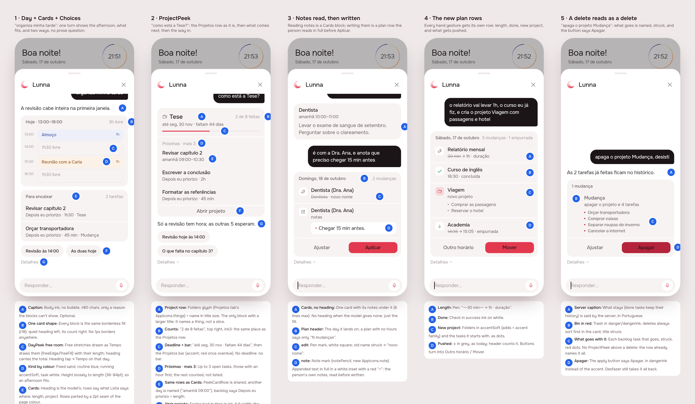
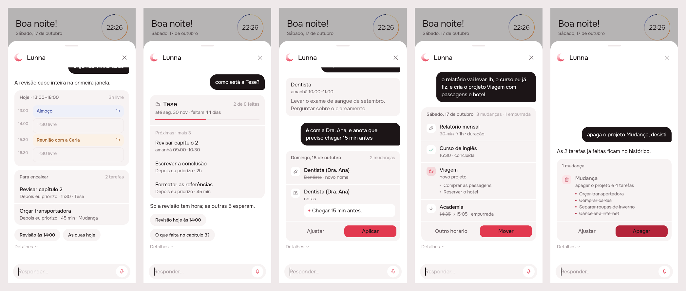
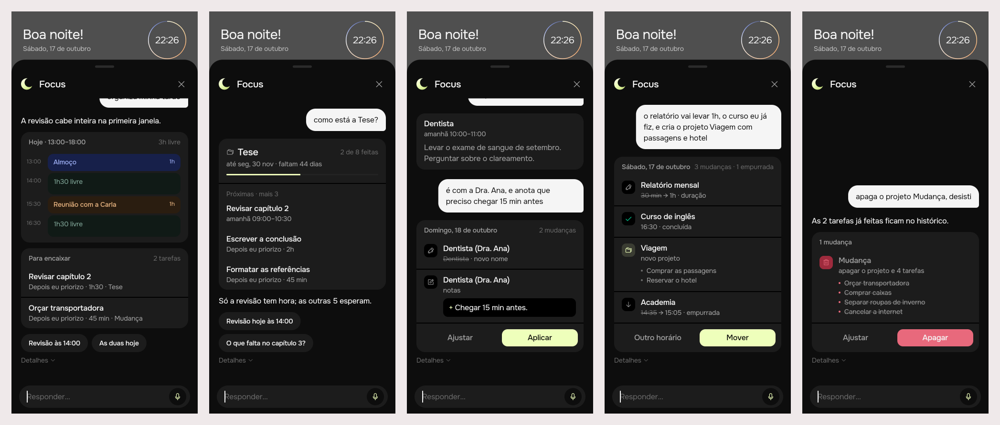

# Agent UI: the agent answers in a catalogue of surfaces

2026-10-17 · Status: **built** (RFC phases 1, 4 and 5) · From the RFC
[2026-10-17-agent-ui](../../research/2026-10-17-agent-ui/README.md)

## 1. The prompt

> /create based on agent ui research, I want you to focus this design stage
> on the components used for a2ui, specially the new introduced one in the
> proposal related to project (ProjectPeek) I want to review the design of
> all the a2ui catalogue and refine it.

> ok, proceed with handoff. Dont forget about the backend details from
> research.

Build session:

> /create build agent-ui

Answers to the build's questions: scope **surface end-to-end** (phases 1,
4 and 5); two changes on one card are **two rows**; DayPeek **keeps**
`freeEdge`; a project delete relies on the **plan card + Desfazer**.

> how close to final because it is almos 80% context window and I would
> love to test this soon

> you can do the bureaucracy, I will push this anyway

## 2. The design

Board data: [board.json](./board.json). The screens were drawn by the real
Flutter app (Lunna), with the agent sheet seeded with each turn.

**References** (drawn from known patterns; Mobbin was not browsed):
Linear's inline issue previews (a compact read-only card with a way in),
Sunsama's and Structured's day strips (a slice of the day with free
room), ChatGPT's and Notion AI's rich answers (blocks instead of
paragraphs, with steps folded away).

### Decisions

| Screen · pin | Decision |
|---|---|
| 1·A | **Caption**: body ink, no bubble, ≤ 80 chars, only for a reason the blocks can't show. Optional |
| 1·B | **One card shape** (`AnswerCard`) for every block: borderless `fill`, radius 18, quiet heading left, its count right. Rows parted by a 2pt seam of `bg`. The plan card loses its 1px border |
| 1·C | **DayPeek** free room drawn as Tempo draws it (`freeFill`/`freeEdge`) with its length; heading carries the total; heading tap opens Tempo on that day |
| 1·D | DayPeek kind by colour: fixed sand, routine blue, running `accentSoft`, task `bg`. Height loosely follows length (36–84pt) |
| 1·E | **Cards**: the model's heading; rows say what Lista says (where, length, project) |
| 1·F | **Choices**: pills are now `fill`, not outlined; equal weight, never the accent |
| 1·G | **Steps** leave the answer: folded under *Detalhes ⌄*, quiet ink3 ticks when open |
| 2·A–C | **ProjectPeek** is the Projetos row: folders glyph (`AppIcons.things`), name in `title`, "2 de 8 feitas", deadline line, the progress bar (red when overdue) |
| 2·D–E | Up to 3 next open tasks (hour first, then backlog), "mais N" for the rest; rows are the shared `PeekCardRow`; another day is named ("amanhã 09:00") |
| 2·F | *Abrir projeto*: full-width text button in ink, the card's footer |
| 2·G | `focus` only means drawn first; no highlight, the accent stays on actions |
| 3·A | Cards with no heading: just the fill; a card asked about for its notes shows them (6 lines max) |
| 3·B | Plan header: the day it lands on; a plan with no hours says only "N mudanças" |
| 3·C | `edit` row: pen mark, old name struck, "novo nome" |
| 3·D | `note` row: new `AppIcons.note` (Phosphor notePencil); the appended text in full, in a `bg` inset with a red "+" |
| 4·A–D | Length (`~~30 min~~ → 1h · duração`), done (success check), new project (folders on `accentSoft`, its starting tasks as dots), pushed (↓, as today) |
| 5·A | What stays on a delete is said by the server, in Portuguese |
| 5·B–C | Deletes sort first; red bin (`danger`/`dangerInk`); title struck; every backlog task that goes is listed, struck. **No ProjectPeek above a delete** |
| 5·D | The apply button says **Apagar**, in `dangerInk` instead of the accent |

**Icons.** Two new Phosphor icons in `AppIcons`: `note` (notePencil) and
`unfold` (caretDown). No new brand asset. The agent stays the crescent.

## 3. What was built

The build, shot through the preview entry point in both brands (since
deleted). Scenes 3–5 draw plan rows (`edit`, `note`, `done`, new project,
delete) the app can read but the server does not propose yet: they are
phases 5b–7.

**The contract.** The model ends every turn with one tool, `answer
{ caption?, blocks[] }`. Each block names *what* to show (a plan's
gestures, 2–3 choices, a day's slice, cards by ref, a project by ref) and
the server fills in every fact: hours, lengths, titles, the dry run. The
model never writes an id, a path, an hour or a ref the person reads.
`POST /agent/turn` answers with `ui`, one A2UI v0.9 surface, and keeps
`reply`/`plan`/`options` for builds already on phones.

**Server** (`server/src/agent/`):

| File | What |
|---|---|
| `speech.ts` (new) | `speakable`: refs → titles, "backlog" → "Depois eu priorizo", counted as leaks |
| `answer.ts` (new) | the bound blocks, `peekDay`/`peekCard`/`peekProject`, `toA2ui`, `summary` (the reply in words) |
| `board.ts` | refs stable per conversation; `reach(task)` (`b31`, `d1`); the project index and each card's project; notes; lengths as "1h30" |
| `agent.service.ts` | the `answer` loop (`_compose`, `_choices`, `_dayBlock`, `_cardsBlock`); `read_cards` and the page context are one function (`_read`); limits in code |
| `agent.prompt.ts` | refs in tool arguments only, the glossary, the blocks; tools `read_timeline`, `read_conversations`, `read_cards`, `answer` |
| `agent.controller.ts` | strips the service-only fields (`blocks`, `leaks`, `raw`) |
| `evals/` | leak@1 on the raw words, a fail when a leak reaches the person; multi-turn cases; projects in the world; `drawn` checks; 5 new cases |

**App** (`app/packages/agent/`): `AgentSurface.decode` reads `ui` into the
blocks (unknown component → caption, a broken one skipped);
`QuickReply.say` (a choice that sends its words as the next message, only
on the latest answer); `AgentLinks` (`openProject`) provided by the shell,
so *Abrir projeto* opens the page from Tempo; `AgentCubit.about`.

**Tests.** Server: 44 agent tests (6 new end-to-end: the afternoon as a
slice with two choices and its apply, a project from Tempo, an empty answer
sent back, titles in the caption, stable refs across turns, a task past the
30th reached through its project and moved; 4 `speakable` unit tests).
App: 62 agent tests (a new decoder test). `.tool/check` green: eslint, tsc,
server tests, `flutter analyze`, every touched package under both brands.

**Eval** (`npm run eval:agent`, Haiku 5.5, k=2, $0.047): pass^2 27/29
(93%), pass@1 95%, **leak@1 0%** raw, 1.29 calls per turn, p50 2.3 s. The
two failures: `afternoon-shown` was the case's own wrong expectation (the
model drew the day, as asked; fixed, then 1/1), and `from-backlog-today`
once took the backlog task as something new and asked the duplicate doubt.

**Where the build differs from the mockup and the RFC**

- A plan that pushes tasks ends the turn: the card shows what moves and
  asks (Outro horário / Mover). The model is no longer called again to ask
  in words, which saves a call.
- The DayPeek heading does not open Tempo on its day: Tempo has no way to
  scroll to a given day yet.
- *Abrir projeto* shows only from Tempo: pages pushed over the shell (a
  task's, a project's) are outside its `AgentLinks`, and on the project's
  own page it is already open.
- Phase 0b (F vs C) was not run: the build went straight to C, the model
  composing. `tool_choice` stays `auto`; plain text becomes a caption.
- Past conversations keep only `reply` (the caption or the server's
  summary) and the plan line, not the surface.
- Refs are kept in memory per conversation (the last 500), like the plans.

## 4. How to turn it on

Nothing new: `OPENROUTER_API_KEY` and `OPENROUTER_MODEL` as before; without
a key `POST /agent/turn` answers 503. The app reads `ui` when it is there
and the old fields when it is not, so either side can ship first.

## 5. Cost and time

USD for the build session from `mcp__usage-bars__session_cost` (the running
total, plus the last minutes estimated); the figures include the talk
around the work, and wall-clock time includes pauses. Outside Claude: the
OpenRouter eval, **$0.048** (two runs).

Design session:

| # | At | Took | Message | Turns | Peak context | In (cache read) | Out (thinking) | USD |
|---|---|---|---|---|---|---|---|---|
| 1 | 21:43 | 11 min | /create based on agent ui research… | 39 | 183k | 4.96M (4.81M) | 56k (18k) | $3.30 |
| 2 | 22:01 | 1 min | ok, proceed with handoff… | 1 | 184k | 184k (184k) | 282 (111) | $0.06 |
| | | **17 min** | **Total** | **40** | | **5.15M** (4.99M) | **56k** (18k) | **$3.36** |

Build session:

| # | At | Took | Message | Turns | Peak context | In (cache read) | Out (thinking) | USD |
|---|---|---|---|---|---|---|---|---|
| 1 | 22:02 | 21 min | /create build agent-ui | 79 | 256k | 15.05M (14.82M) | 84k (25k) | $6.73 |
| 2 | 22:24 | 2 min | you can do the bureaucracy… | 5 | 263k | 1.30M (1.29M) | 4k (140) | $0.47 |
| | | **24 min** | **Total** | **84** | | **16.35M** (16.12M) | **88k** (25k) | **$7.20** |

**Both sessions: 41 min, 124 turns, 21.5M tokens in, 144k out, $10.56**
(plus $0.05 of OpenRouter).
