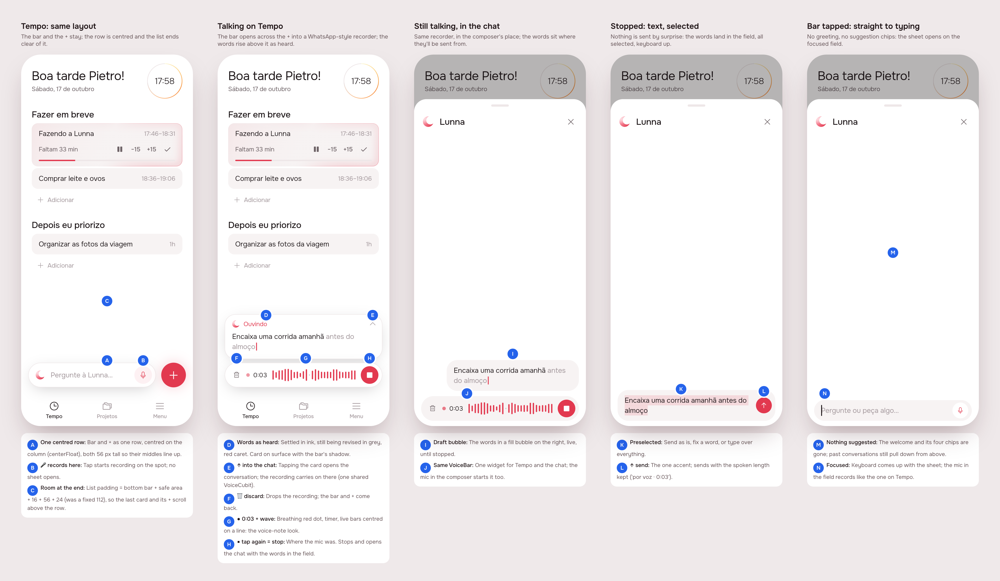
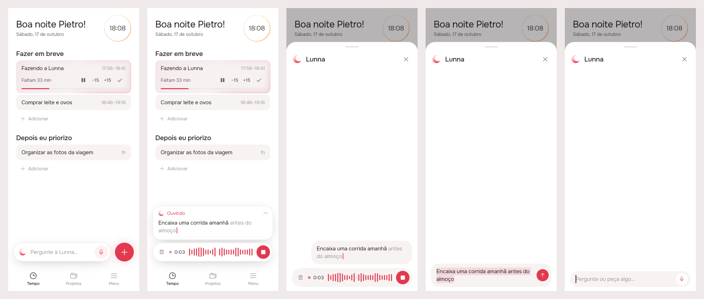
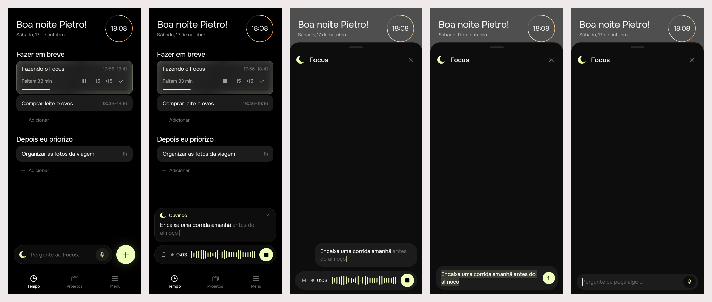

# Ask dock: talking to Lunna from Tempo

The agent's bar on Tempo covered the foot of the day. This keeps the bar and
the + where they were, gives the list room to scroll clear of them, and makes
the microphone record on the spot, the way a voice note does, with the words
carried into the conversation already selected.

## 1. The prompt

Every message of the request, verbatim and in order.

1. `/create` lunna assistant is on the way and doesnt allow me to tap on
   certain areas of the bottom of screen because of that. Propose a change
   for improving this experience
2. what if we unify the plus and lunna. quite honest i didnt like your
   proposal because we should not rely on scrolling
3. I also didnt like this one. I kind of like having lunna button, maybe we
   can have it compact and then it can expand. Search for mobbin references,
   I just auth on its mcp
4. see if you can now
5. cant you open my chrome browser, I have mobbin openeed there. Lets
   research first :)
6. lets see your proposal first.
7. nevermind. Lets rewind everything. 1. Keep the current layout 2.
   Centralize the "lunna text field" with the + FAB. I think what we can do
   is increase the scroll padding on the list.

   I also want some improvements: forget about suggestions. People should go
   straight to text field with the text preselected. Change the mic button to
   tap and then tap again, for tap and release (stops). Also, if the user
   already taps on the home page, it should expand something and already
   start listening. That is the goal. This works too if the user first taps
   and then goes to the internal chat. Maybe we can take inspiration from
   whatsapp that already shows the waveform in the textfield. Anyway, make it
   look beatiful
8. perfect

After the build:

9. is it working like, if I keep with the button pressed and then release?
   *(It was not: holding started the recording on release.)*
10. Press and hold please.

### Proposals dropped on the way

| Round | Proposal | Why it went |
|-------|----------|-------------|
| 1 | The bar folds into a crescent circle beside the + once the day scrolls, and leaves while a card is dragged | Relies on scrolling |
| 2 | One + for both: the creation sheet gains a "☾ Lunna" pill that hands the text to the agent | The user wants a Lunna button of its own |
| 3 | A crescent circle docked in the bottom bar's row (Shopify Sidekick), opening sideways into a field (Shopify Quick sale) | Rewound in favour of keeping the layout |

## 2. The design

Pins in [board.json](board.json).

### References

Browsed on Mobbin in the user's Chrome (free plan: six results a search;
the Mobbin MCP refused every call without a paid plan).

| App | Pattern | Taken |
|-----|---------|-------|
| WhatsApp (known pattern, not browsed) | The voice note: the field becomes a recorder with a live wave, timer, discard and stop | The recorder (`VoiceBar`) |
| Mindtrip, Perplexity, v0 ([img](img/ref-composers.jpg)) | An "Ask anything" field docked at the foot, with the mic inside | The composer the sheet opens on |
| Shopify ([img](img/ref-shopify.png)) | Sidekick as a circle in the bar; Quick sale opening sideways into a row | Round 3; the bar opening across the + while recording |
| WHOOP ([img](img/ref-whoop.png)) | The coach as a field in the feed; the + as a speed dial | Considered, not taken |

### Decisions

| Pin | Decision |
|-----|----------|
| A | The bar and the + are one row, centred on the column (`centerFloat` on Tempo); both 56 px tall |
| B | The bar's 🎤 starts recording on Tempo; no sheet opens |
| C | The list's bottom padding is the bottom bar + safe area (`MediaQuery.paddingOf(context).bottom`, since the body runs under the bar) + 16 + 56 + 24, instead of a fixed 112 |
| D | While recording, the words rise above the bar in a card: settled in ink, still being revised in ink3, a red caret |
| E | Tapping that card opens the conversation; the recording carries on (one `VoiceCubit` for the app) |
| F | 🗑 discards the recording; the bar and + come back |
| G | ● (breathing) · timer · live wave bars centred on a line: the voice-note look |
| H | ■ stop sits where the mic was: tap, then tap again. Stopping opens the chat with the words in the field |
| I | In the chat, the live words sit in a fill bubble on the right, over the recorder |
| J | The same `VoiceBar` on Tempo and in the chat's composer |
| K | Stopped, the words land in the field **all selected**, keyboard up: send, fix, or type over |
| L | ↑ send is the one accent; the spoken length is kept (`por voz · 0:03`) |
| M | No welcome, no suggestion chips: the sheet opens empty |
| N | The field is focused as the sheet opens (unless recording) |

Icons: the crescent (`AppIcons.agent`), Phosphor microphone, trash, and a new
`AppIcons.stop` (Phosphor fill stop). No new brand asset.

## 3. What was built

App only; the server is untouched.

Scenes, left to right: Tempo at rest; the mic tapped on Tempo, recording on
the spot; the words tapped, the conversation still recording; stopped, the
words in the field, selected; the bar tapped, straight to an empty field.

### The contract

**Stop never sends.** The microphone records as a finger lands on it: a
quick tap leaves it recording until stop, and held for 0.4 s or longer,
letting go is the stop (`VoiceHold`). Stopping puts
the words in the field, all selected, keyboard up. Sending is always a tap
on ↑. There is one recording for the app, so it carries over between Tempo
and the conversation.

### App pieces

| Piece | Where | What |
|-------|-------|------|
| `AskDock` | `packages/agent/lib/src/view/ask_bar.dart` | The bar and the + as one row, centred; while recording, the recorder with the words in a card above it (`_Heard`) |
| `AskBar` | same | 56 px pill; its mic starts recording as the finger lands; a refused or missing microphone opens the sheet, which says why |
| `VoiceHold` | `voice_bar.dart` | Tap or hold: a press held 0.4 s or longer stops on release; the release is caught by the dock and the sheet, since the mic is swapped for the recorder under the finger |
| `VoiceBar`, `VoiceTranscript`, `VoiceRound`, `VoiceWave` | `packages/agent/lib/src/view/voice_bar.dart` (new) | The recorder, shared by Tempo and the sheet |
| `showAgentSheet(draft:)` / `AgentSheet` | `packages/agent/lib/src/view/agent_sheet.dart` | Opens empty and focused, or on a draft, selected; reads the app's `VoiceCubit`; `listen:` removed; welcome and chips removed |
| `VoiceCubit` provider | `lib/main.dart` | One for the app |
| Shell | `lib/shell/view/shell_page.dart` | `AskDock` on Tempo, `centerFloat`; leaving Tempo discards a recording |
| List padding | `packages/timeline/lib/src/view/timeline_list.dart` | Bottom bar + safe area + 16 + 56 + 24 under the last card |
| `AppIcons.stop` | `app_ui` | Phosphor fill stop |
| Strings | `app_pt.arb` | Added `agentVoiceStop`, `agentVoiceOpen`; removed `agentGreeting`, `agentGreetingHint`, `agentChip*` (4), `agentVoiceEdit` |

### Tests

`packages/agent`: 50 tests, green under both brands. New or rewritten in
`test/voice_test.dart`:

- the sheet: opens empty on the field; opens on a draft, selected; stop puts
  the words in the field selected and sends nothing, then ↑ sends with the
  spoken length; a recording begun on Tempo carries on in it; discard; a
  refused microphone.
- the dock: the mic records on the spot with no sheet; stop opens the
  conversation with the words selected; discard brings the bar and the +
  back; the words open the conversation and the recording goes on; at the
  one-minute limit it says "Parei de ouvir no limite de 1 minuto"; a refused
  microphone opens the conversation, saying why; held, it records until let
  go and opens the conversation on the words; a quick tap keeps recording.
- the sheet, held: the mic stops as it is let go and fills the field.

`history_test` now looks for the field's hint instead of the welcome.
`.tool/check`: `flutter analyze` and every touched package's tests under
both brands passed (agent, app_ui, notifications, projects, timeline). No
flaky test seen.

### Where the build differs from the mockup

- **The 1-minute limit shows on Tempo.** The card says "Parei de ouvir no
  limite de 1 minuto" instead of "Ouvindo" once the recognizer stops at the
  limit. The mockup never showed that state, and the string was already
  there.
- **A refused microphone on Tempo opens the sheet.** Without it, tapping the
  mic would do nothing visible. The sheet's composer already explains the
  refusal.
- **Leaving Tempo discards a recording.** The dock is drawn only on Tempo,
  and a microphone left listening out of sight is worse than losing the
  take (open question from the brief).
- Closing the sheet while recording leaves the recorder on Tempo (shared
  cubit), as the brief expected.

The list's padding was not checked on a real phone. The calendar's
`TimelineExtended` trigger reads `extentAfter`, which includes the padding,
so a taller padding only makes it fire slightly earlier.

- **Press and hold** was added after the build, on request: the design had
  only tap, then tap again.

## 4. How to turn it on

Nothing to configure. It ships with the app. Voice still needs the
platform's speech recognizer and the microphone permission, as before.

## 5. Cost and time

Times in America/Sao_Paulo. Wall-clock time includes the user's pauses; the
figures include the talk around the work. No spend outside Claude (no
server or model calls).

**Design session** (`accd8dfa`, USD from the finished transcript, hand-off
included):

| # | At | Took | Message | Turns | Peak context | In (cache read) | Out (thinking) | USD |
|---|---|---|---|---|---|---|---|---|
| 1–2 | 17:20 | 8 min | first two proposals | 37 | 129k | 3.44M | 32k | $2.06 |
| 3–6 | 17:32 | 9 min | round 3, Mobbin research | 36 | 221k | 6.29M | 21k | $3.28 |
| 7 | 17:52 | 7 min | the rewind, approved board | 21 | 280k | 5.39M (5.33M) | 33k (10k) | $2.42 |
| 8–10 | 18:00 | 3 min | approval and hand-off | 5 | 288k | 1.42M | 6k | $0.53 |
| | | **44 min** | **Total** | **99** | | **16.54M** (16.18M) | **91k** (24k) | **$8.29** |

**Build session** (`3d8ae657`, USD is the running total from usage-bars,
read before this README was written):

| # | At | Took | Message | Turns | Peak context | In (cache read) | Out (thinking) | USD |
|---|---|---|---|---|---|---|---|---|
| 1 | 18:04 | 5 min | /create build ask-dock | 29 | 127k | 2.94M (2.84M) | 19k (4k) | $1.75 |

**Both: ~49 min, 19.48M tokens in, 110k out, about $10.04.**
