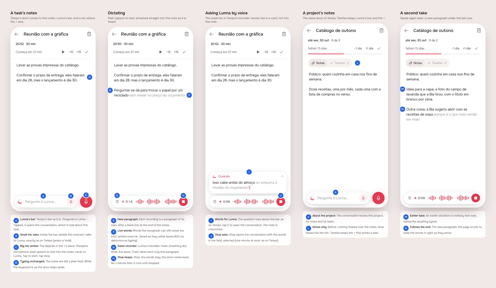
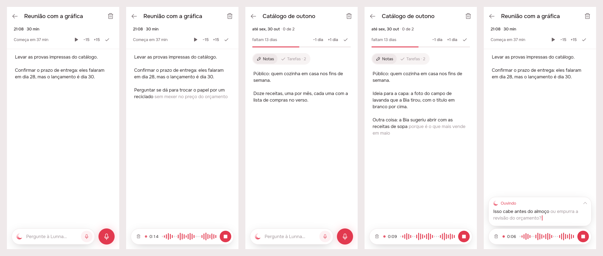
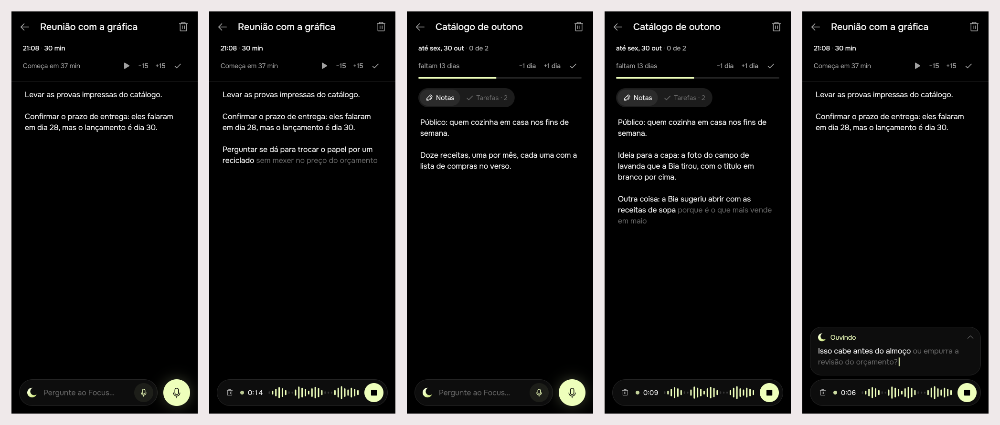

# Dictation: speaking into notes, and Lunna at their foot

A task's notes and a project's notes get Tempo's dock: Lunna's bar, and
beside it, where the + is, a microphone that dictates. Dictation is plain
speech to text, not the agent: the words stream into the note as they are
heard, each recording a paragraph of its own. The bar's own small microphone
still asks Lunna, as on Tempo.

## 1. The prompt

Every message of the request, verbatim and in order.

1. `/create` I want to add the assistant also to both the notes of the task
   and the notes of the project. Besides that, I want a special plain
   interaction so I can say instead of writing. I would suggest to have the
   same fab but with the mic icon and doing the similar waveform etc. But
   note: this is not AI-assistant ask response, its just plain STT that is
   directly added to the notes/tasks. I also would like to have this
   streamed continuously so the person can just freely speak and see the
   result of the speech already in the note. A new speech is actually a new
   paragraph
2. and if I want to ask assistant with the mic?
   *(Round 1 had taken the bar's microphone away, so the row had one mic.
   It came back: the small one asks Lunna, the big one writes.)*
3. perfect, proceed
4. `/create build dictation` *(the build session)*

## 2. The design

Pins in [board.json](board.json).

### References

Drawn from known patterns, not browsed:

| App | Pattern | Taken |
|-----|---------|-------|
| Apple Notes / iOS keyboard dictation | Words appear in the text as spoken, the unsure tail lighter | Live words in ink3 inside the note |
| WhatsApp | The voice note: field becomes a recorder with wave, timer, discard, stop | `VoiceBar`, reused unchanged |
| Otter / Google Recorder | Long-form, continuous transcription with no time cap | No limit on dictation |

### Decisions

| Pin | Decision |
|-----|----------|
| A | Tempo's bar as it is ("Pergunte à Lunna…"); tapped, the conversation opens about this task (shorter "sobre a tarefa…" strings were tried and truncated) |
| B | The small mic inside the bar asks Lunna, exactly as on Tempo (press or hold, one minute) |
| C | The big mic is an `AppFab` with `AppIcons.microphone` (Phosphor) in the +'s place: dictation only, tap to start, tap stop |
| D | The notes stay a plain field; the dock hides while the keyboard is up |
| E | Each recording is a new paragraph, after a blank line, at the end of the notes |
| F | Words still open to revision are ink3, settled ones ink; saved by the same 800 ms debounce as typing |
| G | The recorder is Lunna's `VoiceBar`; trash removes only this paragraph |
| H | Stop keeps the words; dictation has no time limit |
| I | Asking by voice: the words rise in Tempo's card above the bar, never into the note |
| J | Stop opens the conversation with the words selected, as on Tempo |
| K | On a project, the conversation is about the project |
| L | Notas gets the dock with the mic; Tarefas keeps the bar and the + |
| M, N | An earlier take is ordinary text; the page scrolls to follow the new words |

## 3. What was built

Prints of the real build, through the preview entry point (fake recognizer,
the demo day). Scenes: 1 a task resting, 2 dictating, 3 a project resting,
4 a second take, 5 asking Lunna by voice. Lunna:

Focus, from the same code:

### The contract

**The small microphone inside the bar asks the agent; the big one beside it
writes.** Dictation is plain speech to text on the phone, straight into the
notes, each recording a paragraph of its own, saved the way typing is. The
server never knows the words were spoken. A conversation opened from a
page is about that page: the agent reads the task (or the project, with its
tasks) and its notes, and still only ever proposes changes to the day.

### Server (`server/src/agent/`)

- `agent.controller.ts`: `POST /agent/turn` takes `about: { taskId } |
  { projectId }` (`optionalSubject`: a UUID, exactly one of the two, or a
  400).
- `agent.service.ts`: `Subject`; `_subject` writes, after the board, the
  task's line (its ref when it is on the board) and its notes, or the
  project's name, deadline, notes and tasks. Notes are cut at 2000
  characters. A subject that is not the person's is refused, 404
  `refused`, "Não encontrei essa tarefa." / "…esse projeto.".
- `agent.prompt.ts`: one line: on a task's or project's page, "isso" means
  it. (The prompt stays byte-identical across turns; only the board message
  changes.)
- `agent.module.ts` imports `ProjectStoreModule`; `evals/run.ts` passes a
  memory project store.

No new routes for dictation: notes save through `PATCH /api/tasks/:id`,
`PATCH /api/events/:id` and `PATCH /api/projects/:id`, as typing does.

### App

- **`app_ui`:** `LiveTextController` (the tail still open to revision in
  ink3; `write`, `settle`), `NotesDockBuilder (context, notes, taskId)`,
  `kNotesDockClearance`.
- **`agent`:**
  - `NotesDock`: resting, Tempo's `AskDock` with a microphone `AppFab` in
    the +'s place; dictating, `AskPill(VoiceBar)`. `NotesDock.task` for
    `EventPage.dock`.
  - `DictationCubit`: a `VoiceCubit` with no limit; a session the platform
    ends is followed by another, joined into the same paragraph.
  - One microphone: dictating cancels the agent's recording; the agent's
    starting stops dictation, keeping the words.
  - A refused microphone or no recognizer is said in a snackbar
    (`agentVoiceDenied` / `agentVoiceUnavailable`).
  - The dock steps aside while the keyboard is up, read off the `View`
    (`didChangeMetrics`).
  - `AgentSubject.task|project`, carried by `AskDock(about:)` →
    `showAgentSheet(about:)` → `AgentCubit.open(about:)` → every turn.
  - `VoiceBar(stopLabel:, discardLabel:)`; `AskPill` made public.
- **`timeline`:** `EventPage.dock`; the notes use a `LiveTextController`, a
  listener-based debounced save, follow the end while dictated, and take the
  server's copy only when it differs from what they last saved and nothing
  is being dictated. A fixed block's dock names no task.
- **`projects`:** Notas gets the dock (`about` the project); Tarefas' bar is
  about the project too; the task pages it opens get `NotesDock.task`.
- **`l10n`:** `dictationStart`, `dictationStop`, `dictationDiscard`.

### Tests

- Server: 3 new specs in `agent.controller.spec.ts` (the task and its
  notes in the context; the project with its tasks; a missing or malformed
  subject refused before the model is called).
- App:
  - `agent`: 11 new: `DictationCubit` has no limit; `LiveTextController`
    spans; `NotesDock`: a new paragraph with the live tail, stop keeps the
    words still heard, a platform-ended session stays one paragraph,
    discard takes it back, a refused mic says why, the agent's mic stops
    dictation keeping it, the keyboard hides it, the conversation it opens
    carries `about`; `AgentCubit` sends `about` on every turn of that
    conversation and not after.
  - `projects`: 1 new: dictating into Notas, saved after the pause, the
    server's echo undoing nothing, a second take a paragraph of its own.
  - `timeline`: new `event_page_test.dart`, 3 tests: the dock gets the
    task's id (null for a fixed block); dictated words are saved and neither
    the echo nor a revision undoes the other.
- `.tool/check`: eslint, tsc and `flutter analyze` clean; `agent` (61),
  `app_ui`, `notifications`, `projects`, `timeline` pass under both
  `BRAND=focus` and `BRAND=lunna`. Server: 247 tests, all passing on the
  second full run. On the first full run, `the agent › says what kind of
  failure it was, with the trace` got a 403 instead of 409. It passed 3/3
  alone and on the rerun, and nothing on that path answers 403, so it is
  counted as flaky and not caused by this change.
- Never run on a phone: the recognizer is faked in tests and prints.

### Where the build differs from the mockup

- **The keyboard rule needed a different signal.** The mockup read
  `MediaQuery.viewInsets`, which is always zero inside a Scaffold's body,
  so the dock never stepped aside; a test caught it, and the dock now reads
  the view's insets.
- Otherwise as approved. The open questions stay open: a long pause does
  not start a new paragraph, the big mic is tap/tap only, and the agent
  reads notes but never proposes edits to them.

## 4. How to turn it on

Nothing to set. Dictation uses the platform recognizer the agent's voice
already uses (`speech_to_text`, pt-BR, the microphone and speech
permissions already in the Info.plist and manifest). The agent's `about`
needs the server deployed with this change; an older server ignores the
field. Without `OPENROUTER_API_KEY` the bar still answers that Lunna is not
connected, and dictation works anyway, since it never reaches the server.

## 5. Cost and time

USD is the running total from usage-bars, spread by token weight.
Wall-clock time includes the user's pauses. There was no spend outside
Claude: no model was called, since the agent specs use a scripted model.

| Session | Took | Turns | In (cache read) | Out (thinking) | USD |
|---|---|---|---|---|---|
| Design | 15 min | 47 | 5.65M (5.52M) | 46k (15k) | $3.10 |
| Build | 11 min | 72 | 10.01M (9.84M) | 49k (11k) | $4.17 |
| **Total** | **26 min** | **119** | **15.66M** (15.36M) | **95k** (26k) | **$7.27** |

### Build session

| # | At | Took | Message | Turns | Peak context | In (cache read) | Out (thinking) | USD |
|---|---|---|---|---|---|---|---|---|
| 1 | 20:19 | 11 min | /create build dictation | 72 | 192k | 10.01M (9.84M) | 49k (11k) | $4.17 |

### Design session

USD is the running total from usage-bars; wall-clock includes the user's
pauses.

| # | At | Took | Message | Turns | Peak context | In (cache read) | Out (thinking) | USD |
|---|---|---|---|---|---|---|---|---|
| 1 | 20:01 | 9 min | /create I want to add the assistant also to bot… | 37 | 146k | 4.09M (3.97M) | 36k (13k) | $2.40 |
| 2 | 20:11 | 4 min | and if I want to ask assistant with the mic? | 9 | 164k | 1.40M (1.38M) | 9k (2k) | $0.65 |
| 3 | 20:16 | 1 min | perfect, proceed | 1 | 164k | 164k (164k) | 356 (48) | $0.05 |
| | | **15 min** | **Total** | **47** | | **5.65M** (5.52M) | **46k** (15k) | **$3.10** |
