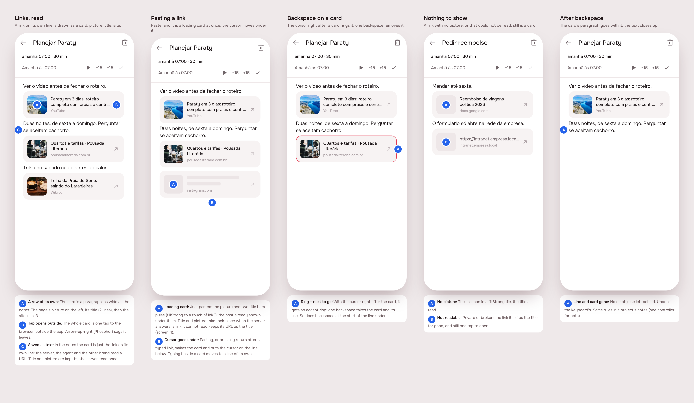
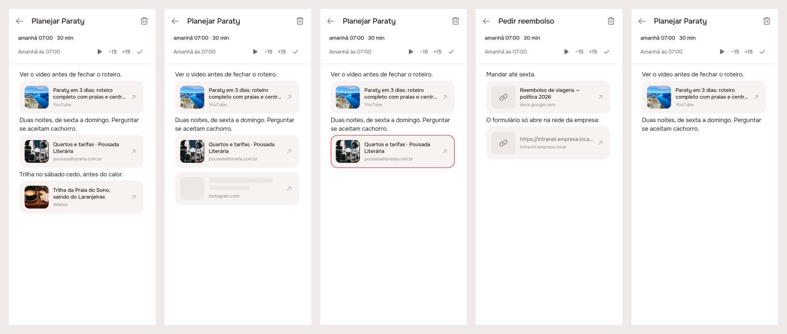
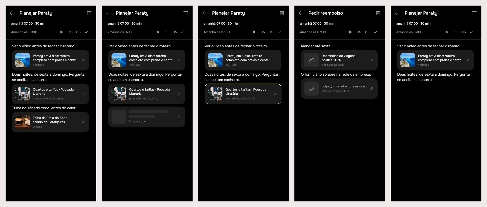

# Link cards: links in notes become cards

A link written on its own line in a task's or a project's notes is drawn as
a card: the page's picture, its title and its site, the whole card one tap
from the browser. It stays text underneath (the link on its own line), so
the server and the agent still read a URL. Pasting a link makes the card at
once; one backspace takes it and its line away.

## 1. The prompt

Every message of the request, verbatim and in order.

1. `/create` transform hyperlinks inside tasks and projects in clickable
   cards. It is very simple, when pasting a hyperlink, it automatically
   fetches the title, and the thumbnail preview, and always keep that so
   user can tap quickly and see it in an external browser. User can delete
   it by pressing backwards, so lets try it to  be integrated to text (but
   there is no two cards in the same row), so that means we enter a link it
   already counts as new paragraph and when deleting the paragraph also
   deletes the note.
2. the link* *(correction: deleting the paragraph deletes the link, not the
   note)*
3. *(after round 1, answering the two open questions: should the server
   fetch the previews, and proxy the pictures for the web?)* yep for both
   answers, lets have it on server. I just see no loading screen for the
   recently added hyperlinks.
4. loading card
5. great, do the handoff

## 2. The design

Pins in [board.json](board.json); single screens `img/1.png`…`img/5.png`
(Lunna).

### References

Drawn from known patterns, not browsed:

| App | Pattern | Taken |
|-----|---------|-------|
| Notion | The web bookmark block: a pasted link becomes a block of its own | A card is a paragraph, never inline |
| Apple Notes | Rich link previews inside a plain note | Picture, title, site, in a quiet fill |
| iMessage / Slack | The preview loads after the link is sent, the link stays the truth | Loading card, then the preview; the URL is what is saved |

### Decisions

| Screen · Pin | Decision |
|--------------|----------|
| 1 · A | A card has its row to itself, as wide as the notes: 64 px picture on the left (radius `buttonRadius`), title in `labelStrong` (2 lines), site in `caption` ink3. Fill `AppColors.fill`, no border |
| 1 · B | Tapping anywhere on the card opens the link outside the app; `AppIcons.external` (Phosphor arrowUpRight) says so |
| 1 · C | Saved as text: in the notes the card is the URL on its own line. Title and picture are read once by the server and kept |
| 2 · A | Loading card: the picture and two title bars pulse (`AppSkeleton(onFill: true)`, fillStrong towards ink3), the host is shown at once |
| 2 · B | Pasting, or return after a typed link, makes the card and puts the cursor on the line under it; typing beside a card moves to a line of its own |
| 3 · A | Cursor right after a card rings it in `accent`; one backspace takes the card and its line, as does backspace at the start of the line under it |
| 4 · A | No picture: `AppIcons.link` (Phosphor link) on a fillStrong tile |
| 4 · B | Not readable (private, broken): the URL as the title, for good; still opens |
| 5 · A | The card's line goes with it, no empty line left; undo is the keyboard's. Same rules in a project's notes |

Icons: `AppIcons.link` and `AppIcons.external`, both Phosphor regular. No
new brand asset.

## 3. What was built

The five scenes of the board, drawn by the shipped widgets in both brands:
links read, a link just pasted (loading), the cursor on a card (ringed in
`accent`: lime on Focus), links with nothing to show, a card taken away.

### The contract

**The notes stay text.** A card is the URL on its own line; nothing else
is saved in the notes. The server reads each link's page once, for
everyone, and never from an address that is not public. The full contract
is in [product/spec/links.md](../../spec/links.md).

### Server (`server/src/links/`)

| Route | Answer |
|-------|--------|
| `GET /api/links/preview?url=` | `{ url, title, site, image }`, read once and kept in `link_preview` |
| `GET /api/links/image?url=` | the picture (JPEG/PNG/GIF/WebP/BMP, ≤ 5 MB), `private, max-age=604800`, `nosniff`, sandboxed CSP |

- `link_preview` table (migration `drizzle/0008_link_preview.sql`): url
  primary key, title, site, image, failed, fetched at. No user column.
- `links.service.ts`: kept rows answer at once; a failed page is kept and
  retried after a day; two simultaneous reads of one link share one fetch.
- `page-fetcher.ts` (`HttpPageFetcher`): Node `http`/`https`, 5 s per hop,
  4 redirects, gzip/deflate/br, pages cut at 1 MB, pictures refused past
  5 MB. **SSRF guard** in the socket's own `lookup`, so every hop's
  resolved address is the one checked and the one connected to (no DNS
  rebinding window); IP literals checked before connecting.
- `address.ts`: private, loopback, CGNAT, link-local/metadata, ULA,
  multicast, IPv4-mapped IPv6.
- `page-meta.ts`: Open Graph, then Twitter, then `<title>`; entities
  decoded; the picture resolved against where the redirects ended; the
  charset from the header or the page's own `<meta charset>`.
- `request.ts`: 400 refusals in Portuguese (no link, too long, not a web
  address, not http(s), with credentials).

Checked live once against YouTube, GitHub and Wikipedia (a throwaway
script, not committed): titles, sites and pictures all read as expected.

### App

- `app_ui`: `AppLinkCard`, `LinkPreviews`, `LinkPreviewScope`,
  `LiveTextController` with the card rules, `AppSkeleton(onFill:)`,
  `AppIcons.link`/`external` (all from the design session, unchanged).
- `app/lib/links/api_link_previews.dart`: `ApiLinkPreviews`, the real
  `LinkPreviews`: a session cache, one request per link in flight, a
  failure answered as a bare link (not cached, so the next draw asks
  again), `url_launcher` in `externalApplication` mode. On the web the
  picture goes through `/links/image`; phones load it directly.
- `main.dart`: `LinkPreviewScope` above `App`, so every route's notes
  (task and project) get it. `url_launcher` added to the app's pubspec;
  Android manifest gained an `https` VIEW query.

### Tests

- Server: `links.controller.spec.ts` (8, end to end with a fake web),
  `page-fetcher.spec.ts` (26: the address table and the fetcher refusing
  loopback, metadata, `[::1]`, `localhost`, ftp, without leaving the
  machine), `pg-link-preview.store.spec.ts` (1, PGlite). 35 in all.
- App: `live_text_controller_test.dart` (10, from the design session) and
  `app_link_card_test.dart` (2): the card pulses then draws its preview,
  and **a tap on a card inside a `TextField` opens the link and leaves
  the notes alone**, through the real gesture arena. That was the brief's
  open question about taps.
- `.tool/check`: server eslint, tsc and tests, `flutter analyze`, and
  agent, app_ui, notifications, projects and timeline under both brands,
  all green. One flaky run: `events.controller.spec.ts` failed 3 cases
  while the preview build ran beside it, then passed alone under
  `TZ=UTC` (97/97) and in the full rerun. It is not touched by this build.

### Where the build differs from the mockup

- The server answers `image` as the picture's own address, and the **app**
  turns it into the proxy URL on the web only. The brief had the server
  point `image` at the proxy. But the API base differs per platform, and
  phones need no proxy (and would have to send a bearer header for it),
  so the app picks.
- Nothing else: the widgets are the design session's.

## 4. How to turn it on

Nothing to set: no env vars, no new service. The migration runs on boot.
`cd app && flutter pub get` picks up `url_launcher`.

- In production the web app shares an origin with the API, so the image
  proxy gets the session cookie. **On the web dev server** (`:5173`
  against `:3000`) the pictures are cross-origin requests without the
  cookie, so they 401 and the cards draw the link icon. Titles still
  work.
- Not tried on a real phone: the caret beside the 88 px card, and the
  native browser hand-off. The tap itself is covered by the widget test.

## 5. Cost and time

USD from `mcp__usage-bars__session_cost` (running totals) passed to
`.tool/cost --usd`. Wall-clock time includes the user's pauses and the talk
around the work.

### Design session

| # | At | Took | Message | Turns | Peak context | In (cache read) | Out (thinking) | USD |
|---|---|---|---|---|---|---|---|---|
| 1 | 20:38 | 12 min | /create transform hyperlinks… | 43 | 142k | 4.51M (4.40M) | 47k (19k) | $2.68 |
| 2 | 20:52 | 3 min | yep for both answers… / loading card | 10 | 154k | 1.50M (1.49M) | 5k (794) | $0.59 |
| 3 | 20:56 | 1 min | great, do the handoff | 1 | 155k | 155k (155k) | 171 (0) | $0.05 |
| | | **18 min** | **Total** | **54** | | **6.16M** (6.04M) | **53k** (20k) | **$3.31** |

### Build session

| # | At | Took | Message | Turns | Peak context | In (cache read) | Out (thinking) | USD |
|---|---|---|---|---|---|---|---|---|
| 1 | 20:57 | ~10 min | /create build link-cards | ~45 | ~145k | 4.22M (4.11M) | 37k (8k) | ~$2.6 |

(Read before the last check and the README edits; the final figure is a
few cents higher.)

### Both

**About 28 min, ~10.4M tokens in (mostly cache reads), ~90k out, about
$5.9.** Nothing was spent outside Claude: the live read hit three public
pages, and no paid API is involved.
