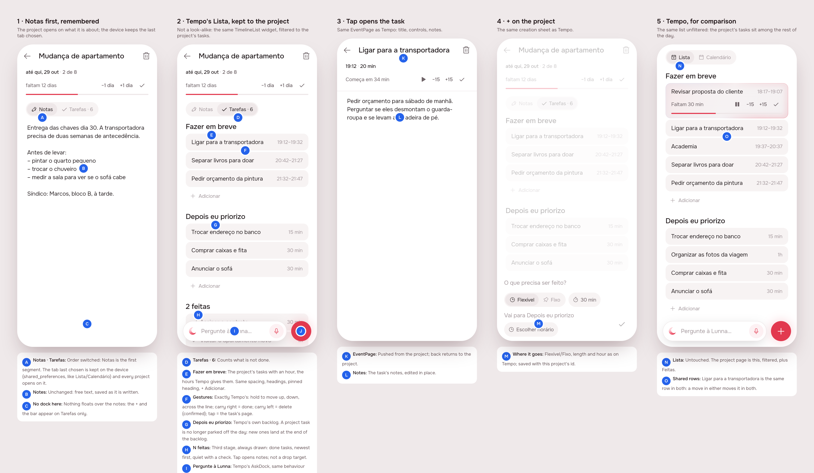
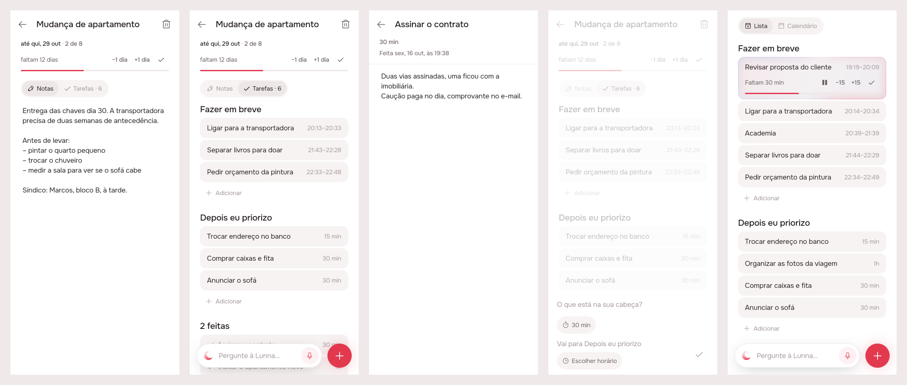
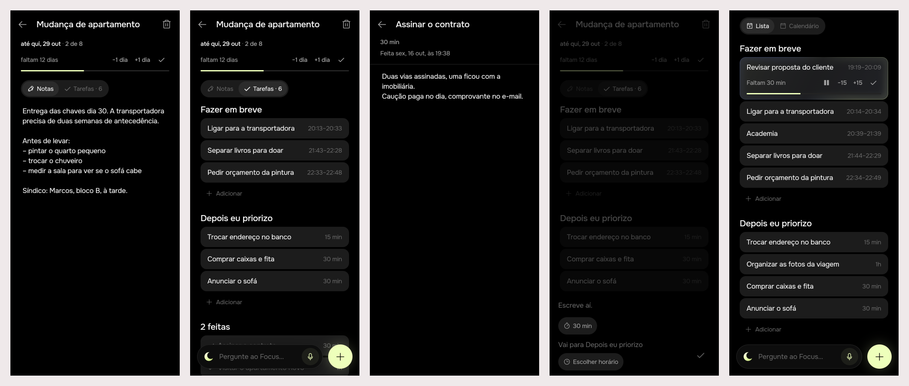

# Project page: Tempo's Lista, kept to the project

## 1. The prompt

> let's improve the project experience: 1. Switch note and task order. 2.
> Last selected option is not being preserved properly 3. The list of tasks
> is not using the same visual structure as the home list - it should not
> only be inspired, it should be identical. Meaning the spacing, the
> behavior when moving between columns, to the left deletes, to the right is
> done (or something alike). When tapping on a task, should give the same
> behavior - open the task note. Also, for sake of simplicity lets have
> always three segments: Depois eu priorizo (yes the same from the timeline -
> we will always have it added to the least important part of the
> timeline), em breve (have an actual time), and done (so we keep track of
> what is being done). Also we should have the + and the lunna helper as we
> have in home, it behaves exactly the same - with exception it will be
> added to the project context, and possibly have context of the project
> (but that is actually another research).

Answers to the open questions:

> one per project. Tempo order is perfect. proceed

So the tab is remembered **per project**, and the stages are in Tempo's
order: Fazer em breve, Depois eu priorizo, then N feitas.

## 2. The design

Pins in [board.json](board.json). The references were known patterns, not
browsed: Things 3 and Todoist, where a project is a filtered view of the
same task list rather than a list of its own.

| Pin | Decision |
|-----|----------|
| A | Notas is the first segment. The tab last chosen for each project is kept on the device (`shared_preferences`, `project.tab.<id>`). |
| B | The notes don't change. |
| C | Nothing floats over the notes: the dock is on Tarefas only. |
| D | `Tarefas · N` counts what is not done. |
| E | Fazer em breve: the project's tasks with an hour, drawn by `TimelineList` itself, filtered. |
| F | Tempo's gestures, unchanged: hold to move, carry right to finish, carry left to delete (confirmed), tap to open the task's page. |
| G | Depois eu priorizo is Tempo's backlog. A project's task is no longer parked off the day; a new one lands at the end of the backlog. |
| H | N feitas: a third stage, always drawn, newest first, quiet with a check; a tap opens it; nothing can be dropped there. |
| I | Tempo's `AskDock`, the same bar. Giving the agent the project as context is a separate research. |
| J | The + writes where the list is looking, as on Tempo, into this project. |
| K, L | A tap opens `EventPage`, with the task's notes. |
| M | The same creation sheet as Tempo. |
| N, O | Tempo for comparison: the project's tasks are the same rows there. |

No new icon.

## 3. What was built

Scenes, left to right: Notas; Tarefas (Fazer em breve, Depois eu priorizo,
2 feitas, with the dock and +); a finished task opened; the + from the
project (no Fixo switch); Tempo's Lista for comparison.

**The contract.** A project's task is an ordinary task on the day. It is no
longer parked: it is written down at the end of the backlog, and every
move, start, finish and delete on it is Tempo's, through the day's routes
and `EventLayoutService`. The project only reads where its tasks are.

### Server

- `drizzle/0007_drop_parked.sql`: moves every parked task to the end of its
  person's backlog, in order, then drops `task.parked`. `parked` is gone
  from the schema, `Task`, `NewTask` and both task stores.
- `POST /tasks` takes `projectId`. `TasksController` checks it against the
  person's projects (*"Esse projeto não existe mais."*).
  `projects/project-store.module.ts` provides `ProjectStore` to both the
  day and the projects, since `EventsModule` can't import `ProjectsModule`.
- `PATCH /tasks/:id` on a **finished** task changes its title and notes.
  Its hour or length is refused (*"Esta tarefa já foi feita. Só o nome e as
  notas ainda mudam."*).
- `POST /projects/:id/tasks` writes at the end of the backlog through
  `EventLayoutService.createTask`. `POST /projects/:id/tasks/:taskId/place`
  is removed, along with `Placement`, `TASK_PLACES` and the `project`
  place. `GET /projects` tasks now carry `notes`, and `place` is
  `backlog|queue|scheduled|done`.
- `DELETE /projects/:id` removes the project's tasks that wait in the
  backlog, and keeps the queued, anchored and done ones with no project.
  These are the counterpart of the old parked tasks.

### App

- `TimelineList(only:, done:)`: draws only the given ids, plus a Feitas
  stage. A drop is counted among the cards drawn and `_wholeOf` turns it
  into a place in the whole queue or backlog: right under the card drawn
  above it, over the first one at the top, or at the end of an empty stage.
  So the server keeps one meaning of `index`. In a filtered list, a drop
  at the top begins the task only when it is also the top of the whole
  day.
- `EventPage(finished:)`: a task that is no longer on the timeline opens on
  its name and notes, says *"Feita {dia}, às {hora}"*, and has no controls
  or trash.
- `writeDownOnTimeline(projectId:)` → `EventCreated.projectId` →
  `TimelineRepository.createTask(projectId:)`. From a project the creation
  sheet has no Fixo switch (`AppPromptSheet.fixable`).
- `ProjectPage`: Tarefas is `TimelineList` kept to the project, with the
  `AskDock` and the +. It reloads `ProjectsCubit` whenever the timeline's
  tasks or backlog change. Notas/Tarefas is remembered per project.
- Removed: `PlaceSheet`, `ProjectsCubit.placeTask/addTask`,
  `ProjectsRepository.placeTask/addTask`, the `place*` strings.
  `ProjectsCubit.delete` tells the day to reload.

### Tests

- Server: `projects.controller.spec.ts` has 9 e2e tests (backlog
  insertion, `projectId` accepted and refused, a task followed through a
  move with its hour, a finished task's notes, delete). `pg-project.store.spec.ts`
  has 4, one of which runs migrations 0000–0006 on PGlite, writes parked
  rows and applies 0007. The other e2e specs only gained the memory
  project store.
- App: `timeline_list_test.dart` has 3 new tests (only/done drawn, a drop
  counted in the whole queue, and in the whole backlog). `project_page_test.dart`
  has 4 (tab remembered, stages, finished task opened, reload on a day
  change), and `projects_cubit_test.dart` was rewritten.
- `.tool/check`: server eslint, tsc and tests all pass, and agent, app_ui,
  notifications, projects and timeline pass under both brands. No flaky
  test was seen.

### Where the build differs from the mockup

- **No Fixo from a project** (pin M said the same sheet). An event belongs
  to no project, so a fixed block written from a project would leave it.
  The sheet hides the switch instead.
- **Deleting a project now removes its backlog tasks.** The board did not
  cover this. It follows the old rule, where what only the project held
  went with it. The confirm copy says so.
- The drop translation is done in the app, not with neighbour ids on the
  server. Both keep one meaning of `index`, and this way changes nothing
  on the server.

## 4. How to turn it on

Nothing to configure. Migration 0007 runs on server boot. It is
irreversible: parked tasks become backlog tasks and the column goes. Ship
the server and the app together. An old app would still call the `place`
route, which now answers 404.

## 5. Cost and time

Design session:

| # | At | Took | Message | Turns | Peak context | In (cache read) | Out (thinking) | USD |
|---|---|---|---|---|---|---|---|---|
| 1 | 18:31 | 7 min | /create let's improve the project experience… | 27 | 140k | 2.92M (2.81M) | 27k (10k) | $1.97 |
| 2 | 18:39 | 1 min | one per project. Tempo order is perfect. proceed | 3 | 143k | 427k (425k) | 951 (102) | $0.16 |
| | | **8 min** | **Total** | **30** | | **3.34M** (3.23M) | **28k** (10k) | **$2.13** |

Build session:

| # | At | Took | Message | Turns | Peak context | In (cache read) | Out (thinking) | USD |
|---|---|---|---|---|---|---|---|---|
| 1 | 18:41 | 58 min | /create build project-list. | 71 | 202k | 10.09M (9.92M) | 50k (12k) | $4.38 |

**Both: 66 min, 101 turns, 13.43M tokens in, 78k out, $6.51.** USD is
usage-bars' running total, taken before this README was written. Wall-clock
time includes a usage-limit pause in the build session. The build caused no
spend outside Claude.
