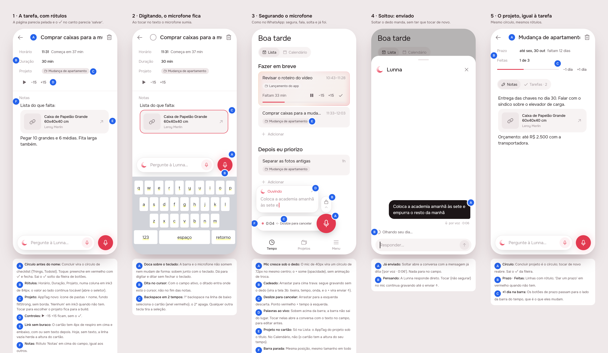
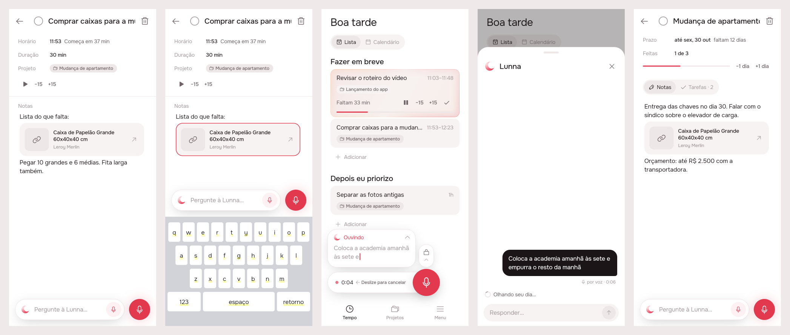
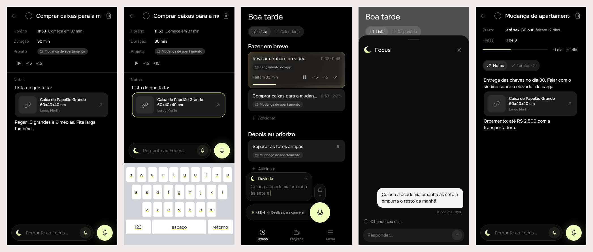

# Polish: the bar that stays put, voice that sends, pages with labels

A round of fixes and visual changes from using the app: the microphone
vanished while typing, the bar animated between states, a voice message had
to be sent twice, link cards behaved oddly under backspace, and the task and
project pages looked bare, with a check that read as "save".

## 1. The prompt

Every message of the request, verbatim and in order.

1. `/create` Primeiro bug extremamente inconveniente e toda vez que eu aperto
   na caixa de texto some microfone eu não consigo falar mesmo quando eu
   estou com a caixa de texto ativa

   Segundo coisa animações horrorosas na transições das barras não sei o que
   o chat inventou isso enfim o Claudinho inventou essa porra a Barrinha tem
   que ficar Paradinha ali

   Terceira coisa olha o microfone está funcionando muito bem aqui no dentro
   do do contexto da escrita né mas o assistente de voz tá funcionando ruim
   por quê porque quando eu dou meu release né quando eu solto ali o
   microfone e falo beleza estou com essa mensagem ele coloca mensagem na
   caixa de texto eu tenho que te pagar de novo não eu só quero soltar a
   porra e mandar entendeu

   Quarta coisa é quando eu estou segurando é um pouco estranho a transição
   tinha que ser um pouco mais natural como o WhatsApp faz

   Quinta coisa também aí relacionado aos links o link tá funcionando bem a
   questão é que a interação dele com resultados é estranho primeiro que tem
   um GAP muito grande antes de eu colocar um texto quando eu coloco um texto
   depois do link aí o GAP fica menor e e se eu dou um back Space ele não
   seleciona o link e aí eu dou um Space ele remove de novo né ele só ele só
   remove o link de uma vez daí fica uma

   Outra coisa tu considerando usar um ando mesmo desfazer eu acho que a
   gente tem que dar uma pesquisada melhor nisso porque o desfazer ele só
   está sendo usado pra gente pra edição de agentes e enfim tem uma
   consideração técnica é importante porque se a gente ficou desfazer tudo se
   vai ter que dar uma salva uma história no banco de dados o que a gente
   pode fazer é fazer pelo menos pra Na última duas três pelo menos pra tudo
   né pra projeto de projeto edição de calendário etcétera mas eu acho que
   isso daí a gente pode deixar ali na list Inha

   seria bom umas melhorias visuais como por exemplo adicionar alguma tarefa
   pertence no projeto é também tirar esse esse cheque aqui que é meio
   sliding no dentro da tarefa né e do projeto que tem um chequezinho aqui
   porque é para marcar para dano mas ele parece que tá sendo para confirmar
   e a edição o que mais Enfim acho que colocar também uns rótulos né nos
   lugares assim para deixar o visual um pouco mais mais interessante mais
   completo porque parece meio pelado Às vezes o app Focus on the visual
   changes for the design
2. proceed with handoff

### Parked

- **Undo for everything** (projects, calendar edits, not only the agent's
  plans). It needs a history kept in the database; the user suggested at
  least the last two or three changes per thing. Left on the list, to be
  researched (`/research`) before it is built.

## 2. The design

Pins in [board.json](board.json). Drawn by the real app (Lunna), one round,
approved as is.

### References

Drawn from known patterns, not browsed: **WhatsApp** (hold to record, slide
left to cancel, slide up to lock, release sends), **Things 3 / Todoist**
(the round box before a task's name is "done"), **Notion / Linear**
(labelled property rows above the body; a block selected by the first
backspace and removed by the second).

### Decisions

| Screen | Pin | Decision |
|--------|-----|----------|
| 1 Task | A | Done is a round box before the name (`AppDoneCircle`): empty ink3 ring, filled accent with a check. The bare ✓ leaves the page's row of controls |
| 1 Task | B | Labelled rows: Horário, Duração, Projeto, in an 84px ink3 column; the values stay tappable |
| 1 Task | C | The project as an `AppTag` (folders icon + name, `fillStrong`, no border); "Nenhum" in ink3 when there is none |
| 1 Task | D | ▶ −15 +15 stay, without ✓ |
| 1 Task | E | A link card has the same small gap above and below, text after it or not |
| 1 Task | F | A "Notas" label over the notes |
| 2 Typing | A | The dock never hides: with the keyboard up it sits on it, same shape |
| 2 Typing | B | With the field focused, dictation writes at the cursor |
| 2 Typing | C | Backspace under a card selects it (ring); a second backspace removes it; any other key deselects |
| 3 Held | A | The bar's 40px mic swells to 72px on the same centre; the + goes invisible (keeps its room) |
| 3 Held | B | A lock above: slide up and the recording goes on hands-free (bar = trash, dot, time, wave; the + becomes send ↑) |
| 3 Held | C | Dot + time on the left, "← Deslize para cancelar"; slide left drops it |
| 3 Held | D | The words rise above the bar; tapping them opens the conversation with them in the field, unsent |
| 3 Held | E | Lista cards carry the project tag under the title; Calendário does not (cards are to scale) |
| 3 Held | F | The bar has one place and one size in every state; no `AnimatedSize`/`AnimatedSwitcher` |
| 4 Sent | A | Releasing a hold sends: the conversation opens with the message said ("por voz · 0:06") |
| 4 Sent | B | Lunna answers straight away |
| 5 Project | A | The same round box; tapping a done project reopens it |
| 5 Project | B | Labelled rows Prazo and Feitas; "Dar um prazo" in accent when none |
| 5 Project | C | −1 dia / +1 dia beside the time bar they change |

New icon: `AppIcons.lock` (Phosphor `lockSimple`). No brand icon.

## 3. What was built

Scenes 1–5 of the board, drawn by the final widgets in both brands
(the preview entry point is deleted).

### The contract

- **The bar never moves or changes size.** Held, the microphone swells on
  its own centre and the + goes invisible; nothing is animated between
  states. **Letting go of a hold sends**, on Tempo and in the sheet's
  composer. Slide left 100 px drops it; slide up 80 px locks it on.
- **A card never vanishes on one key.** The first backspace under a link
  card selects it; the second removes it with its line.
- **Dictation goes where the cursor is** when the notes have the keyboard,
  at the end otherwise.
- **A task of a project says so**: the server sends `project: {id, title}`
  on its card in `tasks`, `backlog` and `cards`.

### Server

- `events/timeline.service.ts`: `Day.projects` (id → title, read once per
  day from `ProjectStore`, injected `@Optional()` so the agent's sandbox
  copy works without one); `taskCard` and `backlogCard` carry `project`.
- `events/entities/event.entity.ts`: `CardProject`, `project?` on
  `TimelineCard` and `BacklogCard`.
- No new route. `GET /api/timeline` and every write that answers with the
  timeline carry the field.

### App

- `agent/ask_bar.dart`: `AskDock` follows the held pointer (`_move`):
  cancel past 100 px left, lock past 80 px up; `AskRecorder.slide` moves the
  swollen microphone and slides and fades "Deslize para cancelar". Release =
  take + open sheet + `agent.send(voice:)`; the words card = draft, unsent;
  the + is send ↑ while recording.
- `agent/voice_bar.dart`: `VoiceHold` with a timer, `held`, `onHeld` and
  `abandon()` (let the finger go without sending).
- `agent/agent_sheet.dart`: a hold let go sends (`_say`); stop still fills
  the field.
- `agent/notes_dock.dart`: never hides for the keyboard, no
  `AnimatedSwitcher`; wrapped in `TextFieldTapRegion` so tapping it keeps
  the notes focused; dictation splits the notes at the cursor
  (`_before`/`_after`) and keeps the caret after the words.
- `app_ui/live_text_controller.dart`: two-step backspace; a zero-width
  character after an empty last line under a card (it was 224 px tall
  instead of 144 px, measured in the test); `write(cursor:)`.
- `app_ui`: `AppTag`, `AppDoneCircle`, `AppIcons.lock`.
- `timeline`: `TimelineEvent.projectId/projectTitle`; Lista cards show the
  project tag (`EventTile.showProject`); the event page has the done
  circle, labelled rows (Horário, Duração, Projeto), "Notas".
- `projects/project_page.dart`: done circle, Prazo/Feitas rows, ±1 dia by
  the bar.
- `l10n`: 11 new strings; the unused `eventMarkUndone` dropped.

### Tests

`.tool/check`: analyze clean; server 293 passed (one new e2e spec, *a task
of a project names its project wherever it is drawn*); agent 65, app_ui 20,
timeline 121, projects 12, notifications 19, in both brands.

New or rewritten: hold sends (sheet and Tempo), slide left cancels, slide
up locks, send ↑ sends, the words open a draft, the dock stays with the
keyboard up, dictation at the cursor, two-step backspace, the empty line
under a card is a line tall.

**Flaky:** `TimelineBloc pauses a running card and draws it paused before
the server answers` failed once under Lunna while a web build ran in
parallel; it passed 3/3 alone and is untouched by this work.

### Where the build differs from the mockup

- Scene 3 still draws the held recorder at rest; the slide offsets are
  live only under a finger, so no print shows the microphone mid-slide.
- The lock does not light up as the finger nears it; it simply locks at
  80 px.

### Open questions (from the design, still open)

1. Should the "Projeto" row on a task move it to another project?
2. The running card on Tempo keeps its quick ✓. Remove it too?
3. A tap on the microphone records until send; confirmed by the build as
   designed, not by the user yet.

## 4. How to turn it on

Nothing to configure: no env vars, no migration. Ship the server and the
app together; an older app ignores `project`, an older server sends none
and the tags simply don't show.

## 5. Cost and time

Design session (before `/clear`):

| # | At | Took | Message | Turns | Peak context | In (cache read) | Out (thinking) | USD |
|---|---|---|---|---|---|---|---|---|
| 1 | 10:44 | 13 min | /create Primeiro bug extremamente inconveniente… | 53 | 189k | 7.35M (7.16M) | 56k (19k) | $4.09 |
| 2 | 11:03 | 1 min | proceed with handoff | 1 | 191k | 191k (190k) | 177 (0) | $0.06 |
| | | **19 min** | **Total** | **54** | | **7.54M** (7.35M) | **56k** (19k) | **$4.15** |

Build session:

| # | At | Took | Message | Turns | Peak context | In (cache read) | Out (thinking) | USD |
|---|---|---|---|---|---|---|---|---|
| 1 | 11:05 | 11 min | /create build polish | 65 | 156k | 7.27M (7.15M) | 33k (7k) | $3.11 |

**Both: 30 min, 119 turns, 14.81M tokens in (14.50M cache reads), 89k
out, $7.26.** USD from usage-bars' running total in each session;
wall-clock includes the user's pauses. No spend outside Claude (no model
calls by the app or server).
