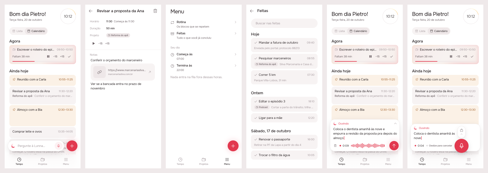
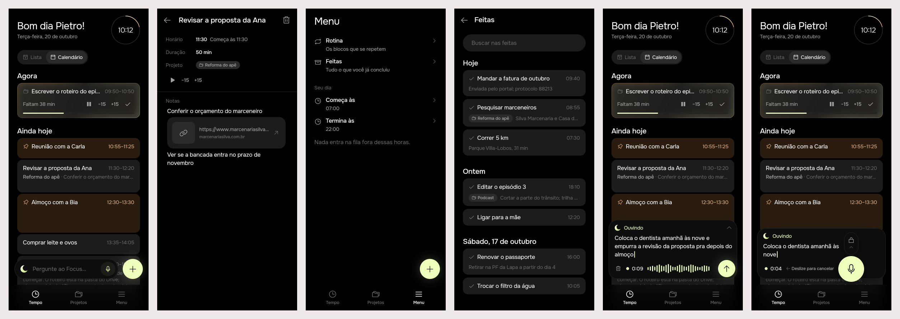
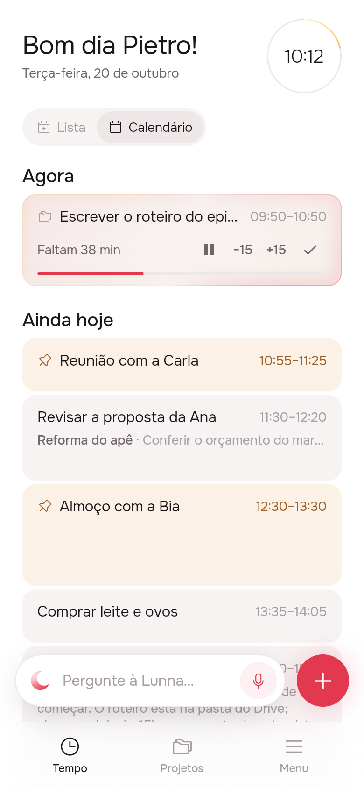
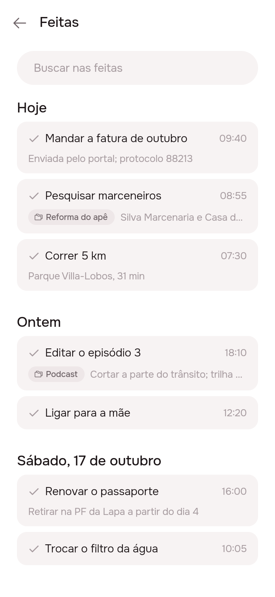
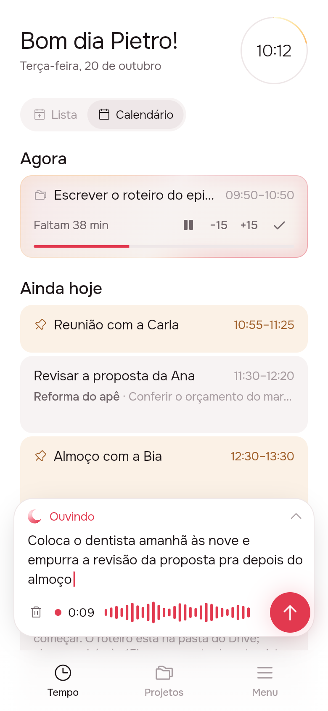

# Improvements: notes and projects on the calendar, Feitas, a quieter bar, one recorder

Six fixes from using the app: the calendar now shows how each note starts,
under the title, and which project a task belongs to, with no extra
height. Menu gets an archive of finished tasks. The + stops animating
between tabs. The circle before a task's name is gone, and the task page
no longer marks anything done. Recording becomes one panel instead of three
loose pieces.

## 1. The prompt

GitHub issue [#1](https://github.com/pietroid/lunna/issues/1), verbatim:

> Improvements
>
> * Show note previews in the calendar: Display the beginning of each note’s text without cluttering the calendar or taking up more space than a regular task.
> * Add a completed tasks archive: Include a section in the menu to access completed tasks for future reference. Consider adding music there as well.
> * Fix bottom bar animations: The animations still feel awkward and need to be improved. Ensure they work consistently across all stars.
> * Fix the checkmark UI: The checkmark was removed during the improvements, but an odd circle appeared in its place. Remove the circle and any remaining unwanted elements.
> * Display projects in the calendar: Projects currently appear only in the project view, which doesn’t make sense. They should also be visible in the calendar.
> * Improve audio interactions: Audio interactions have improved but are still not fully polished. The layout becomes particularly awkward when recording, so the interaction flow and layout need further discussion and refinement.

Worked unattended by the Lunna queue (design session). Approval and
answers come on the issue.

The design was reviewed on the issue, and the person replied, verbatim:

> Remove mark as done.
>
> The short description on the task should be below the title not aside. If it doesn't fit the task height it just doesn't show at all

Worked unattended again (second design round). Screens 1, 2, 5 and 6
were re-shot (5 and 6 show the calendar behind the recorder). 3 and 4
did not change.

The second round was reviewed on the issue, and the person replied,
verbatim:

> Great. Build it

That approves the board as drawn in round 2. Nothing was re-shot for
this reply: the board below is the approved one.

A last reply on the issue, verbatim, before the build:

> Approve

The build (sections 3 to 5) was also worked unattended.

## 2. The design

Pins in [board.json](board.json). Drawn by the real app (Lunna) from
`app/lib/improvements_preview.dart`, at a fixed 10:12. Each screen with
its pins, for reading on a phone:

| | |
|---|---|
|  |  |
|  |  |
|  |  |

Raw shots without pins: `img/mockup-1.png` … `img/mockup-6.png`.

### References

These come from patterns I already know. I did not browse Mobbin.

- **Google Calendar / Fantastical**: an event's description goes under
  the title when the block is tall enough, and is left out when it isn't.
- **Things 3 Logbook**: finished tasks grouped by day, newest first, and
  searchable.
- **WhatsApp / Telegram**: the voice recorder takes the whole composer
  row, and send sits where the attach/send button already was.

### Decisions

| Screen | Pin | Decision |
|--------|-----|----------|
| 1 Calendário | A | A card with room for a second line (≥ 72 px drawn, about 40 min or more) shows the start of its notes under the title in ink3. It shows as many lines as fit, up to 3. The card never gets taller |
| 1 Calendário | B | A card with no room for a second line (30 min) shows no notes at all: they never run on beside the title. A note line that is only a link is skipped (`notesPreview`) |
| 1 Calendário | C | A project task's second line starts with the project name (labelStrong, ink2): "Reforma do apê · Conferir…" |
| 1 Calendário | D | A project task with no room for a second line (Agora, short cards) gets the folders icon before its title, the same way fixed cards get a pin |
| 1 Calendário | E | The + is in the same spot on every tab. Changing tabs no longer animates it (`FloatingActionButtonAnimator.noAnimation`) |
| 2 Task | A | The circle before the name (`AppDoneCircle`) goes, on both the task page and the project page |
| 2 Task | B | Horário, Duração and Projeto rows stay as they are |
| 2 Task | C | The page has no way to mark the task done: the row is ▶ −15 +15 and nothing else. A task is ticked off on Tempo, by the ✓ on the running card |
| 3 Menu | A | New "Feitas" row right after Rotina, with the archive icon (Phosphor `archive`) and "Tudo o que você já concluiu". It opens `/feitas` |
| 3 Menu | B | The Menu's + sits exactly where the + sits on Tempo and Projetos |
| 3 Menu | C | The bottom bar doesn't change: brightness alone marks the current tab |
| 4 Feitas | A | Search looks in titles and notes |
| 4 Feitas | B | Newest first, under the calendar's day headings: Hoje, Ontem, then the date. Older tasks load as you scroll |
| 4 Feitas | C | Each row shows ✓, the name and the time it was done, then the project (`AppTag`) and the start of the notes |
| 4 Feitas | D | Tapping a row opens the done task's page (`EventPage(finished:)`) |
| 5 Recording | A | While recording, the bar and the + become one surface as wide as both, growing upward: the words on top, the recorder below |
| 5 Recording | B | The words appear as they are heard, up to 4 lines. Tapping them opens the conversation with the words in the field, unsent |
| 5 Recording | C | A 48 px send ↑ sits centred where the + was |
| 5 Recording | D | The trash, time and wave row stays at the bar's height and position, so nothing jumps when recording starts |
| 6 Held | A | The mic swells to 72 px, centred on the bar's mic where the finger landed. Releasing sends |
| 6 Held | B | The lock sits inside the panel, above the mic, and the words make room for it. Sliding up 80 px locks |
| 6 Held | C | While held, the dot, the time and "← Deslize para cancelar" (100 px) replace the wave |
| 6 Held | D | The +'s corner stays empty while the finger is down. Once locked, it becomes the send ↑ of screen 5 |

No new icon: `AppIcons.archive` and `AppIcons.things` already existed.

### Decided unattended

- **"Across all stars"** is read as "across all tabs" (Tempo, Projetos,
  Menu). The awkward motion is the Scaffold's default FAB switch: it
  scales out and back in, and slides between the two locations, every
  time the button changes from the ask dock to the plain +. The + was
  already in the same spot on every tab (checked against the geometry),
  so the fix is no animation, not a new position.
- **Round 2: "Remove mark as done"** is read as: the task page has no
  done control at all (the round-1 pill "Marcar como feita" is gone, and
  `AppDoneButton` with it). A task is still ticked off by the ✓ on
  Tempo's running card, which the reply did not mention. A finished
  task's page still says when it was done ("Feita hoje às …").
- **The project page loses its circle too, with nothing in its place**,
  to match the task page. Round 1's open question about a "Concluir
  projeto" pill is dropped with it (see the questions).
- **Round 2: notes below or nowhere.** The project's folders mark on a
  short card stays (pin 1D): the reply is about the notes only.
- **"Projects in the calendar"** is read as: a project's tasks say so on
  the calendar, as they already did in Lista. Project deadlines on the
  calendar are left as a question (below).
- **Note previews only on the calendar.** Lista cards size to their
  content, so a preview there would make them taller, which the issue
  rules out.
- **Music** is not drawn. "Consider adding music there as well" can mean
  too many things (see the questions).
- **Round 3: "Great. Build it"** did not answer the three open
  questions. The build takes the reading with the least new surface:
  no music in Feitas, no project deadlines on the calendar, and no way
  to finish a project from its page. The questions stay open below for
  a later issue; none of them blocks the build.
- **Six screens instead of 3–5**: the held and tapped recorders are
  different layouts, and recording is the part the issue calls most
  awkward.
- `.tool/mockup/shoot-flutter.sh` now waits for Chrome's debug port (up
  to 20 s) instead of sleeping a fixed 2 s. On a busy machine Chrome took
  3 s and every screenshot failed.

### Open questions

1. **Music in Feitas**: what should it be? Some readings: focus sounds to
   play while a task runs, a link to a playlist (Spotify/YouTube) per
   project, or a record of what was playing while a task was done.
   Nothing is built until this is answered.
2. **Project deadlines on the calendar**: should a project's due day also
   show on the calendar, as a slim untimed line under that day's heading
   ("Prazo · Reforma do apê")?
3. **Finishing a project**: with its circle gone, the project page has
   no way to mark the project finished. Is that wanted, or should it be
   done some other way (from the projects list, say)?

## 3. What was built

Shot from the real build, through the same preview entry point (now
deleted), at a fixed 10:12. Scenes, left to right: Calendário, a task's
page, Menu, Feitas, recording (tapped), recording (held).

**Lunna**

**Focus**

| Calendário | Feitas | Recording |
|---|---|---|
|  |  |  |

### The contract

- **A calendar card is never taller for its notes.** Drawn 72 px or
  taller (about 40 minutes), it shows its project and the first line of
  its notes with words under the title, up to 3 lines. Shorter, it shows
  no notes at all, and a project's task gets the folders mark before its
  title. Lista draws neither, since its cards size to their content.
- **A task is ticked off only on Tempo.** Its page and the project page
  have no done control any more.
- **Feitas reads the server, a page at a time.**
  `GET /api/tasks/done?q=<words>&limit=<n>&before=<iso>&beforeId=<id>`
  answers `{ done: [card] }`, newest first by `done_at`, then by id. Each
  card's `startTime` and `endTime` are its `doneAt`, and it carries `day`
  (in the person's zone), `notes` and `project`. `q` is matched
  case-insensitively against the title and the notes (`ILIKE`, with `%`
  and `_` taken literally). The cursor is the last card's `doneAt` and
  id, so tasks finished in the same millisecond are not lost between
  pages. Bad input is a 400 in Portuguese: a limit outside 1–100, half a
  cursor, or a search over 200 characters.

### Server

- `tasks/task.store.ts`, `tasks/pg-task.store.ts`: `TaskStore.done(user,
  page)` in memory and in Postgres. `tasks/task.types.ts`: `DonePage`.
- `events/request.ts`: `requireDonePage`. `events/tasks.controller.ts`:
  `GET /tasks/done`. `events/entities/event.entity.ts`: `DoneCard`.
- No migration, no new env var. Notes and `project` already came on
  every calendar card.

### App

- `timeline`: `TimelineRepository.fetchDone`, `DoneArchiveCubit` (first
  page, the next one 600 px before the end, search after 300 ms of no
  typing, late answers to old words dropped, duplicates between pages
  dropped), `DoneArchivePage` over it (loading, failure with "Tentar de
  novo", empty, no match). `EventTile(preview:)` and `notesPreview` from
  the design, unchanged.
- `lib/app/view/app.dart`: the `/feitas` route. A tap opens
  `EventPage(finished:)` with the notes dock, and the archive reads itself
  again when the page closes, since notes can be changed there.
- `projects`: the circle before the project's name is gone, with nothing
  in its place. `AppDoneCircle` is deleted from `app_ui`.
- `l10n`: `archiveFailed` and `archiveRetry` added. `eventMarkDone`,
  `projectDone` and `projectReopen` deleted (no longer used).
- `ask_bar.dart` (the one-panel recorder) and `shell_page.dart`
  (`noAnimation`) from the design, unchanged.
- `AGENTS.md`: Feitas, the route and the card preview rule, in "The app
  shell" and "Calendário".

### Tests

- Server: 4 end-to-end specs in `events.controller.spec.ts` (newest
  first with project and day, search in titles and notes in any case,
  paging across three tasks finished at the same instant, refusals) and
  1 PGlite spec in `pg-task.store.spec.ts` (order, cursor, `ILIKE`, a
  literal `%`, other people's tasks). Frozen clock, pinned zone.
- `timeline`: `done_archive_test.dart` (3 cubit tests: paging, debounced
  search, failure; 2 page tests: Hoje/Ontem headings and opening a
  task, empty vs no match), `event_tile_preview_test.dart` (3
  `notesPreview` tests; a card at 90 px shows the notes under the title,
  at 60 px shows none and stays 60 px; project name vs folders mark;
  Lista draws neither), and one more in `event_page_test.dart` (no ✓ on a
  task's page).
- `agent` (`voice_test.dart`): send sits within 1.5 px of the +'s
  centre, and the panel is as wide as the bar and the + and ends at the
  dock's bottom; held, the swollen mic is within 2 px of the bar's mic
  where the finger landed. The existing hold, slide, lock and send tests
  still pass.
- All of it under both brands, through `.tool/check`, which passes
  (app analyze, every touched package under Focus and Lunna, server
  eslint, tsc and tests).
- **Flaky, seen once.** The first `.tool/check` ran right after the two
  web builds, on a busy machine. Two server tests failed in it, neither
  about this change: "the day › reordering › never moves a fixed block"
  (`GET /timeline` answered 403) and "the agent › the answer as a
  surface › reaches a task off the board through its project" (the
  answer had no `tasks`). Both files passed alone (133 of 133), and the
  full check passed on the next run with the same code, so I didn't
  stash to bisect it. Worth watching if it comes back.

### Where the build differs from the mockup

- **Feitas has states the mockup didn't draw**: a small spinner while
  the first page loads, and a line with "Tentar de novo" when it can't
  be read.
- **Nothing else.** The calendar, the task page, Menu and the recorder
  are the widgets the design drew. The strips match the board.

### Decided unattended (build)

- **The archive searches on the server**, not just over what is loaded,
  so a task from months ago is found without scrolling to it.
- **NotesDock is left as it is.** While dictating, its words go straight
  into the notes, so it already is one pill, the bar and the + together,
  with nothing floating above it. Its other microphone asks the agent
  through the same `AskDock`, so it gets the new panel too.
- **No feature spec file.** These are six small fixes to existing
  features, not a new one, so the rules went straight into `AGENTS.md`
  (Feitas and the card preview), where every session reads them.
- **The shell's `noAnimation` has no test.** The app's root package has
  no test folder, and pumping `ShellPage` needs every bloc of the app.
  The setting is one line. It shows on the board: the + is in the same
  spot on scenes 1 and 3.
- **`ProjectsCubit.setDone` stays.** Nothing in the UI calls it now, but
  it is the server's `done` field and question 3 may bring it back.

### The flaky server test (after merging main)

After main was merged in, `.tool/check --all` failed on `server-test`:
one test in `events.controller.spec.ts` fell over with "socket hang up",
and a different one on each run. Once it answered **401**, which no
stubbed guard in the suite can send. It was not this branch: the same
spec, from main's tree (`git archive 5daf05d`), failed 1 run in 10 as
well.

The cause is supertest on macOS. Given a server that isn't listening,
supertest calls `listen(0)` (on `::`) for every request and then dials
`127.0.0.1:<port>`. macOS lets that wildcard bind share a port another
program holds on `127.0.0.1` alone, and the request goes to that program.
This Mac has plenty of them in the ephemeral range: Chrome, Code, Claude
Code, dart. A two-line Node script showed it: a wildcard listen on
another program's loopback port succeeds, and a `127.0.0.1` listen on it
is refused (`EADDRINUSE`). CI, on Linux, refuses both binds, so it never
saw this.

**The fix:** the four specs that talk HTTP (events, projects, agent,
links) now bind their app once, with `app.listen(0, '127.0.0.1')`, instead
of `app.init()`. Requests go to that server. The full server suite then
passed 12 runs in a row (before the fix it failed by the 3rd), and
`.tool/check --all` is green.

### Not tested

- On a real phone: whether the finger stays on the swollen mic is shown
  by the geometry test and the shots, not by a hand.
- Against a real Postgres (Neon). The store's query ran on PGlite.

## 4. How to turn it on

Nothing to set. No env var and no migration. Deploy the server and the
app together: an older server answers `GET /api/tasks/done` with a 404,
and Feitas then shows its "Tentar de novo" line.

## 5. Cost and time

Measured by the queue: see the pull request. The build made no calls to
outside services (no OpenRouter, no model evals).
