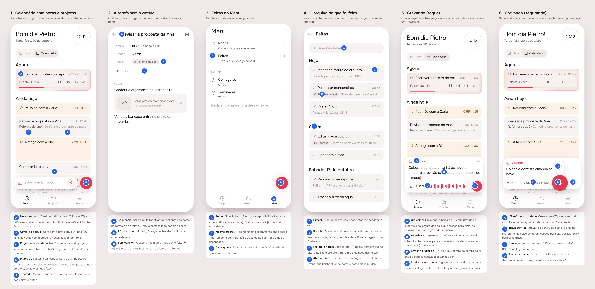
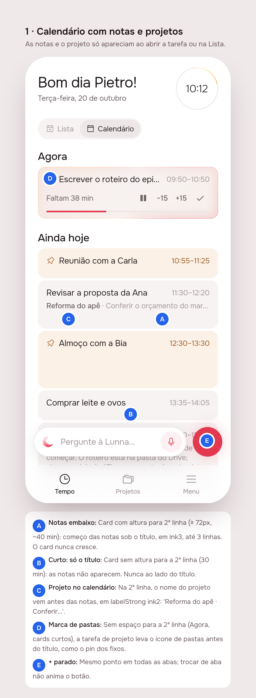
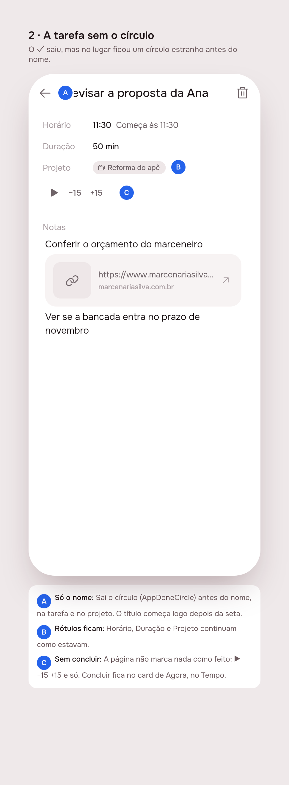
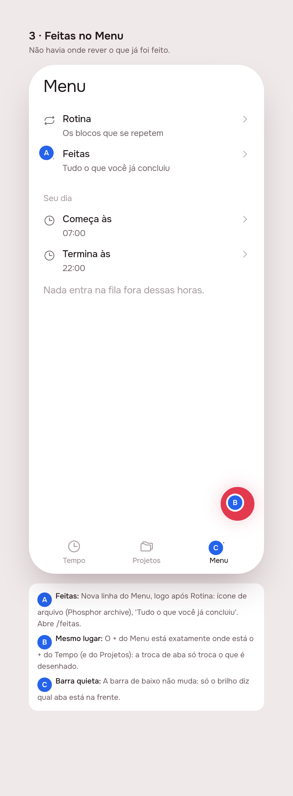
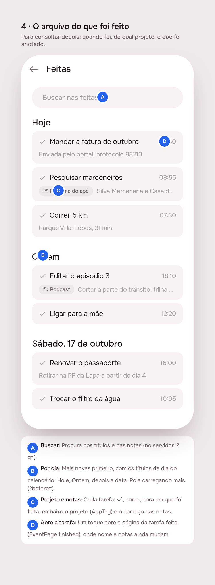
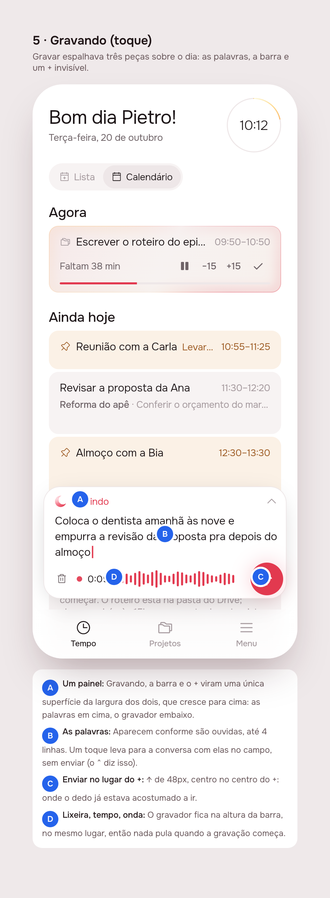
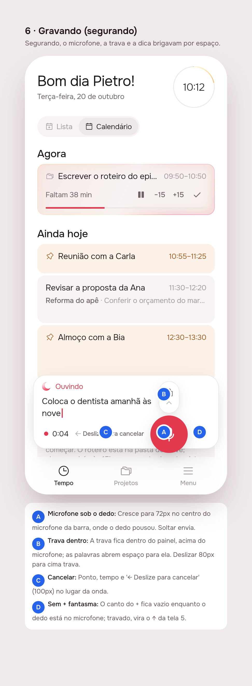

# Improvements: notes and projects on the calendar, Feitas, a quieter bar, one recorder

Six fixes from using the app: the calendar now shows how each note starts,
under the title, and which project a task belongs to, with no extra
height. Menu gets an archive of finished tasks. The + stops animating
between tabs. The circle before a task's name is gone, and the task page
no longer marks anything done. Recording becomes one panel instead of three
loose pieces.

## 1. The prompt

GitHub issue [#1](https://github.com/pietroid/lunna/issues/1), verbatim:

> Improvements
>
> * Show note previews in the calendar: Display the beginning of each note’s text without cluttering the calendar or taking up more space than a regular task.
> * Add a completed tasks archive: Include a section in the menu to access completed tasks for future reference. Consider adding music there as well.
> * Fix bottom bar animations: The animations still feel awkward and need to be improved. Ensure they work consistently across all stars.
> * Fix the checkmark UI: The checkmark was removed during the improvements, but an odd circle appeared in its place. Remove the circle and any remaining unwanted elements.
> * Display projects in the calendar: Projects currently appear only in the project view, which doesn’t make sense. They should also be visible in the calendar.
> * Improve audio interactions: Audio interactions have improved but are still not fully polished. The layout becomes particularly awkward when recording, so the interaction flow and layout need further discussion and refinement.

Worked unattended by the Lunna queue (design session). Approval and
answers come on the issue.

The design was reviewed on the issue, and the person replied, verbatim:

> Remove mark as done.
>
> The short description on the task should be below the title not aside. If it doesn't fit the task height it just doesn't show at all

Worked unattended again (second design round). Screens 1, 2, 5 and 6
were re-shot (5 and 6 show the calendar behind the recorder). 3 and 4
did not change.

The second round was reviewed on the issue, and the person replied,
verbatim:

> Great. Build it

That approves the board as drawn in round 2. Nothing was re-shot for
this reply: the board below is the approved one.

## 2. The design

Pins in [board.json](board.json). Drawn by the real app (Lunna) from
`app/lib/improvements_preview.dart`, at a fixed 10:12. Each screen with
its pins, for reading on a phone:

| | |
|---|---|
|  |  |
|  |  |
|  |  |

Raw shots without pins: `img/mockup-1.png` … `img/mockup-6.png`.

### References

These come from patterns I already know. I did not browse Mobbin.

- **Google Calendar / Fantastical**: an event's description goes under
  the title when the block is tall enough, and is left out when it isn't.
- **Things 3 Logbook**: finished tasks grouped by day, newest first, and
  searchable.
- **WhatsApp / Telegram**: the voice recorder takes the whole composer
  row, and send sits where the attach/send button already was.

### Decisions

| Screen | Pin | Decision |
|--------|-----|----------|
| 1 Calendário | A | A card with room for a second line (≥ 72 px drawn, about 40 min or more) shows the start of its notes under the title in ink3. It shows as many lines as fit, up to 3. The card never gets taller |
| 1 Calendário | B | A card with no room for a second line (30 min) shows no notes at all: they never run on beside the title. A note line that is only a link is skipped (`notesPreview`) |
| 1 Calendário | C | A project task's second line starts with the project name (labelStrong, ink2): "Reforma do apê · Conferir…" |
| 1 Calendário | D | A project task with no room for a second line (Agora, short cards) gets the folders icon before its title, the same way fixed cards get a pin |
| 1 Calendário | E | The + is in the same spot on every tab. Changing tabs no longer animates it (`FloatingActionButtonAnimator.noAnimation`) |
| 2 Task | A | The circle before the name (`AppDoneCircle`) goes, on both the task page and the project page |
| 2 Task | B | Horário, Duração and Projeto rows stay as they are |
| 2 Task | C | The page has no way to mark the task done: the row is ▶ −15 +15 and nothing else. A task is ticked off on Tempo, by the ✓ on the running card |
| 3 Menu | A | New "Feitas" row right after Rotina, with the archive icon (Phosphor `archive`) and "Tudo o que você já concluiu". It opens `/feitas` |
| 3 Menu | B | The Menu's + sits exactly where the + sits on Tempo and Projetos |
| 3 Menu | C | The bottom bar doesn't change: brightness alone marks the current tab |
| 4 Feitas | A | Search looks in titles and notes |
| 4 Feitas | B | Newest first, under the calendar's day headings: Hoje, Ontem, then the date. Older tasks load as you scroll |
| 4 Feitas | C | Each row shows ✓, the name and the time it was done, then the project (`AppTag`) and the start of the notes |
| 4 Feitas | D | Tapping a row opens the done task's page (`EventPage(finished:)`) |
| 5 Recording | A | While recording, the bar and the + become one surface as wide as both, growing upward: the words on top, the recorder below |
| 5 Recording | B | The words appear as they are heard, up to 4 lines. Tapping them opens the conversation with the words in the field, unsent |
| 5 Recording | C | A 48 px send ↑ sits centred where the + was |
| 5 Recording | D | The trash, time and wave row stays at the bar's height and position, so nothing jumps when recording starts |
| 6 Held | A | The mic swells to 72 px, centred on the bar's mic where the finger landed. Releasing sends |
| 6 Held | B | The lock sits inside the panel, above the mic, and the words make room for it. Sliding up 80 px locks |
| 6 Held | C | While held, the dot, the time and "← Deslize para cancelar" (100 px) replace the wave |
| 6 Held | D | The +'s corner stays empty while the finger is down. Once locked, it becomes the send ↑ of screen 5 |

No new icon: `AppIcons.archive` and `AppIcons.things` already existed.

### Decided unattended

- **"Across all stars"** is read as "across all tabs" (Tempo, Projetos,
  Menu). The awkward motion is the Scaffold's default FAB switch: it
  scales out and back in, and slides between the two locations, every
  time the button changes from the ask dock to the plain +. The + was
  already in the same spot on every tab (checked against the geometry),
  so the fix is no animation, not a new position.
- **Round 2: "Remove mark as done"** is read as: the task page has no
  done control at all (the round-1 pill "Marcar como feita" is gone, and
  `AppDoneButton` with it). A task is still ticked off by the ✓ on
  Tempo's running card, which the reply did not mention. A finished
  task's page still says when it was done ("Feita hoje às …").
- **The project page loses its circle too, with nothing in its place**,
  to match the task page. Round 1's open question about a "Concluir
  projeto" pill is dropped with it (see the questions).
- **Round 2: notes below or nowhere.** The project's folders mark on a
  short card stays (pin 1D): the reply is about the notes only.
- **"Projects in the calendar"** is read as: a project's tasks say so on
  the calendar, as they already did in Lista. Project deadlines on the
  calendar are left as a question (below).
- **Note previews only on the calendar.** Lista cards size to their
  content, so a preview there would make them taller, which the issue
  rules out.
- **Music** is not drawn. "Consider adding music there as well" can mean
  too many things (see the questions).
- **Round 3: "Great. Build it"** did not answer the three open
  questions. The build takes the reading with the least new surface:
  no music in Feitas, no project deadlines on the calendar, and no way
  to finish a project from its page. The questions stay open below for
  a later issue; none of them blocks the build.
- **Six screens instead of 3–5**: the held and tapped recorders are
  different layouts, and recording is the part the issue calls most
  awkward.
- `.tool/mockup/shoot-flutter.sh` now waits for Chrome's debug port (up
  to 20 s) instead of sleeping a fixed 2 s. On a busy machine Chrome took
  3 s and every screenshot failed.

### Open questions

1. **Music in Feitas**: what should it be? Some readings: focus sounds to
   play while a task runs, a link to a playlist (Spotify/YouTube) per
   project, or a record of what was playing while a task was done.
   Nothing is built until this is answered.
2. **Project deadlines on the calendar**: should a project's due day also
   show on the calendar, as a slim untimed line under that day's heading
   ("Prazo · Reforma do apê")?
3. **Finishing a project**: with its circle gone, the project page has
   no way to mark the project finished. Is that wanted, or should it be
   done some other way (from the projects list, say)?

## Build brief

Phase 3 starts here. Remove this section in Phase 4.

Approved on the issue ("Great. Build it"), board as in round 2. The
three open questions were not answered; build without them (see
"Decided unattended").

### Files Phase 1 wrote or changed (committed on `queue/1-improvements` by the queue, kept for the build)

- `app/lib/improvements_preview.dart`: the preview entry point, six
  scenes, a fixed clock, fake repository (`noSuchMethod`). Delete it after
  Phase 4.
- `app/pubspec.yaml`: `clock` dependency (the preview uses `withClock`).
  Drop it if nothing else in `lib/` uses it.
- `app/packages/timeline/lib/src/widgets/event_tile.dart`: `preview`
  param, `_body(lines:)`, a `LayoutBuilder` giving the notes a second
  line by drawn height (`_twoLines = 72`) or leaving them out, and the
  folders mark.
- `app/packages/timeline/lib/src/widgets/format.dart`: `notesPreview`.
- `app/packages/timeline/lib/src/view/timeline_list.dart`:
  `preview: !_isList` in `_tile`.
- `app/packages/timeline/lib/src/view/event_page.dart`: circle removed
  from the title, no done control (round 2 took the pill out again).
- `app/packages/timeline/lib/src/view/done_archive.dart` (new):
  `DoneArchivePage` (search, day headings) and `DoneArchiveTile`. For now
  it takes a fixed list and filters locally. Exported from `view.dart`.
- `app/packages/app_ui/lib/src/widgets/app_done_button.dart`: written in
  round 1, deleted in round 2. `app_done_circle.dart` is still there
  (the project page uses it).
- `app/packages/agent/lib/src/view/ask_bar.dart`: `AskRecorder` is one
  panel. `_Heard` has no surface of its own, and `onOpen` is null while
  held. Send is an `AppFab(diameter: 48)` in the +'s spot. `_HeldRow`
  reserves the mic and + room.
- `app/lib/shell/view/shell_page.dart`:
  `floatingActionButtonAnimator: noAnimation`.
- `app/lib/menu/view/menu_page.dart`: the Feitas row (`/feitas`, no route
  yet).
- `app/packages/l10n/lib/arb/app_pt.arb` + `gen/`: `eventDoneShort`,
  `menuArchive`, `menuArchiveHint`, `archiveSearch`, `archiveToday`,
  `archiveYesterday`, `archiveEmpty`, `archiveNoMatch` (`eventDoneShort`
  was added in round 1 and removed in round 2). `eventMarkDone` is now
  unused: delete it in the build.
- `.tool/mockup/shoot-flutter.sh`: wait for the debug port.

### Server

- `GET /api/tasks/done?before=<iso>&q=<words>&limit=<n>` →
  `{ done: [card] }`. Newest first by `done_at`, with
  `startTime = done_at`, `project`, `notes`. `q` is matched case-insensitively
  against title and notes (`ILIKE`). Validate the way `events/request.ts`
  does, with refusals in Portuguese. Add it to `TaskStore` (Pg + Memory)
  and write an e2e spec with a frozen clock.
- Nothing else: notes and `project` already arrive on every card in
  `cards`.

### App

- `TimelineRepository.fetchDone({before, query})`, plus a
  `DoneArchiveCubit` (pages, search with debounce). `DoneArchivePage`
  reads the cubit, loads more near the end, and opens
  `EventPage(finished:)` with the NotesDock. Add a go_router route
  `/feitas` in `lib/app`.
- Projects: remove `AppDoneCircle` from `project_page.dart` with nothing
  in its place (question 3 is unanswered, so no finish control), then
  delete `app_done_circle.dart`.
- Delete `eventMarkDone` from `app_pt.arb` and regenerate.
- Recording: check that the finger stays on the swollen mic on a real
  phone. With the panel's bottom row at the bar's height, the centre
  should land exactly. Check the notes page's `NotesDock` for the same
  awkward layout and make it match if needed.
- Tests: `notesPreview` (link lines skipped, whitespace collapsed); an
  `EventTile` with preview at 60 px vs 90 px height (no notes at all vs
  a second line, never taller); the event page has no circle and no done
  control; archive grouping and search; the shell's FAB uses
  `noAnimation`; the recorder panel's send finds the +'s centre; the
  existing ask-dock hold/slide/lock tests still pass. Update tests that
  find `AppDoneCircle`.
- Run under both brands.

### Decisions not in the pins

- Not built (open questions, unanswered at approval): music in Feitas,
  project deadlines on the calendar, finishing a project.
- The preview's second line takes `(height − 64) / 18` lines, clamped to
  1–3. Agora is laid out at its natural height, so it never gets a second
  line.
- The archive's rows are not greyed out like Lista's "N feitas": they are
  there to be read.

### Cost and time (design session)

The queue measures this run and writes the figures in the PR, so
`.tool/cost` was not run here (per the queue's instructions).
