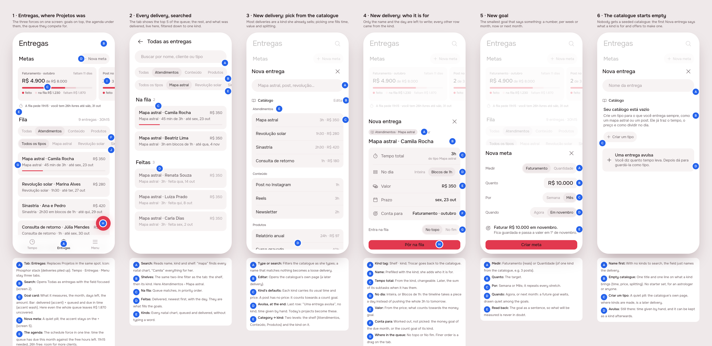
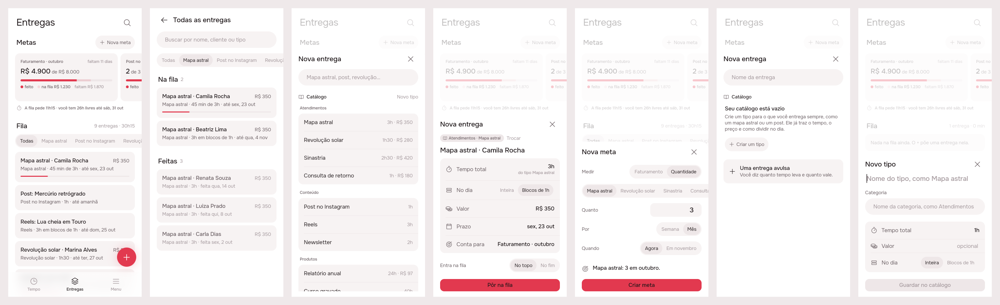
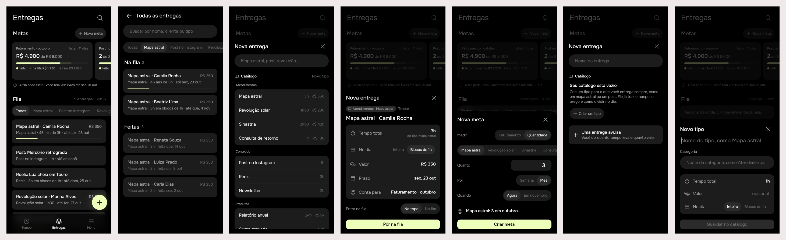

# Entregas: deliveries, goals and the catalogue replace Projetos

Status: **built** (issue #12): the design was approved on the issue and
built unattended. The build is in sections 3–5.

## 1. The prompt

From [issue #12](https://github.com/pietroid/lunna/issues/12):

> New structure for organization: artifacts.
>
> Lunna was always meant to be an _Artifact Management System_ built for women.
>
> The main goal of Lunna is help women organizing what they need to do, when they need to do, given the ability to do based on their cycles and calendar.
>
> Conceptually we have those three "forces":
>
> - Planned artifacts: a queue of products, services or deliverables she has to do
> - Goals: hard or soft goals - primarily financial - involving how much she should earn or delivery in a given timeframe
> - Schedule: in the future will consider periods, but also consider other tasks such as wellbeing, the day to day routine (time to sleep, time to wakeup, weekends).
>
> Schedule and goals compete by the planned artifacts, goals are capitalistic and market demands and schedule is the realistic operation a women can do in a healthy way.
>
> # Challenges
>
> This seems conceptually sound, but put this in a nice simple design is harder than it seems.
>
> ## The term
>
> First of all, there is no clear word for "artifact" that seems universal but at the same time good for user to understand. "Product" or "Service" can be a good term, but still depends. For example, post on Instagram is a measurable artifact but is neither a product nor service.
>
> ## Visualization
>
> My initial idea is to have a separate tab for those "artifacts" with a queue of them. Probably we will need to separate between categories or types, as an Instagram post is different from a client that you will talk to.
>
> ## Catalogue
>
> For an astrologer (the use case im working on), there are a catalogue of products, and an artifact is simply something from that catalogue. The instagram post can be a catalogue as well. There seems to be two dimensions: category, and inside that category, types.
>
> ## Goals
>
> The hardest are goals, because goals can be really fuzzy, and I think AI will help us a lot with this. But we still need a substrate. The simplest goal we can start is by having $X amount in this month. Or another is to post X posts per week.
>
> We can tie a goal with a certain metric per certain amount of time for now. And there are active goals and future goals.
>
> ## Where goals vs artifacts live
>
> I was thinking of a proposition that we have this unified tab for goals/artifacts and goals are at the top, with the queue of artifacts coming up later, kind of organized by priority. We can expand and see all artifacts for example, or search by them.
>
> ## And Projects?
>
> We should extinguish the concept of project and turn it into plain artifacts only. And here is the catch: artifacts almost map 1:1 into small projects, or even big projects if we think. Let's consider I should work 2 weeks on some project to deliver something, thats an artifact. It contains multiple subtasks, internal notes, etc. But there can be simpler artifacts that just take 1 hour. Or take 4 hours, but I can split them into multiple times of my day. That's the whole idea.
>
> ## Artifacts can be split in the timeline
>
> For tasks more than 2 hours is pretty boring that it's moved to tomorrow if I need for today. I just maybe get a bit of it (can be a subtask of it or just a literal bit of it).
>
> Artifacts thus have some sort of total time, that can be either totalized at the beginning of definition or by computing the subtasks.
>
> ## Final considerations
>
> This seems a big delivery. You have just 5 screens to show. I want you to focus on the main features and on the top level screens (the tabs, creation of an artifact). We can later focus on the impact on the timeline and the internal pages of catalogue, etc.

The design was reviewed on the issue, and the person answered the two open
questions and asked for one more thing:

> 1. When it's delivered, for now.
> 2. It should start empty
>
> Please make the possibility to filter by each kind of product as well.

The second round drew the types as a second line under a picked category,
and the person replied:

> No i mean, unify types with categories, like the most used types for example show up.

The third round was answered:

> approve

## 2. The design

Pins in [board.json](board.json). Drawn by the real app (Lunna), new
`artifacts` package. One screen per image, for a phone:
[1](img/mockup-1.png) · [2](img/mockup-2.png) · [3](img/mockup-3.png) ·
[4](img/mockup-4.png) · [5](img/mockup-5.png) · [6](img/mockup-6.png).

**Second round:** screens 1 and 2 filter by type as well as by category,
and screen 6 is new: the catalogue as everyone first finds it, empty.
Screens 3 and 4 show a catalogue after she has filled it.

**Third round:** types and categories are **one filter line** (pins 1F,
2B): *Todas*, then the three types she uses most, then the categories,
each marked with a folder. The second line is gone. Screen 1 has the
category Conteúdo picked (the line scrolls it into sight), screen 2 the
type Mapa astral.

### The term: **Entrega**

*Entrega* (plural *Entregas*) is what Brazilian freelancers already call
the thing they owe: "minhas entregas da semana". It covers all three cases
in the issue: a natal chart for a client, an Instagram post, a two-week
course. *Produto* and *Serviço* each leave one of them out. In code the
model stays `Artifact`, in the `artifacts` package. Goals are **Metas**,
the catalogue is **Catálogo**, its two levels are a **category** (the
shelf: Atendimentos, Conteúdo, Produtos) and a **type** (Mapa astral,
Reels).

### The flow

1. **Entregas** takes Projetos's tab. On top, the **Metas** scroll sideways
   (active, then future). Under them, one line puts the **schedule** against
   them: the time the queue has due this month against the free hours left
   on the agenda. Then the **Fila**, in priority order, filtered by one
   line: the types she uses most, then the categories.
   The example shows the three forces pulling against each other: even if
   the whole queue is delivered, October misses its goal by R$ 1.870, and
   the agenda has 26h free for 11h15 of work, so there is room for more
   clients.
2. **Todas as entregas**: search by name, type or category, or pick one
   from the same line; the queue's matches, then what was delivered.
3. **Nova entrega** opens on the **catalogue**: pick a type and its time,
   price and splitting come with it. A one-off delivery with no type is
   the last row.
4. Then only the name and the deadline are left to write. **No dia:
   Inteira / Blocos de 1h** is how a long delivery gets split on the
   timeline. **Conta para** is worked out from the type and the deadline,
   not picked.
5. **Nova meta**: Faturamento or Quantidade (of one type), how much, per week
   or month, now or from next month.
6. The first time, the **catalogue is empty**: Nova entrega opens on the
   name, says what a type is for, and offers "Criar um tipo" or a one-off
   delivery.

### Decisions (the pins)

| Pin | Decision |
|-----|----------|
| 1A | Entregas replaces Projetos in the same tab. Still three tabs: Tempo · Entregas · Menu. Icon: Phosphor `stack`. |
| 1B | Search sits in the header and opens screen 2. |
| 1C | Goal card: label · month, days left, amount "de" target, a two-part bar (delivered in accent, queued and due in the stretch in the accent wash), and what is still missing. |
| 1D | "Nova meta" is a quiet pill; the accent stays on the +. |
| 1E | The schedule line: hours the queue has due by the end of the month against the free hours on the agenda until then. |
| 1F | **One filter line** (`ShelfFilter`, an `AppSegmented` that scrolls sideways): Todas, then the 3 types she uses most (by count in the queue and the delivered), then every category with a folder icon. One pick at a time, a type or a category; the picked one is scrolled into sight. |
| 1G | A row shows the name and value, then the type, the time (or time worked of the total, or steps done) and the deadline. The bar appears once work has started. Order is priority; drag to reorder, as in Lista. |
| 1H | The + writes a delivery. Same spot as on every tab. |
| 1I | Future goals are drawn quiet, with the day they start. |
| 2A–D | Search covers name, type and category, and the same filter line narrows it to one type or one category. Results come in two sections: Na fila (priority order), then Feitas (newest first). |
| 3A | One field both searches the catalogue and names a one-off delivery. |
| 3B | "Editar" opens the catalogue's page (a later delivery). |
| 3C | Each type has a default time, an optional price and an optional block length. |
| 3D | "Uma entrega avulsa": no type, time given by hand. |
| 3E | Two levels: category, then type. |
| 4A | A tag shows the category · type; "Trocar" goes back to the catalogue. |
| 4B | The name is prefilled with the type; she adds who it is for. |
| 4C | Total time comes from the type. Later it can be the sum of the subtasks. |
| 4D | **Splitting**: Inteira, or Blocos de N. The timeline takes one block at a time instead of pushing the whole thing to tomorrow. |
| 4E | Value comes from the price and counts towards the money goal. |
| 4F | "Conta para" is derived: the money goal of the deadline's month if it has a value, or the count goal of its type. |
| 4G | It enters the queue at the top or the end. |
| 4H | "Pôr na fila" is the one accent action. |
| 5A–E | A goal is a metric (money or count of a type) × an amount × a period (week or month) × a start (now or next month), read back as a sentence. |
| 6A | With an empty catalogue the field only names the delivery. |
| 6B | The empty catalogue says what a type brings (time, price, splitting). No starter set for anyone. |
| 6C | "Criar um tipo" is a quiet pill; making types belongs to the catalogue's page. |
| 6D | The one-off delivery stays, and can be kept as a type afterwards. |

New icons (Phosphor, wired in `AppIcons`): `artifacts` (stack),
`category` (folder, on a category's chip), `goal` (target), `search` (magnifyingGlass), `catalog` (bookOpen), `value`
(coins), `split` (rows). No sparkles, no new brand SVG.

**References** (drawn from known patterns, not browsed):

- Linear's issue list: one priority-ordered queue with filter chips over it.
- Nubank's and Mobills' *Metas* cards: an amount "de" a target, with one bar.
- Notion's database templates: a new item starts from a type that brings its own fields.

### Decided unattended

Nobody was at the keyboard, so these were taken as I would recommend.
Say otherwise on the issue.

1. **The term is *Entrega*** (code: `Artifact`).
2. **Projetos is gone as a tab.** Each existing project becomes a one-off
   delivery: same name, notes and tasks (as its subtasks), and its deadline.
   Its page becomes the delivery's page (not drawn: "internal pages later").
3. **Goals measure only two things for now**: money from deliveries done in
   the stretch (their value), and a count of one type. Both repeat per week
   or per month. A future goal is one whose stretch hasn't started.
4. **"Na fila" on a goal counts only queued deliveries due inside the
   stretch.** Anything later can't help this month.
5. **The schedule line is one sentence, not a chart**, and counts only
   deliveries due by the end of the month.
6. **Splitting is a property of the delivery** (default from its type).
   How the timeline cuts blocks is the next delivery; this one only stores
   it.
7. **The tab shows the first 5 of the queue**, then "Ver todas as N".
8. Screens show Lunna only; Focus gets the same tokens.
9. **One line, most-used types first, then categories** (third round,
   from the reply). Three types: with Todas and three categories that
   already fills a phone and a half. "Most used" counts every delivery of
   the type, queued or delivered, with no time window; ties keep the
   catalogue's order; a type never used doesn't come in. A type picked
   elsewhere that is not in the top three joins the line after them.
   Categories are marked with a folder (`AppIcons.category`) so a shelf
   reads differently from a type. The catalogue in Nova entrega (screen 3)
   keeps its grouping by category; it could put the same three types on
   top as "Mais usados" if wanted.
10. **The filter is the same on the tab and on Todas as entregas**, and
    neither remembers it between visits (the build may keep it on the
    device, as `TimelineModeCubit` does, if it turns out to be wanted).
11. **The empty catalogue offers "Criar um tipo"** although the catalogue's
    page is out of this delivery: the build makes it open a small sheet
    with a type's name, category, time, price and block length, the
    least that lets her fill the catalogue at all.

### Answered on the issue

- **A delivery's money counts when it is delivered** (`doneAt`), for now.
  No paid date.
- **The catalogue starts empty** for everyone (screen 6). No seed.
- **Filter by each type as well**, and then **unify types with
  categories, the most used types showing up** (pins 1F, 2B).

### Open questions of the design

Both were left with the option marked when the design was approved, and
the build follows them: "Criar um tipo" opens a small type sheet (11), and
Nova entrega's catalogue does not open on "Mais usados" (9).

## 3. What was built

### The real build, both brands

Drawn by the real widgets behind the real `ArtifactsCubit`, with a fake
repository answering canned data. Scenes: 1 the tab, 2 Todas as entregas
kept to Mapa astral, 3 the catalogue, 4 a delivery of a kind, 5 a count
goal, 6 the empty catalogue, 7 the first kind (new).

One screen per image, for a phone: [the tab](img/build-1.png) ·
[a delivery of a kind](img/build-4.png) · [a goal](img/build-5.png) ·
[a new kind](img/build-7.png).

### The contract

**A project is now a delivery, and nothing else changed for its tasks.**
The `project` table became `artifact` with the same ids, and
`task.project_id` became `task.artifact_id`, so every project's tasks,
notes and deadline are still there, as a one-off delivery at the end of the
queue. Money counts towards a goal on the day a delivery is delivered
(`done_at`); a goal's *na fila* is what is open and due before its stretch
ends. Every route under `/artifacts`, `/catalog` and `/goals` answers the
whole tab. The full spec is [product/spec/artifacts.md](../../spec/artifacts.md).

### Server

- `server/src/artifacts/` (was `projects/`): `ArtifactStore` with
  `MemoryArtifactStore` and `PgArtifactStore` (deliveries, catalogue,
  goals), `ArtifactsService` (the answer, goals measured per stretch, the
  schedule, the most used kinds, the queue's order), `stretch.ts` (weeks
  from Monday and months, as day arithmetic), `request.ts` (refuses, never
  guesses).
- Routes: `GET|POST /artifacts`, `PATCH|DELETE /artifacts/:id`,
  `POST /artifacts/:id/move`, `POST /artifacts/:id/tasks`,
  `POST /catalog/types`, `POST /goals`, `DELETE /goals/:id`. `POST /tasks`
  takes `artifactId`; a card names its delivery as `artifact: { id, title }`.
- Migrations: `0009_artifacts` creates `catalog_category`, `catalog_type`,
  `artifact`, `goal` and `task.artifact_id`, and copies every project and
  its tasks across; `0010_drop_projects` drops `task.project_id` and
  `project`. Two steps so `drizzle-kit generate` never had to ask about a
  rename. No catalogue seed.
- The agent reads deliveries where it read projects: the board, the
  `artifact` answer block and `ArtifactPeek`, `about: { artifactId }`. The
  prompt says the person calls them *entregas*.

### App

- `app/packages/artifacts` is the real package now: `ArtifactsCubit` and
  `ArtifactsRepository`, the models read off the wire, and the views of the
  design wired to them. `ArtifactPage` is the project page moved over, with
  a line for the kind, time and value and a ✓ that marks it delivered.
- `app/packages/projects` is deleted. `ShellPage` puts Entregas in its tab
  (icon `stack`), and the + on it opens Nova entrega.
- The timeline and agent packages say artifact where they said project
  (`writeDownOnTimeline(artifactId:)`, `TimelineEvent.artifactId`,
  `AgentSubject.artifact`, `AgentLinks.openArtifact`). The agent's decoder
  still reads `ProjectPeek` and `add_project` from conversations stored
  before this build.
- `AppIcons.things` (folders) is gone; a delivery's tag and a card's mark
  use `AppIcons.artifacts`.

### Tests

- Server: 6 new end-to-end specs in `artifacts.controller.spec.ts` (empty
  catalogue then kinds on named or picked shelves, a delivery of a kind with
  its defaults and a whole one, the queue's order, goals over the month, the
  week and one ahead, the schedule against a frozen clock, the most used
  kinds), the store's catalogue and goals against PGlite, and the
  `0009`/`0010` migration run on rows written before it. The renamed
  project specs still pass unchanged.
- App (`packages/artifacts`, 23 tests): the answer read off the wire, the
  shelf filter, the cubit (optimistic drag, refusals, the day told on a
  removal), the delivery page ported from the project page plus delivering
  it, and widget tests for the tab, the search and the three sheets.
- `.tool/check` passes whole: `app-analyze`, the agent, app_ui,
  artifacts, notifications and timeline packages under both brands,
  `server-eslint`, `server-tsc` and `server-test` (306 tests in 21 suites).
  No flaky test was seen. The first run failed only on prettier line breaks
  the rename left in the server; they were formatted and the rerun passed.
- Not tested: a real phone, a real Postgres other than PGlite, and the
  agent against a real model.

### Where the build differs from the design

1. **"Editar" in the catalogue is "Novo tipo".** The catalogue's page is a
   later delivery, so the link opens the same small type sheet the empty
   catalogue opens; otherwise only the first kind could ever be written.
2. **Nova meta has a real amount field** and, for Quantidade, a line of the
   kinds to count; the readback says weeks too ("Faturar R$ 2.000 por
   semana.", "Post: 3 por semana."). For a weekly goal the second choice is
   "Semana que vem".
3. **A one-off is timed and priced in place**: its time row opens the
   length picker (1h until changed), and its value is typed. The deadline
   row opens the day picker for both.
4. **The empty catalogue's one-off hint** no longer says it can be kept as
   a kind afterwards: that belongs to the catalogue's page.
5. **The search is on the device**: the answer carries every delivery, so
   Todas as entregas filters what it has rather than asking the server
   (`?category=`/`?type=` waits for paging the delivered list).
6. **The queue is dragged only under *Todas***: a place among one shelf's
   says nothing about the rest. A long press on a goal card removes it.
7. **The goal strip is 12 px taller** (140) so a larger text size does not
   clip the card; rows of the sheets shrink their controls rather than run
   off at large text.

### Decided unattended in the build

12. The ids stay: a project became a delivery with the same id, so links
    and conversations about it still reach it.
13. A delivery's total time is the one written down, or else the sum of its
    tasks; *time worked* is the sum of its finished tasks.
14. The schedule's free time is the working day less every event and every
    laid-out task, from now to the end of the month; a delivery's own queued
    tasks count on both sides.
15. Notas/Tarefas is remembered under `artifact.tab.<id>`; the old
    `project.tab.<id>` choice is forgotten once.

## 4. How to turn it on

Nothing to set: no new env var or secret. The server migrates on boot
(`0009`, `0010`). **The app and the server ship together**: a phone on an
older build still calls `/projects` and gets a 404 until it updates (the web
build ships with the server).

## 5. Cost and time

Measured by the queue: see the pull request. The build made no calls to
OpenRouter or any other paid service (`npm run eval:agent` was not run).
