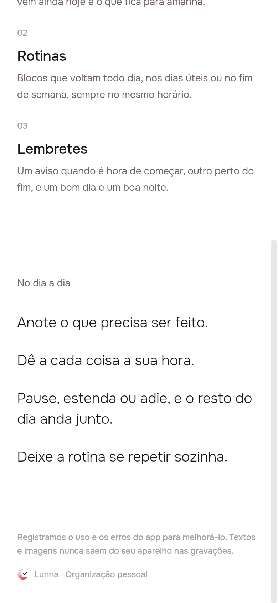
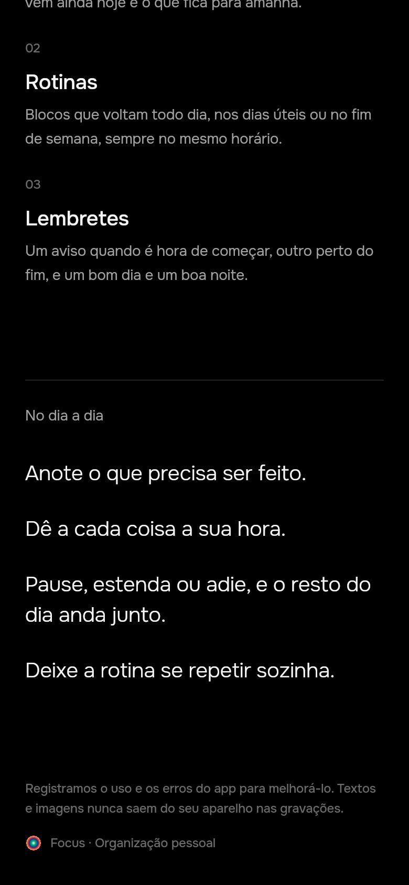

# PostHog: users, errors and replays

2026-10-21 · delivery · **built** · track: plan

## 1. The prompt

From [issue #21](https://github.com/pietroid/lunna/issues/21):

> **Implement Posthog based on Research**
>
> Based on past research made by the repository, implement Posthog

Then, on the issue, after the plan: **"approve"**.

The research is the RFC
[product/research/2026-10-21-posthog](../../research/2026-10-21-posthog/README.md).
Its binding decision: **US cloud, no heatmaps, no consent prompt**. The two
it left open take their recommended option here: **one project** for both
brands, and **everything masked** in replays.

## 2. The plan

**Track: plan.** Nothing in the RFC's rollout draws a new screen; the only
visible touch is one line of copy on the landing page (below). This
delivery ships **all of the RFC's rollout phases 0–4**, except the web
source-map upload in CI (phase 4's last item), which needs a personal API
key and is left for later.

### Approach

1. **Phase 0, the measuring.** One PostHog project on the US cloud. Its
   project key (public by design) goes in a repo variable `POSTHOG_KEY` and
   in the app's `env/*.json`; `POSTHOG_HOST` is `https://us.i.posthog.com`.
   The server reads the same two from its env (`server/.env.example`,
   `deploy/docker-compose.yml`, `SETUP.md`).
2. **Server** (`server/src/analytics/`): `posthog-node`, one `Analytics`
   provider in an `AnalyticsModule` (disabled when `POSTHOG_KEY` is unset,
   so tests and `start:local` stay offline), `enableExceptionAutocapture`
   for what escapes every request (the minute tick), `shutdown()` on
   `onApplicationShutdown`. `LoggingInterceptor` (built with `new` in
   `main.ts:45`) takes it as a constructor argument: `captureException`
   with `{ method, url, status }` on a 5xx or a missing status, and one
   event per successful write from a route table (`POST /tasks` →
   `task_created`, `/tasks/:id/start` → `task_started`, `/tasks/:id/done`
   → `task_done`, `/agent/plans/:id/apply` → `plan_applied`, routines,
   artifacts…). Reads and 4xx (the server's own refusals) are not events.
   The `distinctId` is `req.user.id`; no email, no name, no body.
3. **App seam** (`app/packages/analytics`): `abstract class Analytics {
   identify, reset, screen, captureException }`, `PostHogAnalytics` over
   `posthog_flutter`, `NoAnalytics`. `main.dart` picks PostHog only when the
   `POSTHOG_KEY` define is set; tests, `preview.dart` and the demo get
   `NoAnalytics` and never touch the method channel. `AUTO_INIT` false in
   `Info.plist` and `AndroidManifest.xml`; `Posthog().setup(config)` from
   the define.
4. **App wiring:** `AppBloc._onUserChanged` identifies with Better Auth's
   user id and `{brand: AppBrand.id}`, `reset()` on sign-out.
   `PosthogObserver` in the `GoRouter`, a `name:` on each `GoRoute`, and
   `ShellPage` calls `screen()` when the tab changes (three tabs, one
   route). Errors: `captureFlutterErrors`, `capturePlatformDispatcherErrors`,
   `captureNativeExceptions`, plus the Dio `onError` in `api_client` (5xx
   only, not a dropped network) and `AppBlocObserver.onError`.
5. **Replay:** `sessionReplay: true`, `maskAllTexts` and `maskAllImages`
   left on, `PostHogWidget` above `MaterialApp.router`. On the web, "Canvas
   capture" turned on in the project settings (a click in PostHog, listed
   in `SETUP.md`).
6. **Web:** the posthog-js snippet in `app/web/index.html` with a
   `__POSTHOG_KEY__` placeholder that `tool/brand_web.sh` fills, `api_host:
   '/ingest'`, `ui_host: 'https://us.posthog.com'`, no heatmaps;
   `deploy/nginx.conf` proxies `/ingest/static/` to
   `us-assets.i.posthog.com` and `/ingest/` to `us.i.posthog.com`.
   `deploy.yml` writes `POSTHOG_KEY`/`POSTHOG_HOST` into `env/web.json`.
7. **The one visible touch:** under the sign-in button on the landing page
   (`app/lib/landing/view/landing_page.dart`), one muted line from
   `app_pt.arb`: *"Registramos o uso e os erros do app para melhorá-lo.
   Textos e imagens nunca saem do seu aparelho nas gravações."* (shot in
   Phase 4 through a small preview, both brands).

### References

- [PostHog Flutter SDK](https://posthog.com/docs/libraries/flutter): `setup`, `AUTO_INIT`, `PosthogObserver`, and that `setup()` does nothing on web without the JS snippet.
- [Flutter session replay](https://posthog.com/docs/session-replay/installation/flutter): `PostHogWidget`, `maskAllTexts`/`maskAllImages` default to true.
- [Node SDK](https://posthog.com/docs/libraries/node) and [NestJS error tracking](https://posthog.com/docs/error-tracking/installation/nestjs): `captureException`, `enableExceptionAutocapture`, `shutdown()`; why we reuse our interceptor rather than add `PostHogInterceptor`.
- [nginx proxy](https://posthog.com/docs/advanced/proxy/nginx): the two US locations for `/ingest`.

The version pinned will be the current `posthog_flutter` on pub.dev at
build time (the RFC read 5.56.1; canvas masking needs ≥ 5.34.0).

### Decisions

| # | Decision | Chosen | Why |
|---|----------|--------|-----|
| 1 | Region | US cloud | RFC decision, binding |
| 2 | Projects | one for both brands, `brand` as a property | the same person in both apps is one row, as in the database (RFC, recommended) |
| 3 | Masking | all text and images | titles and notes are the most private thing in the app; a picture can't be redacted later (RFC, recommended) |
| 4 | Heatmaps | off | RFC decision; Flutter paints one canvas |
| 5 | Consent prompt | none; one informative line on the landing page | RFC decision (sign-up is by invitation); the line is not a prompt |
| 6 | Where actions are counted | the server's `LoggingInterceptor` | backend events are not ad-blocked, one place for three platforms |
| 7 | Secrets | none new: the project key is public; `POSTHOG_KEY` is a repo **variable** | PostHog project keys are meant to ship in clients |
| 8 | Left out | web source maps in CI, LLM analytics for the agent | the first needs a personal API key secret; the second is its own topic |
| 9 | Without a key | everything off (`NoAnalytics`, `disabled: true`) | tests, CI, dev and preview stay offline |

### How it will be proved

- `npm test` in `server/`: a spec of `LoggingInterceptor` with a fake
  `Analytics`, asserting a 5xx calls `captureException` with the user id, a
  4xx does not, `POST /tasks/:id/done` emits `task_done`, a `GET` emits
  nothing; and the e2e timeline specs still pass with no key.
- `flutter test` of `packages/analytics` and the app under both brands:
  `AppBloc` identifies and resets through a fake `Analytics`; the Dio
  interceptor reports a 500 and not a connection error.
- `flutter build web` + `tool/brand_web.sh lunna`: the built
  `index.html` has the key and no `__POSTHOG_` placeholder left; `nginx -t`
  on `deploy/nginx.conf` (via the `nginx` image if Docker is here).
- `flutter build apk --flavor lunnaDev` (and iOS if signing allows) to
  prove `AUTO_INIT` and the plugin compile.
- **Not provable here:** events arriving in PostHog. That needs the project
  key on a real device; section 4 will say so and list what to look for
  (a `task_done` with the person's id, a masked replay).
- `.tool/check` once at the end.

## 3. What was built

### The contract

**Nothing a person wrote leaves for PostHog, and without `POSTHOG_KEY`
nothing leaves at all.** The server sends route names and statuses, the app
sends the account id, the brand, screen names and errors, and replays mask
every text, every image and everything custom-painted. The whole spec is
[product/spec/analytics.md](../../spec/analytics.md).

### The one visible touch

The landing page's foot, under the "No dia a dia" list, above the brand
line (shot through a throwaway preview, deleted after):

| Lunna | Focus |
|-------|-------|
|  |  |

### Server (`server/src/analytics/`)

- `analytics.ts`: `Analytics` (`capture`, `captureException`,
  `shutdown`), `PostHogAnalytics` over `posthog-node` 5.56.4 with
  `enableExceptionAutocapture`, `NoAnalytics`, and `analyticsFrom(env)`,
  which is `NoAnalytics` without a key.
- `events.ts`: the route → event table (38 write routes, from
  `task_created` to `plan_applied`), keyed by the route Nest matched
  (`/tasks/:id/done`), never the url, so neither an id nor a query (the
  Feitas search, `?q=`) reaches PostHog.
- `analytics.module.ts`: a global `AnalyticsModule` providing `ANALYTICS`
  from `ConfigService`, flushing on `onApplicationShutdown`.
- `common/logging.interceptor.ts` takes it in its constructor (`main.ts`
  passes `app.get(ANALYTICS)`): a write that succeeded with a person is an
  event `{ route, status, source: 'server' }`; an error with no status or
  a 5xx is `captureException` with `{ method, route, status }`; a 4xx is
  neither.

### App (`app/packages/analytics`, new)

- `Analytics` (`identify`, `reset`, `screen`, `captureException`,
  `navigatorObservers`, `wrap`), `NoAnalytics`, `AnalyticsScope` (answers
  `NoAnalytics` where there is none, so no test needs one), and
  `PostHogAnalytics.start`, the only code that calls `posthog_flutter`
  5.56.1: replay on with `maskAllTexts`, `maskAllImages` and
  `maskCustomPaint`; Flutter, platform-dispatcher and native errors;
  `identified_only` profiles; no surveys.
- `main.dart` starts it only when the `POSTHOG_KEY` define is set, and hands
  it to `bootstrap` (`AppBlocObserver.onError` reports what a bloc threw;
  the log now goes in front of PostHog's `FlutterError.onError` instead of
  replacing it), `AppBloc` (identify with `{brand}` on sign-in and for the
  restored account, once per account; `reset` on sign-out), `App`
  (`PosthogObserver` on the `GoRouter`, a `name` on each route,
  `PostHogWidget` around `MaterialApp.router`) and `AnalyticsScope`, which
  `ShellPage` reads to report `Tempo`, `Entregas` and `Menu`.
- `api_client`: `ApiClient(onServerError:)`, called for a 5xx only;
  `main.dart` reports it with method, path and status.
- `AUTO_INIT` false in `Info.plist` and `AndroidManifest.xml`.
- Web: the posthog-js snippet in `web/index.html` (`api_host: '/ingest'`,
  `ui_host` US, no autocapture, no pageviews, no heatmaps, no surveys,
  `canvasCapture.maskRegionsFn: () => null` so no frame is recorded before
  Flutter's masks are mounted). It loads nothing unless the key looks like
  `phc_…`, so `flutter run -d chrome` stays offline. `tool/brand_web.sh`
  fills `__POSTHOG_KEY__` from `POSTHOG_KEY` (refusing anything that is
  not a key, and failing if a placeholder is left); `deploy.yml` passes
  `vars.POSTHOG_KEY` to both the define and the script.
- `deploy/nginx.conf`: `/ingest/static/` → `us-assets.i.posthog.com`,
  `/ingest/` → `us.i.posthog.com`, resolved at request time like `/api`,
  20 MB bodies for replay chunks.
- `landingPrivacy` in `app_pt.arb`, drawn in the landing footer.
- Settings: `server/.env.example`, the four `app/env/*.example.json`,
  SETUP.md (the Pi's `.env`, the repo variable, and a new §6 PostHog with
  the project settings to click), `product/spec/analytics.md`, and an
  Analytics section plus both folders in `AGENTS.md`.

### Proof

| What | Command | Result |
|------|---------|--------|
| Interceptor + table | `npx jest src/analytics` | 9 passed: a done is `task_done` with route and status; no title, note or query in what is sent; a GET and an anonymous write send nothing; a 5xx and a status-less error are exceptions with the person; a 400 is not; off without a key |
| `posthog-node` loads under CommonJS | `node -e "require('posthog-node')…shutdown()"` | `ok` |
| Analytics package | `flutter test` in `packages/analytics` | 4 passed |
| 5xx hook | `flutter test` in `packages/api_client` (new `test/`) | 3 passed: a 500 is heard, a 400 and a dropped connection are not |
| AppBloc | `flutter test test/app` in `app/`, both brands | 3 passed each: the restored account is identified with its brand, a sign-in once, sign-out resets, no name or email sent |
| Web build | `flutter build web … --dart-define=POSTHOG_KEY=phc_TestKey123` then `POSTHOG_KEY=phc_TestKey123 tool/brand_web.sh lunna` | `build/web is Lunna`; the key appears once in `index.html`, `__POSTHOG` zero times; `POSTHOG_KEY='bad"key'` → `POSTHOG_KEY is not a project key`, exit 1 |
| Android | `flutter build apk --debug --flavor lunnaDev` | `✓ Built build/app/outputs/flutter-apk/app-lunnadev-debug.apk` (the plugin and the `AUTO_INIT` meta-data compile) |
| Everything CI checks | `.tool/check` | all ✓: `app-analyze`; tests of `agent`, `analytics`, `api_client`, `app_ui`, `artifacts`, `notifications`, `timeline` under Focus and Lunna; `server-eslint`, `server-tsc`, `server-test` (22 suites, 315 tests, under `TZ=UTC`). No failure, nothing flaky |

**Not run here:**

- `nginx -t` on `deploy/nginx.conf`: this machine has neither nginx nor
  Docker. The first deploy proves it (the web container would not start
  on a syntax error).
- iOS build: no signing here; `Info.plist` gained one key only.
- Events reaching PostHog: no project key exists yet. Once it is set, look
  in PostHog for a `task_done` whose person is the Better Auth user id with
  `brand`, a `$screen` named `Tempo`, a `$exception` from a forced 500, and
  a replay where every text is a grey block.
- The AppBloc test lives in `app/test/`, which neither CI nor
  `.tool/check` runs (both test `packages/*` only); it was run by hand
  under both brands.

### Where the build differs from the plan

- **The landing line is in the footer**, not under the sign-in button: the
  button is the compact one in the top bar, with no room under it.
- **`maskCustomPaint` is on** too: the calendar paints a free stretch's
  hours itself, and `maskAllTexts` does not reach painted text. Replays
  lose some Material decorations (tabs, switches) in exchange.
- **The web snippet waits for Flutter's masks** (`maskRegionsFn`), which
  the plan didn't name: without it the first frames of a web replay would
  be unmasked.
- **`docker-compose.yml` is unchanged**: the backend already reads every
  key of `/opt/lunna/.env`.
- **The Dio hook is a callback** (`onServerError`), so `api_client` does
  not depend on PostHog.
- `PATCH /tasks/:id` (`task_edited`) also fires on each notes autosave;
  kept, since it is what the person did.

## 4. How to turn it on

1. Create the PostHog project on the US cloud and copy its key (`phc_…`).
2. `POSTHOG_KEY=<key>` and `POSTHOG_HOST=https://us.i.posthog.com` in the
   Pi's `/opt/lunna/.env`; restart the backend.
3. Repository variable `POSTHOG_KEY` (Settings → Variables), so the next
   deploy's web builds carry it.
4. `"POSTHOG_KEY": "<key>"` in `app/env/<brand>.production.json` before
   building the phones.
5. In the project: session replay on, canvas capture on, heatmaps and
   autocapture off, error tracking on (SETUP.md §6).

Without any of them, that part sends nothing and works as before.

## 5. Cost and time

Measured by the queue: see the pull request. No spend outside Claude: no
PostHog call was made.

## Decided unattended

- **Track: plan.** The only visible change is one line of copy; no layout
  to approve.
- Took the RFC's recommended options on its two open decisions: one
  project, everything masked.
- Kept the landing-page line the RFC left in scope (no answer on the
  issue); drop `landingPrivacy` and the footer's first line if it is not
  wanted. Its copy is mine.
- Left the web source-map upload out (needs a personal API key secret).
- Put the line in the footer; turned `maskCustomPaint` on (above).

## Questions

- Has the US PostHog project been created? Its key goes in the three
  places of section 4; until then nothing is sent.
- Should CI also run `app/test/` (the AppBloc test, today the only test
  there)? A one-line change in `deploy.yml`, left out of this delivery.
