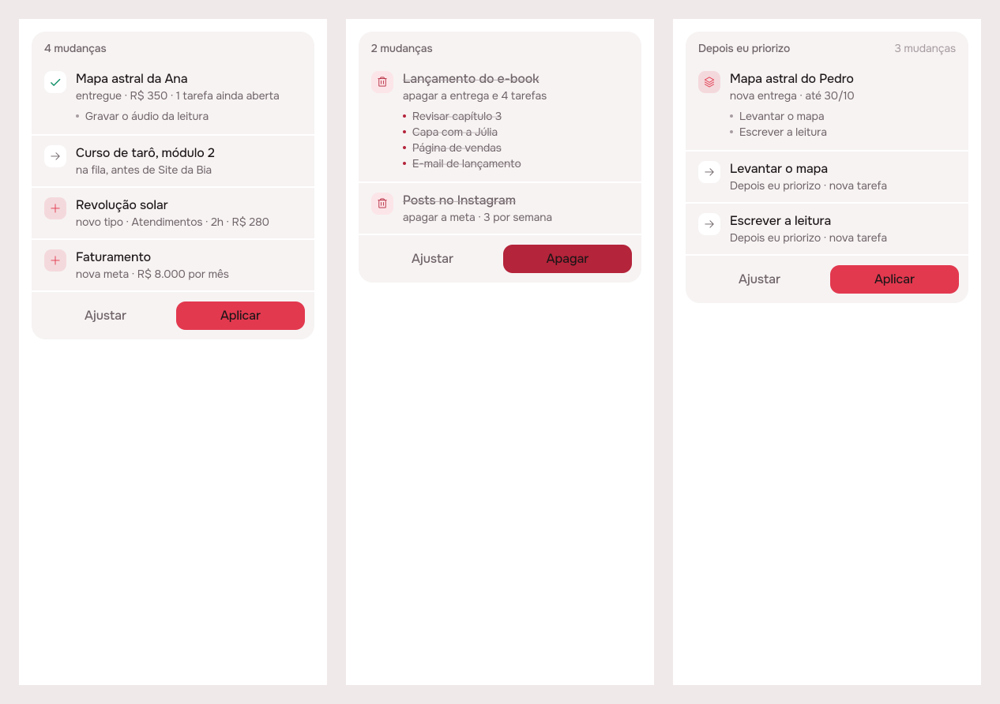
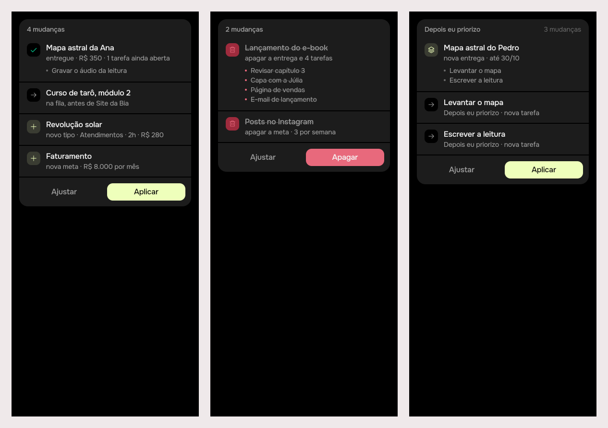

# Lunna can do anything the person can: one registry of controls

2026-10-22 · delivery · **built** · Track: **plan** ·
RFC: [agent-full-surface](../../research/2026-10-21-agent-full-surface/README.md)
(approved in #20, merged in #22) · Issue: #26

## 1. The prompt

> Implement: Lunna can do anything the person can: one registry of controls
>
> Build what the RFC [product/research/2026-10-21-agent-full-surface/README.md](https://github.com/pietroid/lunna/blob/main/product/research/2026-10-21-agent-full-surface/README.md) recommends, approved in #20 and merged in #22.
>
> - Read it as the research (see "From an RFC" in the /create skill): what it recommends, in its priority order, and its Rollout are the spec.
> - A `> **Decision**` note in it is binding; every other decision takes the option marked *(recommended)*.
> - The plan (or the board, if it changes what the person sees) says which rollout phases this PR ships, Phase 0 first.

Build, after approval on the issue (`/create build agent-registry`):

> The design was approved on the issue. Do Phases 3 and 4 unattended.
> .tool/check must pass before you finish; a failure your change didn't
> cause is proved (stash, rerun) and named in the README. In section 5
> write "Measured by the queue: see the pull request." instead of
> .tool/cost tables.

## 2. The plan

**This PR ships the RFC's Phases 0, 1 and 2**: the failing eval cases,
the registry with snapshot undo under today's five gestures, and then
deliveries, catalogue and goals on top of it. Phases 3 (task and block
lifecycle) and 4 (routines, working day, `open`, persisted plans) are
the next PRs, each one domain, as the RFC's rollout says.

Why the plan track: Phases 0 and 1 change nothing anyone sees, and the
one screen Phase 2 touches, the plan card, already draws the artifact
kinds (`PlanChangeKind.addArtifact` and its siblings in
`app/packages/agent/lib/src/models.dart`, drawn by `plan_card.dart`).
There is no layout to approve; Phase 4 of the build shoots the card.

### Approach

1. **Phase 0, the measuring.** In `server/src/agent/evals/cases.ts`, one
   case per Phase 2 verb, each built around the trap in the RFC's
   *Writes, verb by verb* (a delivery twice, delivering with open tasks,
   a task for the wrong delivery, a kind named loosely, a goal amount not
   said, a delete that takes 6 tasks). `World` learns `kind()` and
   `goal()`, `State` learns `artifacts` (title, done, deadline, value, its
   tasks). Plus an **undo check** in `run.ts` for every case with a plan:
   Desfazer must leave the state identical to the setup. They fail on
   `main`; `coverage.mjs` moves into `server/tool/coverage.mjs` with a
   new check that each handler's first call is a service.
2. **Phase 1, the registry, no behaviour change.**
   `server/src/agent/actions/` holds one `Action` per verb (`name`,
   `domain`, `args` as JSON schema, `resolve`, `make`, `line`) in a file
   per domain (`queue.ts` today's five: `place`, `at_hour`,
   `first_free`, `to_backlog`, `swap`) and an `index.ts` registry. The
   `do` enum and `CHANGES` schema (`agent.prompt.ts`), the `_draft`
   switch and `_view` (`agent.service.ts`), `make` (`gestures.ts`) and
   `ChangeKind` (`plan.ts`) are all read from it. **Undo by snapshot**:
   `make` diffs the hands' stores before and after a gesture and writes
   `restore` for each changed row and `revive` for each one gone;
   `TaskStore`, `CalendarStore` and `ArtifactStore` gain `revive(row)`
   (insert with its own id, `ON CONFLICT DO NOTHING`), Pg and Memory.
   **Rules out of controllers**: the delivery check moves from
   `events/tasks.controller.ts` into `EventLayoutService.createTask`; the
   working-day write moves from `users/users.controller.ts` into a new
   `UsersService.setWorkDay`.
3. **Phase 1, the schema shape (decision 6).** The registry builds both
   shapes: `anyOf` with one variant per verb (each with only its own
   arguments) and today's flat item. `AGENT_SCHEMA=flat|variants` picks
   one; `eval:agent` runs both once and keeps `variants` unless it scores
   lower. The default ships as the winner.
4. **Phase 2, deliveries, catalogue and goals.** Board lines for kind,
   time owed, value and the 5 last delivered, and index lines for kinds
   (`k1`) and goals (`g1`) (`board.ts`). `Hands` gains a
   `MemoryArtifactStore` and an `ArtifactsService`. `actions/artifacts.ts`:
   `new_artifact` (with `as` for forward refs), `edit_artifact`,
   `deliver`, `remove_artifact`, `move_artifact`, `new_kind`, `new_goal`,
   `remove_goal`, and `artifact` on `new` for every task gesture.
   `ArtifactsService.create` returns the new id. The plan card gets the
   lines it lacks (`deliver`, kinds, goals) in `PlanChangeKind` and
   `app_pt.arb`.

### References

- [Claude structured outputs, JSON Schema limits](https://platform.claude.com/docs/en/docs/build-with-claude/structured-outputs):
  "`anyOf` and `allOf` (with limitations: `allOf` with `$ref` not
  supported)"; `additionalProperties` must be `false`. So the `variants`
  shape uses `anyOf` (never `oneOf`, not listed) with no `$ref`.
- [OpenRouter, tool calling](https://openrouter.ai/docs/guides/features/tool-calling):
  tools are an OpenAI-compatible JSON spec, "OpenRouter standardizes the
  tool calling interface across models and providers"; it does not
  promise how each provider reads `anyOf`, which is why Phase 1 measures
  both shapes on the real model instead of assuming.
- [Drizzle, `onConflictDoNothing`](https://orm.drizzle.team/docs/insert#on-conflict-do-nothing):
  what `revive` is written with, as routines' days already are.
- The RFC's own sources (SABER, GateArena, RAG-MCP) stand as cited there.

### Decisions

| # | Decision | Chosen | Why |
|---|---|---|---|
| 1 | Phases in this PR | 0, 1 and 2 | 0 alone measures nothing new and 1 alone changes nothing; 2 is the issue's ask (deliveries) and proves the registry carries a new domain |
| 2 | "Now" actions | behind Aplicar (RFC 1a) | recommended; not used until Phase 3 |
| 3 | Notes | the agent may append, shown on the card (RFC 2a) | recommended; lands with Phase 3's `note`, not here |
| 4 | Plans after a restart | persisted in Postgres before deletes ship (RFC 3a) | recommended. `remove_artifact` is a delete and ships here, so **the `plan` table ships here too**, pulled forward from Phase 4: one migration, `PlanStore` over it, same 2-hour TTL |
| 5 | Deletes asked once | a doubt past 3 rows (RFC 4a): "Apagar as 6" / "Só a entrega" | recommended |
| 6 | Order | deliveries before the lifecycle (RFC 5a) | recommended, the issue's ask |
| 7 | Shape of a change | `anyOf` per verb, kept unless the eval scores it lower (RFC 6a) | recommended; `AGENT_SCHEMA` is a switch for the eval, not a product setting |
| 8 | Read tool for kinds and goals | a `read_cards` mode, not a new tool | RFC §3 recommends; the model keeps 4 tools |
| 9 | `shift`, `resize` | left out | RFC §5, decided there |
| 10 | Real-model evals | run per domain, ~US$0.10–0.50 each on OpenRouter | never in CI; named in section 5 with what they cost |

### How it will be proved

- `npm test` in `server/`: unit specs for each action's `resolve`
  refusals, and an end-to-end spec per Phase 2 verb in
  `agent.controller.spec.ts` (frozen clock, memory stores): turn → plan
  → Aplicar → state, then Desfazer → state equal to the setup, including
  the snapped run of a delivery's tasks and a removed delivery's
  backlog tasks coming back with their ids.
- A spec that the registry's `flat` schema is byte-equal to today's
  `CHANGES` before Phase 2 adds verbs (Phase 1's "no behaviour change").
- `node server/tool/coverage.mjs`: from 6 of 39 routes to 6 + the
  Phase 2 routes (target 17 of 39), and no handler whose first call is
  not a service.
- `npm run eval:agent` (real model) on `main`'s cases before and after,
  and on both schema shapes: the pass counts go in section 3.
- `.tool/check` green under both brands; the plan card shot through a
  small `agent_registry_preview.dart` with a delivery plan, both brands.

## 3. What was built

The plan card drawing Entregas' changes, the real `PlanCard` on canned
plans: (1) a delivery delivered with a task left open, one moved in the
queue, a new kind and a new goal; (2) a delete that takes four tasks and a
goal, so the button says Apagar in red; (3) a new delivery with its first
tasks.

**The contract.** Every verb the agent has is one `Action` in
`server/src/agent/actions/`, and its `make` calls the same service method
the button calls. The `do` enum, the changes' schema (both shapes), the
reading of a change, the dry run, Aplicar and the card's line all come
from the registry. Desfazer restores a snapshot of every row the plan could
touch, so no verb needs an inverse of its own.

### Server

- `agent/actions/`: `action.ts` (the `Action` interface, the shared `ARGS`),
  `queue.ts` (`place`, `at_hour`, `first_free`, `to_backlog`, `swap`, moved
  out of `agent.service.ts` and `gestures.ts`), `artifacts.ts`
  (`new_artifact`, `edit_artifact`, `deliver`, `remove_artifact`,
  `move_artifact`, `new_kind`, `new_goal`, `remove_goal`), `index.ts` (the
  registry, `changesSchema(flat|variants)`).
- `gestures.ts`: `make` dispatches through the registry; `snapshot`,
  `undoOf`, `takeBack` are the undo. `TaskStore`, `CalendarStore` and
  `ArtifactStore` gained `revive(row)` (Pg and memory).
- `board.ts`: kinds (`k1`), goals (`g1`), each delivery's kind, time owed
  and value, the last five delivered.
- A delete that takes more than three tasks is a doubt: "Apagar as N" /
  "Só a entrega", each its own plan (`agent.service.ts`).
- Plans in Postgres: `agent_plan` (migration `0011_agent_plan.sql`),
  `PgPlanStore`, the same two-hour life.
- Rules out of controllers: the delivery check on a new task now lives in
  `EventLayoutService.createTask`; the working day is set by
  `UsersService.setWorkDay`.
- `AGENT_SCHEMA` (`variants` by default, or `flat`).
- `server/tool/coverage.mjs`: the agent now reaches **14 of 39** routes a
  person drives (6 before), and every handler hands its work to a
  service.
- No new route.

### App

- `PlanChangeKind` learns `deliver`, `moveArtifact`, `addKind`, `addGoal`,
  `removeGoal`; `PlanChange` reads `value`, `shelf`, `goal`, `takes`,
  `deadline` from the wire.
- `plan_card.dart` draws each one (✓ for delivered, → for moved, + for a
  kind or goal, the bin for a goal deleted); 9 new strings in `app_pt.arb`.

### Tests

- Server: `actions.spec.ts` (4: the flat schema for the queue's verbs
  byte-equal to the prompt's before the registry, every verb named once
  with real arguments, each variant with only its own arguments, a shared
  argument described per verb), `pg-plan.store.spec.ts`
  (4, PGlite), and 10 new end-to-end cases in `agent.controller.spec.ts`
  (frozen clock, memory stores): every Phase 2 verb from turn to plan to
  Aplicar to Desfazer, which must give back the setup, including a removed
  delivery's backlog tasks with their ids. The 31 cases that were there
  pass unchanged.
- App: `history_test.dart` checks every new line of the card.
- Evals: 10 new cases in `evals/cases.ts`, each built around the trap
  the RFC names; every case with a plan is also undone and checked against
  its setup.
- `.tool/check`: all 18 steps green (app analyze, every package's tests
  under Focus and Lunna, server eslint, tsc and tests).
- `npm run eval:agent -- --schema flat,variants --k 2 --budget 0.5`, on
  `google/gemini-3.1-flash-lite`, 39 cases (29 from `main`, 10 new):

  | Shape | pass^2 | pass@1 | leak@1 (raw) | p50 | p95 | calls/turn | tokens in/turn | cost |
  |---|---|---|---|---|---|---|---|---|
  | flat | 37/39 (95%) | 96% | 3% | 3.2 s | 17.0 s | 1.76 | 7242 | $0.187 |
  | variants | 34/39 (87%) | 94% | 0% | 2.6 s | 16.3 s | 1.63 | 10176 | $0.198 |

  `variants` scored lower, so by decision 7 **`flat` ships as the
  default**. Failures: flat `delivery-twice` 2/2 and `goal-amount-unsaid`
  1/2 (neither a plan nor a question); variants `delivery-twice`,
  `delivery-task-for-it`, `kind-named-loosely`, `remove-cascade` and
  `multi-refs` 1/2 each. The new cases were not run on `main`: it has
  no verb for them, so they fail there by construction.

### Where it differs from the plan

- Coverage reaches 14 routes, not the 17 the plan aimed at.
  `POST /artifacts/:id/tasks` is not counted: a delivery's task is written
  through the day's gestures (`new` with `artifact`, `createTask`) instead.
- The eval was run only on this branch, on both shapes, not on `main`
  too: the new cases fail on `main` by construction (it has no verb for
  them), and running `main` needs a second checkout this run must not make.
- The default shape is `flat`, not the `variants` the plan expected:
  `variants` scored lower.
- `delivery-twice` fails on `flat` 2 of 2: the model neither asks nor
  proposes when a delivery with that name already exists. The server
  refuses the duplicate (the spec case passes), but the model doesn't then
  ask. This is left for the next PR.
- The card has no separate line for "and the 6 tasks with it" beyond what
  `remove_artifact` already drew (it lists them, struck).

## 4. How to turn it on

Nothing to turn on: the migration runs on boot and the verbs are live with
the agent (`OPENROUTER_API_KEY`). `AGENT_SCHEMA=variants` switches the changes'
schema to one object per verb, for the evals; unset, it is `flat`.

## 5. Cost and time

Measured by the queue: see the pull request.

Outside Claude: the real-model eval on OpenRouter, US$0.385 (flat $0.187, variants $0.198).

## Decided unattended

- **Track: plan.** Nothing in Phases 0–2 needs a layout decision; the
  plan card already draws artifact changes.
- **Phases 0–2 in one PR**, not 0–1. If you would rather review the
  registry alone first, say so on the issue and the build stops after
  Phase 1.
- **Plans persisted now**, not in Phase 4, because RFC decision 3 says
  "before deletes ship" and `remove_artifact` is a delete.
- **`coverage.mjs` copied to `server/tool/`** so it runs on the code it
  measures; the RFC's copy stays as the evidence it was.
- **The eval budget**: two shapes, k=2, at most US$0.50 each, on the
  model in `server/.env.local`.
