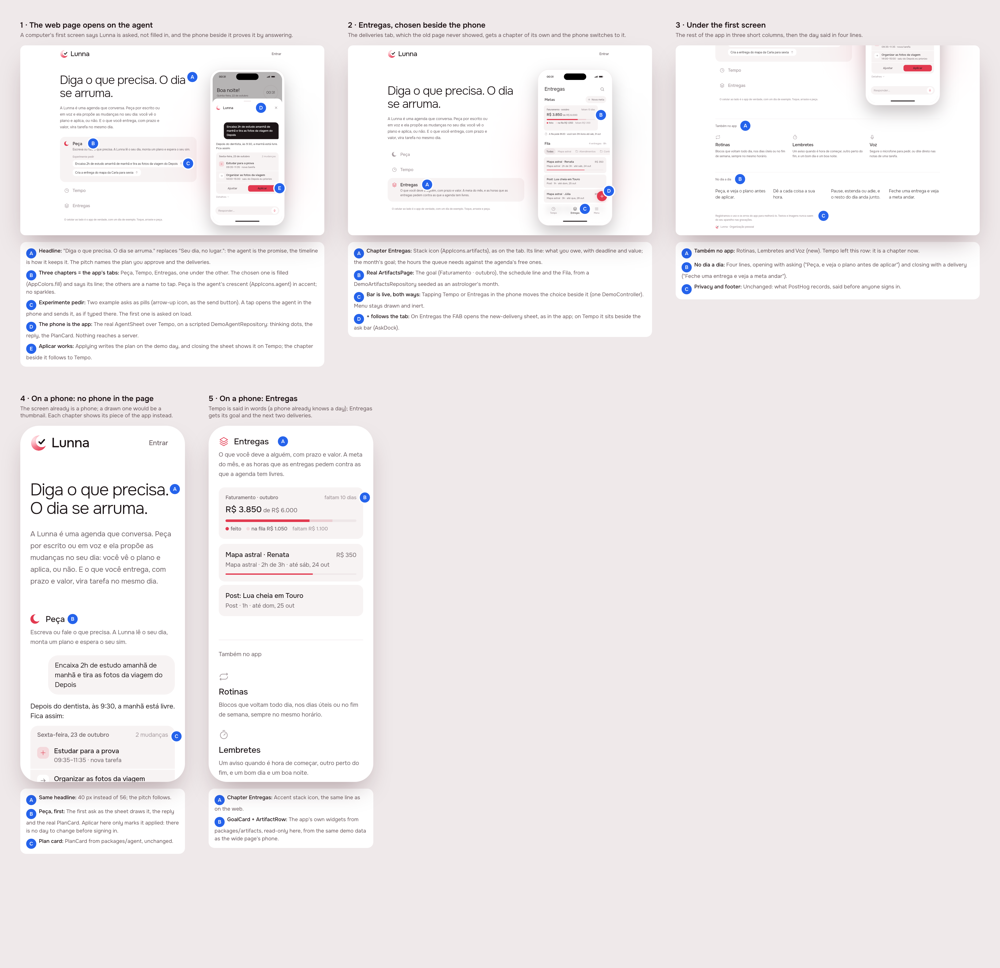
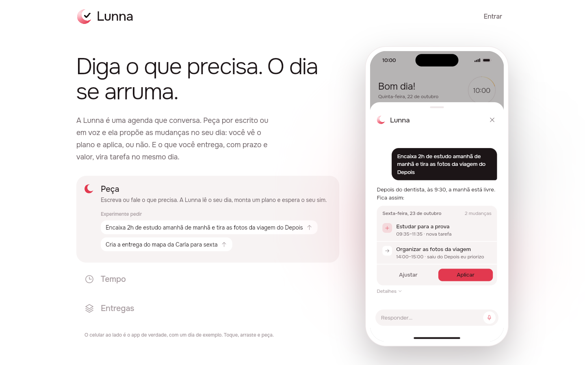
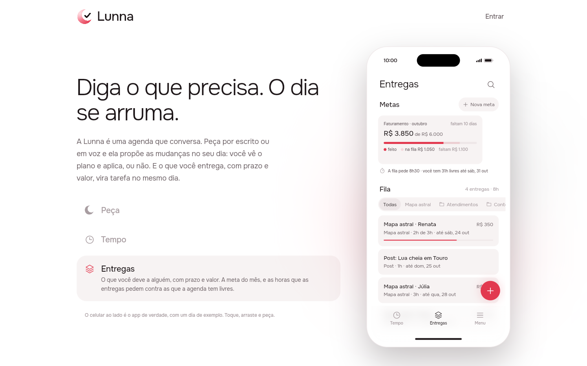
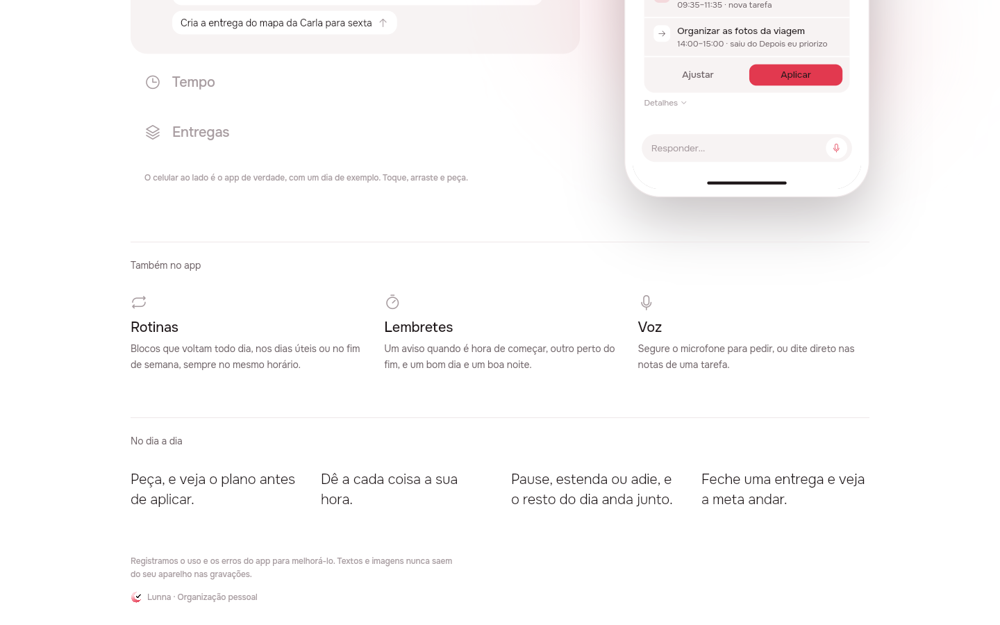
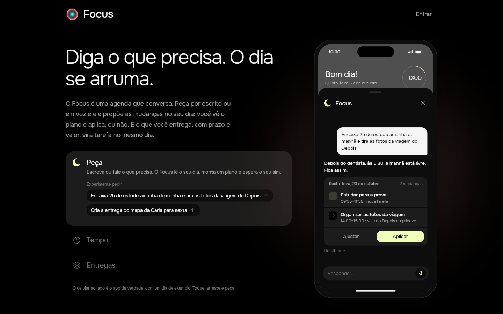
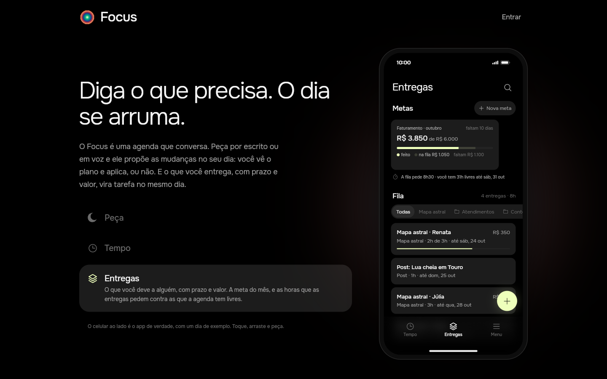
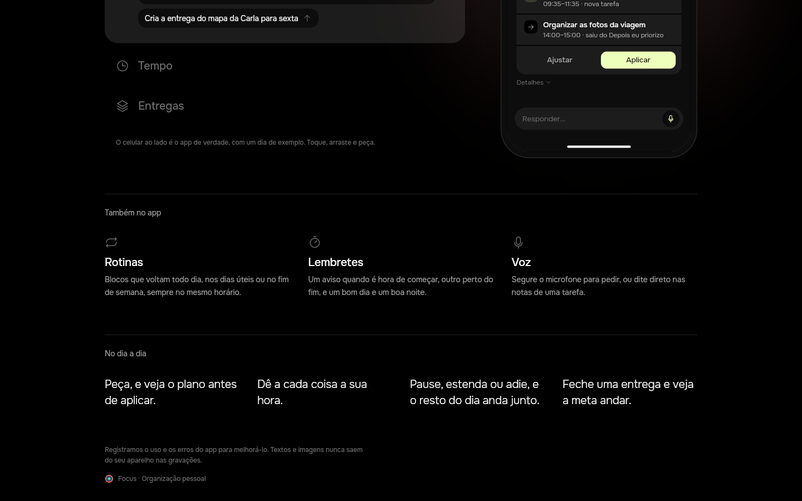
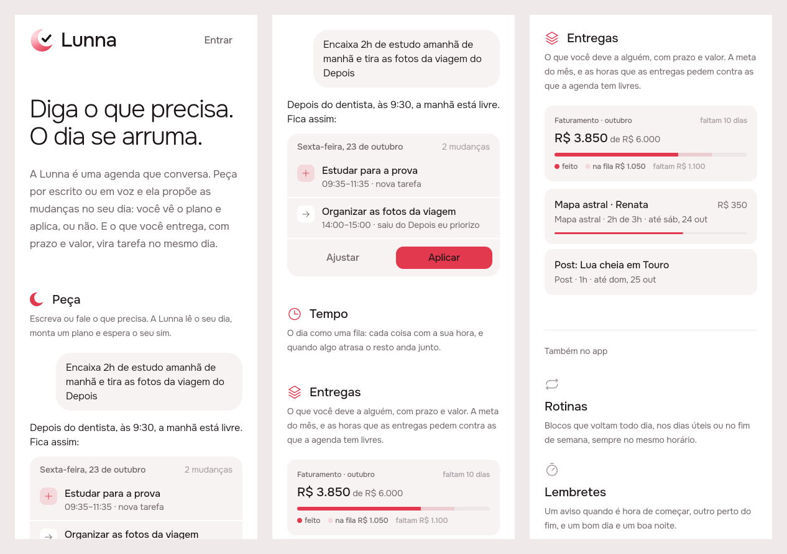
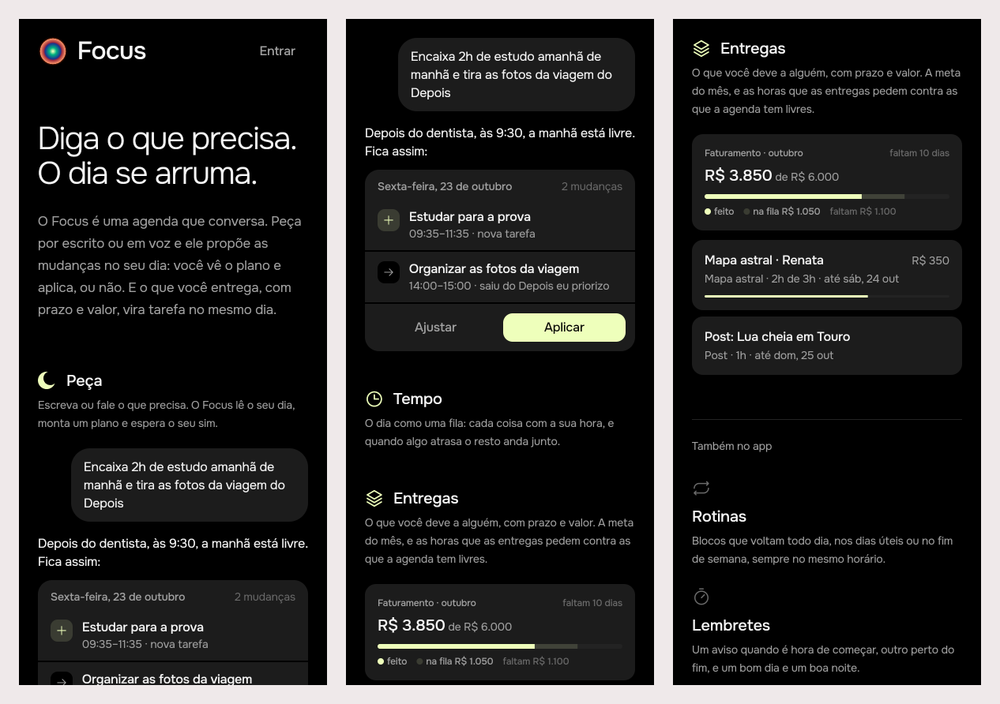

# Landing page: the agent first, and Entregas shown

Status: **built** (issue #24), designed and built unattended on the
mockup track. The design was approved on the issue; the build is sections
3 to 5.

## 1. The prompt

From [issue #24](https://github.com/pietroid/lunna/issues/24):

> Improve landing page
>
> Improve landing page specially for the web to showcase the agentic Lunna, it is just appearing the timeline.
>
> Also highlight the existence of the "deliveries" tab

## 2. The design

Pins in [board.json](board.json). Drawn by the real app (Lunna), the web
page at 1440×900 and the narrow page at 390×844. One screen per image,
for a phone: [1](img/mockup-1.png) · [2](img/mockup-2.png) ·
[3](img/mockup-3.png) · [4](img/mockup-4.png) · [5](img/mockup-5.png).
The web shots at full size: [1](img/shot-1.png) · [2](img/shot-2.png) ·
[3](img/shot-3.png).

### The flow

1. **The web page opens on the agent.** The headline changes from "Seu
   dia, no lugar." to **"Diga o que precisa. O dia se arruma."**, and the
   pitch names what makes Lunna Lunna: you ask, it proposes a plan, you
   apply it or not; what you deliver becomes tasks on the same day. Beside
   the pitch, three **chapters**, which are the app's tabs said in words:
   **Peça** (the agent), **Tempo** and **Entregas**. The phone beside them
   is the app running on demo data, and on load it opens the agent's sheet
   and asks it the first example; the reply and its plan card come in as
   they do in the app.
2. **Entregas** is a chapter of its own. Choosing it switches the phone to
   the Entregas tab: the month's goal, the line of hours owed against free
   hours, the queue. The phone's bottom bar works both ways: a tab tapped
   in the phone moves the choice beside it.
3. **Under the first screen**, the rest of the app in three columns
   (Rotinas, Lembretes, and Voz, new) and the day in four lines, which now
   open with asking and close with a delivery.
4. **On a phone** there is no phone drawn in the page (a phone inside a
   phone is a thumbnail). Each chapter shows its piece instead, drawn by the
   app's widgets: Peça the ask, the reply and the real `PlanCard`;
   Entregas the `GoalCard` and the next two `ArtifactRow`s. Tempo is said in
   words.

### References

Drawn from known patterns; Mobbin was not browsed in this run.

- **Linear and Arc's home pages**: a short list of features beside a live
  product picture, where choosing one changes the picture. Here the picture
  is the app itself, not a video.
- **ChatGPT's and Claude's empty states**: example asks as tappable pills
  under "Experimente pedir", sent as if typed.
- **Notion's mobile landing**: on a narrow screen the product picture is
  replaced by the piece of UI each section is about.

### Decisions (the pins)

| Pin | Decision | Why |
|-----|----------|-----|
| 1A | Headline "Diga o que precisa. O dia se arruma." and a pitch that names the plan and the deliveries | The issue: the page showed only the timeline. The agent is the promise; the timeline is how it keeps it |
| 1B | Three chapters, Peça · Tempo · Entregas, the chosen one filled (`AppColors.fill`) and the only one that says its line | They are the app's tabs, so what the page teaches is what the app looks like. Peça uses the crescent (`AppIcons.agent`) in accent: no sparkles or robots |
| 1C | Two example asks as pills with the send arrow (`AppIcons.arrowUp`), one about the day, one about a delivery | Shows the agent on both halves of the app; a tap asks the phone's agent |
| 1D | The phone opens on the agent's real sheet, answering the first ask | The first thing a visitor sees move is the agent working |
| 1E | Aplicar writes the plan on the demo day; closing the sheet shows Tempo and the chapter follows | The demo is honest: the plan really lands |
| 2A | Entregas chapter, stack icon (`AppIcons.artifacts`, as on the tab) | The issue: highlight the deliveries tab |
| 2B | The real `ArtifactsPage`, on a `DemoArtifactsRepository` seeded as an astrologer's October | Same widgets the app ships, believable numbers (R$ 3.850 of R$ 6.000) |
| 2C | Bottom bar live both ways (one `DemoController`), Menu drawn and inert | The phone and the list never disagree |
| 2D | The + follows the tab: new delivery on Entregas, beside the ask bar (`AskDock`) on Tempo | As in the app |
| 3A | "Também no app": Rotinas, Lembretes, Voz | Tempo moved up into the chapters; voice is new on the page |
| 3B | "No dia a dia" opens with asking, closes with delivering | Same story as the hero, in short |
| 3C | Privacy line and footer unchanged | Says what PostHog records before anyone signs in |
| 4A–C | Narrow page: no phone; Peça shows the ask, reply and `PlanCard`, whose Aplicar only marks it applied | No day exists before signing in |
| 5A–B | Narrow Entregas: `GoalCard` + two `ArtifactRow`s, read-only | The tab's two forces in one glance |

### Decided unattended

- **Mockup track**, since the page is what the visitor sees.
- **Lunna only** in the prints; Focus gets the same page (copy selects on
  `AppBrand.id`), checked in the build's prints.
- **The web page gets wide prints.** `.tool/preview` shoots phones only, so
  the 1440×900 shots and the board with desktop screens were made by a
  copy of its scripts in the scratchpad (`shoot-wide.mjs`,
  `board-wide.mjs`). Folding a `--wide` option into `.tool/preview` and
  `board.mjs` is left for an `/improve` run.
- **Scripted agent, not the real one.** The demo's agent answers from a
  script (`DemoAgentRepository`): any text typed gets the first ask's
  answer. A real model on a page anyone can open would cost money per
  visitor and needs a session.
- **Two example asks**, one per half of the app (the day, a delivery), so
  Peça stays short enough for Tempo and Entregas to be on the first screen
  at 900 px.
- **Tempo's chapter has no piece on the narrow page**: a phone already
  knows what a day looks like, and a third block made the page long.

### Open questions of the design

- The demo read the real clock: a visit at night showed "Boa noite" and
  a day that was over. Should the build pin the demo to a working hour
  (say 10:00 in the visitor's zone)? Recommended: yes. **Not answered on
  the issue, so the build took the recommendation** (see section 3).

## 3. What was built

### The prints

The real build, signed out, at 1440×900 (wide) and on a 390×844 phone
(narrow), both brands. The wide shots were taken at 00:30 or so of the
machine's clock; the phone reads 10:00 because the demo is pinned.

**Lunna, wide:** opens on Peça with the agent answering · Entregas chosen ·
under the hero.

**Focus, wide:**

**Narrow** (top, Peça's plan, Entregas), Lunna then Focus:

### The contract

**The demo is the app on fakes, never reaches a server, and is lived at
ten in the morning.** While `LandingPage` is up, the app's clock
(`package:clock`, which every widget and bloc already reads) reads 10:00
today in the visitor's zone and runs on from there. Signed in, nothing
shifts it. Written down in [product/spec/landing.md](../../spec/landing.md),
with a pointer section in `AGENTS.md`.

### Server

No change. The page is signed out and the demo is local.

### App

| Piece | What changed |
|-------|--------------|
| `lib/demo/demo_clock.dart` (new) | `DemoClock`: `around(clock)` wraps the app's clock, `pin()`/`unpin()` shift it to 10:00 today and back. Pins nest |
| `lib/main.dart` | The app runs inside `withClock(DemoClock.around(clock), …)`. `clock` is now a direct dependency of the app (it was already in the lock file through the packages) |
| `lib/landing/view/landing_page.dart` | Pins the clock in `initState`, lets go in `dispose` |
| `lib/demo/data/demo_repositories.dart` | Tasks keep an **anchor**: written down at an hour, moved with `after`, snoozed. The layout places the running task, then the anchored ones at their hours (or the first room after), then the queue in the room left, as the server's two passes do. `snapshot()`/`restore()` for undo |
| `lib/demo/data/demo_artifacts.dart` | `DemoArtifactsRepository` keeps what it is told: create (at the top or the end, from a kind), rename, deadline, notes, deliver, move, remove. The catalogue and goals are drawn and not changed |
| `lib/demo/data/demo_agent.dart` | `apply` writes the study plan at the hours its card shows (09:35 tomorrow, the photos at 14:00), writes the delivery plan's new delivery in Entregas, and keeps the day it found; `undo` puts it back exactly. An unknown plan is refused (`AgentFailure`) |
| `lib/demo/view/demo_app.dart` | `DemoApp` holds the three repositories so the agent writes on the same day and Entregas the phone draws; Entregas is read again when its tab or chapter comes forward, as the app does |
| `lib/demo/**`, `lib/landing/widgets/chapters.dart` | `clock.now()` everywhere instead of `DateTime.now()` |
| `web/index.html`, `web/manifest.json` | Description: "`<name>`: diga o que precisa, o dia se arruma." (was "seu dia, no lugar.") |

The l10n strings, the page and the chapters are the design's, unchanged.

### Tests

13 new, all passing under both brands (`--dart-define=BRAND=lunna` and the
default Focus), and the new ones under `TZ=UTC`, `America/Sao_Paulo` and
`Asia/Tokyo`. The app's whole suite is 16 tests.

- `test/landing/landing_page_test.dart` (7): wide, the phone opens on the
  agent answering the first ask; at half past midnight the demo still says
  "Bom dia" and the clock reads 10:00; choosing Entregas shows Entregas in
  the phone; a tab tapped in the phone moves the chapter; an ask pill asks
  the phone. Narrow, no phone and the plan, goal and two rows instead;
  Aplicar only marks the plan applied.
- `test/demo/demo_agent_test.dart` (6): the study plan lands at its card's
  hours; undo gives back the same day; the delivery plan writes a delivery
  and undo removes it; undoing an unknown plan is refused; the artifacts
  repository keeps create, move, deliver and remove; `DemoClock` pins,
  nests and lets go.

`.tool/check` passed (`✓ app-analyze`). It runs the tests of
`app/packages/*` only, and this build touched none of them, so it ran no
tests: the root app's tests above were run by hand. No flaky test seen.

### Where the build differs from the design

- **The voice:** the brief asked `DemoVoiceRecognizer` to say it is a
  demo. It answers "unavailable", and the agent's bar then simply doesn't
  offer the microphone; saying more would mean a demo-only string inside
  the agent package. Typing works, so it was left as is.
- **The demo is always at 10:00**, not only at night: the same day for
  every visitor, and prints that don't depend on when they are shot.
- Otherwise as the board: same widgets, same copy.

### Decided unattended (build)

- **Pin the clock, at 10:00, always**: the open question's recommended
  answer, taken because it was not answered on the issue.
- **Through the zone clock, not a `now` passed down.** The timeline, the
  agent and Entregas read `clock.now()` in some thirty places; wrapping the
  app's zone is the one seam that reaches all of them without touching
  the packages. The cost: a global shift that must be let go, which
  `LandingPage.dispose` does and the tests check.
- **Wide prints by a scratchpad copy of `shoot.mjs`** at 1440×900, as in
  the design session. A `--wide` option for `.tool/preview` stays for an
  `/improve` run.

## 4. How to turn it on

Nothing to set. The landing page is what the web app (and a phone that is
not signed in) shows; `flutter run -d chrome --web-port 5173
--dart-define-from-file env/lunna.dev.json` signed out shows it. The web
build's description is stamped by `tool/brand_web.sh` as before.

## 5. Cost and time

Measured by the queue: see the pull request. No spend outside Claude: the
demo's agent is scripted and calls no model.
