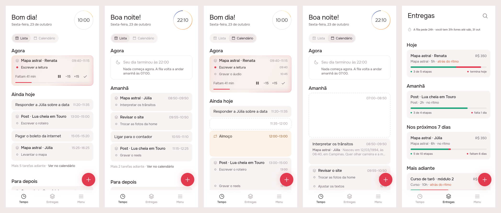
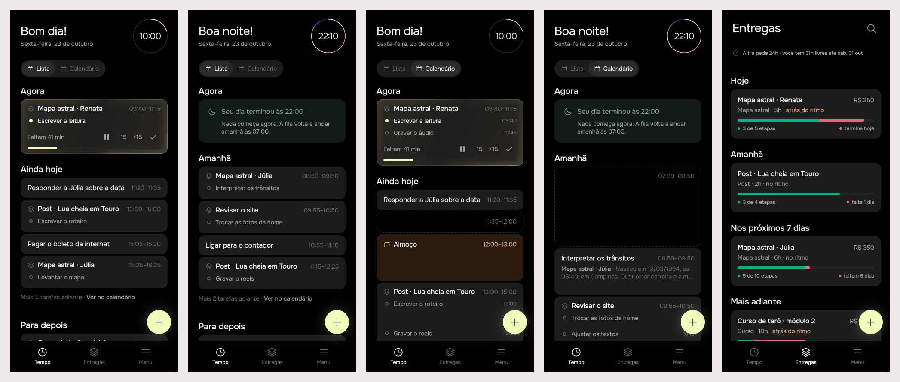

# Delivery first: Lista, Calendário and Entregas around the delivery

2026-10-23 · delivery · **built** · Track: **mockup** · Issue: #34

## 1. The prompt

> **Recreate the logic of list and calendar and deliveries**
>
> modo lista tem um problema as categorias né as entregas que estão aqui de rótulo tão legais culpa muito espaço
>
> a gente podia inverter completamente a lógica né olha o teste aí a entrega ela fica como algo principal né o nome das entrega o título E aí embaixo por exemplo pode ter sob tarefa que eu tô fazendo né E aí a Barrinha pode ser composta com isso né tipo ter tipo múltiplas sobre Barrinhas dentro né dentro da Barrinha né não Três Barras separadas
>
> Acho que até legal porque isso também conversa com aquela ideia né te mostrar a sua de tarefas de álcool então pode ser que por exemplo uma entrega também pode ser um blocão né uma entrega de uma rotina por exemplo que é uma entrega de Olha que legal né Isso daí é interessante tipo a entrega por exemplo de café da manhã né Tem uma lista de coisas para fazer
>
> É acho que essa visão também funciona no calendário bem viu aí fica legal Maravilha e aí é muito bom porque eu agora ele é sobre a tarefa que você tá focando agora e aí você pode estar até inclusive focando em várias tarefas né de novo em várias entregas na verdade tarefa não mas entregas
>
> é o mais legal a gente não precisa estipar na questão da lista sem entrega por exemplo né questão de tarefas você entrega porque às vezes acontece sabe mas a gente tem que reduzir bastante ou fazer em breve eu colocaria por exemplo como é modo lista né aí isso já resolve também outra outro dilema o modo lista tem que ser breve né porque se colocar a lista de tudo que precisa ser feito naquela Então tem que pensar a medida do dia mesmo né E aí ou por exemplo se tiver muito próximo Talvez amanhã depois é uma boa depois de ter finalizado o horário limite é o amanhã que aparece porque não tem nada para fazer hoje perfeito
>
> aí a gente muda do fazer em breve Pode ser ou fazer hoje ou fazer amanhã para deixar claro o que que é breve né para hoje ou para amanhã dependendo das suas regras e aí e aí eu depois para eles coloca para depois entendeu ficar simples
>
> aí no modo calendário né Ah E aí bom aí tem agora né o agora eu acho que pode ficar em cima de tudo tá Aliás ele pode ficar também como uma sessão na lista de agora e aí fica acima de tudo acho uma ótima dá essa separada Olha então ainda por exemplo agora ainda hoje e amanhã olha só que legal ele vai ficar consistente agora ainda hoje é amanhã na lista também tem essas consistência interna desse calendário Maravilha
>
> bom aí a gente tinha pensado sobre por exemplo as entregas né onde é que a gente coloca essa caralhada de entrega Será que tem um terceiro modo por exemplo lista calendário entregas ao invés de ter uma tese de entregas deixa eu ver como é que ficaria isso é interessante porque assim tem um aspecto da time é então pode ser tipo Olha só aí isso é super interessante tem uma moto lista um modo calendário e o modo de ir no modo calendário né mas o modo lista não tá
>
> tire um modo horário de de hora sabe de saber que horas as coisas vão acontecer E aí tem o calendário mesmo que aí é por semana Então por semana a gente consegue ver ali o progresso da coisa mas ele também poderia ser meio tipo assim ver por dia sabe o quanto vai avançar aquela coisa e o quanto vai acabar mas eu acho que isso porque Ah eu percebo assim se eu tiver múltiplas coisas para entregar né múltiplas entregas ali não sei não vai ter uma visualização boa então vamos deixar assim Acho que tá ótimo desse jeito
>
> agora aba de entregas né abra de entregas é interessante porque tem muitas coisas primeiro tirar a questão de meta porque isso atrapalha E aí a gente tem as entregas mesmo as entregas elas viram uma lista também certo e as entregas Elas têm enfim aí tem a Barrinha dinâmica tá ela se parece com agora né De certa forma Então pode então pode até uma visualização de agora ainda hoje e para depois por exemplo Ela não combina não na verdade o agrupamento dela não é bom aqui não nesse aspecto
>
> não tem essa sensação de temporalidade né de quando as entregas vão acabar eu acho que isso pode se acontecer a gente pode colocar por exemplo agora hoje certo ela tem que acabar não é tipo tá fazendo porque está fazendo isso pode estar fazendo várias coisas mas ela tem que acabar hoje para sempre ganha destaque superior né na parte de cima aí ela tem que acabar Sei lá só daqui a 7 dias ela vai e assim que vai ordenar
>
> tá então essa questão da Barrinha a dinâmica é assim tem a barra do aspecto temporalidade completando mais Progresso de quanto já foi para quanto ainda falta e aí tem a outra que é a quantidade de coisa que você já fez né versus o que tem de ainda ser feito E aí elas ficam meio que competindo né tipo porque a gente começa começa assim você não vai gastar todo o seu tempo na tarefa Então se a gente me diz só em questão de horas absolutas não ia dá para comparar E aí a gente assume que você vai sei lá se comprometer nas tarefas de forma uniforme com as outras então a gente tem um componente de proporcionalidade que é comum né
>
> que eu quero dizer com isso imagina aqui um caso muito prático Eu tenho um projeto que termina sei lá amanhã então ele já tá 90% completo mas eu tenho 10 tarefas para fazer eu só fiz uma uma barra vai ficar claramente menor que a outra né Mas agora vamos imaginar um caso um pouco mais normal assim eu tenho sei lá eu já tenho 10 ta E aí essas 10 tarefas elas são enfim dessas das trocas 5 já foram feitas
>
> então dessas 10 era 5 já foram feitas e digamos que tem que entregar Daqui a uma semana e uma semana já passou as Duas Barras vão estar compatíveis e isso é confortável porque se bom se eu passei uma semana entregando metade das coisas a próxima semana entregar a metade das coisas vai ser tranquilo né então eu acho que tem Esse aspecto
>
> Remove the "meta" part now. Not the implementation, just a flag to hide it visually.

The first board was reviewed on the issue, and the person replied:

> Ok, that's great but I have some considerations about the amount of information.
>
> 1. We should prioritize in list mode just the next task appearing as subtitle, not all of them. If there is no task, the amount of hours on the right will already tell great things.
> 2. On calendar mode, if it fits, we could totally show them as timeline, which i found it pretty interesting. If there is no open task, it will show the note as it was showing before.
> 3. the bars on deliveries should be overlapped. I know this can be challenging, but I think colors can help with that. For example, the time color is always red, and the done color is always green. So if green is on top of red, its because we are in a good state. If red is appearing and green is behind, its because it is lagging. Remember, green must be good looking in relation with the rest of palette.

The second board was reviewed on the issue, and the person replied:

> Just one tiny adjustment, the Fila label should not exist anymore, and the hoje amanha, etc have the same hierarchy as they have on the timeline

The third board was approved on the issue:

> approve

## 2. The design

Five screens drawn by the real app (Lunna, the clock fixed at 10:00 on Friday
23 October, 22:10 for screen 2), pins in [board.json](board.json), the shots
without pins in `img/shot-N.png`. Second round, after the reply above: Lista
shows only each delivery's next task, the calendar draws a run's tasks as a
timeline where they fit, and Entregas' two bars are one, green over red.
Third round: Entregas loses its "Fila" heading, and its due days (Hoje,
Amanhã…) are headed as the timeline heads its days. One per screen:
[1](img/mockup-1.png) · [2](img/mockup-2.png) · [3](img/mockup-3.png) ·
[4](img/mockup-4.png) · [5](img/mockup-5.png).

**The idea in one line:** the delivery is the card. Lista keeps only the
day (Agora, Ainda hoje or Amanhã, then Para depois) and under each delivery
only its next task; Calendário draws the same card to scale, with every task
a line at its hour where they fit; Entregas loses the goals, is ordered by
when each delivery ends, and shows one bar per delivery, the work done in
green over the time gone in red.

### References

Drawn from known patterns. Mobbin was not browsed in this run.

- **Things 3, Today / This Evening / Upcoming**: a short list for the day,
  everything later one tap away. Ainda hoje, Amanhã and "Mais 4 tarefas
  adiante" follow it.
- **Linear, project progress**: one bar split by issue state. That's the run
  bar in Agora, one piece per task.
- **Copilot Money / YNAB budget pacing**: spending against the share of the
  month gone, "on pace" in words beside it. That's Feito against Prazo.

### Decisions (the pins)

| Pin | Decision |
|-----|----------|
| 1A | Tasks of one delivery that sit **next to each other** on the day form one card (`DeliveryTile`): the delivery's name in `bodyStrong` with the stack icon (`AppIcons.artifacts`), the run's hours on the right. The `AppTag` under every task goes away. Only adjacent tasks join, so the card never reorders the day. |
| 1B | In Lista, **only the next task** is under the name, as one quiet line: an accent dot while it runs, a ring while it waits, no hour (the run's hours on the right already say how long it is). The other tasks of the run are not drawn. |
| 1C | Agora ends in **one bar made of pieces** (`RunBar`), one piece per task of the run sized by its minutes, 3 px apart: done tasks full, the running one partly filled, the rest empty. So Lista's Agora still shows how far the run has got with one line of text. Pause, ±15 and ✓ act on the running task. |
| 1D | "Fazer em breve" becomes **Ainda hoje** (`sectionToday`, the calendar's own words), and holds only today's hours. |
| 1E | A task with no delivery keeps its own card (`EventTile`), as today. |
| 2A | **Agora** is the first stage of Lista too. Outside the working day it is `DayOverTile`, as on the calendar. |
| 2B | Once the day is over, or nothing in it is left, the stage is **Amanhã**: tomorrow's hours only, each delivery with its next task. |
| 2C | Lista **stops at that day**. Anything queued later is one line: "Mais 4 tarefas adiante · Ver no calendário", which switches to Calendário. |
| 2D | "Depois eu priorizo" becomes **Para depois**. The backlog groups by delivery too; the card's header gives "2 tarefas · 2h30" instead of hours. |
| 3A | Calendário puts the **same Agora card** on top, drawn as a **timeline** (`timeline: true`): every task of the run a line with its hour, done ones struck through, the running one in ink. |
| 3B | A delivery's run is **one block** as tall as the run. When it has room for every task (a line's 28 px each), each line sits at its hour inside the block. |
| 3C | Free stretches, routines and fixed blocks are drawn as they are now. |
| 4A | A routine's day **with a checklist** (Café da manhã: café, meditar, louça) uses the same card in `routineFill` with the repeat mark. This needs items on a routine, which the model lacks: **second phase** (see open questions). |
| 4B | Lines sit **at their hours** in the block, pushed apart to a line's height when two are closer than that (Passar o café 07:00, Meditar 07:25). |
| 4C | A run of **one task** has no list to draw, so the block shows that task and the start of its **notes**, as a calendar card always did (`notesPreview`, as many lines as fit, up to 3). |
| 4D | A run **too short** for all its lines (three 15-minute tasks in 55 minutes) falls back to Lista's look: the name and the next task. Shorter than one line, the name alone. |
| 5A | **Metas hidden** by a flag, `ArtifactsPage(showGoals: false)`, the default: no goal cards and no "Nova meta". The model, the routes and the agent's goal verbs are untouched. The schedule line ("A fila pede 24h · você tem 31h livres") stays. |
| 5B | Entregas is **headed by due day**: Hoje (today or overdue), Amanhã, Nos próximos 7 dias, Mais adiante, Sem prazo, set as the timeline sets its days and stages (`AppTypography.title`, ink, flush with the cards). The **"Fila" heading and its summary ("5 entregas · 26h") are gone**: the due days are the page's only headings. It's sorted by deadline, and the queue's own order breaks ties. Drag to reorder leaves this page. |
| 5C | **One bar, two fills** (`PaceBars`, 6 px). Red (`paceTime`) runs to the share of the time from creation to the end of the deadline day; green (`paceDone`), drawn **over** it, to the share of tasks done (or of minutes, with no tasks). Green covering the red is ahead or on pace; red showing past the green is lagging, by as much as shows. Overdue, the red fills the bar. With no deadline, only green. |
| 5D | Under the bar, **a key** in the same two colours: a green dot and "3 de 5 etapas", a red dot and "termina hoje" / "faltam 6 dias" (`dangerInk` once late). The labels Feito and Prazo go. |
| 5E | The subtitle ends in **"no ritmo"** or **"atrás do ritmo"** (warning ink), so the pace doesn't rest on colour alone. |
| 5F | The person's own example: Júlia, 5 of 10 tasks done with a little over half her time gone. A hair of red shows past the green: on pace. |

No new icon: the stack (`AppIcons.artifacts`) marks a delivery, the repeat
mark a routine.

**Two new colour tokens**, so the bar never branches on the brand:
`AppColors.paceTime`, always red (Lunna's accent `#E2394F`; on Focus, whose
accent is lime, the lifted danger `#E8697C`), and `AppColors.paceDone`,
always green (on Lunna `#1FA37A`, an emerald as light as the red so the two
weigh the same beside the rose neutrals, lighter than `success` `#0E8F68`,
which read as dull next to the red; on Focus `success` `#00B481`).
Entregas on Focus, to check the pair on black: [focus-5](img/focus-5.png).

### Not drawn: a third mode

The issue weighed a third mode (Lista · Calendário · Entregas, or a weekly
view of how each delivery advances) and settled on "vamos deixar assim". No
third mode.

## 3. What was built

The real build, drawn by the real `TimelineList` and `ArtifactsPage` on a
canned day (10:00, and 22:10 for screens 2 and 4): Lista at 10:00, Lista
after the day, Calendário at 10:00, Calendário after the day, Entregas.

### The contract

**The delivery is the card.** Tasks of one delivery that follow each other
are one card (`deliveryRuns`), and only tasks next to each other join, so
the card never reorders the day. Nothing on the server changed: the app
groups by the `artifact.id` that `GET /api/timeline` already sends.

- **Lista** has three stages: **Agora** (the running run, the break, or
  `DayOverTile`), **one day** (Ainda hoje while the working day is open and
  has tasks left, or nothing is queued at all; otherwise Amanhã), ending in
  "Mais N tarefas adiante · Ver no calendário" (which switches mode) and a
  +, then **Para depois**. A delivery's card shows only its next task. To a
  tap and a drag the card is that task, and a drop under it lands after the
  whole run (`_runEnd` in `_measure`).
- **Calendário** draws a run with no room drawn inside it as one block, as
  tall as its blocks one under another, so nothing below moves. Each task
  is a line at its hour when every line fits (else the next task alone), and
  **each line is its task** to a tap, a drag, a nudge and a swap. Agora's run
  draws every line with the running task's controls. A delivery's lone task
  stays the `EventTile` it was (title, delivery, notes).
- **Entregas**: goals hidden (`showGoals: false`), sorted by deadline under
  due-day headings in the timeline's style, one bar with green over red.

### Files

- `app/packages/timeline/lib/src/models/delivery_run.dart` (new):
  `deliveryRuns`, `sameDelivery`.
- `app/packages/timeline/lib/src/widgets/delivery_tile.dart`: per-line keys,
  the carried line or card left hidden, the pressed fill, the controls'
  key, and Começar / Esperar 15 min for a task waiting in Agora.
- `app/packages/timeline/lib/src/view/timeline_list.dart`: Lista's stages
  (`_listRows`, `_agoraRun`, `_listDay`, `_addAgora`, `_runTile`,
  `_AheadRow`) and the calendar's runs (`_runAt`, `_calendarRun`); a lifted
  line is carried at a card's height.
- `app/packages/timeline/lib/src/widgets/event_tile.dart`: `showArtifact`
  and its `AppTag` removed.
- `app/packages/artifacts/`: as the design left it (`pace_bars.dart`, the due
  headings, `showGoals`).
- `app/packages/l10n`: `stageBacklog` is now "Para depois" (the design's
  duplicate `stageLater` is gone), new `stageDayEmpty`, and
  `promptToBacklog` ("Deixar para depois"), `eventInBacklog`,
  `agentChangeFromBacklog`, `artifactDeleteBody` reworded.
- `server/src/agent/` (speech, prompt, board, answer, service, actions,
  evals, specs) and the schema comments: "Depois eu priorizo" → "Para
  depois", so the agent names the stage as the app does.
- `AGENTS.md` ("Tasks and events", "The timeline", "Entregas") and
  `product/spec/artifacts.md` (deadline order, the bar, goals hidden).

### Tests

- `app/packages/timeline/test/delivery_run_test.dart` (new, 12): the
  grouping rule, Lista's card (one line, no tag, tap opens the next task, a
  drop under it lands after the run, Agora's run with its `RunBar`), the
  calendar's block (a line per task, the height of its blocks, a tap on a
  line opens that task, room between keeps two cards), and `DeliveryTile`
  (one line in Lista, every line where they fit, the next one where not, a
  lone task's notes).
- `app/packages/timeline/test/timeline_list_test.dart`: four tests changed
  to the new stages (one day kept under Agora with the rest counted, the
  empty day's text, the + writing after the day kept).
- `app/packages/artifacts/test/pace_test.dart` (new, 12): `dueOf` at overdue,
  today, tomorrow, day 7, day 8 and none; `byDue` ties; `workDone` with and
  without tasks; `isBehind` on both sides of the slack and with no deadline;
  `PaceBars` with no red without a deadline, green over red, and the danger
  ink once late; the page hiding goals and heading by due day in
  `AppTypography.title`.
- `.tool/check` passes, all 18 steps: `flutter analyze`, every touched package's
  tests under Focus and Lunna (timeline, artifacts, agent, app_ui, analytics,
  api_client, notifications), and the server's eslint, tsc and tests. No
  flaky test was seen.
- One test of this change depended on the machine's date, and the rerun on
  24 October caught it: the page's two widget tests counted their due days
  from the real `clock.now()`, so on the 24th a deadline on the 25th was
  Amanhã, not "Nos próximos 7 dias". They now pump the page under
  `withClock(Clock.fixed(now))` at the test's Wednesday, and `.tool/check`
  passes again, all 18 steps.

### Where the build differs from the design

- **Dragging a card carries its next task, not the whole run.** In Lista
  the card is its next task; on the calendar each line is its task.
  Carrying a whole run would be one move per task, which the queue can
  reshuffle between them. A follow-up could add a run move on the server.
- **No done tasks in a run.** The day the app holds has no ticked-off
  tasks, so Agora's lines and `RunBar` cover the open run only (the mockup
  struck through "Levantar o mapa"). The delivery's whole progress is
  Entregas' bar. Giving the card `artifact.done`/`total` is the optional
  server item the brief named.
- **A run's seam is not pulled** on the calendar (its bottom edge isn't the
  last task's alone); a lone task's still is.
- **Lista's Agora is not a drop target** of its own; dropping above the
  running task still starts what's dropped, as before.
- **Ainda hoje is kept when nothing is queued at all**, not Amanhã, so the
  first task written down lands under the day it lands on.
- **A delivery's own Tarefas** (`TimelineList(only:)`) keeps one stage,
  *Fazer em breve*, a card per task: it lists all of one delivery's tasks,
  so neither the day cut nor the grouping applies.
- **Routine checklists** (pin 4A) are not built: second phase, as the
  design said.

## 4. How to turn it on

Nothing to set: no env var, no migration, no server route. The goals come
back with `ArtifactsPage(showGoals: true)`.

## 5. Cost and time

Measured by the queue: see the pull request. No spend outside Claude: no
model was called by the build.

## Decided unattended

- **Mockup track**: the request changes three screens.
- Lista's dated stage is **Ainda hoje** (or **Amanhã** after hours), not "Fazer
  hoje/amanhã": the issue's own conclusion was "agora, ainda hoje e amanhã"
  for both modes.
- Only **adjacent** tasks of a delivery join. Joining across the day would
  hide the order the queue gives.
- Agora's bar covers the run (today's done tasks + the run), not the whole
  delivery. The delivery's whole progress is Entregas' Feito bar.
- Entregas is **ordered by deadline** and loses drag-to-reorder on that
  page. "assim que vai ordenar"; the position stays for ties and for the
  agent.
- The goals' **schedule line stays**; only the goal cards are hidden.
- Behind = Prazo more than **15 points** ahead of Feito (`paceSlack`).
- Routines with a checklist are drawn but left to a **second phase**.
- Second round, from the reply:
  - "If there is no task, the hours tell": read as **no line under the name
    when there is nothing to list**; Lista's one line has no hour of its
    own, since the hours on the right are the run's.
  - "If there is no open task, it shows the note as before": read as **a
    run of one task** (nothing else open in the run to list) showing that
    task and its notes. Every card of a delivery on the day is a task, so a
    card with no open task at all doesn't occur.
  - **Agora on the calendar is a timeline** too (it is not drawn to scale,
    so its lines always fit); in Lista it shows the running task only, and
    keeps the `RunBar` for the rest of the run.
  - A run whose lines don't fit falls back to the **next task**, not to the
    notes, which belong to one task.
  - The overlapped bar is **6 px**, red under green, with a **coloured-dot
    key** under it in place of the Feito/Prazo labels. The red stays red when
    on pace (only its visible length changes), and `warning` no longer colours
    the time; "atrás do ritmo" still says it in words.
  - **Green for Lunna is a new `#1FA37A`**, not `success` (`#0E8F68`), so it
    sits as bright as the red; Focus keeps `success`.

- Third round, from the reply:
  - "The Fila label should not exist anymore": the **heading and its
    summary** ("5 entregas · 26h") both go, since the summary only qualified
    it. The schedule line above ("A fila pede 24h…") stays: it is a goal
    line, not a label, and the reply didn't name it.
  - "Same hierarchy as on the timeline": the due headings take the
    timeline's heading style exactly (`AppTypography.title`, ink for every
    day, no longer quieter after Hoje), flush with the cards as the
    timeline's are.

- Build, after an approval that left the open questions below unanswered:
  each took the option the design assumed (checklists later, one running
  delivery in Agora, no drag on Entregas, the schedule line kept).
  - The backlog is renamed by **changing `stageBacklog`'s value** rather
    than adding a key, and the agent's speech follows ("no Para depois").
  - A delivery's lone task on the calendar stays an `EventTile`, which
    already shows the delivery and the notes (pin 4C), and keeps its nudge
    and seam.
  - The card's drag carries its next task; the run move is left out (see
    "Where the build differs").

## Open questions

1. **Routine checklists** (Café da manhã with items): build them now
   (items on `routine`, written into each day) or later? The mockup assumes
   later.
2. **Several deliveries in Agora** ("focando em várias entregas"): only one
   task runs at a time today. Should Agora also show other deliveries
   started today but not running, or is one running delivery enough?
3. Entregas' **drag to reorder** goes away with the deadline order. Is that
   right, or should a drag within a heading still set priority?
