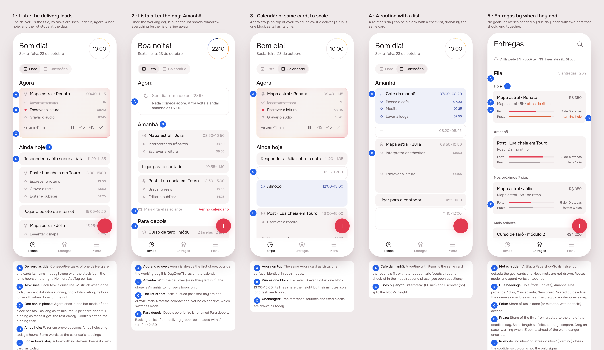

# Delivery first: Lista, Calendário and Entregas around the delivery

2026-10-23 · delivery · **design, awaiting approval** · Track: **mockup** · Issue: #34

## 1. The prompt

> **Recreate the logic of list and calendar and deliveries**
>
> modo lista tem um problema as categorias né as entregas que estão aqui de rótulo tão legais culpa muito espaço
>
> a gente podia inverter completamente a lógica né olha o teste aí a entrega ela fica como algo principal né o nome das entrega o título E aí embaixo por exemplo pode ter sob tarefa que eu tô fazendo né E aí a Barrinha pode ser composta com isso né tipo ter tipo múltiplas sobre Barrinhas dentro né dentro da Barrinha né não Três Barras separadas
>
> Acho que até legal porque isso também conversa com aquela ideia né te mostrar a sua de tarefas de álcool então pode ser que por exemplo uma entrega também pode ser um blocão né uma entrega de uma rotina por exemplo que é uma entrega de Olha que legal né Isso daí é interessante tipo a entrega por exemplo de café da manhã né Tem uma lista de coisas para fazer
>
> É acho que essa visão também funciona no calendário bem viu aí fica legal Maravilha e aí é muito bom porque eu agora ele é sobre a tarefa que você tá focando agora e aí você pode estar até inclusive focando em várias tarefas né de novo em várias entregas na verdade tarefa não mas entregas
>
> é o mais legal a gente não precisa estipar na questão da lista sem entrega por exemplo né questão de tarefas você entrega porque às vezes acontece sabe mas a gente tem que reduzir bastante ou fazer em breve eu colocaria por exemplo como é modo lista né aí isso já resolve também outra outro dilema o modo lista tem que ser breve né porque se colocar a lista de tudo que precisa ser feito naquela Então tem que pensar a medida do dia mesmo né E aí ou por exemplo se tiver muito próximo Talvez amanhã depois é uma boa depois de ter finalizado o horário limite é o amanhã que aparece porque não tem nada para fazer hoje perfeito
>
> aí a gente muda do fazer em breve Pode ser ou fazer hoje ou fazer amanhã para deixar claro o que que é breve né para hoje ou para amanhã dependendo das suas regras e aí e aí eu depois para eles coloca para depois entendeu ficar simples
>
> aí no modo calendário né Ah E aí bom aí tem agora né o agora eu acho que pode ficar em cima de tudo tá Aliás ele pode ficar também como uma sessão na lista de agora e aí fica acima de tudo acho uma ótima dá essa separada Olha então ainda por exemplo agora ainda hoje e amanhã olha só que legal ele vai ficar consistente agora ainda hoje é amanhã na lista também tem essas consistência interna desse calendário Maravilha
>
> bom aí a gente tinha pensado sobre por exemplo as entregas né onde é que a gente coloca essa caralhada de entrega Será que tem um terceiro modo por exemplo lista calendário entregas ao invés de ter uma tese de entregas deixa eu ver como é que ficaria isso é interessante porque assim tem um aspecto da time é então pode ser tipo Olha só aí isso é super interessante tem uma moto lista um modo calendário e o modo de ir no modo calendário né mas o modo lista não tá
>
> tire um modo horário de de hora sabe de saber que horas as coisas vão acontecer E aí tem o calendário mesmo que aí é por semana Então por semana a gente consegue ver ali o progresso da coisa mas ele também poderia ser meio tipo assim ver por dia sabe o quanto vai avançar aquela coisa e o quanto vai acabar mas eu acho que isso porque Ah eu percebo assim se eu tiver múltiplas coisas para entregar né múltiplas entregas ali não sei não vai ter uma visualização boa então vamos deixar assim Acho que tá ótimo desse jeito
>
> agora aba de entregas né abra de entregas é interessante porque tem muitas coisas primeiro tirar a questão de meta porque isso atrapalha E aí a gente tem as entregas mesmo as entregas elas viram uma lista também certo e as entregas Elas têm enfim aí tem a Barrinha dinâmica tá ela se parece com agora né De certa forma Então pode então pode até uma visualização de agora ainda hoje e para depois por exemplo Ela não combina não na verdade o agrupamento dela não é bom aqui não nesse aspecto
>
> não tem essa sensação de temporalidade né de quando as entregas vão acabar eu acho que isso pode se acontecer a gente pode colocar por exemplo agora hoje certo ela tem que acabar não é tipo tá fazendo porque está fazendo isso pode estar fazendo várias coisas mas ela tem que acabar hoje para sempre ganha destaque superior né na parte de cima aí ela tem que acabar Sei lá só daqui a 7 dias ela vai e assim que vai ordenar
>
> tá então essa questão da Barrinha a dinâmica é assim tem a barra do aspecto temporalidade completando mais Progresso de quanto já foi para quanto ainda falta e aí tem a outra que é a quantidade de coisa que você já fez né versus o que tem de ainda ser feito E aí elas ficam meio que competindo né tipo porque a gente começa começa assim você não vai gastar todo o seu tempo na tarefa Então se a gente me diz só em questão de horas absolutas não ia dá para comparar E aí a gente assume que você vai sei lá se comprometer nas tarefas de forma uniforme com as outras então a gente tem um componente de proporcionalidade que é comum né
>
> que eu quero dizer com isso imagina aqui um caso muito prático Eu tenho um projeto que termina sei lá amanhã então ele já tá 90% completo mas eu tenho 10 tarefas para fazer eu só fiz uma uma barra vai ficar claramente menor que a outra né Mas agora vamos imaginar um caso um pouco mais normal assim eu tenho sei lá eu já tenho 10 ta E aí essas 10 tarefas elas são enfim dessas das trocas 5 já foram feitas
>
> então dessas 10 era 5 já foram feitas e digamos que tem que entregar Daqui a uma semana e uma semana já passou as Duas Barras vão estar compatíveis e isso é confortável porque se bom se eu passei uma semana entregando metade das coisas a próxima semana entregar a metade das coisas vai ser tranquilo né então eu acho que tem Esse aspecto
>
> Remove the "meta" part now. Not the implementation, just a flag to hide it visually.

## 2. The design

Five screens drawn by the real app (Lunna, the clock fixed at 10:00 on Friday
23 October, 22:10 for screen 2), pins in [board.json](board.json). One per screen:
[1](img/mockup-1.png) · [2](img/mockup-2.png) · [3](img/mockup-3.png) ·
[4](img/mockup-4.png) · [5](img/mockup-5.png).

**The idea in one line:** the delivery is the card and its tasks are lines
in it. Lista keeps only the day (Agora, Ainda hoje or Amanhã, then Para depois);
Calendário draws the same card to scale; Entregas loses the goals, is
ordered by when each delivery ends, and shows two bars, work done and time
gone, that should end together.

### References

Drawn from known patterns. Mobbin was not browsed in this run.

- **Things 3, Today / This Evening / Upcoming**: a short list for the day,
  everything later one tap away. Ainda hoje, Amanhã and "Mais 4 tarefas
  adiante" follow it.
- **Linear, project progress**: one bar split by issue state. That's the run
  bar in Agora, one piece per task.
- **Copilot Money / YNAB budget pacing**: spending against the share of the
  month gone, "on pace" in words beside it. That's Feito against Prazo.

### Decisions (the pins)

| Pin | Decision |
|-----|----------|
| 1A | Tasks of one delivery that sit **next to each other** on the day form one card (`DeliveryTile`): the delivery's name in `bodyStrong` with the stack icon (`AppIcons.artifacts`), the run's hours on the right. The `AppTag` under every task goes away. Only adjacent tasks join, so the card never reorders the day. |
| 1B | Each task is one quiet line: ✓ struck through when done today, an accent dot while it runs, a ring while it waits, and its hour (or its length once done) on the right. |
| 1C | Agora ends in **one bar made of pieces** (`RunBar`), one piece per task sized by its minutes, 3 px apart: done tasks full, the running one partly filled, the rest empty. Pause, ±15 and ✓ act on the running task. |
| 1D | "Fazer em breve" becomes **Ainda hoje** (`sectionToday`, the calendar's own words), and holds only today's hours. |
| 1E | A task with no delivery keeps its own card (`EventTile`), as today. |
| 2A | **Agora** is the first stage of Lista too. Outside the working day it is `DayOverTile`, as on the calendar. |
| 2B | Once the day is over, or nothing in it is left, the stage is **Amanhã**: tomorrow's hours only. |
| 2C | Lista **stops at that day**. Anything queued later is one line: "Mais 4 tarefas adiante · Ver no calendário", which switches to Calendário. |
| 2D | "Depois eu priorizo" becomes **Para depois**. The backlog groups by delivery too; the card's header gives "2 tarefas · 2h30" instead of hours. |
| 3A | Calendário puts the **same Agora card** on top. |
| 3B | A delivery's run is **one block** as tall as the run; its lines share the height by their minutes. |
| 3C | Free stretches, routines and fixed blocks are drawn as they are now. |
| 4A | A routine's day **with a checklist** (Café da manhã: café, meditar, louça) uses the same card in `routineFill` with the repeat mark. This needs items on a routine, which the model lacks: **second phase** (see open questions). |
| 4B | Lines are spaced by their lengths inside the block. |
| 5A | **Metas hidden** by a flag, `ArtifactsPage(showGoals: false)`, the default: no goal cards and no "Nova meta". The model, the routes and the agent's goal verbs are untouched. The schedule line ("A fila pede 24h · você tem 31h livres") stays. |
| 5B | Entregas is **headed by due day**: Hoje (today or overdue), Amanhã, Nos próximos 7 dias, Mais adiante, Sem prazo. It's sorted by deadline, and the queue's own order breaks ties. Drag to reorder leaves this page. |
| 5C | **Feito**: share of the delivery's tasks done (or of its minutes, when it has no tasks), in accent. |
| 5D | **Prazo**: share of the time from creation to the end of the deadline day. It is the same length as Feito, so the two compare directly. Grey when on pace, `warning` when it runs more than 15 points ahead of the work (`paceSlack`), `dangerInk` once overdue. With no deadline, only Feito is drawn. |
| 5E | The subtitle ends in **"no ritmo"** or **"atrás do ritmo"** (warning ink), so the pace doesn't rest on colour alone. |
| 5F | The person's own example: Júlia, 5 of 10 tasks done with about half her time gone. The bars end together: on pace. |

No new icon: the stack (`AppIcons.artifacts`) marks a delivery, the repeat
mark a routine.

### Not drawn: a third mode

The issue weighed a third mode (Lista · Calendário · Entregas, or a weekly
view of how each delivery advances) and settled on "vamos deixar assim". No
third mode.

## Build brief

Phase 3 starts here; Phase 4 removes this section.

### Files written in the design session (uncommitted, kept for the build)

- `app/lib/delivery_first_preview.dart`: the preview entry point, five scenes
  (`?s=1..5`) on hand-built cards. **Delete it after Phase 4's prints.**
- `app/packages/timeline/lib/src/widgets/delivery_tile.dart` (new, exported
  from `widgets.dart`): `DeliveryTile` (Lista and, with `height`, Calendário;
  `routine:` for a routine's list) and `RunBar`.
- `app/packages/artifacts/lib/src/view/pace_bars.dart` (new, exported):
  `PaceBars`, `workDone`, `isBehind`, `paceSlack`.
- `app/packages/artifacts/lib/src/view/artifact_row.dart`: the subtitle
  (kind · time · pace word) and `PaceBars` replace the steps/deadline text
  and the single bar.
- `app/packages/artifacts/lib/src/view/artifacts_page.dart`: `showGoals`
  (default false) wraps the goals block; the queue is drawn under due
  headings (`Due`, `dueOf`, `byDue`, `dueGroups`, `dueLabel`) instead of the
  `SliverReorderableList`.
- `app/packages/l10n/lib/arb/app_pt.arb` (+ gen): `stageLater`, `stageAhead`,
  `stageAheadOpen`, `deliveryTasks`, `artifactsDue*`, `artifactPaceDone`,
  `artifactPaceTime`, `artifactPaceOn`, `artifactPaceBehind`.

### What the build must do

**App (timeline):**
1. `TimelineList`, Lista mode: three stages, **Agora** (the running task or
   its run, `DayOverTile` outside the day, the break otherwise), **Ainda hoje**
   or **Amanhã** (the first working day with hours left; `inList` cut at
   that day's end), **Para depois** (the backlog). A quiet "Mais N tarefas
   adiante · Ver no calendário" line ends the dated stage. Each stage keeps
   its +.
2. Group adjacent tasks with the same `artifactId` into `DeliveryTile`, in
   Lista and Calendário, Agora included. Done-today tasks of the running
   delivery come from what the bloc already holds (or a `doneToday` field
   per artifact; see the server item).
3. Gestures on a grouped card: dragging the **card** carries the whole
   run (one move per task, or a new run move). Dragging a **line** carries
   that task alone. On the calendar a nudge or resize on a run is the
   existing snapped-run behaviour. The tap on a line opens that task's
   `EventPage`; a tap on the header opens the delivery. Keep `index`
   counting tasks, not cards.
4. Rename "Fazer em breve" → Ainda hoje/Amanhã and "Depois eu priorizo" →
   Para depois everywhere they're read (`stageSoon`, `stageBacklog`,
   `promptToBacklog`, `eventInBacklog`, `agentChangeFromBacklog`,
   `artifactDeleteBody`, and the agent's speech on the server, which names
   the stage).
5. `EventTile.showArtifact` and its `AppTag` go once grouping lands.

**App (artifacts):** keep what is written, add tests: `byDue`/`dueOf`
edges (overdue, today, day 7, day 8, none), `workDone` with and without
tasks, `isBehind` at the slack edge, `showGoals` hiding the goal section.
The `move` route stays (the agent uses it); only the page's drag goes.

**Server:** nothing is required for 1–5 if the app groups by `artifactId`
from `GET /api/timeline`. Optional: `ArtifactTask` already has `place`; give
the timeline card `artifact.done`/`artifact.total` if the Agora bar should
show the delivery's tasks from other days (the mockup shows today's only).

**Specs/docs:** AGENTS.md's "The timeline" (Lista's stages, the grouping),
`product/spec/artifacts.md` (order by deadline, the two bars, goals
hidden).

### Decided unattended

- **Mockup track**: the request changes three screens.
- Lista's dated stage is **Ainda hoje** (or **Amanhã** after hours), not "Fazer
  hoje/amanhã": the issue's own conclusion was "agora, ainda hoje e amanhã"
  for both modes.
- Only **adjacent** tasks of a delivery join. Joining across the day would
  hide the order the queue gives.
- Agora's bar covers the run (today's done tasks + the run), not the whole
  delivery. The delivery's whole progress is Entregas' Feito bar.
- Entregas is **ordered by deadline** and loses drag-to-reorder on that
  page. "assim que vai ordenar"; the position stays for ties and for the
  agent.
- The goals' **schedule line stays**; only the goal cards are hidden.
- Behind = Prazo more than **15 points** ahead of Feito (`paceSlack`).
- Routines with a checklist are drawn but left to a **second phase**.

### Open questions

1. **Routine checklists** (Café da manhã with items): build them now
   (items on `routine`, written into each day) or later? The mockup assumes
   later.
2. **Several deliveries in Agora** ("focando em várias entregas"): only one
   task runs at a time today. Should Agora also show other deliveries
   started today but not running, or is one running delivery enough?
3. Entregas' **drag to reorder** goes away with the deadline order. Is that
   right, or should a drag within a heading still set priority?

### Cost (design session)

The queue measures this run and writes the figures in the PR.
