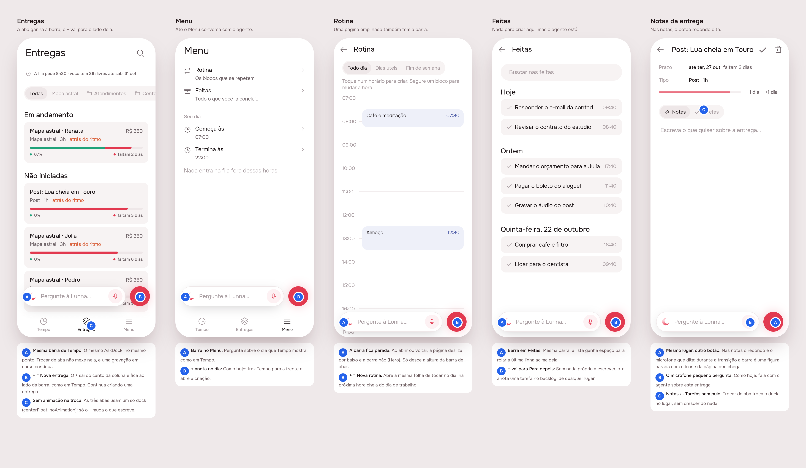

# The agent everywhere: one bar, in the same place, on every screen

2026-10-24 · agent · **draft (design)** · Track: **mockup** · Issue: #42

## 1. The prompt

> **Add assistant box to all places of the app.**
>
> I realized the assistant box does not exist in the menu nor the deliveries tab. Also when transitioning between tabs or screens the assistant textbox animates in a weird behavior.
>
> This stems from a fundamental issue: the assistant should be present in every context of the app. Fix this and check if it doesnt break anything.

## 2. The design

Pins and screens: [`img/board.json`](img/board.json), one print per screen
in `img/mockup-1.png` … `mockup-5.png`. Drawn by the real app (Lunna) on
the demo fakes.

### Why it animated oddly

The bar was drawn three different ways, so every change of screen was a
change of widget, place or animator:

| Where | Before | What it did on a change |
|-------|--------|-------------------------|
| Tempo | the shell's FAB slot, `AskDock`, `centerFloat` | Entregas and Menu swapped it for a lone + at the column's end: the bar vanished |
| Entregas, Menu | a lone `AppFab` at `AppFab.location` | no bar at all |
| A delivery, Tarefas | the page's FAB slot, **default animator** | the FAB is null on Notas, so switching to Tarefas *scaled the bar up out of nothing* |
| A delivery's / a task's notes | inside the body (`Stack`), `NotesDock` | pushed with the page: on a push the old bar slid off with Tempo while the new one slid in with the page |
| Rotina, Feitas, Todas as entregas | nothing | — |

### The rule

**Every screen has the agent's bar at its foot, in the same place, and one
round button beside it that writes what that screen is about.** One
`AskDock` per route, floated at `AskDock.location` (centred) with
`AskDock.animator` (no animation). Between tabs the dock is one widget, so
it doesn't move; only the + changes what it writes. Between pages it is a
`Hero` (`DockHero`), so the page slides in under it and the bar stays still
(it glides the bottom bar's height between a tab and a page). Only a sheet
covers it.

| Screen | The round button | The bar is about |
|--------|------------------|------------------|
| Tempo | + writes on the day in sight (as today) | the day in sight |
| Entregas | + Nova entrega (now beside the bar) | — (the agent already makes and moves deliveries) |
| Menu | + writes on Tempo's day, bringing Tempo forward (as today) | the day |
| Rotina | + **Nova rotina**, at the next whole hour of the working day | — |
| Feitas | + writes a task into Para depois | — |
| Todas as entregas | + Nova entrega | — |
| A delivery, Tarefas | + writes one of its tasks (as today) | the delivery |
| A delivery's / a task's notes | microphone that dictates (as today) | the delivery / the task |

### Decisions

| Pin | Decision | Why |
|-----|----------|-----|
| 1A, 2A | One `AskDock` for the three tabs | the bar never leaves, so there is nothing to animate |
| 1B | The +'s place on Entregas and Menu moves from the column's end to beside the bar | the same spot on every screen is the point; the + is still the one accent at the foot |
| 1C | `centerFloat` + `noAnimation` everywhere, as `AskDock.location` / `AskDock.animator` | one constant per decision; no screen can pick the default scale-in again |
| 1A | A recording keeps going when the tab changes (the shell used to cancel it on leaving Tempo) | the bar it was started on is still there |
| 3A | `DockHero`: the dock is a hero with one tag, `transitionOnUserGestures` on | a push or a swipe back holds it still instead of sliding two bars |
| 3A, 5A | During the flight the dock is a **picture** (the bar and the arriving page's round button, no pointer) | a second live dock in the overlay would record, or read providers the overlay doesn't have |
| 3B | Rotina's + opens the same sheet as tapping the day, at the next whole hour inside the working day (else its start) | it adds no new gesture, only a way in |
| 4B | Feitas has nothing of its own to write: its + puts a task into Para depois | the button keeps its shape and place; the backlog needs no hour |
| 4A | Pages that scroll under the dock get `kNotesDockClearance` at the end | the last row can be scrolled clear of it |
| 5C | Notas ↔ Tarefas swaps the dock in place | the scale-in was one of the "weird" animations |
| — | No subject (`about`) for Entregas, Menu, Rotina, Feitas | the server's subjects are a task or a delivery; a list page adds no fact the agent can't read. No server change |
| — | Icons unchanged: the crescent (`AppIcons.agent`), `plus`, `microphone` | nothing new to draw |

### References

Drawn from known patterns (Mobbin not browsed): **Spotify's / Apple
Music's mini player**, which stays put above the tab bar while pages push
under it; **ChatGPT's composer**, always at the foot; **Arc's command bar**,
the same entry from every context.

## Build brief

### Files written in the design session (uncommitted, kept for the build)

- `app/lib/agent-everywhere_preview.dart`: the preview entry point
  (`?s=1` Entregas, `2` Menu, `3` Rotina, `4` Feitas, `5` a delivery's
  notes). Delete it after Phase 4's prints.
- `app/packages/agent/lib/src/view/ask_bar.dart`: `AskDock.location`,
  `AskDock.animator`, `AskDock.hero`, and `DockHero` (the hero, its still
  shuttle).
- `app/packages/agent/lib/src/view/notes_dock.dart`: the notes dock is its
  page's `DockHero` (microphone), its inner `AskDock` is not.
- `app/lib/shell/view/shell_page.dart`: one `AskDock` on the three tabs; no
  longer cancels the recording on leaving Tempo.
- `app/lib/demo/view/demo_app.dart`: the landing's phone does the same.
- `app/packages/artifacts/lib/src/view/artifact_page.dart`:
  `AskDock.location` / `AskDock.animator`.
- `app/packages/artifacts/lib/src/view/all_artifacts_page.dart`: the dock,
  + Nova entrega, clearance.
- `app/lib/routines/view/routines_page.dart`: the dock, + Nova rotina
  (`_nextHour`).
- `app/packages/timeline/lib/src/view/done_archive.dart`: `dock:` handed
  in (the timeline package knows no agent), clearance;
  `app/lib/app/view/app.dart` hands it an `AskDock` whose + writes into
  Para depois.
- `app_pt.arb`: `routinesNew` ("Nova rotina"), l10n regenerated.

- `app/packages/artifacts/test/artifacts_page_test.dart`: its harness
  provides a `VoiceCubit` (Todas as entregas now draws the dock, which
  reads the app's microphone; the app provides it globally).

`flutter analyze` is clean on all of it. Tests pass: the app's own 20
(including the landing demo), agent 68, timeline 156, artifacts 37 (Focus
and Lunna).

### What the build must still do (app only; nothing on the server)

1. **Line the notes' dock up with the FAB slot.** On the delivery page the
   Notas dock is in the body and Tarefas' in the FAB slot; check both sit at
   the same height with and without a bottom safe area (or lift the notes
   dock into the slot, keeping it above the keyboard). Same on `EventPage`.
2. **Clearance** on Entregas (the last card runs under the bar in print 1),
   Menu and Rotina's grid: `kNotesDockClearance` at the scroll's end.
3. **The hero across real routes**: go_router pages (`/rotina`, `/feitas`,
   `/evento/:id`) and `MaterialPageRoute`s (a delivery, Todas as
   entregas, a finished task). Check a push, a pop, the iOS swipe back, and
   that two docks never share a route (`IndexedStack` keeps one FAB slot).
   Check the dock doesn't fly into a sheet (sheets are `PopupRoute`s, which
   heroes ignore).
4. **Voice**: a recording started on one tab and sent from another sends
   with that tab's `day`; dictation on a notes page still stops when the
   agent's microphone starts. Update the shell's doc comment and
   `AskDock`'s about the cancel that is gone.
5. **Tests**: a widget test that each tab and each page has one `AskDock`
   (or `NotesDock`) at `AskDock.location`; that the shell keeps the same
   `AskDock` element across tab changes; `DockHero`'s shuttle draws the
   arriving icon and takes no taps.
6. Both brands: prints in Focus too (the design board is Lunna only).
7. `AGENTS.md` ("The app shell") and `product/spec/agent.md`: the bar is on
   every screen, same place, the + per screen as in the table above.

### Decided unattended

- Track: **mockup** (the issue is about what is seen and how it moves).
- The +'s place on Entregas and Menu moves beside the bar (it used to sit
  alone at the column's end).
- Feitas' + writes into Para depois; Rotina's + is Nova rotina at the next
  whole hour.
- A recording survives a tab change.
- No new agent subject (no server change) for the list pages.

### Open questions

- Should Entregas' bar be *about* the deliveries (a new `AgentSubject`,
  a server change), so "qual atrasa mais?" reads the list in front? Left
  out; the agent already reads them.
- Feitas: is a + that writes into Para depois wanted, or should Feitas
  have the bar alone (full width, no round button)? The bar alone breaks
  "same shape everywhere"; the + was kept.

### Cost of the design session

Measured by the queue, which writes the figures in the PR.
