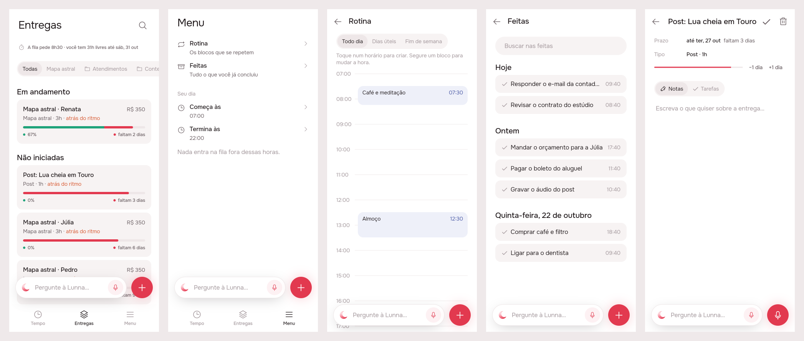
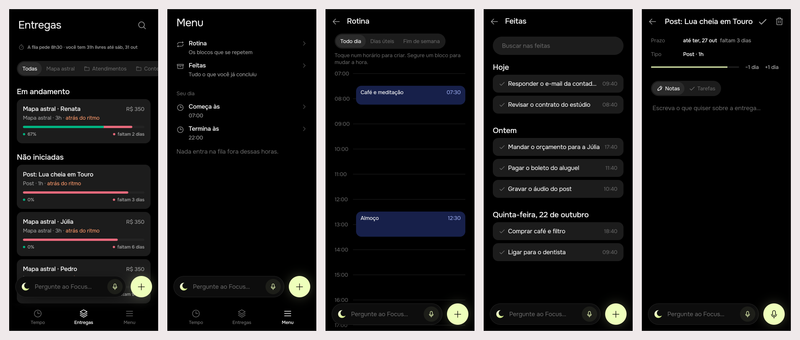

# The agent everywhere: one bar, in the same place, on every screen

2026-10-24 · agent · **delivered** · Track: **mockup** · Issue: #42

## 1. The prompt

> **Add assistant box to all places of the app.**
>
> I realized the assistant box does not exist in the menu nor the deliveries tab. Also when transitioning between tabs or screens the assistant textbox animates in a weird behavior.
>
> This stems from a fundamental issue: the assistant should be present in every context of the app. Fix this and check if it doesnt break anything.

On the issue, after the design: **approve**.

## 2. The design

Pins and screens: [`img/board.json`](img/board.json), one print per screen
in `img/mockup-1.png` … `mockup-5.png`. Drawn by the real app (Lunna) on
the demo fakes.

### Why it animated oddly

The bar was drawn three different ways, so every change of screen was a
change of widget, place or animator:

| Where | Before | What it did on a change |
|-------|--------|-------------------------|
| Tempo | the shell's FAB slot, `AskDock`, `centerFloat` | Entregas and Menu swapped it for a lone + at the column's end: the bar vanished |
| Entregas, Menu | a lone `AppFab` at `AppFab.location` | no bar at all |
| A delivery, Tarefas | the page's FAB slot, **default animator** | the FAB is null on Notas, so switching to Tarefas *scaled the bar up out of nothing* |
| A delivery's / a task's notes | inside the body (`Stack`), `NotesDock` | pushed with the page: on a push the old bar slid off with Tempo while the new one slid in with the page |
| Rotina, Feitas, Todas as entregas | nothing | — |

### The rule

**Every screen has the agent's bar at its foot, in the same place, and one
round button beside it that writes what that screen is about.** One
`AskDock` per route, floated at `AskDock.location` (centred) with
`AskDock.animator` (no animation). Between tabs the dock is one widget, so
it doesn't move; only the + changes what it writes. Between pages it is a
`Hero` (`DockHero`), so the page slides in under it and the bar stays still
(it glides the bottom bar's height between a tab and a page). Only a sheet
covers it.

| Screen | The round button | The bar is about |
|--------|------------------|------------------|
| Tempo | + writes on the day in sight (as today) | the day in sight |
| Entregas | + Nova entrega (now beside the bar) | — (the agent already makes and moves deliveries) |
| Menu | + writes on Tempo's day, bringing Tempo forward (as today) | the day |
| Rotina | + **Nova rotina**, at the next whole hour of the working day | — |
| Feitas | + writes a task into Para depois | — |
| Todas as entregas | + Nova entrega | — |
| A delivery, Tarefas | + writes one of its tasks (as today) | the delivery |
| A delivery's / a task's notes | microphone that dictates (as today) | the delivery / the task |

### Decisions

| Pin | Decision | Why |
|-----|----------|-----|
| 1A, 2A | One `AskDock` for the three tabs | the bar never leaves, so there is nothing to animate |
| 1B | The +'s place on Entregas and Menu moves from the column's end to beside the bar | the same spot on every screen is the point; the + is still the one accent at the foot |
| 1C | `centerFloat` + `noAnimation` everywhere, as `AskDock.location` / `AskDock.animator` | one constant per decision; no screen can pick the default scale-in again |
| 1A | A recording keeps going when the tab changes (the shell used to cancel it on leaving Tempo) | the bar it was started on is still there |
| 3A | `DockHero`: the dock is a hero with one tag, `transitionOnUserGestures` on | a push or a swipe back holds it still instead of sliding two bars |
| 3A, 5A | During the flight the dock is a **picture** (the bar and the arriving page's round button, no pointer) | a second live dock in the overlay would record, or read providers the overlay doesn't have |
| 3B | Rotina's + opens the same sheet as tapping the day, at the next whole hour inside the working day (else its start) | it adds no new gesture, only a way in |
| 4B | Feitas has nothing of its own to write: its + puts a task into Para depois | the button keeps its shape and place; the backlog needs no hour |
| 4A | Pages that scroll under the dock get `kNotesDockClearance` at the end | the last row can be scrolled clear of it |
| 5C | Notas ↔ Tarefas swaps the dock in place | the scale-in was one of the "weird" animations |
| — | No subject (`about`) for Entregas, Menu, Rotina, Feitas | the server's subjects are a task or a delivery; a list page adds no fact the agent can't read. No server change |
| — | Icons unchanged: the crescent (`AppIcons.agent`), `plus`, `microphone` | nothing new to draw |

### References

Drawn from known patterns (Mobbin not browsed): **Spotify's / Apple
Music's mini player**, which stays put above the tab bar while pages push
under it; **ChatGPT's composer**, always at the foot; **Arc's command bar**,
the same entry from every context.

## 3. What was built

### Prints of the real build

Lunna, then Focus: Entregas, Menu, Rotina, Feitas, a delivery's notes
(the real widgets on the demo fakes).

### The contract

**Every screen floats the agent's bar at `AskDock.location` with
`AskDock.animator`, inside a `DockHero`, with the screen's own round button
beside it.** The three tabs share one `AskDock`, so a tab change keeps the
same widget, at the same place, with any recording on it. A push or a pop
between two pages with docks draws a still picture of the bar where it
was. Only a sheet covers it. Nothing changed on the server: the bar on a
list page sends no subject (`about`), as Tempo's never did.

### App pieces

| File | What |
|------|------|
| `packages/agent/lib/src/view/ask_bar.dart` | `AskDock.location`, `AskDock.animator`, `AskDock(hero:)`; `DockHero` (one tag, `transitionOnUserGestures`, its shuttle a still picture of the bar and the arriving page's button inside `IgnorePointer`) |
| `packages/agent/lib/src/view/notes_dock.dart` | the notes' dock is its page's `DockHero` (microphone); the `AskDock` inside it is not |
| `lib/shell/view/shell_page.dart` | one `AskDock` for Tempo, Entregas and Menu; the recording is no longer cancelled when you leave Tempo |
| `lib/demo/view/demo_app.dart` | the landing page's phone does the same |
| `lib/routines/view/routines_page.dart` | the dock, + Nova rotina at the next whole hour of the working day, `kNotesDockClearance` under the grid |
| `packages/timeline/lib/src/view/done_archive.dart`, `lib/app/view/app.dart` | Feitas takes a `dock:` (the timeline package doesn't know the agent); the app hands it an `AskDock` whose + puts a task into Para depois |
| `packages/artifacts/lib/src/view/all_artifacts_page.dart` | the dock, + Nova entrega, clearance |
| `packages/artifacts/lib/src/view/artifact_page.dart` | Tarefas' dock at `AskDock.location`, no scale-in |
| `app_pt.arb` | `routinesNew` ("Nova rotina") |

### Checked against the brief

- **Where the docks sit.** Notas draws its dock in the body (inside the
  page's `SafeArea`, 16 px up). Tarefas draws its dock in the Scaffold's
  floating slot (16 px plus the bottom safe area, or 16 px above the
  keyboard). These come to the same pixel with and without a home
  indicator and with the keyboard up, so the dock didn't need to move. A
  test now pins it.
- **Clearance.** Entregas (128 px) and Menu (112 px) already had more
  room than the dock needs (96 px). Rotina's grid had 48 px and now has
  `kNotesDockClearance`.
- **Real routes.** Every route the dock appears on is a page on the root
  navigator, which has `MaterialApp`'s `HeroController`: `/rotina`,
  `/feitas` and `/evento/:id` (go_router), plus the `MaterialPageRoute`s
  for a delivery, Todas as entregas and a finished task. Each page has
  exactly one `DockHero`: the shell's `IndexedStack` has one floating
  slot, and the delivery page draws either Notas' or Tarefas' dock, never
  both. Sheets are `PopupRoute`s, and heroes only fly between
  `PageRoute`s. A finished task's page still has its dock (`isInteractive`
  is `managed`, which is always true).
- **Voice.** `day:` on the shell's dock always reads Tempo's aim, so a
  recording sent from Entregas or Menu carries the day Tempo shows.
  Dictation still stops when the agent's microphone starts (that
  `BlocListener` didn't change).

### Tests

New:

- `agent/test/dock_hero_test.dart`: during a push, the dock is a picture
  of the bar beside the arriving page's microphone, at the exact rect the
  dock had. Nothing in it takes taps. On landing the new dock sits at the
  same rect, and on a pop the page underneath draws its +.
- `artifacts/test/artifact_page_test.dart` ("Notas and Tarefas draw the bar
  in the same place"): with a 34 px bottom safe area, the bar's rect on
  Notas equals its rect on Tarefas, with one `DockHero` on each.
- `test/landing/landing_page_test.dart` ("a tab tapped in the phone moves
  the chapter"): Entregas draws the bar, and going back to Tempo keeps the
  **same** `AskDock` state at the same place, measured against the bottom
  bar because the landing page moves the whole phone between chapters.

`.tool/check` passes: app analyze, plus agent and artifacts tests under
Focus and Lunna. Its first run failed only on `flutter analyze` infos in
the preview entry point (`file_names`, `directives_ordering`), which is
deleted before commit; the rerun without it is clean. The check doesn't
run the app's own tests or timeline's, so they were run by hand under
both brands. Counts: app 20, agent 69, artifacts 38, timeline 156, all
passing, with no flaky tests.

### Where the build differs from the mockup

It doesn't, on screen. The one thing the brief expected to change, lifting
the notes' dock into the floating slot, turned out unnecessary (see above).

## 4. How to turn it on

Nothing to turn on: no env var, no server change, no migration. It ships
with the next app build of either brand.

### Decided unattended

- Track: **mockup** (the issue is about what is seen and how it moves).
- The + on Entregas and Menu moves beside the bar (it used to sit alone at
  the end of the column).
- Feitas' + writes into Para depois. Rotina's + is Nova rotina at the next
  whole hour.
- A recording keeps going when you change tabs.
- No new agent subject (no server change) for the list pages.
- The notes' dock stays in the page body: it already lines up with the
  floating slot, and moving it would mean lifting the notes' controller
  out of `_Notes`.

### Open questions

- Should Entregas' bar be *about* the deliveries (a new `AgentSubject`,
  a server change), so "qual atrasa mais?" reads the list in front? Left
  out; the agent already reads them.
- Feitas: is a + that writes into Para depois wanted, or should Feitas
  have the bar alone (full width, no round button)? The bar alone breaks
  "same shape everywhere", so the + was kept.

## 5. Cost and time

Measured by the queue: see the pull request. The build made no OpenRouter
or other paid calls.
