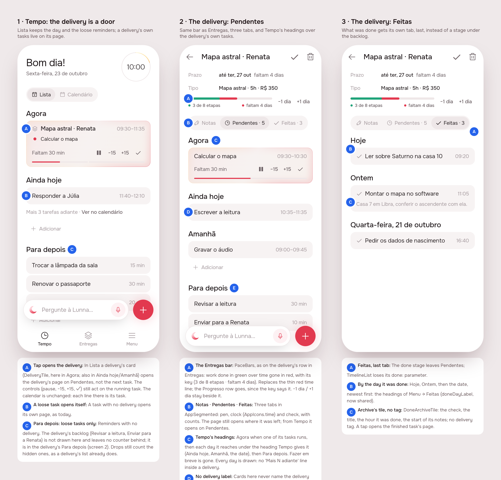

# Declutter: Tempo keeps the day, the delivery keeps its tasks

Draft from the design session (mockup track, unattended). Sections 1 and 2
are done; the **Build brief** is what `/create build declutter` starts from.

## 1. The prompt

From [issue #40](https://github.com/pietroid/lunna/issues/40), verbatim:

> Remove cognitive load from the interface
>
> The goal of this delivery is to remove cognitive load and excessive information from the user interface. That comes in various ways:
>
> - Do not show tasks of deliveries under "Para depois". They should only show inside the delivery internal
> - Things under para depois are just orphan tasks that are added as reminders that needs to be done sometime.
> - When tapping on a block on list it should open the delivery, not the task (unless it is a orphan task)
> - The delivery internal screen should have the same bar behavior as the deliveries tab
> - Internal delivery screen: remove the label of delivery inside the task list. It is redundant, we dont need that.
> - Instead of done tasks in the same tab, create an additional tab (notas/pendentes/feitas), and add the done there as the last one.
> - To maintain consistency, copy the same strategy of the list "Ainda hoje"/"Amanha" and "Para depois" on the list

## 2. The design

Each screen alone: [1](img/mockup-1.png) · [2](img/mockup-2.png) ·
[3](img/mockup-3.png). Pins in [board.json](board.json). Drawn by the real
app (Lunna) at Friday 10:00, from `app/lib/declutter_preview.dart`.

The flow: on Tempo's Lista a delivery's card is a way into the delivery
(1); its page holds everything still to do of it under the headings Tempo
uses (2), and what was done has a tab of its own, last (3).

### References

Drawn from known patterns, not browsed (no Mobbin session here):

- **Things 3**: a project is a row in Today that opens the project; the
  project's to-dos are listed there under their own headings, and the
  Logbook keeps what was done apart from what is left.
- **Linear**: a project's page has its own tabs (overview, issues), and
  done issues sit in a group of their own rather than mixed with the open
  ones.
- **Todoist**: the Inbox is for loose items; tasks of a project are seen
  in the project.

### Decisions (the pins)

| Pin | Decision |
|-----|----------|
| 1A | In Lista, a tap on a delivery's card (Agora, Ainda hoje, Amanhã) opens the delivery's page on **Pendentes**. Its buttons still act on the running task. Calendário is unchanged: each line there is its own task. |
| 1B | A task with no delivery opens its own page, as today. |
| 1C | Tempo's **Para depois** draws only tasks with no delivery. A delivery's backlog is not drawn and leaves no counter behind. A drop still counts the hidden tasks, as a delivery's list already does. |
| 2A | The page's bar is **`PaceBars`**, as on the delivery's row in Entregas: work done in green over time gone in red, with its key. It replaces the thin red time line. The *Feitas* (progress) row goes, since the key says it. −1 dia / +1 dia stay beside the bar. |
| 2B | Three tabs: **Notas** (pen) · **Pendentes · n** (`AppIcons.time`) · **Feitas · n** (check). The page still opens on the tab last used, except from Tempo, where it opens on Pendentes. |
| 2C | Pendentes uses Tempo's headings: **Agora** when one of its tasks is running, then **every day** it reaches, each under Tempo's name for it (Ainda hoje, Amanhã, the date), then **Para depois**. *Fazer em breve* is gone. |
| 2D | No card on the page names the delivery: no tag and no stack mark. |
| 2E | The delivery's own Para depois is where its backlog lives now. The `+` and the bar write into this delivery, as they do today. |
| 3A | The done stage leaves Pendentes for the **Feitas** tab, last. `TimelineList` loses its `done:` parameter. |
| 3B | Feitas is newest first, under **Hoje / Ontem / the date**, the headings of Menu → Feitas (`doneDayLabel`, now shared). |
| 3C | Each done task is drawn with `DoneArchiveTile`: the check, the title, the hour it was done and the start of its notes, with no delivery tag. A tap opens the finished task's page. |

No new icon: `AppIcons.time` is the clock already used for Tempo.

## Build brief

### Files the design session wrote (uncommitted, kept for the build)

- `app/lib/declutter_preview.dart`: the preview entry point (`?s=1` Tempo,
  `2` Pendentes, `3` Feitas). It runs on a `_FakeTimeline` (a
  `TimelineRepository` subclass whose `fetch` returns a canned day) and on
  `DemoArtifactsRepository` with its own deliveries. Delete it after Phase 4.
- `app/packages/timeline/lib/src/view/timeline_list.dart`:
  - new `onDeliveryTap: ValueChanged<String>?`, called through `_open` on a
    tap in Tempo's Lista (`only == null`) when the card has an `artifactId`;
  - `_waiting` leaves out tasks that belong to a delivery when
    `only == null`, and `_placeOf` now always goes through `_wholeOf`
    (that is the identity when nothing is hidden);
  - in `only` mode, day headings replace *Fazer em breve* (`_onlyLabel`
    for the first heading and its pinned label; plain `_HeadingRow`s for
    the later days);
  - `done:` and `_DoneTile` are removed.
- `app/packages/timeline/lib/src/view/done_archive.dart`: `doneDayLabel`
  is now a public top-level function.
- `app/packages/artifacts/lib/src/view/artifact_page.dart`: three tabs
  (`_doneTab = 2`), `PaceBars` in `_Summary` with the progress row gone,
  `_Tasks` without done, and the new `_Done` tab.
- `app/lib/home/view/home_page.dart` and `app/lib/demo/view/demo_app.dart`:
  `onDeliveryTap: (id) => openArtifact(context, id, tab: 1)`.
- `app_pt.arb` (+ gen): `artifactPendingTab`, `artifactDoneTab`,
  `artifactDoneEmpty`.

### What the build must do

**Server:** nothing. `GET /timeline` keeps sending the deliveries' backlog
tasks, because the delivery's page reads them from there. Hiding them on
Tempo is the app's job.

**App:**

1. Only the first day heading in a delivery's list is a drop target with
   its own pinned label. The later ones are drawn but are not in `drawn`.
   Make each one a real heading entry (section = that day, as the calendar
   does) so the pinned heading follows the scroll and a drop on it lands on
   that day (`after` = the day's first hour, as on the calendar). Check
   `_placeOf` / `_hourAbove` against it.
2. Tempo's `+` at the end of Para depois writes a task with no delivery, as
   it does today. Moving a delivery's task into the backlog on Tempo makes
   it disappear from Tempo. That is expected, but test that the drop lands
   at the right place in the whole backlog (`_wholeOf`).
3. `TimelineAim` in the delivery's list: the stage at the top is now a day
   heading. Check that the `+` beside the bar still aims at the queue or at
   that day.
4. Remove whatever has no use left: `ArtifactBar` (if nothing else uses
   it), and the ARB keys `artifactTasksTab`, `artifactProgressLabel`,
   `artifactTaskCount`, `stageDone`, `stageDoneEmpty`, `stageSoon` (check
   each with grep first).
5. Tests to update: `artifacts/test/artifact_page_test.dart` (the tab label
   and the done stage at ~174/250) and `timeline/test/timeline_list_test.dart`
   (the `done:` stage at ~1624–1674). New specs:
   - a delivery's backlog task is not in Tempo's Lista, and a loose one is;
   - a drop into Tempo's backlog counts the hidden tasks;
   - a tap on a delivery card in Lista calls `onDeliveryTap`, a tap on a
     loose task calls `onCardTap`, and in Calendário a tap always calls
     `onCardTap`;
   - Pendentes draws Agora / Ainda hoje / Amanhã / Para depois;
   - Feitas groups by day, newest first;
   - the page draws `PaceBars`.
6. `AGENTS.md`: update "The timeline" (Para depois holds loose tasks; in
   Lista a delivery's card opens the delivery) and the Entregas paragraph
   (the delivery's three tabs). Update `product/spec/artifacts.md` the same
   way.
7. `dart format` here (Dart 3.12.1) rewrote lines in files I had not
   touched. I reverted those files, but a few formatter-only hunks are left
   in `timeline_list.dart` and `artifact_page.dart`. CI does not check
   formatting. Drop those hunks if the diff should stay small.

### Decided unattended

- **Pendentes draws every day**, not Tempo's one day followed by "Mais N
  tarefas adiante · Ver no calendário". A delivery has few tasks, and once
  they leave Tempo's Para depois this tab is the only place to see them
  all. A count that sends you to the calendar would hide them again. What
  is copied from Tempo is its stages and headings (Agora, Ainda hoje,
  Amanhã, Para depois).
- **Only Lista opens the delivery.** The issue says "on list". On the
  calendar each line of a run is its own task to tap, drag, nudge or swap,
  so a tap there still opens the task.
- **The running delivery card in Agora also opens the delivery** on a tap.
  Its pause / −15 / +15 / ✓ buttons still act on the running task.
- **From Tempo the page opens on Pendentes.** From Entregas it opens on
  the tab last used, as today.
- **No counter for the hidden backlog** on Tempo: the point is less on
  screen.
- **The progress row goes** from the delivery's page: the bar's key
  already says "3 de 8 etapas".
- **Feitas uses the archive's tile and headings** (the hour it was done,
  the start of its notes, Hoje/Ontem/date). It replaces the quiet
  `_DoneTile`, which showed only the task's length.
- **"The label of delivery inside the task list"**: in the code on `main`,
  Lista's cards on the delivery's page no longer carry the delivery's name
  (`EventTile` shows it only on the calendar), and the delivery page's
  done stage used `_DoneTile`, which has no tag. So the rule is that
  nothing on the page names the delivery. Feitas passes cards without
  `artifactTitle`, so `DoneArchiveTile` draws no `AppTag`. See the open
  question.

### Open questions

- Which label did you mean in "remove the label of delivery inside the
  task list"? The design makes sure that no card on the delivery's page
  names it. The task's own page, opened from there, still has its
  *Entrega* row. Should that row go too when the page is opened from the
  delivery?
- Should a tap on a delivery's block in **Calendário** also open the
  delivery? The design keeps it per task (see above).

### Cost of the design session

Not recorded here: the queue measures every run and writes the figures in
the PR.
