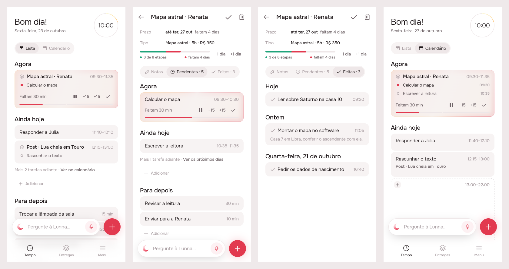
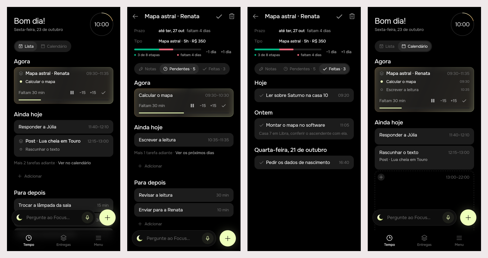

# Declutter: Tempo keeps the day, the delivery keeps its tasks

Issue [#40](https://github.com/pietroid/lunna/issues/40), mockup track,
designed and built unattended by the queue. Tempo's Para depois holds only
loose tasks, a delivery's card on Tempo opens the delivery, and the
delivery's page keeps what is left to do in Tempo's own stages and what
was done in a tab of its own.

## 1. The prompt

From [issue #40](https://github.com/pietroid/lunna/issues/40), verbatim:

> Remove cognitive load from the interface
>
> The goal of this delivery is to remove cognitive load and excessive information from the user interface. That comes in various ways:
>
> - Do not show tasks of deliveries under "Para depois". They should only show inside the delivery internal
> - Things under para depois are just orphan tasks that are added as reminders that needs to be done sometime.
> - When tapping on a block on list it should open the delivery, not the task (unless it is a orphan task)
> - The delivery internal screen should have the same bar behavior as the deliveries tab
> - Internal delivery screen: remove the label of delivery inside the task list. It is redundant, we dont need that.
> - Instead of done tasks in the same tab, create an additional tab (notas/pendentes/feitas), and add the done there as the last one.
> - To maintain consistency, copy the same strategy of the list "Ainda hoje"/"Amanha" and "Para depois" on the list

The person's reply to the first board, on the issue, verbatim:

> - Ainda hoje/amanha on timeline has still the same dynamic: any tasks associated with delivery will have the delivery name instead.
> - The internal page of a delivery should have exactly the same structure of timeline: just "Ainda hoje" or "Amanha", depending on the time. Para depois is perfect.
> - Which label did you mean in "remove the label of delivery inside the task list: its already removed, thanks
> - Should tapping a delivery's block in Calendário also open the delivery? yep

## 2. The design

Each screen alone: [1](img/mockup-1.png) · [2](img/mockup-2.png) ·
[3](img/mockup-3.png) · [4](img/mockup-4.png). Pins in
[board.json](board.json). Drawn by the real app (Lunna) at Friday 10:00,
from `app/lib/declutter_preview.dart`.

The flow: on Tempo a delivery's card is a way into the delivery, in Lista
(1) and on the calendar (4); its page holds what is still to do of it in
Tempo's own stages, Agora, one day and Para depois (2), and what was done
has a tab of its own, last (3).

Second round, after the reply: Pendentes keeps **one day**, Ainda hoje or
Amanhã by the hour, as Tempo does, and the days after are one line away
(2C, 2E); a tap on a delivery's block in Calendário opens the delivery
(screen 4). Ainda hoje / Amanhã on Tempo keep the delivery's card under
its name (1C). The label question is closed: it was already gone.

### References

Drawn from known patterns, not browsed (no Mobbin session here):

- **Things 3**: a project is a row in Today that opens the project; the
  project's to-dos are listed there under their own headings, and the
  Logbook keeps what was done apart from what is left.
- **Linear**: a project's page has its own tabs (overview, issues), and
  done issues sit in a group of their own rather than mixed with the open
  ones.
- **Todoist**: the Inbox is for loose items; tasks of a project are seen
  in the project.

### Decisions (the pins)

| Pin | Decision |
|-----|----------|
| 1A | In Lista, a tap on a delivery's card (Agora, Ainda hoje, Amanhã) opens the delivery's page on **Pendentes**. Its buttons still act on the running task. |
| 1B | A task with no delivery opens its own page, as today. |
| 1C | Ainda hoje / Amanhã are unchanged: a delivery's tasks there are its card, under the delivery's name, with only the next task beneath. |
| 1D | Tempo's **Para depois** draws only tasks with no delivery. A delivery's backlog is not drawn and leaves no counter behind. A drop still counts the hidden tasks, as a delivery's list already does. |
| 2A | The page's bar is **`PaceBars`**, as on the delivery's row in Entregas: work done in green over time gone in red, with its key. It replaces the thin red time line. The *Feitas* (progress) row goes, since the key says it. −1 dia / +1 dia stay beside the bar. |
| 2B | Three tabs: **Notas** (pen) · **Pendentes · n** (`AppIcons.time`) · **Feitas · n** (check). The page still opens on the tab last used, except from Tempo, where it opens on Pendentes. |
| 2C | Pendentes has Tempo's structure: **Agora** when one of its tasks is running, then **one day**, Ainda hoje or Amanhã, picked by the hour as Tempo picks it (`_listDay`), then **Para depois**. *Fazer em breve* is gone. |
| 2D | No card on the page names the delivery: no tag and no stack mark. |
| 2E | The tasks after that day are one line, as on Tempo: *Mais N tarefas adiante · **Ver os próximos dias***. The page has no calendar to send them to, so the link draws them here, each under its date. |
| 2F | The delivery's own Para depois is where its backlog lives now. The `+` and the bar write into this delivery, as they do today. |
| 3A | The done stage leaves Pendentes for the **Feitas** tab, last. `TimelineList` loses its `done:` parameter. |
| 3B | Feitas is newest first, under **Hoje / Ontem / the date**, the headings of Menu → Feitas (`doneDayLabel`, now shared). |
| 3C | Each done task is drawn with `DoneArchiveTile`: the check, the title, the hour it was done and the start of its notes, with no delivery tag. A tap opens the finished task's page. |
| 4A | In Calendário, a tap on any line of a delivery's block opens the delivery on Pendentes. A drag, a nudge, a swap and the seam still take that line's task; the buttons act on the running one. |
| 4B | A delivery's lone task on the calendar opens the delivery too: the rule is "a card with a delivery", not "a run". |
| 4C | A task with no delivery opens its own page. |

No new icon: `AppIcons.time` is the clock already used for Tempo.

## 3. What was built

The real build, drawn by the preview entry point on the final code (the
real cubits and `TimelineList`, a canned day behind a `TimelineRepository`,
`DemoArtifactsRepository` for the deliveries), Friday 10:00. Left to right:
Tempo's Lista, the delivery's Pendentes, its Feitas, Tempo's Calendário.

**Lunna**

**Focus**

### The contract

**On Tempo a delivery's card is the delivery; the hands still work on its
task.** A tap on a card with a delivery, in Lista (Agora included) or on
any line of its block or its lone task on the calendar, opens the
delivery's page on Pendentes. A drag, a nudge, a swap, a seam and the
running card's buttons act on the task, as before. Tempo's Para depois
draws only tasks with no delivery; a delivery's backlog lives on its page.
Nothing on the server changed: `GET /timeline` still sends every backlog
task, and a drop into Tempo's Para depois is still counted in the whole
backlog (`_wholeOf`), hidden tasks included.

### The app

- `timeline/lib/src/view/timeline_list.dart`
  - `onDeliveryTap: ValueChanged<String>?`: every tap goes through `_open`,
    which hands a card with an `artifactId` to it on Tempo (`only == null`),
    and anything else to `onCardTap`.
  - `_waiting` on Tempo leaves out the deliveries' tasks; `_placeOf` always
    maps the drop through `_wholeOf`.
  - A delivery's list (`only:`) has Tempo's stages: **Agora** (its running
    task, only when one runs), **the one day** (`_listDay`), with the
    empty text Tempo's day uses, a line *Mais N tarefas adiante · Ver os
    próximos dias* that draws the later days here, and **Para depois**.
    Each heading (Agora, the day, each later date) is a real heading entry
    keyed by its own section, so the pinned heading follows the scroll and
    says Agora, Ainda hoje, Amanhã or the date. The **+** under the day
    writes right after the last of the delivery's tasks drawn, counted in
    the whole queue (before, it wrote at the delivery's own count, which
    the server read as a place in the whole queue); with none drawn, right
    before its next one. The foot's `+` (`TimelineAim`) aims at the same
    place while the day is at the top, and at the backlog below it.
  - `done:`, `_DoneTile` and *Fazer em breve* are gone.
- `timeline/lib/src/view/done_archive.dart`: `doneDayLabel` is shared.
- `artifacts/lib/src/view/artifact_page.dart`: three tabs, Notas ·
  Pendentes · Feitas, in a `FittedBox` so they shrink rather than overflow
  on a narrow phone or with large text; `PaceBars` replaces the thin time
  line and the *Feitas* progress row, with −1 dia / +1 dia beside it; the
  new `_Done` tab (newest first, Hoje / Ontem / date, `DoneArchiveTile`,
  no delivery tag).
- `artifact_format.dart`: `ArtifactBar` removed (nothing used it).
- `lib/home/view/home_page.dart`, `lib/demo/view/demo_app.dart`:
  `onDeliveryTap: (id) => openArtifact(context, id, tab: 1)`.
- `app_pt.arb`: new `artifactPendingTab`, `artifactDoneTab`,
  `artifactDoneEmpty`, `stageAheadShow`; removed `stageSoon`,
  `stageSoonEmpty`, `stageDone`, `stageDoneEmpty`, `artifactTasksTab`,
  `artifactProgressLabel`, `artifactTaskCount` (each grepped first).

### The tests

- `timeline/test/delivery_run_test.dart`, 7 new: a tap on a delivery's card
  in Lista opens the delivery and a loose task its own page; the running
  card in Agora opens the delivery; Para depois keeps only loose tasks; a
  drop into Para depois counts the hidden delivery task (`index: 2`); on
  the calendar a tap on a run's line and on a lone task opens the delivery,
  a loose task opens itself; a short drag on a run's line still nudges
  that task (`EventShifted('p2', 20)`).
- `timeline/test/timeline_list_test.dart`: the kept list draws its tasks
  under Ainda hoje with no Agora; new, Agora then Amanhã (empty) then the
  line, whose tap draws the later tasks under their date, and the + that
  writes after the running task (`queue(1)`) and, once the days are drawn,
  after the last (`queue(4)`). The two drop tests now measure from the
  day's heading and from the + under the backlog.
- `artifacts/test/artifact_page_test.dart`, 2 new and 3 updated: the tabs
  remember Pendentes (1) and Feitas (2); the page draws `PaceBars`;
  Pendentes has no done task; Feitas is newest first under Hoje / Ontem
  with no `AppTag`; a finished task opens from Feitas.
- `.tool/check` passes (eslint, tsc and server tests are not touched; the
  app's analyze and every touched package's tests under Focus and Lunna).

### Where the build differs from the mockup

- The tabs sit in a `FittedBox`: three labels with counts are wider than
  two, and in the test font (and on a 320 px phone) they ran off the edge.
  At 390 px in Onest they are drawn at full size, as in the mockup.
- The **+** under a delivery's day writes after its last task drawn rather
  than at the end of its tasks (see above), as the brief asked.
- The empty day on a delivery's page says what Tempo's empty day says
  (*Nada com hora neste dia…*); *Nada na fila…* went with *Fazer em breve*.

### Decided unattended

- **Pendentes keeps one day, and the line after it reveals the rest
  here** (round 2). The reply asks for exactly Tempo's structure, so the
  later tasks are one line, as on Tempo. Its Tempo link ("Ver no
  calendário") would send the person off the page to a calendar of every
  delivery, so on this page the link is *Ver os próximos dias* and draws
  the later days in place, under their dates. Otherwise the delivery's
  later tasks, now gone from Tempo's Para depois too, would be seen
  nowhere on its own page.
- **Agora stays in Pendentes** when one of the delivery's tasks runs, as
  Tempo's list opens with it; with nothing running there is no Agora
  heading (Tempo's break and day-over tiles are about the day, not the
  delivery).
- **On the calendar, the tap is the delivery's; the hands are the
  task's** (round 2, "yep"). Every line of a run, and a delivery's lone
  task, opens the delivery; drag, nudge, swap and seam are unchanged.
- **The running delivery card in Agora also opens the delivery** on a tap.
  Its pause / −15 / +15 / ✓ buttons still act on the running task.
- **From Tempo the page opens on Pendentes.** From Entregas it opens on
  the tab last used, as today.
- **No counter for the hidden backlog** on Tempo: the point is less on
  screen.
- **The progress row goes** from the delivery's page: the bar's key
  already says "3 de 8 etapas".
- **Feitas uses the archive's tile and headings** (the hour it was done,
  the start of its notes, Hoje/Ontem/date). It replaces the quiet
  `_DoneTile`, which showed only the task's length.
- **"The label of delivery inside the task list"**: already removed, as
  the reply confirms. Nothing on the delivery's page names it; Feitas
  passes cards without `artifactTitle`, so `DoneArchiveTile` draws no
  `AppTag`. The task's own page keeps its *Entrega* row.

- **Ver os próximos dias resets** when the page is opened again or its
  tab is left: it is the list's own state, like its scroll, so the page
  always opens on one day.
- **The + with no task of the delivery drawn** writes right before its
  next task in the whole queue, or at the end of the queue when it has
  none.

## 4. How to turn it on

Nothing to turn on: no server change, no env var, no migration. The app
build carries it.

## 5. Cost and time

Measured by the queue: see the pull request.
