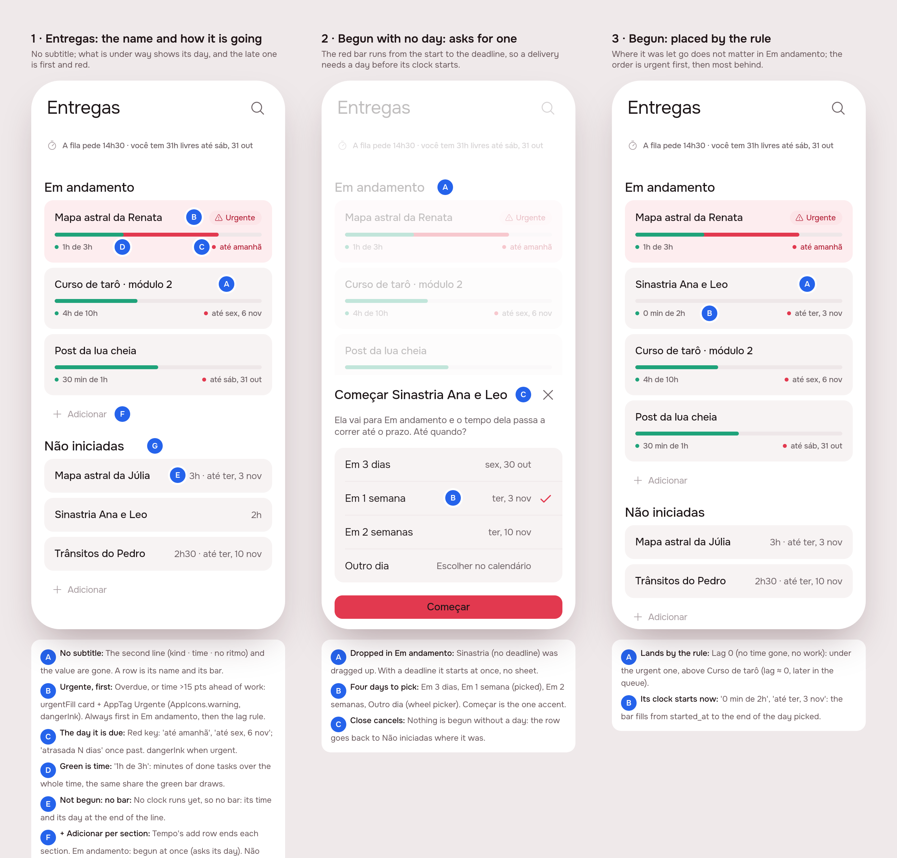
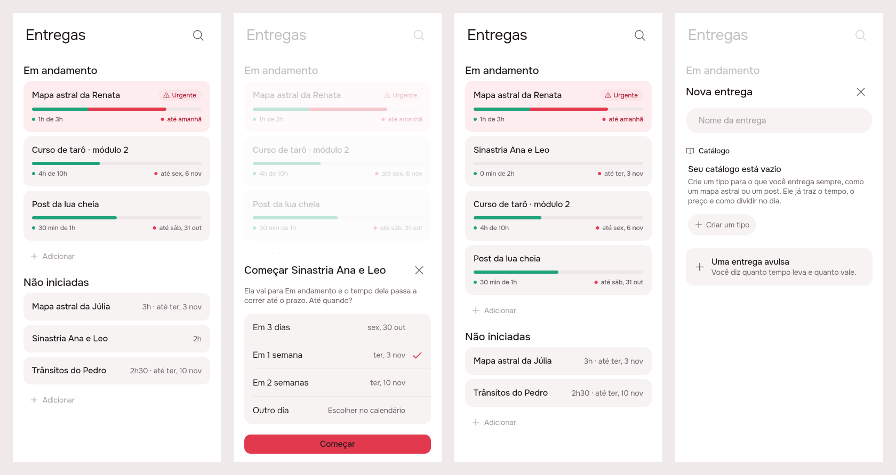
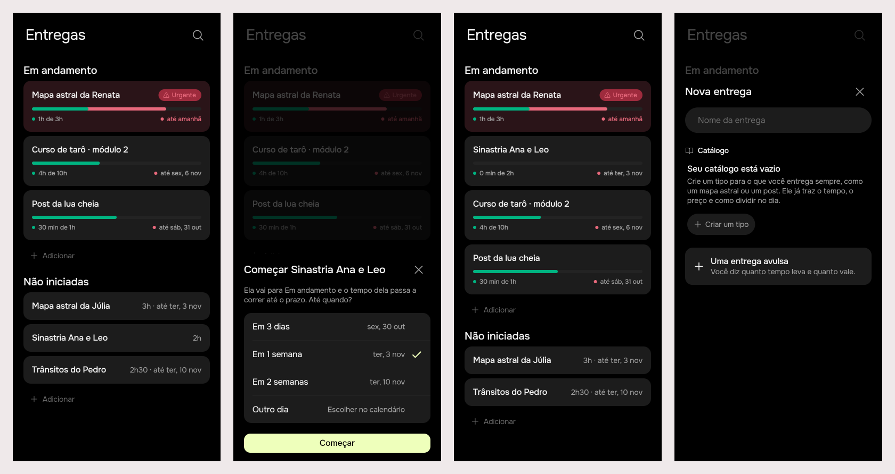

# Entregas, simplified: the day it is due, what is late first, both sections dragged

Issue [#48](https://github.com/pietroid/lunna/issues/48), **mockup track**,
designed and built unattended by the queue. The design was approved on
the issue ("Approve"); the build is sections 3 to 5. The review of the
build asked to remove the schedule line (open question 1) and merge: see
*After the review* in section 3.

## 1. The prompt

From [issue #48](https://github.com/pietroid/lunna/issues/48), verbatim:

> Improve deliveries experience
>
> Deliveries is too messy yet. A couple of simplifications:
>
> - Nobody reads the subtitles, just remove it.
> - When can move the not started to started, and it will define a deadline, if there isn't such already
> - The in progerss should have the due date showing
> - If a task is delayed, it should be at the first item, and the card should be a bit red, with the label "urgent"
> - We can drag nao iniciadas para em andamento and vice versa, but the ordering depends on the logic that we already have
> - We should have adicionar buttons also to the last part of each section, as we do in the timeline
> - Review if the proportions are right: consider the total time vs completed ratio on one side and total delivery delta vs already passed since beginning

Answer on the issue, after the design:

> Approve

Answer on the issue, after the build:

> Remove the line, and then merge it

## 2. The design

Each screen alone: [1](img/mockup-1.png) · [2](img/mockup-2.png) ·
[3](img/mockup-3.png). Pins in [board.json](board.json). Drawn by the real
app (Lunna) on Tuesday 27 October at 10:00, from
`app/lib/deliveries_preview.dart`.

The flow: Entregas is the name of each delivery and how it is going,
nothing else (1). What is under way shows the day it is due, and the one
that is late comes first, tinted red and tagged Urgente (1). A delivery
not begun is dragged up into Em andamento; with no day yet, it asks for
one before its clock starts (2). Begun, it takes its place by the rule
Em andamento already has (3).

### The proportions, reviewed

The bar compares two shares. Both were measured against the wrong thing:

| | Today | Proposed |
|---|---|---|
| **Green** (work) | tasks done ÷ tasks (`stepsDone / steps`): a 15-minute task weighs as much as a 3-hour one | **minutes of the tasks done ÷ the delivery's whole time** (`doneMinutes / minutes`, both already on the wire) |
| **Red** (time) | from **creation** to the end of the deadline day: a delivery written down a month before it was begun reads late the moment it starts | from **when it was begun** (`startedAt`, new) to the end of the deadline day |
| Not begun | red runs from creation | **no red**: no clock runs until it is begun, so a not-begun row has no bar at all |

Same arithmetic otherwise: calendar time (nights count, as the deadline
is a day), `paceSlack` 15 points. Example from screen 1: *Mapa astral da
Renata*, 1 h of 3 h done (33%), begun Tuesday 21 at 09:00, due by the end
of Wednesday 28: 145 h of 183 h gone (79%), so 46 points of red show past
the green and it is urgent. Under the old rule, measured from its creation
on the 14th, the red would have read 87% the day it was begun.

### References

Drawn from known patterns, not browsed (no Mobbin session here):

- **Linear** (project list): one line per project, a progress ring and a
  target date at the end, *At risk* / *Off track* as a coloured label; no
  description under the name.
- **Things 3**: a project's deadline is a small flag-and-date at the end
  of its row, red once it has passed; an item dragged from *Anytime* into
  *Today* changes what it is.
- **Todoist** boards: a card is dragged across columns, and a column ends
  in *+ Add task*, as Tempo's stages end in *+ Adicionar*.

### Decisions (the pins)

| Pin | Decision |
|-----|----------|
| 1A | **No subtitle.** The row's second line (kind · time · blocks · no ritmo / atrás do ritmo) is gone, and so is the value on the name's line (it stays on the delivery's page). A row is its name and how it is going. |
| 1B | **Urgente** = under way and either its day has passed or its time is more than 15 points ahead of its work (`isUrgent`: overdue or `isBehind`). The card is `AppColors.urgentFill` (new token: `#FDEDEF` Lunna, `#2A1418` Focus) and carries an `AppTag` *Urgente* with `AppIcons.warning` in `dangerInk` on `danger`. Urgent ones are **always first** in Em andamento, then the existing rule (`lagOf`, most behind first). |
| 1C | **The day it is due**, on every row under way, in the red key of the bar: *até amanhã*, *até sex., 6 nov*; once past, *atrasada 2 dias*. In `dangerInk` when urgent. It replaces *faltam N dias*. |
| 1D | **Green key is time**: *1 h de 3 h* (`artifactTimeDone`), the same minutes the green bar is drawn from. |
| 1E | **Not begun has no bar**: the name, then at the end of the line its time and, if it has one, its day (*3 h · até ter., 3 nov*), the day in `dangerInk` once passed. |
| 1F | **+ Adicionar** ends each section, Tempo's add row (plus, `ink3`, *Adicionar*). In Em andamento it writes a delivery that is begun at once (the sheet asks its day); in Não iniciadas, at the end of the queue. The `AppFab` stays and keeps writing to the queue as today. |
| 1G | **Both headings are always drawn** once there is any open delivery, so an empty Em andamento is still a place to drop on (its add row alone). |
| 2A | **Drag across.** One long press drags a row in either section. Dropped in **Em andamento**, it is begun (`startedAt` = now); its place there is the rule's, not where it was let go. Dropped in **Não iniciadas**, it is no longer begun, at the place it was let go (queue order, as today). |
| 2B | **Begun with no day asks for one**: *Começar Sinastria Ana e Leo*, the line *Ela vai para Em andamento e o tempo dela passa a correr até o prazo. Até quando?*, and four choices: *Em 3 dias*, *Em 1 semana* (picked), *Em 2 semanas*, *Outro dia* (the wheel picker). **Começar** is the one accent. A delivery that has a day starts at once, no sheet. |
| 2C | **Closing the sheet cancels**: the row goes back to Não iniciadas where it was. A clock needs an end, so nothing is begun without a day. |
| 3A | **Begun, it lands by the rule**: just begun, it has no red and no green (lag 0), so it sits under the urgent one and above *Curso de tarô* only because the rule says so. |
| 3B | Its bar starts empty; its key reads *0 min de 2 h* and *até ter., 3 nov*. |

### Decided unattended

- **"Subtitles" means the row's second line.** The schedule line under the
  title (*A fila pede 14h30 · você tem 31h livres até sáb, 31 out*) stays: it is not a
  delivery's subtitle, and it is the one place the month's load meets the
  agenda. Open question below.
- **The value leaves the row** (it is on the page). Fewer things per row
  was the ask.
- **Urgent is only for what is under way.** A delivery not begun has no
  clock, so it is never "behind"; its row shows its day in `dangerInk` once
  passed, and it stays where the queue put it.
- **"Started" becomes a fact, not a guess.** Today it is inferred from work
  done; dragging back to Não iniciadas must stick even with work done, so
  it is stored (`artifact.started_at`). Beginning any task of a delivery on
  Tempo begins the delivery (sets it if null). The migration sets it, for
  each delivery with work done, to its first task's start.
- **Begun with no day: a week by default.** The same default the page's
  deadline picker already uses.
- **Time is calendar time** (nights and weekends count), as the deadline is
  a calendar day; working hours would make the bar jump at 22:00.
- The "Ver todas" cap (`shown`, 5) stays and counts both sections.

### Open questions

The approval answered neither, so the build kept both as proposed:

1. Should the schedule line (*A fila pede … · você tem … livres até …*) go too?
   Kept for now. **Answered after the build: remove it** (section 3,
   *After the review*).
2. Should an overdue delivery that was **never begun** be pulled into Em
   andamento as urgent? Proposed: no, it stays in the queue with its day
   in red.

## 3. What was built

The real widgets, shot from a preview entry point on fixed data (Tuesday
27 October, 10:00; deleted after the prints): (1) Entregas, the late one
first, red and tagged; (2) a delivery with no day dropped into Em
andamento asks for one; (3) begun, it lands by the rule, its bar empty;
(4) Em andamento's **+ Adicionar**: the creation sheet with a day already
set a week out, no "Entra na fila", and **Começar**.

### After the review

"Remove the line" was read as open question 1, the one line the build
had kept on purpose: the schedule line under the title (*A fila pede
14h30 · você tem 31h livres até sáb, 31 out*). It is gone, and the
prints above are re-shot from the final code:

- `ArtifactsPage` no longer draws it; the space it held closed, so Em
  andamento's heading sits right under the title (with the goals on, they
  keep their gap above the list).
- `goalSchedule` left `app_pt.arb` (and the generated l10n).
- `schedule` stays in the model and in `GET /artifacts`: nothing else
  reads it in the app, but the server's figure is cheap and the goals
  (hidden by the flag) may want it back. The server is untouched.
- `artifacts_page_test`: the goals test now checks that *A fila pede* is
  not drawn. `AGENTS.md` and `product/spec/artifacts.md` say so.
- `.tool/check` on the change: every step green (app analyze, every
  package's tests under Focus and Lunna).

The merge is the person's (or the queue's) to do: this run leaves the
change in the branch's files for the PR.

### The contract

**Begun is a stored fact, and nothing is begun without a deadline.**
`artifact.started_at` is set by a drag into Em andamento, by writing one
down there, or by beginning one of its tasks on the day; it is cleared
only by a drag back into Não iniciadas. The red bar runs from it to the
end of the deadline day; the green is minutes done over the whole time.
Urgent = begun and (past its day or more than 15 points behind), always
first.

### Server

- `db/schema.ts`: `artifact.started_at timestamptz`. Migration
  `drizzle/0013_artifact_started.sql` adds it and backfills it, for open
  deliveries, with the earliest start of any of their tasks' events or
  the earliest `done_at`, whichever came first.
- `artifacts/`: `startedAt` on `Artifact`, `ArtifactView` and both
  stores. `POST /artifacts { started: true }` and `PATCH /artifacts/:id
  { started: true|false }`; `true` needs a deadline (on the row or in
  the same request), or it's refused with *"Dê um prazo para começar a
  entrega."*, and keeps the first start's hour if it was already begun. A
  delivered one is refused (*"Essa entrega já foi entregue."*).
  `POST /artifacts/:id/move { index, started: false }` stops and places it
  in one call; `started: true` on a move is refused (beginning is the
  PATCH's, since it may need a day).
- `events/event-layout.service.ts`: `_begin` (every way a task starts:
  the ▶, a drop with `start: true`, the guard's answers) calls
  `_beginArtifact`, which sets the task's delivery's `started_at` when it
  was null.
- No new route, so no new analytics row (`PATCH` and `move` already have
  theirs).

### App

- `artifacts`: `Artifact.startedAt`; `progressAt` from it; `workDone` by
  minutes; `isStarted`, `isUrgent`, `progressGroups` (urgent first).
  `ArtifactRow` with no subtitle, the urgent tint and tag, no bar when not
  begun. `PaceBars` keyed with time done and the day due.
  `ArtifactsRepository.create(started:)`, `update(started:)`,
  `move(stop:)`; `ArtifactsCubit.start(id, deadline:)` and `stop(id,
  index)`, both drawn before the server answers, `start` put back on a
  refusal. `StartSheet` (`showStartSheet`). `ArtifactSheet(started:,
  top:)`. `ArtifactsPage`: one `SliverReorderableList` over
  `[...started, the line, ...waiting]`; `_drop` begins, stops or moves.
- `app_ui`: `AppAddRow` (new), Tempo's add row promoted; `timeline_list`
  uses it. `AppColors.urgentFill` in both brands.
- `lib/demo/data/demo_artifacts.dart`: the landing demo follows the new
  signatures; *Mapa astral da Renata* is begun five days before, so the
  demo still has something under way.
- `product/spec/artifacts.md` and the Entregas paragraph of `AGENTS.md`
  rewritten for the new rules.

### Tests

- Server, 350 in all, passing. New: 5 in `artifacts.controller.spec.ts`
  (written down begun or not, with and without a day; begin, ask a day,
  keep the first hour, stop; stop on a move at its place; refused on a
  delivered one; begun by a task begun on the day, and staying stopped
  after), the `startedAt` round trip and the `0013_artifact_started`
  backfill on PGlite in `pg-artifact.store.spec.ts`.
- App, `artifacts` package 48, passing under both brands: `pace_test`
  rewritten (urgent first, overdue counts, minutes share, from
  `startedAt`, no clock when not begun, both groups drag, two add rows, an
  empty Em andamento still headed, the urgent tint, tag and danger-ink day,
  a drag up begins, a drag up with no day opens the sheet and closing it
  begins nothing, a drag down stops at its place), `models_test`
  (`startedAt` read, the bar from it), `artifacts_cubit_test` (start drawn
  at once, a refused start put back, stop drawn in place).
- `.tool/check --all`: every step green (app analyze; every package's
  tests under Focus and Lunna; server eslint, tsc, tests). No flaky test
  showed up.

### Where the build differs from the mockup

- **The row snaps back while the sheet asks for a day.** The mockup drew
  the dragged delivery already in Em andamento under the sheet (2A). Here
  it stays in Não iniciadas until **Começar**, then moves to its place.
  The result is the same, and closing the sheet leaves nothing to undo.
- **The sheet from Em andamento's + ends in *Começar*** rather than *Pôr
  na fila*, and opens with a day a week out (the deadline is required, so
  the button is never disabled for want of one). Not on the board; it
  follows 1F.
- **Não iniciadas' + writes at the end of the queue** by default (the
  sheet's *Entra na fila* starts on *No fim*); the `AppFab` keeps
  writing at the top, as before.
- The start sheet's day column takes the room its short names leave
  (*Escolher no calendário* was cut off in the first print).

### Decided unattended in the build

- **Stopping is one call**: `POST /artifacts/:id/move { index, started:
  false }`, so a drop into Não iniciadas can't leave a delivery stopped
  but out of place. Beginning stays on the `PATCH`, since it may carry
  the day.
- **A task begun begins its delivery even after it was stopped**: the
  stop holds until the next task of it is begun on Tempo.
- **The migration backfills from the first task begun or done**, which
  is a little wider than the brief's "a done task": a delivery whose one
  task is running counts as begun too.

### Not done

- The agent has no verb to begin or stop a delivery, and the delivery's
  page has no control for it: written in the spec's *Not yet*.
- Never run against a real Postgres (Neon): the migration ran on PGlite in
  the spec.

## 4. How to turn it on

Nothing to set. The migration runs on the server's boot
(`migrateDatabase`), backfilling `started_at`; no env var. An app build
older than this server sends no `started`, so deliveries begun before
the migration show as begun (the backfill) and new ones are begun only by
starting one of their tasks.

## 5. Cost and time

Measured by the queue: see the pull request.
