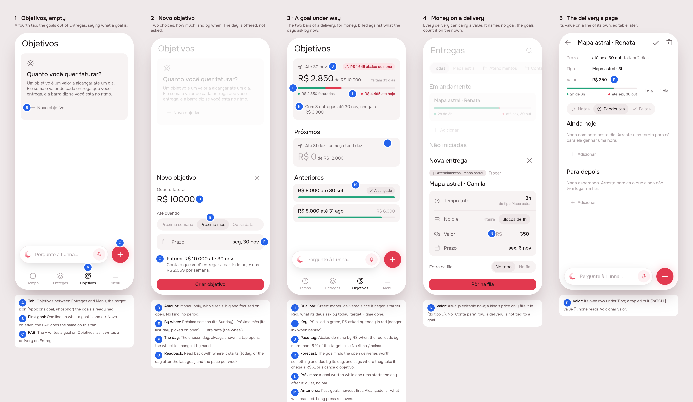
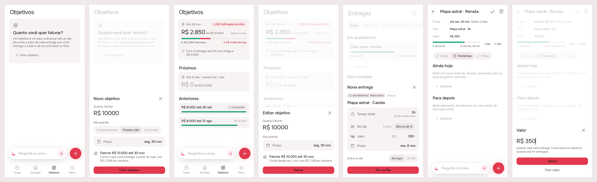
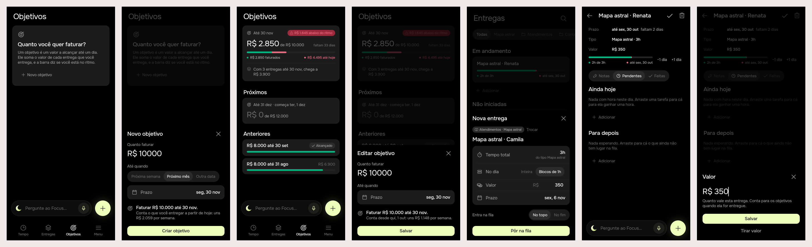

# Objetivos: a goals tab, money first

> Issue [#52](https://github.com/pietroid/lunna/issues/52), mockup track.
> Designed in two rounds on the issue, approved, then built unattended.
> Spec: [product/spec/goals.md](../../spec/goals.md).

## 1. The prompt

From the issue, verbatim:

> **Create goals tab (objetivos)**
>
> Goals are long term engagements that measure if a certain metric will reach
> a certain value at a certain time.
>
> We already have goals but it was not done in the best shape possible. So
> reuse and adapt it in the way that it is good for a single tab.
>
> Prioritize simplicity on the creation of it. Lets start with just financial
> goals for now, for that we need to introduce $money to deliverables.
>
> A goal must also have the dual bar approach: one saying how much was
> achieved and how much is needed up to this date considering the last goal
> we have.
>
> Also, for simplicity, a goal must always suggest "by next month", "by next
> week" (last day of next month), the user can simply change the date
> manually if the want.

On the design, reviewed on the issue, the person replied:

> We don't need to associate a delivery to a goal. It is computed
> automatically, the goal is responsible for being aware of the deliveries
> and understanding how much will be reached from the deliveries

So the delivery sheet no longer names a goal ("Conta para" is gone), and
the goal's card now says where the open deliveries take it (pin K).

Then, on the second round, the person replied:

> Approve

The three open questions of that round were left unanswered, so the build
takes the options drawn (see "Decided unattended").

## 2. The design

The screens one by one, for a phone: [1](img/mockup-1.png) ·
[2](img/mockup-2.png) · [3](img/mockup-3.png) · [4](img/mockup-4.png) ·
[5](img/mockup-5.png). Pins in [board.json](board.json). Drawn by the real
app (Lunna) through `app/lib/goals_preview.dart`, on the demo's deliveries,
with the clock fixed at Wed 28 Oct 2026, 10:00.

**The flow.** A fourth tab, **Objetivos**, takes the goals out of Entregas
(where they were hidden behind a flag). A goal is now **an amount of money to
bill by a day**: no kind, no week/month period, no "now or next". It is
written in two choices: how much, and by when, with the end of next week and
the end of next month offered and next month picked. On the tab the running
goal gets the same two-fill bar as a delivery: green is what was billed
(deliveries delivered since it began, their `value`), red is what its days ask
for by today. The goals after it wait under Próximos; the ones gone by are
listed under Anteriores. Under the bar the goal says **where the open
deliveries take it**: it finds them by itself (worth something, due by its
day) and adds them to what is billed. No delivery is tied to a goal. For
money to count, every delivery now carries an editable **Valor**, which a
kind's price only fills in.

### References

Drawn from known patterns. Mobbin wasn't browsed: no signed-in browser in
this run.

- **YNAB, savings targets ("Save R$ X by date")**: one amount and one date,
  plus a line saying what that asks per week. That is the sheet and its
  readback.
- **Monzo / Nubank "Caixinhas" with a target date**: the next-month date
  offered as the default.
- **Lunna's own `PaceBars`** (Entregas): the green and red bars and the 15 %
  slack, so a goal reads the way a delivery already does.

### Decisions

| Pin | Decision | Chosen |
|-----|----------|--------|
| A | Where | A 4th tab between Entregas and Menu, `AppIcons.goal` (Phosphor `target`, already in the app). No new icon. |
| B, C | First goal | An empty card that says what a goal is, with + Novo objetivo. The FAB writes a goal on this tab. |
| D | What it measures | Money only, whole reais. The `count` kind stays in the model, unused by the app. |
| E | By when | Segmented: *Próxima semana* (that week's Sunday), *Próximo mês* (that month's last day, picked when the sheet opens), *Outra data* (the wheel). |
| F | The day | Always shown as a row, and a tap opens the wheel, so the suggestion is changed by hand. |
| G | Readback | "Faturar R$ 10.000 até 30 nov." plus where it starts and the pace per week ("uns R$ 2.059 por semana"). |
| H | Dual bar | Green: `done / target`. Red: `timeAt(now)`, the share of calendar time from its start to the end of its last day. `PaceBar` is shared with deliveries. |
| I | Key | Green "R$ 2.850 faturados", red "R$ 4.495 até hoje" (= target × time gone); the red text uses the danger ink when behind. |
| J | Pace tag | *R$ X abaixo do ritmo* (danger) when the red leads by more than 15 % of the target (`paceSlack`), otherwise *No ritmo*, or *R$ X acima do ritmo* when ahead. |
| K | Forecast | One line, computed by the goal: the open deliveries worth something and due by its last day, added to what is billed. "Com 3 entregas até 30 nov, chega a R$ 3.900", or "…, alcança o objetivo" when they cover the target. |
| L | Next goals | Under Próximos: no bar, the day it starts. |
| M | Past goals | Under Anteriores, newest first: *Alcançado*, or the amount reached. A long press removes a goal (any section). |
| N | Money on a delivery | The Valor row in the delivery sheet is always editable, filled in with the kind's price ("do tipo Mapa astral"). The sheet names **no goal**: there is no link between a delivery and a goal (the *Conta para* row of the first round is gone, and so is pin O). |
| P | Delivery page | Valor gets its own row under Tipo (it was appended to the kind line). With no value it reads "Adicionar valor". |

### Decided unattended

- **"Considering the last goal we have"** is read as **goals follow each
  other**. A goal counts the money delivered from its start to its last day.
  Its start is the day after the last goal ends, or today if no goal is
  running. So two goals never count the same money, and the red line of the
  running goal starts at its own beginning, not at zero in some earlier
  month. A goal written while one is running goes under Próximos.
- **"By next week (last day of next month)"** is read as two suggestions:
  next week's Sunday, and next month's last day. Both are counted from the
  day the goal starts (today unless one is running). *Próximo mês* is
  preselected.
- **The pace is linear in calendar time** (nights and weekends count), the
  same as a delivery's red bar. No weighting by working days.
- **The money is billed money**: the `value` of deliveries **delivered**
  (`done_at`) between the start and the last day. Nothing changes here from
  today's rule ("money counts on delivery").
- **One tab, goals out of Entregas**: `ArtifactsPage(showGoals:)` and its
  goal strip go. The goals stay in `GET /artifacts` and in `ArtifactsCubit`,
  so there is no new repository.
- **The forecast is the open deliveries due by the goal's last day**,
  their `value` added to what is billed, with no weighting by how far along
  they are. A delivery with no deadline, or due after the goal's day, does
  not count towards it. Each delivery counts once, for the goal whose
  stretch holds its deadline (goals follow each other, so there is one).
- **The open questions of round two, unanswered at approval**, take the
  options drawn: goals follow each other (no cumulative ramp from the last
  goal's target), the whole value of an open delivery counts in the
  forecast however much of it is done, and past goals stay listed under
  Anteriores.
- **Build**: a goal's day may not reach the next goal's first day (so no
  day counts twice); a goal is changed from its card (amount and day, no
  suggestions); the agent can write and remove a goal but not change one;
  old repeating goals become the stretch they are in when the migration
  runs, measured in the database's day rather than the person's zone
  (a few hours' difference around midnight, once).
- **Wording**: *Objetivo* everywhere a person reads it ("Novo objetivo",
  "Criar objetivo"). The code keeps `Goal`.

## 3. What was built

### Prints of the real build

Lunna, scenes 1–7: the empty tab, the new goal sheet, the tab with a
running goal (next and past ones under it), the running goal tapped (the
sheet that edits it), the delivery sheet with Valor from its kind, the
delivery page's Valor row, and the value sheet it opens.

Focus, the same scenes:

### The contract

**A goal is an amount by a day, and goals follow each other.** It counts
the `value` of what was delivered from its first day to its last; a new
goal starts the day after the last one's deadline, or today. **No
delivery names a goal**: the open deliveries due by its deadline are its
forecast (`queued`, `queuedCount`), computed on the server so the tab and
the agent say the same number.

### Server

- `db/schema.ts` + `drizzle/0014_goal_deadline.sql`: `goal.deadline`
  (not null), `period` nullable. The migration turns each old repeating
  goal into the stretch it is in on the day it runs (its Monday or 1st to
  its Sunday or last day, or its first stretch if still ahead). Checked on
  PGlite with four goals (month, week, past, future): each got the stretch
  expected.
- `artifacts/`: `Goal { starts, deadline }`, `GoalEdit`, `GoalView` gains
  `queuedCount` and loses `period`; `ArtifactsService.addGoal({ target,
  deadline })` (the start is worked out), `editGoal`, and `measure` by the
  goal's own days; `ArtifactStore.updateGoal` in both stores;
  `requireGoal`/`requireGoalEdit`; the week/month helpers of `stretch.ts`
  are gone.
- Routes: `POST /goals { target, deadline }`, **new** `PATCH /goals/:id {
  target?, deadline? }`, `DELETE /goals/:id`. Refusals in Portuguese:
  *"Escolha um dia depois de 01/05."*, *"O próximo objetivo começa em 01/04:
  escolha um dia antes."*. `PATCH /artifacts/:id { value: null }` clears a
  value (it already did; now tested).
- Analytics: `PATCH /goals/:id` → `goal_edited`.
- Agent: `new_goal { target, deadline }` (asks when the day is missing,
  offering next week and next month); the board's goal line reads
  `g1 · money · R$ 4.000 from 10/03 to 30/04 · delivered R$ 0, open
  deliveries due by then R$ 1.500 (1)`; the prompt, the plan's `goal: {
  kind, target, deadline }` and the eval case (`goal-said`: "quero faturar 4
  mil até o fim do mês que vem" → 30/11) follow.

### App

- `GoalsPage` (the 4th tab), `GoalCard` (reads `goal.queued` and
  `queuedCount` from the server; `goalQueue` is gone), `GoalRow`,
  `GoalSheet` (posts `{ target, deadline }`; with `goal:` it edits, without
  the three suggestions, from the goal's first day), **new** `ValueSheet`
  (the delivery page's Valor row → `setValue`, with *Tirar valor*).
- `ArtifactsRepository.addGoal/updateGoal`, `update(value:)`;
  `ArtifactsCubit.addGoal/editGoal/setValue`; `Goal` loses `period` and
  gains `queuedCount`; `Artifact.copyWith(value:)`.
- `ArtifactsPage(showGoals:)` and the goal strip are gone from Entregas.
- Agent package: a plan's goal reads "novo objetivo · R$ 8.000 até 30/11";
  a plan kept from before still reads "por mês / por semana".
- 30 strings of the old goal UI removed from `app_pt.arb`; four added
  (`goalEditTitle`, `goalReadbackSince`, `artifactValueClear`,
  `artifactValueHint`); the agent's
  "nova meta" / "apagar a meta" now say *objetivo*.
- The demo's goal carries its forecast; the landing's chapter draws it as
  before. **The demo shell keeps three tabs**, since the landing has three
  chapters.

### Tests

- Server: `artifacts.controller.spec.ts` (goals one after the other, a past
  one, the forecast leaving out a delivery due after the goal, one with no
  value, one with no deadline, and counting an overdue one; the refusals;
  editing; clearing a value), `pg-artifact.store.spec.ts` (`updateGoal`, by
  owner), `agent.controller.spec.ts` (a goal by a day applied and undone,
  read back on the board; the agent asked for the day). `npm test` on
  artifacts + agent: 91 passed.
- App: **new** `goals_page_test.dart` (9: the suggestions on Wed 28 Oct →
  dom 8 nov / seg 30 nov, the start after a running goal, empty state,
  writing, sections, the pace tag at exactly 15 % and one real past it, the
  forecast's two lines, editing); `artifact_page_test.dart` (the value
  sheet: save, take away); `artifacts_page_test.dart` (a kind's price sent
  as the value, no goal row); cubit, models and pace tests updated.
  Artifacts: 57 passed under Focus and under Lunna; the goal and model
  tests also under `TZ` UTC, America/Sao_Paulo, Pacific/Auckland and
  America/Los_Angeles. Agent package: 69 passed.
- `.tool/check`: every step passed (flutter analyze, every package's tests under Focus and Lunna, server eslint, tsc and the whole `npm test`). The first run caught prettier and two untyped `body.message` reads in my server specs, fixed before the second.

### Where the build differs from the mockup

- **Tapping a goal edits it** (the brief asked for it; the mockup had no
  pin). The edit sheet hides the three suggestions: a goal's day is
  changed on the wheel, from its own first day.
- **The forecast is the server's** (`queued`), not worked out on the
  phone, so the agent reads the same number.
- **The "by when" segments shrink on a narrow phone** (`FittedBox`), and
  the pace tag ellipsises before the day does: the test font showed both
  overflowing at 390 px.
- **The value sheet** is new (the mockup only showed the row).

## 4. How to turn it on

Nothing to set. The migration runs on the server's boot; existing goals
become the stretch they are in that day. No new env var.

## 5. Cost and time

Measured by the queue: see the pull request.
