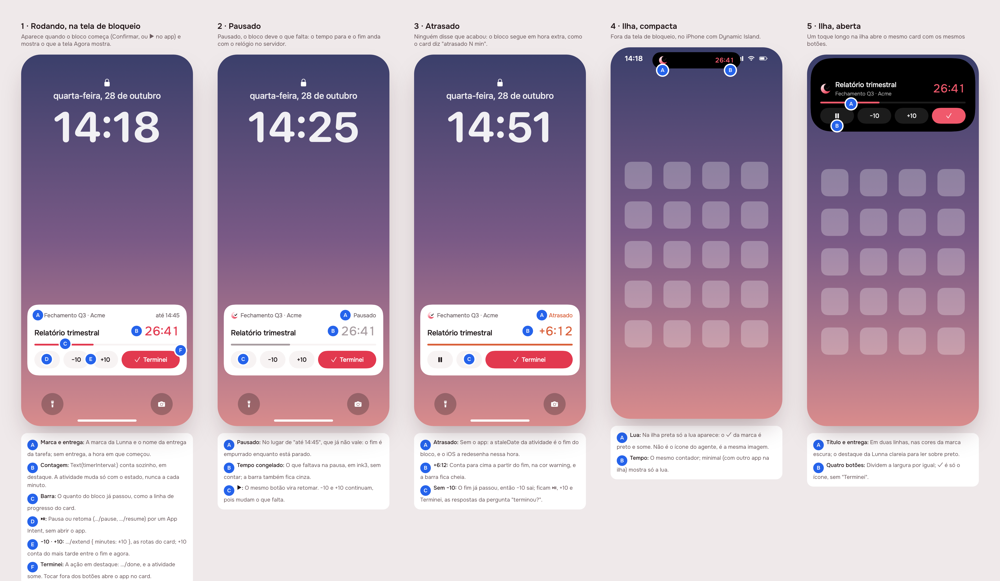
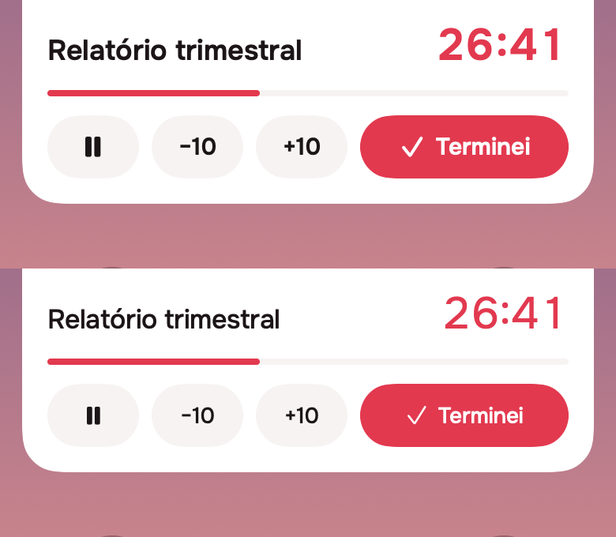
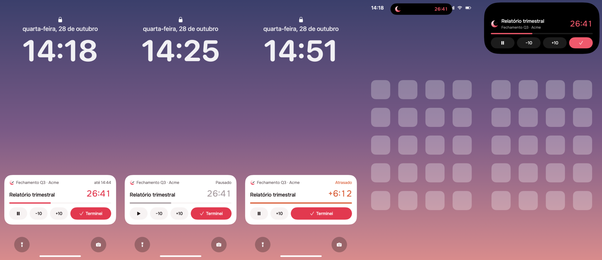
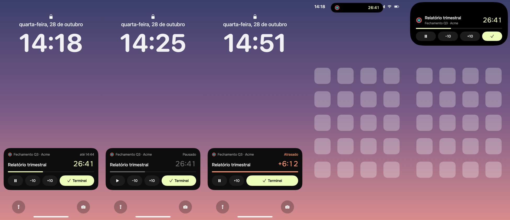

# The running block on the Lock Screen (Live Activity, iOS)

2026-10-28 · delivery · **delivered** · track: mockup · issue #61

## 1. The prompt

From [issue #61](https://github.com/pietroid/lunna/issues/61):

> **Live activities from old issue**
>
> The issue about improving notification had three phases. I think just phase 1 and 2 were done. Can you check if phase 3, the part about live activities on ios was done?

### The answer: Phase 3 was not done

- The RFC [notification-lifecycle](../../research/2026-10-28-notification-lifecycle/README.md)
  (issue #50, merged in #51) asks for "a Live Activity (iOS)" carrying
  ⏯ −10 +10 ✓ while a block runs.
- Its build, [2026-10-28-notification-lifecycle](../2026-10-28-notification-lifecycle/README.md)
  (issue #53, PR #54), shipped Phases 0, 1 and 2 and lists
  **"3 · iOS Live Activity (widget extension, App Intents) · no: next PR,
  mockup track"**.
- The code agrees: `app/ios/` has only the `Runner` target, no widget
  extension, no `NSSupportsLiveActivities`, and nothing in the repo
  imports ActivityKit or names a Live Activity outside those two
  documents.

So this delivery is that Phase 3. The design follows the RFC: the
activity changes only on state, the buttons are App Intents posting the
routes the card already posts, it starts with the app, an intent or
(iOS 26) a schedule, and there is no push server. The Android ongoing
notification stays with [#56](https://github.com/pietroid/lunna/issues/56).

### The review, on the issue

> iOS 17 is good. Only when it runs. The fonts seem to bold doesn it? cant you have something similar to more natural looking of the flutter app?

So: the activity needs **iOS 17** (every phone that gets it has the
buttons), it shows **only while a block runs** (nothing for the next one
waiting to be begun), and the type now follows the app's scale.

### The build, started by the queue

> build live-activity
>
> The design was approved on the issue. Do Phases 3 and 4 unattended.

### The review of the build, on the issue

> do anything needed to work

So this round fixed what kept it from running on a phone: the iOS app
(either brand, with or without this work) did not build under its
flavors, and the activity's link was not registered. See "Made to work"
in section 3.

## 2. The design



Each screen alone: [1](img/mockup-1.png) · [2](img/mockup-2.png) ·
[3](img/mockup-3.png) · [4](img/mockup-4.png) · [5](img/mockup-5.png);
pins in [img/board.json](img/board.json).

**Drawn by the real views.** A Live Activity is SwiftUI in a widget
extension, which the Flutter preview cannot draw. So the board is drawn by
the SwiftUI views the extension will ship
([`app/ios/BlockActivity/BlockActivityViews.swift`](../../../app/ios/BlockActivity/BlockActivityViews.swift)),
rendered on the Mac with `ImageRenderer` (a harness in
`app/ios/BlockActivity/Preview/`, deleted after the build's prints),
in Onest and the brand's `AppColors` values. Only the wallpaper, the
clock, the island's black shape and the home screen icons are the
harness's stand-ins for iOS.

**Lighter type, the app's scale.** The first round set everything in
Onest 600, which the app never uses: `AppTypography` stops at 500 (300
display, 400 headline and body, 500 titles and controls), with tracking
that tightens as the size grows. The views now read that scale: the time
28/400 (the headline), the title 17/500, the line above it 13/400, the
buttons and their symbols 14/500, the island's second line 12/400. Before
(top) and after:



**References** (from known patterns, not browsed): Apple's Clock timer
and Uber's ride activity (title, one big counting time, a thin progress
line); Structured and Things' running-task activities (controls on the
banner itself). Mobbin was not browsed.

| Pin | Decision | Chosen |
|---|---|---|
| 1A | What heads the banner | the brand mark and the task's delivery; without one, the hour it began |
| 1B | The time | time left, counted by the system (`Text(timerInterval:)`), in the accent, 28/400 like the app's headline; no update per minute |
| 1C | Progress | a 4 px line, done over `fill`, as the card's |
| 1D | ⏯ | pause / resume (`POST …/pause`, `…/resume`), one button that flips |
| 1E | −10 · +10 | `POST …/extend { minutes: ±10 }`; the server's "later of end and now" rule stands |
| 1F | ✓ | **Terminei**, the only accent button; `POST …/done`, and the activity ends at once. A tap anywhere else opens the app on the card |
| 2A–C | Paused | "Pausado" for the hour, the time left frozen in `ink3`, grey line, ▶ |
| 3A | Overtime without the app | the activity's `staleDate` is the block's end; when it passes iOS redraws it and the view reads "Atrasado" |
| 3B | Overtime time | counts up from the end (`+6:12`) in `warning`, line full |
| 3C | Buttons in overtime | ⏯ +10 Terminei; −10 goes, the end has passed |
| 4A | Mark on the island | the same mark image; on black its check drops out and the crescent remains |
| 4B | Compact | crescent left, time right; minimal is the crescent |
| — | Type | `AppTypography`'s weights only (300/400/500, never 600) and its tracking, through one `onest(size, weight)` modifier |
| — | When it shows | only while a block runs: begun, paused or in overtime; never for the next block waiting |
| 5A–B | Expanded | the same card in the dark brand's colours, Lunna's accent lifted for black (`#F0596C`); four equal buttons, ✓ icon only |

**Icons.** SF Symbols (`pause.fill`, `play.fill`, `checkmark`) on the
buttons, and −10 / +10 as text. Phosphor would need its glyphs exported
into the extension's asset catalogue for three icons iOS draws natively;
the brand mark is the existing `lunna.png` / `focus.png`.

### Decided unattended (design)

- Track: mockup, with the board drawn by the extension's own SwiftUI
  views on the Mac instead of the Flutter preview, which cannot draw a
  Live Activity.
- Only Lunna is drawn; Focus uses the same views with `BlockPalette.focus`
  and is shot in Phase 4.
- −10 is hidden in overtime (the RFC lists ⏯ −10 +10 ✓ without saying
  what overtime shows).
- ✓ reads "Terminei" on the Lock Screen and is the only accent button.
- The overtime redraw comes from `staleDate`, not from the app or a push.
- SF Symbols on the buttons instead of Phosphor.
- An own method channel rather than a pub package (`live_activities`):
  the intents must call the API natively anyway, so the plugin would add
  a dependency for the one call that is simple.
- Second round: the exact sizes and weights of the lighter type (time
  28/400, title 17/500, header 13/400, buttons 14/500, island 16/500 and
  12/400), read off `AppTypography`; the SF Symbols on the buttons take
  the label's weight (500).

### Decided on review

- iOS 17 is the activity's minimum.
- Only while a block runs; the next block waiting to be begun gets none.
- The type follows the app's (lighter) scale.

## 3. What was built

### The prints

Drawn by the extension's own views as built (`BlockActivityViews.swift`,
the final `BlockState`), through the design's render harness, in both
brands: running, paused, late, the compact island, the expanded island.

Lunna:



Focus:



These are the views rendered on the Mac, not a phone's screen: nothing
here reaches a real Lock Screen without a signed-in phone with a block
running (see "Not tested" below).

### The contract

**The activity shows the block that runs, and nothing else; it changes
only when the block's state does; its buttons are the card's buttons.**

- Running is Agora's begun task or its fixed block, paused or late
  included; never a task waiting to be begun. One rule, written twice:
  `blockOf` in Dart (what the app sends) and `BlockState.running(in:)` in
  Swift (what a button's answer redraws).
- No update per minute: the time is the system's timer, and the
  activity's `staleDate` is the block's end, so iOS redraws it as
  **Atrasado** by itself.
- ⏸/▶, −10/+10 and ✓ post `pause`, `resume`, `extend ±10` and `done` on
  `/api/tasks|events/:id` from the app's process (a `LiveActivityIntent`),
  with the Keychain's session token and `X-Lunna-Via: live_activity`, then
  redraw or end the activity from the day the server answers with. A
  refusal leaves it as it was.

### Server

No new route. `server/src/events/timeline.service.ts` adds `overtimeFrom`
to a late card (the end it ran past, from its first second, before
`overtimeMinutes` appears), declared in `entities/event.entity.ts`; the
activity counts up from it. `analytics/events.ts` accepts `live_activity`
as a `via`.

### App (Dart)

- `TimelineEvent.overtimeFrom` (`packages/timeline`).
- `lib/notifications/live_activity.dart`: `LiveActivity` over the
  `lunna/live_activity` channel (`sync`, `launchCard`, `opened`,
  `changes`), and `blockOf`. It sends only when the block changed, and
  does nothing off iOS.
- `RemindersListener` syncs it on every loaded day, opens the card a tap on
  the activity came from, and reloads the day when a button changed it;
  `App` ends it on sign-out; `answerReminderInBackground` syncs it after a
  reminder's answer (update or end only: iOS starts activities from the
  foreground). Provided in `main.dart`.

### iOS

- **`BlockActivity`**, a Widget Extension target (iOS 17), embedded in
  Runner before Flutter's *Thin Binary* phase, one build configuration per
  flavor, bundle id `<app's>.BlockActivity`, `BRAND_ID` per flavor read
  back as `LunnaBrand` in its Info.plist, its version from
  `Flutter/Generated.xcconfig` (through `BlockActivity.xcconfig`) so it
  always matches the app's.
- In both targets: `BlockAttributes.swift` (`BlockState` now with `work`,
  its length without pauses, which the line is measured against;
  `BlockControl` and its routes; `BlockLink`; the `ActivityAttributes`)
  and `BlockActivities.swift` (start/update/end, the `BlockIntent`, the
  Keychain read of `lunna.session_token`).
- Extension only: `BlockActivityViews.swift` (the design's views),
  `BlockMark.swift` (brand and mark), `BlockActivityWidget.swift` (the
  `ActivityConfiguration`, the island's regions, `widgetURL`), the two
  marks (96 px), Onest (variable, with its OFL) and
  `Localizable.xcstrings` (pt-BR).
- Runner: `LiveActivityPlugin.swift` (the channel on every engine, and the
  tap's link through Flutter's scene life cycle, `addSceneDelegate`),
  `AppDelegate.registerOwnPlugins`, `NSSupportsLiveActivities`.

### Tests and checks

- `app/test/notifications/live_activity_test.dart`, 10 tests: which block
  runs (begun task, fixed block, not a waiting task, not later), paused
  (what was left, not the dragged end), late (counts from the end it ran
  past), sends once and again only on change, ends on the first empty
  sync, resends after a button, the launch card, nothing off iOS.
- Server: the late-task spec now checks `overtimeFrom` and that `extend`
  clears it; the analytics spec accepts `live_activity`.
- `.tool/check` passes: `app-analyze`, `test-timeline` under Focus and
  Lunna, the server's eslint, tsc and tests. The new app test, which
  `.tool/check` does not run (it covers packages), passes under both
  brands (`flutter test test/notifications`, with and without
  `--dart-define=BRAND=lunna`).
- Builds (Xcode 26.6, iOS 26.5 SDK), each with the extension embedded and
  its Info.plist checked: `flutter build ios --simulator --debug` for
  `lunnaDev` (`com.pietroid.lunna.dev.BlockActivity`, `LunnaBrand =
  lunna`) and `focusDev` (`…focus.dev.BlockActivity`, `focus`), and
  `flutter build ios --release --no-codesign` for `lunnaProduction` and
  `focusProduction` (`com.pietroid.{lunna,focus}.BlockActivity`, version
  1.0.0 like the app's). See the Pods note in section 4.

### Made to work (after the review)

- **The flavored iOS builds failed**, on `main` too: every Runner
  configuration was based on `Flutter/Debug.xcconfig` or
  `Release.xcconfig`, which include `Pods-Runner.debug.xcconfig`, a file
  CocoaPods never writes for a project with flavors (it writes
  `Pods-Runner.debug-lunnadev.xcconfig` and so on). Without it `PODS_ROOT`
  was empty and Xcode stopped at *Unable to load contents of file list:
  '/Target Support Files/Pods-Runner/…xcfilelist'*. Each of the twelve
  Runner configurations is now based on its own
  `app/ios/Flutter/<config>.xcconfig` (`Debug-lunnaDev.xcconfig`, …), which
  includes its Pods file and then Flutter's. Written in
  `app/brands/README.md`.
- **The activity's link is registered**: `lunna-activity` is in Runner's
  `CFBundleURLTypes`, so a tap on the activity is always handed to the
  app.
- Checked that the rest holds on a locked phone: the session token is
  kept with `first_unlock` accessibility (`TokenStore`), so the buttons
  can read it from the Keychain with the screen locked; the intent runs
  in the app's process; both targets have team `K3U55XXNRM` and automatic
  signing.

Proved, in this worktree, with the files in the tree and nothing patched
for the build:

```
flutter build ios --simulator --debug --flavor lunnaDev …     ✓ Built build/ios/iphonesimulator/Runner.app
flutter build ios --release --no-codesign --flavor focusProduction …
                                                              ✓ Built build/ios/iphoneos/Runner.app (40.0MB)
PlugIns/BlockActivity.appex CFBundleIdentifier                com.pietroid.focus.BlockActivity
```

The lunnaDev build was installed on an iPhone 17 Pro simulator (iOS
26.5): the app launches and stays up with the extension embedded, and
`xcrun simctl openurl … lunna-activity://card/demo` asks *Open in
"[DEV] Lunna"?*, so iOS routes the activity's link to the app.

### Where the build differs from the design

- **No scheduled start on iOS 26** for the next fixed block. The brief
  allowed skipping it; it would also fire its own alert beside the start
  reminder, and could not be tried here. An activity is started when the
  app is opened with a block running.
- The progress line is measured against the work (`work`), not end minus
  start, so time spent paused is not counted as done, as on the card.
- The compact island is drawn by `compactLeading` (the mark) and
  `compactTrailing` (the time), which is how iOS splits it;
  `BlockIslandCompact` stays as the print's whole.

### Not tested

- **Nothing ran on a phone.** No simulator test reaches a Live Activity's
  buttons, and starting one needs a signed-in app with a block running.
  On a device: begin a task, lock, ⏸, ▶, +10, −10, ✓, a tap on the
  activity (it opens the card), and a block left to run past its end
  (Atrasado, counting up).
- The tap's link on a cold launch relies on Flutter handing the scene's
  connection options to a plugin registered after the scene connected.
- Still not run on a phone (as above): a signed build on a device is the
  one step left, and needs the person's Apple account.
- The signing of the new bundle ids (`com.pietroid.{lunna,focus}[.dev].BlockActivity`)
  was not run: the builds here are unsigned.

### Decided unattended (build)

- iOS 26's scheduled start left out (above).
- `overtimeFrom` added to the card rather than computing the end on the
  phone: the card's own end moves with the clock while it is late.
- The channel is a plugin registered on every engine (the app's and the
  background ones), so a reminder's answer from the Lock Screen also moves
  the activity.
- The tap opens the app with `lunna-activity://card/<id>` read through
  Flutter's scene life cycle, not Flutter's deep linking, which would also
  route Google sign-in's URLs.
- The render harness (`Preview/`) was deleted after the prints, as the
  brief said.
- After the review: one xcconfig per Runner configuration (Flutter's
  documented shape for flavors) rather than editing the Podfile or
  letting CocoaPods set base configurations, which it refuses to do over
  Flutter's own; the URL scheme registered even though a widget's link
  often reaches the app without it. No UI changed, so the prints stand.

## 4. How to turn it on

Nothing to set: it ships with the iOS app of either brand, on iOS 17 and
later, and needs no env var or server change beyond this deploy.

- Signing: the extension's bundle ids are new; Xcode's automatic signing
  (team `K3U55XXNRM`) creates them on the first signed build or archive.
- The person can turn Live Activities off per app in Settings; then
  nothing starts, and the reminders work as before.
- Without iOS 17 (or on Android and the web) nothing changes.

**The flavored iOS builds** failed before this work (see "Made to
work"); they build as they are now, with nothing to patch. After a
`pod install` nothing changes: the per-configuration xcconfigs include
CocoaPods' files by name.

## 5. Cost and time

Measured by the queue: see the pull request.
