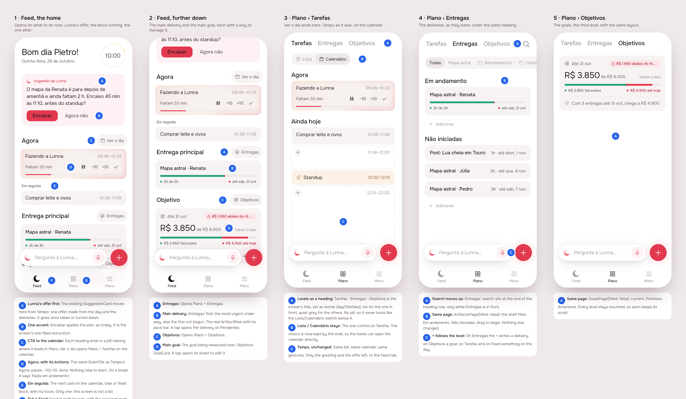
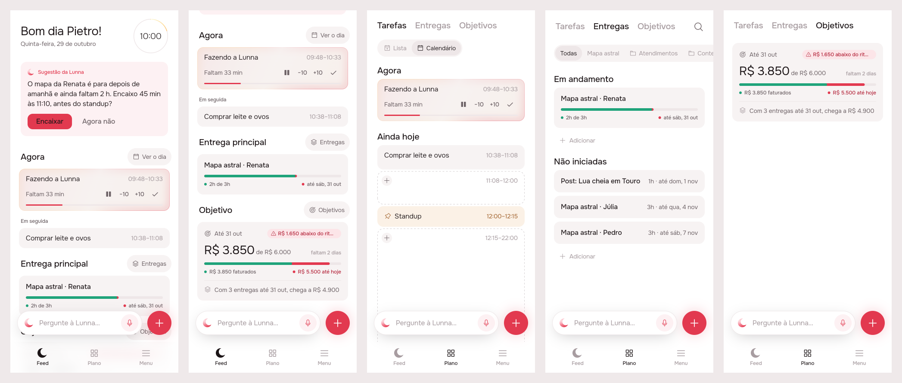
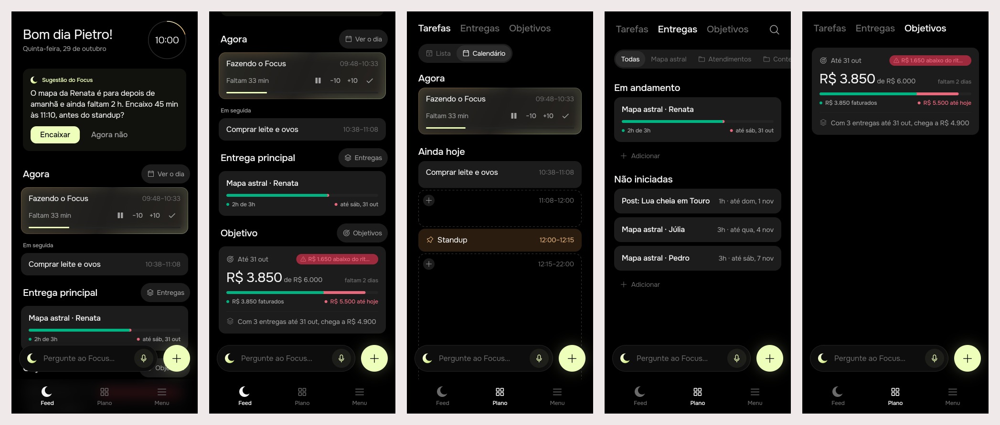

# Lunna home: Feed, Plano, Menu

Track: **mockup**, on [issue #59](https://github.com/pietroid/lunna/issues/59).
The design was approved on the issue after one round (the tabs renamed);
the build was done unattended by the queue. Spec: [product/spec/home.md](../../spec/home.md).

## 1. The prompt

> **Lunna home page**
>
> The way the user can access multiple levels of their management is not very clear.
>
> The information is perfect: timeline, deliverables and goals.
>
> However I would like to have a home page where user would have the best suggestions based on their time and what they need to do.
>
> This is agentic in nature so we can't have all the right information now.
>
> But what I would like you to do: draw the best shape of a home version that contains: next suggestin from Lunna to user, the current task playing, the next one , CTA to go to the calendar. Main deliverable, main goal (and ctas to manage them)
>
> About the other screens it is still the same but they will all live in a single tab. That way we have just three tabs: Lunna, control pane (or something shorter), and menu.
>
> In this control pane there is a tab bar where user can select t multiple levels: tasks, delivers, goals.

The first board was reviewed on the issue, and the person replied:

> Change Lunna by "Feed", and Panel by "Plan"
>
> The rest is perfect

Then, to build:

> build lunna-home
>
> The design was approved on the issue. Do Phases 3 and 4 unattended.

## 2. The design

Board data: [board.json](board.json). Screens one by one:
[1](img/mockup-1.png) · [2](img/mockup-2.png) · [3](img/mockup-3.png) ·
[4](img/mockup-4.png) · [5](img/mockup-5.png).

**The flow.** The app opens on **Feed**, the home. From top to bottom it shows
Lunna's one suggestion, **Agora** (the block running, with its buttons) and
**Em seguida** (the next one), then the **main delivery** and the **goal**.
Each section heading ends in a pill that opens its level in **Plano**:
*Ver o dia* opens Tarefas on the calendar, *Entregas* and *Objetivos* open
theirs. Plano is Tempo, Entregas and Objetivos as they are today, under one
heading whose words are the tabs.

**References** (taken from patterns I know, not browsed; Mobbin wasn't
used):
- **Sunsama / Motion "Today"**: a home that shows what is next and the
  current focus, with the full calendar one tap away.
- **Apple Music / Podcasts "Library"**: a large-text heading whose words are
  the sub-tabs, a level above the in-page segmented controls.
- **Linear's "My issues" / Things' "Today"**: summary cards on top, and each
  one leads to the full list behind it.

### Decisions

| Pin | Decision | Why |
|-----|----------|-----|
| 1A | The existing `SuggestionCard` moves from Tempo to the top of the Feed tab | The issue's "next suggestion from Lunna" is the offer the agent already makes; the home is where it belongs, and Tempo stays the day itself |
| 1B | Encaixar is the only filled accent on the home | One primary action per screen |
| 1C, 2A, 2C | Each section heading ends in an `AppPillButton` naming where it leads: *Ver o dia* (calendar icon), *Entregas*, *Objetivos* | These are the issue's CTAs. They have one shape, the label names the destination, and none of them competes with Encaixar |
| 1D | Agora is the same `EventTile` with the same controls as Tempo's Agora (pause, −10/+10, done, or play when waiting) | "The current task playing" without a new widget to learn |
| 1E | Em seguida is **one** card: the next card on the calendar, task or fixed block | The person plans around whatever comes next. The home is not a list |
| 2B | Main delivery is Entregas' first: the most urgent under way, else the first not begun (`progressGroups`). It uses the real `ArtifactRow`, and a tap opens it on Pendentes | Entregas already decides the order, so the home doesn't invent a second ranking |
| 2D | The goal is the one being measured now, drawn as Objetivos' `GoalCard`. A tap opens its sheet | Manage it where it shows |
| 1F | Tab 1 is **Feed** in both brands (`shellFeedTab`), with the crescent (`AppIcons.agent`) | Asked in review ("Change Lunna by Feed"). It no longer names the brand, so Focus reads "Feed" too |
| 1G | Tab 2 is **Plano** (`shellPlanTab`), icon Phosphor *squares-four* (`AppIcons.plan`, new) | Asked in review ("Panel by Plan"), in Portuguese like every other label. Four squares read as "the pieces" without being a list or a calendar |
| 3A | Plano's levels are a **heading of words** (`AppTitleTabs`, new in app_ui): ink for the one in front, `ink3` for the others, no pill | Picking a level picks what the screen is about, so it reads as the title. Lista/Calendário below stays the only control that looks like a control, so two segmented bars never stack |
| 3B | `TimelineModeCubit` moves up to the shell | So *Ver o dia* can open Tarefas on the calendar |
| 3C | Tempo itself is unchanged; only its greeting (and the account menu behind it) and the suggestion move to the Feed tab | "The other screens are still the same" |
| 4A | Entregas' search moves to the end of Plano's heading, only while Entregas is in front | Its own title row is gone |
| 4C | The + follows what is in front: a delivery on Entregas, a goal on Objetivos, something on the day on Tarefas, Feed and Menu | Same rule as today, one level deeper |

**The icon.** Only `AppIcons.plan` is new (Phosphor `squaresFour`). The
Feed tab reuses the brand crescent (`AppIcons.agent`). There are no AI
glyphs.

### Decided unattended

- **"Plan" is written "Plano".** Every label the person reads is Brazilian
  Portuguese (AGENTS.md), so the review's "Plan" is drawn in Portuguese.
  "Feed" is the same word in both languages and stays as asked. If the tab
  should read "Plan" literally, it is one string (`shellPlanTab`).
- **Feed is Feed on Focus too.** The first tab used to be the brand's
  name; "Feed" names what it is, so both brands share it.
- **The app opens on Feed**, not on Plano.
- **The + on the Feed tab writes on the day without leaving the home.**
  The new task shows up in Em seguida when it lands there. From Menu it still
  brings Tarefas forward first.
- **The home doesn't ask the agent for anything new yet.** The issue says
  "we can't have all the right information now", so the suggestion is
  today's `GET /agent/suggestion`, and everything else on the home is read
  from data the app already loads (timeline, artifacts). A richer
  "best next step" is future work for the agent.
- **Em seguida can be a fixed block** (a meeting, lunch), not only a task.

### Decided unattended in the build

- **The landing's demo keeps its own shell** (Tempo, Entregas, Menu). Its
  three chapters are things the app does, and the Feed is a summary of all
  three, so it has no chapter of its own. `product/spec/landing.md` says so.
  Moving the demo onto Feed/Plano is a follow-up if the landing should
  mirror the tabs exactly.
- **The offer is asked for again** each time Feed comes forward, at
  midnight, and on returning from the background on a new day.
  `GET /agent/suggestion` calls no model, so this costs one cheap read.
- **The greeting moved to `lib/feed/`**, since Feed is the only screen
  that draws it now (the demo imports it from there).

## 3. What was built

The scenes, left to right: Feed (the offer, Agora, Em seguida), Feed
scrolled to the end (the delivery and the goal, now clear of the dock),
Plano › Tarefas on the calendar as *Ver o dia* opens it, Plano › Entregas
(with its search), Plano › Objetivos. Both brands read Feed · Plano · Menu.

**The contract.** The home is made up of what the app already loads. It is
one of each and never a list: Agora is the `agora` card, Em seguida the
first `dia` card (a task or a fixed block), the delivery is the first that
`progressGroups` returns, and the goal is the money goal whose days are
running. Each heading's pill opens its level of Plano. No server change.

**App**
- `app/lib/feed/`: `FeedPage` (stateful: it owns the `SuggestionCubit`,
  `shown` asks again when the tab is brought forward, plus a midnight timer
  and an `AppLifecycleListener`), and `greeting.dart` (moved from `home/`).
- `app/lib/plan/`: `PlanPage` and `PlanTab` (`tasks`, `calendar`,
  `deliveries`, `goals`; `calendar` lights Tarefas).
- `app/lib/tempo/`: `TempoPage` (renamed from `HomePage`; `lib/home/` is
  gone), `MinuteRefresh`.
- `app/lib/shell/view/shell_page.dart`: three tabs, `TimelineModeCubit`
  owned by the shell, the + per level, analytics screen names.
- `app_ui`: `AppTitleTabs` and `AppIcons.plan` (Phosphor *squares-four*).
- `artifacts`: `ArtifactsPage(titled:)` and `GoalsPage(titled:)`. Objetivos
  now adds the bottom bar's height to `kNotesDockClearance`, so its last
  card clears the dock (the same fix as on Feed).
- `l10n`: `shellFeedTab`, `shellPlanTab`, `planTasks`, `feed*`.

**Tests** (all pass under both brands)
- `app/test/feed/feed_page_test.dart`, 9 tests: the three empty states, Agora
  and the one card after it (a fixed block too), the main delivery (begun
  before waiting, and otherwise the first waiting), the goal (not one that
  hasn't started; the running one), each pill's `PlanTab`, the offer asked
  for again when the tab comes back, and the offer drawn.
- `app/test/plan/plan_page_test.dart`, 4: `PlanTab` levels, picking a level,
  the `IndexedStack` keeping all three, and search only on Entregas.
- `app/packages/app_ui/test/app_title_tabs_test.dart`, 3: ink and quiet
  colours with the selected semantics, taps, the trailing widget.
- App root: 33 tests, Focus and Lunna. `.tool/check`: analyze and every
  package's tests, both brands, passed.
- `.tool/check` does not run `app/test/` (only the packages'), so those were
  run by hand: `flutter test --dart-define=BRAND=focus|lunna`.
- No flaky test was seen.

**Where it differs from the mockup.** Only in the code: the names follow
the tabs (`FeedPage`, `PlanPage`, `PlanTab`, `TempoPage`, `AppIcons.plan`,
`feed*` strings), and the Feed's last card no longer ends under the bar.
What the person sees is the board.

## 4. How to turn it on

Nothing to set. It ships with the app; the server is unchanged. The new
dev dependency `shared_preferences` (app root) is only for the tests.

## 5. Cost and time

Measured by the queue: see the pull request.
