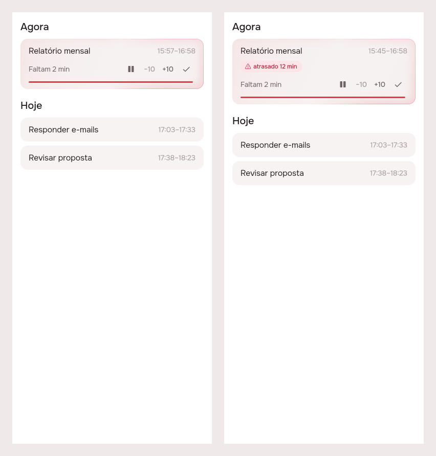
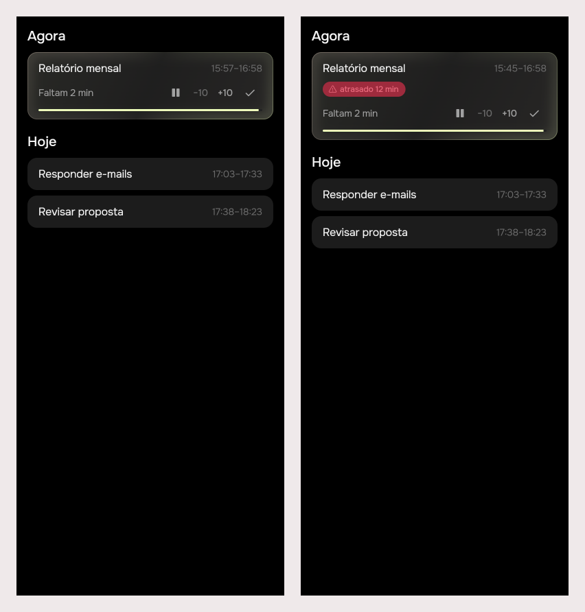

# A reminder should take the answer, not open the app

2026-10-28 · delivery · **built** · track: plan · issue #53

## 1. The prompt

From [issue #53](https://github.com/pietroid/lunna/issues/53):

> **Implement: A reminder should take the answer, not open the app**
>
> Build what the RFC [product/research/2026-10-28-notification-lifecycle/README.md](https://github.com/pietroid/lunna/blob/main/product/research/2026-10-28-notification-lifecycle/README.md) recommends, approved in #50 and merged in #51.
>
> - Read it as the research (see "From an RFC" in the /create skill): what it recommends, in its priority order, and its Rollout are the spec.
> - A `> **Decision**` note in it is binding; every other decision takes the option marked *(recommended)*.
> - The plan (or the board, if it changes what the person sees) says which rollout phases this PR ships, Phase 0 first.

The research is the RFC
[product/research/2026-10-28-notification-lifecycle](../../research/2026-10-28-notification-lifecycle/README.md).
Its binding decision: **every recommended option**. Unanswered overtime
ends at the next fixed block or the working day's end, and is written down
as done there. Every fixed block, meetings included, gets the three end
asks. The other options it recommends: all routines fixed, a 10-minute
step everywhere, re-asks queued for the next 24 h only, no push from the
server, `almostFinishing` dropped, and the Live Activity started by the
app, an intent or iOS 26 scheduling.

The plan was reviewed on the issue, and the person replied:

> Btw I have seen the title but actually if the user taps the notification it should go to the app anyway. You can implement everything for iOS. Leave android for later, you can create an issue just for that?

So a tap on a reminder (not on one of its buttons) opens the app, on
that card, whatever the title says; this PR builds the phone side for
iOS only; and Android's is
[issue #56](https://github.com/pietroid/lunna/issues/56).

## 2. The plan

**Track: plan.** The first phases change rules on the server and put
buttons on notifications the OS draws. The app's only new piece is a
small tag on a card. The one real layout, the Live Activity on the Lock
Screen, is Phase 3 in its own PR, and it gets a board there. It is drawn
in SwiftUI, so this Flutter preview could not draw it anyway.

### What this PR ships

The RFC has no Rollout section, so the phases below follow the order of
its change slides.

| Phase | What | Ships here |
|---|---|---|
| 0 | Measure: where each answer came from (`via`) and how many endings closed in silence, recorded before anything changes | yes |
| 1 | Server: one lifecycle (all routines fixed, overtime instead of "done", start and end asks for fixed blocks, +10 from the later of hour and tap, the new plan) | yes |
| 2 | Phone, **iOS only**: three buttons on every block reminder, answered in the background; a tap still opens the app; the overtime tag on the card and 10 min in the app's ± (both platforms, they are Flutter) | yes |
| 2A | Android: the same buttons, the start sheet removed, then the ongoing notification with a countdown | no: [#56](https://github.com/pietroid/lunna/issues/56) |
| 3 | iOS Live Activity (widget extension, App Intents) | no: next PR, mockup track |

### Approach

- **Phase 0, measure** (`common/logging.interceptor.ts`,
  `analytics/events.ts`): an `X-Lunna-Via: notification | app` header,
  set by the app's `ApiClient` from where the call came, becomes a `via`
  property on the write event already sent. `catchUp` captures
  `block_closed_silently` (`{ kind: task | event, overMinutes }`) every
  time it writes an ending nobody answered. Two weeks of it before the
  build ships give the baseline: today every silent ending is a `task.over`.
- **Phase 1, server.**
  - *Routines* (`routines/`, `calendar/`, `events/timeline.service.ts`):
    `fixed` defaults to true. A migration sets every routine fixed and
    deletes the flexible routine days that have not begun, so the next
    read writes them as events. `routineDays` and `isMissed` go, and their
    branch in `catchUp` with them.
  - *Schema* (`db/schema.ts`, one Drizzle migration): `event.confirmed_at`
    (the start was answered, or the block started anyway) and
    `event.closed_at` (the end was answered, or settled by the cap). Every
    existing row whose end has passed gets `closed_at = end_time`, so the
    deploy cannot make past blocks run on.
  - *Overtime* (`catchUp`, `event-layout.service.ts:926`): a begun block
    whose end passes with no `closed_at` is no longer done. Its end is
    dragged to now, as a paused block's is, and the queue after it
    slides. The end is capped at the start of the next fixed block or at
    the end of the working day. At the cap the block is closed and its
    task done at that hour. The card carries `overtimeMinutes`.
  - *A fixed block's start*: in silence it starts anyway. It closes the
    overtime of the block before it at its own start, so two blocks never
    run at once.
  - *Routes* (`events.controller.ts`, `request.ts`): `POST
    /events/:id/start` (confirm), `POST /events/:id/delay { minutes }`
    (the +10 of a fixed block's start). `snooze`, `extend` and `delay`
    count from **the later of the planned hour and now, plus 10**. `POST
    /events/:id/done` and `/tasks/:id/done` set `closed_at`. Each new
    route gets its row in `analytics/events.ts` and a spec.
  - *The plan* (`notifications/`): the kinds become `askStart`,
    `askEnd`, `headsUp`, `morning`, `evening`. Each unanswered edge gets
    the ask at the hour and re-asks at +10 and +20; the re-asks are only
    planned within 24 h. The 15-minute `headsUp` is planned only when
    something runs right up to a fixed block. `almostFinishing` goes, and
    so does the flexible "only the next task" rule's single ask: the next
    task gets the three start asks. Each item carries `edge`
    (`start | end`) so the phone knows which writes its buttons make. The
    copy stays on the server, in Portuguese: "Café começou", "Café
    terminou?", "Almoço em 15 minutos".
- **Phase 2, phone (iOS).**
  - *Actions* (`packages/notifications`, `notification_queue.dart`): one
    category, `ask`, in `DarwinInitializationSettings` only, with three actions:
    **Confirmar**, **+10 min** (background) and **Falar com a {appName}**
    (opens the app). The labels come from `app_pt.arb` and name the brand
    through `appName(AppBrand.id)`. A top-level
    `@pragma('vm:entry-point')` handler,
    `onDidReceiveBackgroundNotificationResponse`, reads the token as
    `background_refresh.dart` does, posts the answer for its `kind` ×
    `edge`, and then runs `NotificationScheduler.sync()`, which cancels the
    re-asks.
  - *iOS* (`AppDelegate.swift`): `FlutterLocalNotificationsPlugin.setPluginRegistrantCallback`,
    as workmanager's already is, so the background engine has its plugins.
  - *A tap opens the app.* Tapping the notification itself, not a
    button, always brings the app forward on that card's page
    (`eventId`), on a start ask, an end ask or a heads-up alike. The
    buttons are a shortcut; the tap is never taken away.
  - *Falar com a Lunna*: it opens the app with `AskDock`'s sheet already
    about that card (the `about` the notes' microphone passes today).
  - *The start sheet* (`reminders_listener.dart`) goes on iOS, where the
    buttons answer instead. On Android it stays, the only way to answer
    a start until #56; an end ask there opens the card.
  - *Android, until #56*: the server's new plan and copy reach it
    unchanged (they are platform-free); its notifications carry no
    buttons, and a tap opens the app as above.
  - *The card* (`packages/timeline`, `event_tile.dart`): an `AppTag`
    "atrasado N min" in `AppColors` danger while `overtimeMinutes > 0`.
    The ± on Agora go from 15 to 10.

### References

- [flutter_local_notifications 22.3.1](https://pub.dev/packages/flutter_local_notifications)
  (the version in `packages/notifications`), README "Notification
  actions": an action without `showsUserInterface` or `.foreground` wakes
  "a separate Flutter Engine" that calls
  `onDidReceiveBackgroundNotificationResponse`. On iOS the plugin
  registrant callback must be set in the AppDelegate. Categories go in
  `DarwinInitializationSettings.notificationCategories`.
- The same package's source: `AndroidNotificationDetails.chronometerCountDown`
  exists, so the Android countdown in Phase 3 needs no native code. There
  is no promoted-ongoing (Live Update) flag, so the RFC's Android 16
  promotion has to wait or be done natively. This answers one of the RFC's
  three unverified claims.
- [Iqbal & Bailey, CHI 2007](https://www.interruptions.net/literature/Iqbal_Bailey-CHI07.pdf):
  a coarse breakpoint comes ~7 min after a bad moment. This supports the
  10-minute re-ask.
- [Apple, Live Activities](https://developer.apple.com/documentation/activitykit/displaying-live-data-with-live-activities):
  the limits Phase 3 is designed against (16.1 for the activity, 17 for
  buttons, 4 KB of state).

### Decisions

| # | Decision | Chosen | Why |
|---|---|---|---|
| 1 | Phases in this PR | 0, 1, 2; the Live Activity next | a Swift extension and a board of its own; the buttons alone already cut a start from 4 steps to 2 |
| 2 | Unanswered overtime ends | at the next fixed block or the working day's end, done there | the RFC's binding decision |
| 3 | End asks | every fixed block, meetings included | binding |
| 4 | Routines | all fixed, flexible path deleted | RFC, recommended |
| 5 | Step | 10 min, in the app's ± too | RFC, recommended |
| 6 | Re-asks queued | next 24 h | RFC, recommended: 4.2 days of reach |
| 7 | Push | none | RFC, recommended: no keys, no sender, Neon sleeps |
| 8 | Marking an answered end | `event.closed_at`, new column | the end of a fixed block has no task row to hold a `done_at` |
| 9 | Past blocks at deploy | `closed_at = end_time` in the migration | otherwise every past block would wake up as overtime |
| 10 | Measuring | a `via` header and a `block_closed_silently` event, nothing a person wrote | analytics' rule; costs nothing without `POSTHOG_KEY` |
| 11 | The start sheet | removed on iOS; kept on Android until #56 | the buttons say what the sheet said; Android has no buttons yet |
| 12 | A tap on the notification | always opens the app, on the card | the person's review: buttons answer, the tap still goes to the app |
| 13 | Platforms | iOS only for the phone side; Android in [#56](https://github.com/pietroid/lunna/issues/56) | the person's review |

### How it will be proved

- `npm test` in `server/`: a spec per RFC example, on the frozen clock of
  `events.controller.spec.ts`. Breakfast +10 at 08:04 runs 08:14–08:44.
  Lunch +10 on the heads-up runs 12:10–13:10, and in silence it starts at
  12:00 and closes Relatório there. Relatório unanswered at 14:45 is
  "atrasado" at 14:46 and done at 15:20 with 80 minutes. The test at
  `events.controller.spec.ts:1163` is turned around: overtime, not done.
- `notifications.service.spec.ts`: three asks per edge, re-asks only
  within 24 h, no `almostFinishing`. The RFC's `code/plan-count.ts` re-run
  on the build should print the same 85 slots and 4.2 days.
- `flutter test` under both brands: the background handler maps each
  `kind` × `edge` × action to the right route (fake `ApiClient`), a tap
  (no action id) opens the card's page, the category is registered on
  Darwin only, and the tag is drawn at `overtimeMinutes > 0`.
- On an iPhone, written up in section 3: a button answered from the lock
  screen with the app killed reaches the server, the re-asks vanish after
  the sync, and a tap on the notification opens the app on the card.
  Without a device on this run, it is named there as not run.
- `.tool/preview`: Tempo with a card in overtime, both brands.

## 3. What was built

Phases 0, 1 and 2 (iOS), as planned. The one thing to see is the running
card in overtime, drawn by the real `EventTile` (on time, then 12 minutes
late), Lunna then Focus:

### The contract

**Nothing ends in silence, and every reminder takes an answer.** A begun
block past its end with nobody closing it runs on, its end dragged with
the clock, until the next fixed block or the end of the working day, and
is written down as done there. A fixed block starts at its hour whether
or not anyone confirms it. Every ask comes at its hour and twice more ten
minutes apart, and on iOS its buttons post the same route the card's
button does. The whole of it is in
[product/spec/notifications.md](../../spec/notifications.md).

### Server

- `db/schema.ts` + `drizzle/0014_notification_lifecycle.sql`:
  `event.confirmed_at`, `event.closed_at`, `event.overtime_from`;
  `routine.fixed` defaults to true; every routine set fixed, the flexible
  days nobody began deleted, and the past closed (`confirmed_at` and
  `closed_at` on what already started or ended).
- `events/event-layout.service.ts`: `catchUp` drags overtime and closes at
  the cap (`limitOf`), and answers what it closed in silence;
  `startEvent`, `delayEvent`; `snoozeTask` and `_extend` count from the
  later of the hour and now; `done` sets `closed_at`.
- Routes `POST /events/:id/start` and `POST /events/:id/delay`
  (`events.controller.ts`), with their rows in `analytics/events.ts`.
  `STEP_MINUTES = 10` (`request.ts`) is the default of snooze and delay.
- `notifications/`: the kinds `askStart`, `askEnd`, `headsUp`,
  `morning`, `evening`; three asks per edge, re-asks within 24 h, a
  heads-up only when something runs right up to a fixed block; `card` and
  `edge` on each ask; the copy in Portuguese.
- Routines: the flexible path is gone (`routineDays`, `isMissed`, the
  task store's routine writes); `routines.service.ts` writes every routine
  fixed.
- Measuring: `X-Lunna-Via` becomes `via` on each write event
  (`logging.interceptor.ts`; allowed in the dev CORS in `main.ts`), and
  `CatchUpInterceptor` captures `block_closed_silently { kind,
  overMinutes }`.

### App

- `packages/notifications`: `NotificationAction`, `NotificationAnswer`
  (each button × edge × card to its route), the Darwin category `ask` with
  Confirmar, +10 min and Falar com a {appName}, `NotificationScheduler.answer`
  (post, then sync, which takes off the re-asks).
- `lib/notifications/reminder_answers.dart`: `answerReminderInBackground`,
  the background engine's handler, posting with `via: notification`;
  `ios/Runner/AppDelegate.swift` registers the plugins for that engine.
- `RemindersListener`: a tap on the reminder opens the card's page; Falar
  com a Lunna opens the agent's sheet (about the task, when it is one); the
  start sheet stays on Android only.
- `packages/api_client`: the `via` on every request.
- `packages/timeline`: `overtimeMinutes` on the card, the "atrasado N
  min" tag on Agora, `stepMinutes = 10` for the ± and the snooze.
- Rotina: the Flexível / Fixo switch is gone from the routine sheet.

### Tests

- Server: **355 tests, 24 suites**, all passing (`npm test`). New in
  `events.controller.spec.ts`: overtime (runs on, ticked off keeps its
  hour, +10 from the tap, closed at the day's end, closed at the next fixed
  block), a fixed block's edges (starts in silence, +10 from the tap or
  from its hour, confirmed keeps its hour, runs on, stops at the next
  block but not at one it overlaps), snooze from the later of hour and now,
  routines all fixed. `notifications.service.spec.ts`: three asks per
  edge, re-asks in 24 h, heads-up only when something runs up to it, no
  `almostFinishing`, paused blocks not asked. `analytics.spec.ts`: `via`.
- App: `notifications` 24 tests (every button × edge × card to its route,
  post then sync, a tap writes nothing, the handler reaches the queue, the
  wire's `card`/`edge`); `timeline` 168 tests, `overtime_test.dart` new
  (the tag, the model, ±10); `api_client` (the header). All under both
  brands through `.tool/check`.
- The RFC's `code/plan-count.ts`, re-run on the build (its CSV left as
  the RFC had it). The `today` columns are now the built plan:

  | blocks/day | items (built) | reach, days (built) | RFC's estimate, trimmed |
  |---|---|---|---|
  | 2 | 53 | 7.00 | 60 · 7.00 |
  | 3 | 71 | 5.50 | 85 · 4.23 |
  | 4 | 96 | 3.53 | 112 · 2.98 |

  The built plan is smaller than the RFC estimated and reaches further.
  The difference was not traced item by item; the likeliest part is the
  heads-up, which the build plans only when something runs right up to a
  fixed block, where the RFC counted one per block.

### Not run

- **No iPhone on this run.** The lock-screen buttons with the app killed,
  the re-asks vanishing after the sync, and a tap opening the card were
  not tried on a device. What is proved is the Dart side (the mapping, the
  post-then-sync, the tap), the plugin's iOS source (an action without
  `foreground` always goes to the background engine, even with the app
  open), and that the app builds for the web. The iOS build itself was
  not run here.
- Android: no buttons, by design ([#56](https://github.com/pietroid/lunna/issues/56)).

### Where the build differs from the plan

- `event.overtime_from` is a third column: the end a late block was
  planned to have, so the end asks keep their hours while the end itself
  moves, and `overMinutes` can be measured.
- A late card's end is a minute ahead of now, so its progress line says
  "Faltam 2 min" under the "atrasado" tag. True to how the server keeps
  it; a later change could hide the countdown while late.
- A button that opens the app is only Falar com a Lunna. If a Confirmar or
  +10 min ever reaches the running app, the listener answers it there the
  same way.
- The routine sheet's Flexível / Fixo switch was removed, which the plan
  did not name: the server ignores it now.
- The dev CORS allows `X-Lunna-Via`, or the web app on another port would
  fail its preflight.

## 4. How to turn it on

Nothing to set. The migration runs on the server's boot
(`migrateDatabase`) and rewrites every routine as fixed. The buttons need
an iOS build of this branch; the measuring needs `POSTHOG_KEY`, as before,
and sends nothing without it. Older apps keep working: they ignore `card`
and `edge`, and read the new kinds as unknown, so they drop the asks until
updated.

## 5. Cost and time

Measured by the queue: see the pull request.

## Decided unattended

- Track: plan, not mockup. The phases that ship draw nothing of their own
  except one tag, and the Live Activity cannot be drawn by the Flutter
  preview.
- The RFC has no Rollout section. Its change slides, in order, became
  Phases 1–3, and Phase 0 measures first.
- The Live Activity and the Android ongoing notification were deferred to
  a later PR (Phase 3), with a board of their own.
- `event.closed_at` is my name for the answered end. The RFC names only
  `confirmed_at`.
- The past is closed at deploy (`closed_at = end_time`). The RFC does not
  say how to start.
- The start sheet goes, since the buttons say the same thing.
- After the review: Android keeps today's start sheet until #56, so it
  loses no way to answer while it has no buttons. An end ask on Android
  opens the card.
- Issue #56 was opened without the `create` label, so the queue does not
  start it before the person decides when.
- No cost table: the queue measures the run and writes the figures in
  the PR.
- In the build: the routine sheet's Flexível / Fixo switch was removed,
  since every routine is fixed and the server ignores it.
- In the build: a button that opens the app is only Falar com a Lunna; a
  tap on the reminder opens the card even on a start ask, on iOS, where the
  start sheet is gone.
- In the build: the iOS build and a device run were not possible on this
  run; they are named under "Not run".
