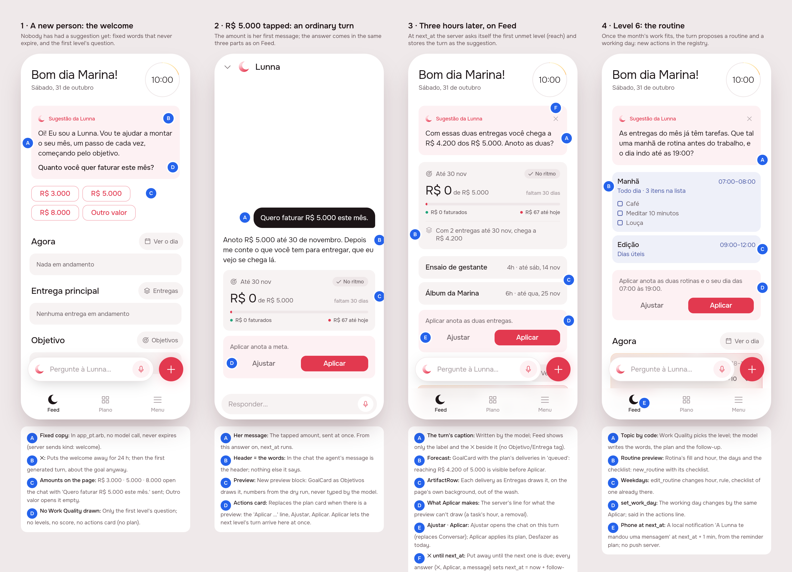

# A suggestion is a turn the agent asks itself, about Work Quality

Draft, design session ([issue #71](https://github.com/pietroid/lunna/issues/71)).
**Mockup track**: the suggestion changes shape (a header, a preview drawn
by the tabs' own widgets, an actions card), a new person meets a welcome,
and the chat draws a turn the same way. The research is
[the RFC](../../research/2026-10-29-agentic-suggestions/README.md),
approved in #69 and merged in #70.

## 1. The prompt

> Implement: A suggestion is a turn the agent asks itself, about Work Quality
>
> Build what the RFC [product/research/2026-10-29-agentic-suggestions/README.md](https://github.com/pietroid/lunna/blob/main/product/research/2026-10-29-agentic-suggestions/README.md) recommends, approved in #69 and merged in #70.
>
> - Read it as the research (see "From an RFC" in the /create skill): what it recommends, in its priority order, and its Rollout are the spec.
> - A `> **Decision**` note in it is binding; every other decision takes the option marked *(recommended)*.
> - The plan (or the board, if it changes what the person sees) says which rollout phases this PR ships, Phase 0 first.

## 2. The design

[board.json](img/board.json) · each screen: [1](img/mockup-1.png),
[2](img/mockup-2.png), [3](img/mockup-3.png), [4](img/mockup-4.png).

The flow is the RFC's golden scenario, left to right. A new person opens
Feed on a Saturday and finds the welcome. She taps R$ 5.000, and the chat
answers with the goal drawn as Objetivos draws it. Three hours later the
server asks itself the next Work Quality level (do the deliveries reach
the goal?) and Feed shows that turn. Further on comes level 6: a routine
and a working day.

### Which phases this PR ships

The RFC has no numbered Rollout section, so its recommendations, in the
RFC's order, are the phases:

| Phase | What | This PR |
|-------|------|---------|
| 0 · Measure | `work_quality` (0–7) per person to PostHog, a number, never text | ✓ first |
| 1 · Work Quality | the seven checks in code; the first unmet one is the topic | ✓ |
| 2 · The stored turn | the suggestion is a `turn()` with a system-written request; caption, plan, `preview`, `followUp`; the template stays as the fallback when a turn fails | ✓ |
| 3 · The three parts | header card, the preview on the page, actions card, on Feed and in the chat (board) | ✓ |
| 4 · The welcome | fixed copy, never expires, for whoever never had a suggestion | ✓ |
| 5 · `next_at` | the follow-up (3–24 h, default 24 h) counted from the last answer, moved into the working day, replacing `validUntil`; a timer per person, settled on read as catch-up; the phone's local notification; the morning reminder names an unseen suggestion | ✓ |
| 6 · Routines in the registry | `new_routine`, `edit_routine`, `set_work_day` (15 → 18 of 42 routes) | ✓ |

All of it ships in this PR because the welcome hands over to turns that
reach level 6, and level 6 needs the routine actions. If the build runs
long, Phase 6 is the one that can go to a PR of its own: until then,
level 6's turn ends in `choices` (no plan) and Rotina is changed by hand.

### References

Drawn from known patterns (Mobbin was not browsed in this run):

- **Chen et al., CHI 2025 (from the RFC)**: a short summary that expands
  into the chat. The header is the summary and Ajustar is the expansion.
- **Linear / Notion AI's "preview before apply"**: the outcome is drawn as
  the real object, and the accept button sits under it.
- **ChatGPT's onboarding chips**: a greeting that asks one question, with
  the answers to tap. The welcome's amounts work that way.

### Decisions

| Pin | Decision | Why |
|-----|----------|-----|
| 1A | The welcome is **fixed copy in `app_pt.arb`** (`agentWelcome`, brand-selected), sent by the server as `kind: 'welcome'` with no model call and no expiry | RFC *A new person* (recommended); costs nothing for the same words every time |
| 1B | ✕ puts the welcome away for 24 h, and any other suggestion until its `next_at` | RFC *Decided unattended*; answers #67's open question |
| 1C | The amounts (**R$ 3.000, 5.000, 8.000, Outro valor**) are secondary buttons **on the page**, under the header. An amount opens the chat with "Quero faturar R$ 5.000 este mês." already sent; Outro valor opens it empty | RFC: the question goes in the header, the page holds only what to tap |
| 1D | **No Work Quality on screen**: no levels, no score. No actions card when there is no plan | RFC review 2: it is internal |
| 2A | The tapped amount is an ordinary user turn, and from its answer on `next_at` runs | RFC |
| 2B–D | In the chat a turn with a `preview` draws **its words, the preview, then `OfferActions`** (the "Aplicar …" line, Ajustar, Aplicar) instead of the plan card. In the chat, Ajustar answers the plan as today | RFC review 3: three parts in both places |
| 2C, 3B | The new `PreviewBlock` (`GoalPreview`, `ArtifactPreview`, `RoutinePreview`) is drawn by the tabs' own widgets: `GoalCard`, `ArtifactRow` (through `AgentLinks.preview`, since `artifacts` depends on `agent`), and a routine block in Rotina's fill. **The server fills every number from the dry run**: the goal's `queued` includes the plan's deliveries | RFC *show the goal as the goal tab will*; the model never types a number |
| 3A | The header carries the mark, "Sugestão da Lunna" and ✕ only. **The Objetivo / Entrega / Rotina tag from #67 is dropped** | Work Quality's seven levels don't map onto three tags, and the RFC's pictures draw none |
| 3D | The line above the buttons (`applies`) is the server's, for what the preview can't draw | RFC *three parts* |
| 3E | Two buttons: **Ajustar** (opens the chat on this turn; it replaces Conversar) and **Aplicar** (the turn's plan, with Desfazer as today) | RFC *Decided unattended* |
| 3F | Every answer (Aplicar, ✕, a message in the chat it opened) sets `next_at = answer + followUp`, held to 3–24 h (24 h if none is given), and moved into the working day | RFC *The next suggestion comes when the last one said* |
| 4A | The topic is code's (the first unmet level); the model writes the words, the plan and the follow-up | RFC decision (recommended) |
| 4B–D | `RoutinePreviewRow`: name and hours in Rotina's `routineFill` and `routineInk`, the days and "3 itens na lista", the checklist as empty boxes. `set_work_day` is told in the actions line | RFC *routines join the registry* |
| 4E | At `next_at` + 1 min, a local notification: "A Lunna te mandou uma mensagem", from the reminder plan (`NotificationsService.plan`). No push server | RFC *One timer per person* (decided) |

No new icon: the agent's mark (`AppIcons.agent`) as before, and routines
reuse Rotina's colours.

### Decided unattended

- **Track: mockup.** The first phases change the card the person sees.
- **Phases: all seven in this PR**, Phase 6 first to split off if the build
  runs long (see the table above).
- **The focus tag (Objetivo / Entrega / Rotina) is dropped from the card.**
  `SuggestionFocus` can stay on the wire for analytics, or go.
- **The welcome's amounts are R$ 3.000, 5.000 and 8.000**, as in the RFC's
  picture, formatted by l10n (`agentWelcomeAmount`, `decimalPattern`).
- **Outro valor opens the chat empty**, with the keyboard up, rather than
  sending a message.
- **"Draft" is not marked on the preview.** The actions line says what
  Aplicar makes, and a faded preview would lose the contrast the RFC
  review asked for.
- **Feed draws one suggestion.** The space under the actions card is
  where a second would go (RFC review 3).

### Open questions

From the RFC, still the person's:

- Is the goal in the golden scenario an amount to bill (today's only
  goal), or something else, which would mean opening `count` goals?
  The build assumes money.
- Should "based on her cycle" mean phases the routine knows about, or is
  it enough for the agent to place blocks by day? The build assumes by
  day (today's `daily` / `weekdays` / `weekend`).

## Build brief

Phase 3 starts here and Phase 4 removes this section.

### Files the design session wrote (uncommitted until the queue commits them)

- `app/lib/agentic_suggestions_preview.dart`: the preview entry point
  (`?s=1..4`, the clock fixed at Sat 31 Oct 10:00, `_Agent` over
  `DemoAgentRepository`). **Delete it at the end of Phase 4.**
- `app/packages/agent/lib/src/surface.dart`: `PreviewBlock` and the
  `PreviewItem`s (`GoalPreview`, `ArtifactPreview`, `RoutinePreview`).
  **Not decoded yet**: `AgentSurface.decode` needs the A2UI component.
- `app/packages/agent/lib/src/view/agent_preview.dart`: `AgentPreview`,
  `RoutinePreviewRow`.
- `app/packages/agent/lib/src/view/offer_actions.dart`: `AgentWash`,
  `OfferActions`.
- `app/packages/agent/lib/src/view/suggestion_card.dart`: rewritten in
  three parts, the welcome, the choices on the page.
- `app/packages/agent/lib/src/view/agent_sheet.dart`: `_Answer` draws
  `PreviewBlock`, and a plan under a preview as `OfferActions`.
- `app/packages/agent/lib/src/models.dart`: `AgentSuggestion.welcome`
  (`kind: 'welcome'`); `agent_links.dart`: `AgentLinks.preview`;
  `agent.dart` exports.
- `app/packages/artifacts/lib/src/view/agent_previews.dart`:
  `drawAgentPreview` (GoalCard / ArtifactRow); exported from `view.dart`.
- `app/lib/shell/view/shell_page.dart`: `AgentLinks(preview:
  drawAgentPreview)`.
- `app_pt.arb` (+ gen): `agentWelcome`, `agentWelcomeQuestion`,
  `agentWelcomeAmount`, `agentWelcomeSay`, `agentWelcomeOther`,
  `agentPreviewItems`. `agentSuggestionTalk`, `agentSuggestionGoal`,
  `agentSuggestionDelivery` and `agentSuggestionRoutine` are unused now:
  remove them if nothing else reads them.

`flutter analyze` is clean on these. The tests have **not** been run; the
existing `suggestion_card` tests (Conversar, the focus tag) will need
rewriting.

### Server

- **Work Quality** (`agent/work-quality.ts`): the seven checks from
  `code/ladder.mjs` (goal running → deliveries reach it → each has day,
  value, length → the main delivery has a next task → work fits the free
  hours (`Schedule.needMinutes` / `freeMinutes`) → routine and working day
  set → on pace), giving the score 0–7 and the first unmet level with its
  facts. Unit specs over the five states of `data/ladder.csv`.
- **Phase 0**: send `work_quality` to PostHog as a number when a
  suggestion is written (an analytics event row in
  `analytics/events.ts`); nothing the person wrote.
- **The stored turn**: replace the arithmetic in `SuggestionStore`'s
  producer with a `turn()` on a system-written request ("Topic: reach.
  Goal R$ 5.000 by 30/11; open deliveries worth R$ 4.200. Propose the next
  step.") through the same tools and dry run. Store its reply as the
  suggestion's `opening`, with `text` as the caption. If the turn fails,
  fall back to #67's template text.
- **`preview` in the `answer` tool**: the model names which plan creations
  to preview; the server fills `GoalPreview.queued`/`queuedCount` (the
  goal's own arithmetic plus the plan's deliveries), the delivery and
  routine fields, and `applies` (speech.ts) from the dry run. It is an
  A2UI component, decoded in `AgentSurface.decode`, `speakable`.
- **`followUp`** (hours) in the answer: clamp 3–24, default 24.
  `next_at = last answer + followUp`, moved to the next working day's
  start when it falls outside it. It replaces `validUntil`, and the wire
  keeps `validUntil` = `next_at` for the app until it reads `nextAt`.
  Every answer moves it: Aplicar on the suggestion's plan, ✕ (a new
  `POST /agent/suggestion/:id/dismiss`, which replaces the device-only
  24 h rest in `SuggestionCubit`), and each message in a conversation
  opened with `suggestionId`.
- **The welcome**: a person with no suggestion row ever gets
  `{ kind: 'welcome', validUntil: null }` (the app draws the copy). It goes
  once answered, or for 24 h on ✕.
- **The timer**: `Map<userId, Timeout>` armed when `next_at` is written,
  re-armed at boot by one query, firing one-shot. On read, a passed
  `next_at` writes the turn then. **Update AGENTS.md's rule "Nothing on
  the server runs on a timer that touches Postgres"** to allow one-shots
  at an hour someone was told to look, never periodic (RFC decision,
  decided).
- **Notifications**: `NotificationsService.plan` gets a `suggestion` item
  at `next_at` + 1 min, "A Lunna te mandou uma mensagem". The morning
  message (`MORNING_MESSAGES`) names an unseen suggestion.
- **Routines in the registry**: `new_routine` (title, hour, rule, length,
  checklist), `edit_routine`, `set_work_day`, each one `Action` through
  `RoutinesService` / the users route, with Desfazer from the snapshot.
  Run `tool/coverage.mjs`: 15 → 18. Add `PlanChangeKind`s and plan-card
  lines in the app for them.
- **In the same conversation**: after Aplicar in a conversation opened
  from a suggestion, the next level's turn is asked into it at once.
- Specs: end-to-end with the memory stores and a frozen clock (follow-up
  clamping, the working-day shift, every answer moving `next_at`, the
  welcome, the catch-up on read, the timer re-armed at boot). Add an
  eval case per level (`npm run eval:agent`, by hand).

### App

- `SuggestionCubit`: hold until `nextAt` (or forever for the welcome); ✕
  posts the dismiss; drop the SharedPreferences rest.
- `AgentSuggestion.nextAt` (nullable) replaces `validUntil`.
- `PlanChangeKind.addRoutine` / `editRoutine` / `setWorkDay`, with their
  `PlanCard` lines; `applyAgentPlan` reloads Rotina's data and `workDay`.
- Notifications package: the `suggestion` item and its copy (from the
  server, as the reminders' copy is).
- Specs: the card's three parts, the welcome's amounts sending their
  message, `OfferActions` in the chat, the preview's fallback with no
  `AgentLinks`. Both brands.
- Specs for the agent: `product/spec/agent.md` *The suggestion* rewritten,
  and the AGENTS.md pointer.

### Design session's cost

Not recorded: the queue measures every run and writes the figures in the
PR (its instructions skip `.tool/cost` here).
