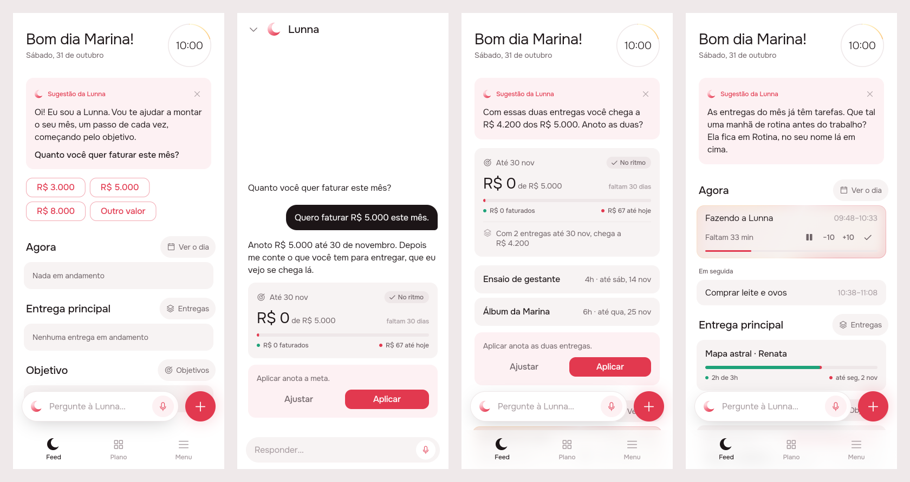
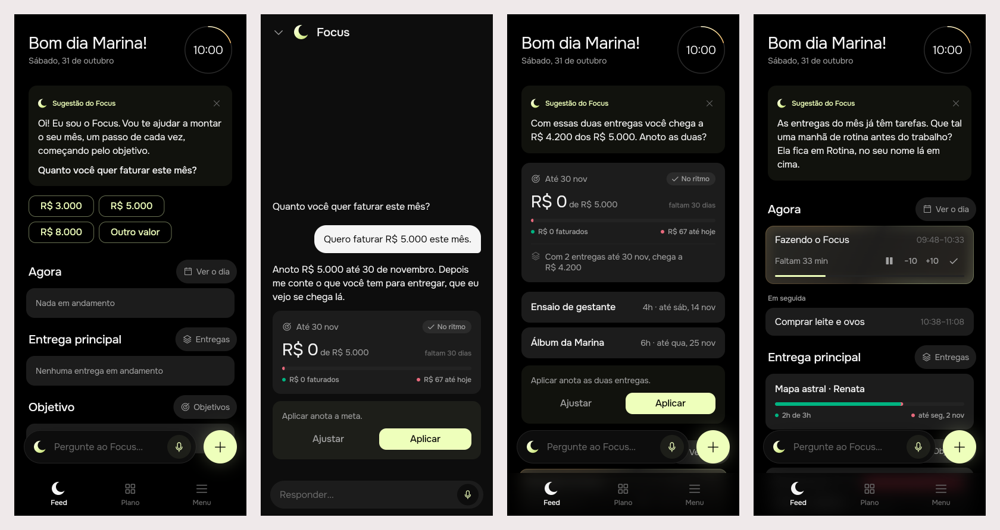

# A suggestion is a turn the agent asks itself, about Work Quality

Delivered ([issue #71](https://github.com/pietroid/lunna/issues/71)).
**Mockup track**: the suggestion changes shape (a header, a preview drawn
by the tabs' own widgets, an actions card), a new person meets a welcome,
and the chat draws a turn the same way. The research is
[the RFC](../../research/2026-10-29-agentic-suggestions/README.md),
approved in #69 and merged in #70.

## 1. The prompt

> Implement: A suggestion is a turn the agent asks itself, about Work Quality
>
> Build what the RFC [product/research/2026-10-29-agentic-suggestions/README.md](https://github.com/pietroid/lunna/blob/main/product/research/2026-10-29-agentic-suggestions/README.md) recommends, approved in #69 and merged in #70.
>
> - Read it as the research (see "From an RFC" in the /create skill): what it recommends, in its priority order, and its Rollout are the spec.
> - A `> **Decision**` note in it is binding; every other decision takes the option marked *(recommended)*.
> - The plan (or the board, if it changes what the person sees) says which rollout phases this PR ships, Phase 0 first.

On the issue, after the design: **"Approve"**. The build was then run with:

> build agentic-suggestions
>
> The design was approved on the issue. Do Phases 3 and 4 unattended. .tool/check must pass before you finish; a failure your change didn't cause is proved (stash, rerun) and named in the README. In section 5 write "Measured by the queue: see the pull request." instead of .tool/cost tables.

## 2. The design

[board.json](img/board.json) · each screen: [1](img/mockup-1.png),
[2](img/mockup-2.png), [3](img/mockup-3.png), [4](img/mockup-4.png).

The flow is the RFC's golden scenario, left to right. A new person opens
Feed on a Saturday and finds the welcome. She taps R$ 5.000, and the chat
answers with the goal drawn as Objetivos draws it. Three hours later the
server asks itself the next Work Quality level (do the deliveries reach
the goal?) and Feed shows that turn. Further on comes level 6: a routine
and a working day.

### Which phases this PR ships

The RFC has no numbered Rollout section, so its recommendations, in the
RFC's order, are the phases:

| Phase | What | This PR |
|-------|------|---------|
| 0 · Measure | `work_quality` (0–7) per person to PostHog, a number, never text | ✓ first |
| 1 · Work Quality | the seven checks in code; the first unmet one is the topic | ✓ |
| 2 · The stored turn | the suggestion is a `turn()` with a system-written request; caption, plan, `preview`, `followUp`; the template stays as the fallback when a turn fails | ✓ |
| 3 · The three parts | header card, the preview on the page, actions card, on Feed and in the chat (board) | ✓ |
| 4 · The welcome | fixed copy, never expires, for whoever never had a suggestion | ✓ |
| 5 · `next_at` | the follow-up (3–24 h, default 24 h) counted from the last answer, moved into the working day, replacing `validUntil`; a timer per person, settled on read as catch-up; the phone's local notification; the morning reminder names an unseen suggestion | ✓ |
| 6 · Routines in the registry | `new_routine`, `edit_routine`, `set_work_day` (15 → 18 of 42 routes) | **split off** (see 3.6) |

All of it ships in this PR because the welcome hands over to turns that
reach level 6, and level 6 needs the routine actions. If the build runs
long, Phase 6 is the one that can go to a PR of its own: until then,
level 6's turn ends in `choices` (no plan) and Rotina is changed by hand.

### References

Drawn from known patterns (Mobbin was not browsed in this run):

- **Chen et al., CHI 2025 (from the RFC)**: a short summary that expands
  into the chat. The header is the summary and Ajustar is the expansion.
- **Linear / Notion AI's "preview before apply"**: the outcome is drawn as
  the real object, and the accept button sits under it.
- **ChatGPT's onboarding chips**: a greeting that asks one question, with
  the answers to tap. The welcome's amounts work that way.

### Decisions

| Pin | Decision | Why |
|-----|----------|-----|
| 1A | The welcome is **fixed copy in `app_pt.arb`** (`agentWelcome`, brand-selected), sent by the server as `kind: 'welcome'` with no model call and no expiry | RFC *A new person* (recommended); costs nothing for the same words every time |
| 1B | ✕ puts the welcome away for 24 h, and any other suggestion until its `next_at` | RFC *Decided unattended*; answers #67's open question |
| 1C | The amounts (**R$ 3.000, 5.000, 8.000, Outro valor**) are secondary buttons **on the page**, under the header. An amount opens the chat with "Quero faturar R$ 5.000 este mês." already sent; Outro valor opens it empty | RFC: the question goes in the header, the page holds only what to tap |
| 1D | **No Work Quality on screen**: no levels, no score. No actions card when there is no plan | RFC review 2: it is internal |
| 2A | The tapped amount is an ordinary user turn, and from its answer on `next_at` runs | RFC |
| 2B–D | In the chat a turn with a `preview` draws **its words, the preview, then `OfferActions`** (the "Aplicar …" line, Ajustar, Aplicar) instead of the plan card. In the chat, Ajustar answers the plan as today | RFC review 3: three parts in both places |
| 2C, 3B | The new `PreviewBlock` (`GoalPreview`, `ArtifactPreview`, `RoutinePreview`) is drawn by the tabs' own widgets: `GoalCard`, `ArtifactRow` (through `AgentLinks.preview`, since `artifacts` depends on `agent`), and a routine block in Rotina's fill. **The server fills every number from the dry run**: the goal's `queued` includes the plan's deliveries | RFC *show the goal as the goal tab will*; the model never types a number |
| 3A | The header carries the mark, "Sugestão da Lunna" and ✕ only. **The Objetivo / Entrega / Rotina tag from #67 is dropped** | Work Quality's seven levels don't map onto three tags, and the RFC's pictures draw none |
| 3D | The line above the buttons (`applies`) is the server's, for what the preview can't draw | RFC *three parts* |
| 3E | Two buttons: **Ajustar** (opens the chat on this turn; it replaces Conversar) and **Aplicar** (the turn's plan, with Desfazer as today) | RFC *Decided unattended* |
| 3F | Every answer (Aplicar, ✕, a message in the chat it opened) sets `next_at = answer + followUp`, held to 3–24 h (24 h if none is given), and moved into the working day | RFC *The next suggestion comes when the last one said* |
| 4A | The topic is code's (the first unmet level); the model writes the words, the plan and the follow-up | RFC decision (recommended) |
| 4B–D | `RoutinePreviewRow`: name and hours in Rotina's `routineFill` and `routineInk`, the days and "3 itens na lista", the checklist as empty boxes. `set_work_day` is told in the actions line | RFC *routines join the registry* |
| 4E | At `next_at` + 1 min, a local notification: "A Lunna te mandou uma mensagem", from the reminder plan (`NotificationsService.plan`). No push server | RFC *One timer per person* (decided) |

No new icon: the agent's mark (`AppIcons.agent`) as before, and routines
reuse Rotina's colours.

### Decided unattended

- **Track: mockup.** The first phases change the card the person sees.
- **Phases: all seven in this PR**, Phase 6 first to split off if the build
  runs long (see the table above).
- **The focus tag (Objetivo / Entrega / Rotina) is dropped from the card.**
  `SuggestionFocus` can stay on the wire for analytics, or go.
- **The welcome's amounts are R$ 3.000, 5.000 and 8.000**, as in the RFC's
  picture, formatted by l10n (`agentWelcomeAmount`, `decimalPattern`).
- **Outro valor opens the chat empty**, with the keyboard up, rather than
  sending a message.
- **"Draft" is not marked on the preview.** The actions line says what
  Aplicar makes, and a faded preview would lose the contrast the RFC
  review asked for.
- **Feed draws one suggestion.** The space under the actions card is
  where a second would go (RFC review 3).

### Open questions

From the RFC, still the person's:

- Is the goal in the golden scenario an amount to bill (today's only
  goal), or something else, which would mean opening `count` goals?
  The build assumes money.
- Should "based on her cycle" mean phases the routine knows about, or is
  it enough for the agent to place blocks by day? The build assumes by
  day (today's `daily` / `weekdays` / `weekend`).

## 3. What was built

### 3.1 The prints

The real build, through `app/lib/agentic_suggestions_preview.dart` (the
real `SuggestionCard`, `AgentSheet`, `GoalCard` and `ArtifactRow` on
canned replies; deleted afterwards). Scenes: 1 the welcome, 2 the chat
after R$ 5.000, 3 the `reach` turn with its preview and actions, 4 the
`routine` turn as this build ships it (words only, see 3.6).

**Lunna**

**Focus**

### 3.2 The contract

**Code picks the topic, the model writes the turn, and `nextAt` says when
the next one comes.** The first unmet Work Quality level is the topic; the
server asks the agent an ordinary turn about it and files the reply as the
suggestion; every answer (Aplicar, ✕, a message in its chat) hides it
and sets `nextAt` = answer + `followUp` (3–24 h, 24 by default), moved
into the working day. The full rules are in
[product/spec/agent.md](../../spec/agent.md#the-suggestion).

### 3.3 Server

| File | What |
|------|------|
| `agent/work-quality.ts` | the seven levels over `ArtifactsService.answer`, the score, the topic's facts, `basisOf` (topic + facts), `requestOf` (the system-written request) |
| `agent/agent.service.ts` | `suggestion()` rewritten: welcome → held → `_write` (the turn) → `_template` (#67's arithmetic, when the turn fails); `dismiss`; `_answered` on Aplicar and on each chat message; `previewsOf` from the dry run's sandbox; `clampFollowUp`, `nextAtOf`, `intoWorkDay`; `_measure` (PostHog) |
| `agent/answer.ts`, `agent.prompt.ts`, `speech.ts` | the `preview` block (A2UI `Preview`), `followUp` on the answer tool, `appliesOf` |
| `agent/suggestion.store.ts`, `pg-suggestion.store.ts` | `kind`, `workQuality`, `followUp`, `nextAt` (replaces `validUntil`), `dismissedAt`, `answeredAt`; `answer()`, `pending()` |
| `agent/suggestion.timer.ts` | one `setTimeout` per person at `nextAt`, re-armed at boot, `unref`'d; fires catch-up then `suggestion()` |
| `notifications/` | a `suggestion` item a minute after `nextAt` |
| `drizzle/0017`, `0018` | the new columns (existing rows carry `valid_until` into `next_at`), then `valid_until` dropped |
| `analytics/events.ts` | `POST /agent/suggestion/:id/dismiss` → `suggestion_dismissed`; `suggestion_written` with `work_quality` is captured by the service |

Routes: `GET /agent/suggestion` now answers `{ id, kind, focus, text,
nextAt, validUntil, action?, opening }`; new `POST
/agent/suggestion/:id/dismiss`.

### 3.4 App

- `AgentSuggestion`: `nextAt` (nullable) and `welcome` replace
  `validUntil` and `focus`; `SuggestionFocus` is gone.
- `PreviewItem.fromJson` and the `Preview` component in
  `AgentSurface.decode` (an unknown item type is skipped); `GoalPreview`
  carries `done`.
- `SuggestionCubit` asks the server on every load and posts the ✕
  (`AgentRepository.dismissSuggestion`); the SharedPreferences rest and the
  package's `shared_preferences` dependency are gone. A welcome amount
  clears the card (answered).
- The preview with no `AgentLinks` draws a line per item instead of
  nothing.
- Notifications: `NotificationKind.suggestion`, filed with the daily
  ones.
- `agentSuggestionTalk`, `…Goal`, `…Delivery`, `…Routine` removed from
  `app_pt.arb`.

### 3.5 Tests

- Server: **114** specs in `src/agent` and `src/notifications` pass
  (`npm test -- src/agent src/notifications`), among them
  `work-quality.spec.ts` (the RFC's five people of `data/ladder.csv`, the
  routine after the work, `keep`, the basis, the follow-up clamp and the
  working-day shift), `suggestion.timer.spec.ts` (re-armed at boot, one
  per person), the end-to-end suggestion specs in
  `agent.controller.spec.ts` (the welcome and its ✕, the turn with its
  preview and `nextAt`, Aplicar hiding it and the next turn 3 h later, a
  chat message moving `nextAt`, the template when the model fails), the
  Postgres store on PGlite with the new migrations, and the notification
  item.
- App: the `agent` package, **75** tests, pass under Focus, and the two
  suggestion files under Lunna too (the welcome's amounts sending their
  message, the three parts with Ajustar opening the chat, the cubit
  posting the ✕, `Preview` decoding).
- `.tool/check`: see 3.7.

### 3.6 Where the build differs from the design

- **Phase 6 (routines in the registry) is split off**, as the design
  allowed. The `routine` level's turn is told it cannot write a routine
  and points to Rotina, with no plan (scene 4); the `RoutinePreview` widget
  stays for that PR. Level 6 is met by **a routine written**: the working
  day has a default (07:00–22:00) that cannot be told apart from one
  chosen, so "working day set" is not checked.
- **The model doesn't name what to preview**: a `preview` block takes no
  arguments and the server draws every goal and delivery the plan makes
  (plus the running goal a new delivery counts towards). The model can't
  name a wrong one, and the numbers are the sandbox's.
- **A turn's plan lives two hours** (`PLAN_TTL_MS`): past it, the next read
  asks the turn again of the day as it is, rather than drawing a card
  whose Aplicar would fail.
- **The notification names no brand**: "Uma sugestão para o seu mês /
  Tenho uma ideia para o próximo passo. Vem ver?", since the server knows
  no brand. The morning reminder does **not** yet name an unseen
  suggestion: nothing records "seen".
- **Not built**: asking the next level's turn into the same conversation
  right after Aplicar, and an eval case per level (`npm run eval:agent`
  costs money and is run by hand).
- The welcome is skipped for someone who already has a goal, and comes
  back after its 24 h ✕ until it is answered.

### Decided unattended (build)

- Phase 6 split off (above); the decisions in 3.6.
- The welcome is a stored row (`kind: welcome`, `nextAt: null`), so its
  conversation carries `suggestionId` and a message there answers it.
- An answered or dismissed suggestion hides until `nextAt`; so does one
  whose topic facts changed (`basis`), as the RFC says.
- `focus` on the wire now carries the topic (`reach`, …) or the
  template's focus; the app no longer reads it.

### 3.7 `.tool/check`

**Passes.** Every step is green: `app-analyze`, the tests of `agent`, `analytics`,
`api_client`, `app_ui`, `artifacts`, `notifications` and `timeline` under
Focus and Lunna, `server-eslint`, `server-tsc` and `server-test`. A first
run failed only `app-analyze`, on lint notes in the preview entry point
(`app/lib/agentic_suggestions_preview.dart`), which Phase 4 deletes. With
it deleted, the second run passed.

## 4. How to turn it on

Nothing new to set. The migrations run on boot. With `OPENROUTER_API_KEY`
unset (or the model down) every suggestion is #67's template, and the
welcome needs no model at all. `work_quality` reaches PostHog only with
`POSTHOG_KEY`. The timer arms itself in the server; there is no cron.

## 5. Cost and time

Measured by the queue: see the pull request. The build made no model
calls outside Claude: every spec runs on a scripted model, and nothing was
run against OpenRouter.
