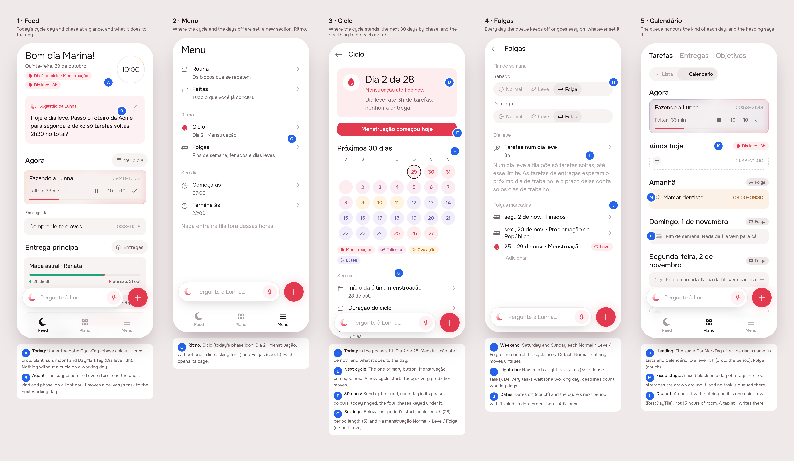

# Ciclo e folgas: the menstrual cycle and days off shape the day

> Issue [#73](https://github.com/pietroid/lunna/issues/73), mockup track.
> Designed unattended. This is the draft: sections 1 and 2 and the Build
> brief. The person approves (or comments) on the issue; the build is a
> fresh session, `/create build cycle`.

## 1. The prompt

From the issue, verbatim:

> **Add menstrual cycle and time off**
>
> The intention of this app being synced to menstrual cycle of the woman, we need a way to input the four cycles stages for the next 30 days (based on research did here, talking about apple health).
>
> So the goal of this task is to show if there is any data, which calendar day of your cycle it is (if there is icon it's better), to have a way to add your next cycle (for now the menu).
>
> Now about how it affects the calendar: the cycle corresponding to the period must be very low work, some tasks can be done but usually not deliverables for client. So that enters the type of blocks that represents time offs or restrictions that also corresponds to weekends and so on.
>
> Remember on including that to also update the agentic layer because it should have access to the suggestions so on so forth.
>
> Also include this time off dynamic to the calculation of deliverables goals etc (where we calculate time related things)

The "research did here, talking about apple health" is not in the repo
(no RFC under `product/research/` mentions the cycle or Apple Health), so
the design follows how Apple Health's Cycle Tracking works: you log the
first day of a period, and it predicts the next periods and the fertile
window from your cycle and period lengths.

## 2. The design

The screens one by one, for a phone: [1](img/mockup-1.png) ·
[2](img/mockup-2.png) · [3](img/mockup-3.png) · [4](img/mockup-4.png) ·
[5](img/mockup-5.png). The pins are in [board.json](board.json). The real
app (Lunna) draws them through `app/lib/cycle_preview.dart`, on the demo's
day and deliveries. Screens 1 to 4 are on Thursday 29 Oct at 10:00, the
second day of a period that began on the 28th. Screen 5 is on Friday at
18:40, so the weekend is in sight.

### The rule

**A day is one of three kinds: work, light or off.** The kind is the
server's to work out. It comes from three sources, and the strictest one
wins (off over light over work):

| Source | Sets | Default |
|--------|------|---------|
| The weekend (Folgas) | Saturday and Sunday, each Normal / Leve / Folga | Normal (nothing changes until it is set) |
| The cycle (Ciclo) | every predicted day of the period | Leve |
| A date off (Folgas) | that date | Folga |

- **Off**: the queue puts nothing there, as it does outside the working
  day. Fixed blocks and routines stay where they are (a meeting on a
  Saturday is still a meeting). What the person drops or writes there by
  hand stays there too: the queue keeps off the day, but the person
  does not have to.
- **Light**: the queue puts on it at most the light budget (3 h unless
  changed) of **loose tasks**. A delivery's tasks (the client work) hop
  over the day to the next working day, the way the queue already hops
  over a fixed block. An anchored task keeps its hour: the person put it
  there.
- **Time math counts working days.** A delivery's red bar (`paceTime`)
  and its lag, a goal's "what its days ask by now", and the agent's
  `fits` (work owed against free hours) all count the share of
  **working** time that has gone, not calendar time. An off day counts 0.
  A light day counts 0 for deliveries, since none of their tasks go
  there. So a week of rest no longer turns a delivery red.

### The cycle

Four phases, worked out the way Apple Health predicts them, from the
first day of the last period, the cycle length (28) and the period
length (5):

| Phase | Days (28-day cycle) | Icon (Phosphor) | Colour token |
|-------|--------------------|-----------------|--------------|
| Menstruação | 1 to 5 (the period) | `drop` (fill) | `cycleMenstrual` (the brand's red) |
| Folicular | 6 to 12 | `plant` | `cycleFollicular` (a rose) |
| Ovulação | ovulation day ±1 (day 14 = length − 14) | `sun` | `cycleOvulatory` (amber) |
| Lútea | 16 to 28 | `moon` | `cycleLuteal` (lilac) |

Every phase has a `…Fill` token too, in both brands.

### References

I drew these from patterns I already know, not from browsing (Mobbin was
not opened in this unattended run):

- **Apple Health, Cycle Tracking**: you log the period's first day, and
  the next periods and the fertile window are predicted. The phases on a
  calendar of dots, one colour per kind of day. This is where the 30-day
  grid on screen 3 comes from.
- **Clue / Flo**: today's cycle day and phase in one line at the top
  ("Dia 2 do ciclo"). This is where the Feed's tag comes from.
- **Motion / Reclaim**: days off and "focus-light" days as rules the
  scheduler honours, not as blocks you draw. This is where the light day
  as a budget comes from, instead of a block that fills the calendar.

### Decisions

| Pin | Decision | Chosen |
|-----|----------|--------|
| A | Where today's cycle shows | Under the Feed's date, as two tags: `CycleTag` ("Dia 2 do ciclo · Menstruação", in the phase's colour and icon) and `DayMarkTag` ("Dia leve · 3h"). With no cycle and a working day, nothing is drawn. |
| B | Does the agent know | The suggestion and every turn read the day's kind and the cycle: here it offers to move a delivery's task off the light day |
| C | Entry point | Menu, a new section **Ritmo** with **Ciclo** (today's phase icon and "Dia 2 · Menstruação") and **Folgas** (couch) |
| D | Today on Ciclo | A card in the phase's fill: the icon, "Dia 2 de 28", "Menstruação até 1 de nov.", and what that does to the day |
| E | Add the next cycle | One primary button, **Menstruação começou hoje**. It starts a new cycle today, and every prediction moves with it. |
| F | The next 30 days | A month grid, Sunday first, each day in its phase's colours, today ringed, a legend of the four phases |
| G | What the cycle is worked out from | Under the grid: the last period's start, the cycle length (28), the period length (5), and **Na menstruação** Normal / Leve / Folga (default Leve) |
| H | Weekend | Saturday and Sunday, each Normal / Leve / Folga (the same segmented control as G) |
| I | The light budget | "Tarefas num dia leve · 3h", and a line on what a light day does (no delivery tasks, deadlines count working days) |
| J | Every day that is not a working day | The dates written down (couch), and the cycle's next period with its kind ("Do ciclo"), in date order, then + |
| K | The calendar's day heading | The same `DayMarkTag` after the day's name, in Lista and Calendário |
| L | A day off with nothing on it | One quiet row, `RestDayTile` ("Fim de semana. Nada da fila vem para cá."), not 15 hours of free stretch. A tap still writes there. |
| M | A day off with a fixed block | The block stays; no free stretches are drawn around it |

### Decided unattended

- **Weekends default to Normal.** The issue says time off "corresponds to
  weekends", but switching every account's weekends off at once would
  move every queue that runs into a weekend. Folgas sets it in one tap.
  The person can flip the default.
- **A period day defaults to Leve, not Folga**, per the issue ("some
  tasks can be done but usually not deliverables").
- **Light means loose tasks only, up to 3 h.** "Not deliverables for
  client" is read as "no task that belongs to a delivery". The queue sends
  them to the next working day. A delivery task the person drags onto a
  light day by hand stays there.
- **Only the period changes the day.** The other three phases are shown
  (Feed, Ciclo, the agent reads them) but set no restriction. A later
  issue can let the luteal days, say, be light too.
- **Prediction is Apple Health's arithmetic** (ovulation = length − 14,
  a 3-day ovulatory window), from one logged start and two lengths. There
  is no averaging over past cycles yet. The server keeps every logged start
  (`cycle_start` rows), so it can average later.
- **No HealthKit import.** "Input the four stages" is done by hand here.
  Reading Apple Health is its own issue: it needs an iOS entitlement and
  a permission screen.
- **The data is health data.** It stays in Postgres, behind the session
  like everything else, and is **never sent to PostHog** (the route →
  event table logs only that the rhythm changed, never what to). The
  agent sees the phase and the kind of day, never the dates of past
  periods.

### Open questions

1. Should weekends default to **Folga** for everyone (the issue's
   reading), or stay Normal until set (drawn here)?
2. Should the luteal phase (or the days just before the period) be light
   too, or is the period the only phase that changes the day?

## Build brief

Phase 3 starts here (`/create build cycle`). Read the spec of each
feature it touches first: [agent.md](../../spec/agent.md),
[artifacts.md](../../spec/artifacts.md), [goals.md](../../spec/goals.md).

### Files the design wrote (uncommitted on the branch, kept for the build)

- `app/lib/cycle_preview.dart`: the preview entry point (5 scenes,
  `?s=1..5`). Its fake timeline drops tasks on days off and anything past
  22:00, which the real server must do itself. **Delete it in Phase 4.**
- `app/packages/cycle/` (new package): `Cycle` (the phase math),
  `RestRules`, `DayOff`, `Rhythm`, `CycleRepository` (`/api/rhythm`),
  `CycleCubit`, `CyclePage`, `DaysOffPage`, `DayKindChoice`. It has no
  tests yet.
- `app/packages/timeline/`: `models/day_mark.dart` (`DayKind`,
  `DayReason`, `CyclePhase`, `DayMark`, `marks.on(day)`);
  `Timeline.marks` read from the response's `days`; `TimelineState.marks`
  set by every bloc handler; `FreeSlot.rest`, so `freeSlots(marks:)`
  draws no room on a day off and one rest slot when the day is empty;
  `widgets/day_mark_tag.dart` (`CyclePhaseLook`, `DayMarkTag`, `CycleTag`,
  `RestDayTile`); `_HeadingRow(mark:)` in Lista and Calendário, and the
  `RestDayTile` branch in the calendar.
- `app/packages/app_ui`: 8 tokens, `cycle{Menstrual,Follicular,Ovulatory,Luteal}`
  and their `…Fill`, in both brands; icons `cycleMenstrual` (drop),
  `cycleFollicular` (plant), `cycleOvulatory` (sun), `cycleLuteal` (moon),
  `dayOff` (couch), `dayLight` (feather).
- `app/lib/feed/view/feed_page.dart` (`_TodayMarks` under the date) and
  `app/lib/menu/view/menu_page.dart` (the Ritmo section, which pushes
  `/ciclo` and `/folgas`).
- `app/packages/l10n/lib/arb/app_pt.arb` (+ gen): the `cycle*`, `dayKind*`,
  `dayOff*`, `daysOff*`, `menuCycle*`, `menuDaysOff*` and
  `menuRestSection` strings, and three `demo*` strings for the preview.
- `app/pubspec.yaml`: the `cycle` path dependency.

### Server

- **Schema** (`db/schema.ts`, `npm run db:generate`):
  - `user.saturday_kind` and `user.sunday_kind` (`work|light|off`,
    default `work`), and `user.light_minutes` (default 180).
  - `cycle` (one per user: `length`, `period_length`, `period_kind`).
  - `cycle_start` (user, day): every logged start. The last one is
    `lastStart`.
  - `day_off` (id, user, day, title).
- **`rhythm/`** (a Nest module, `@UseInterceptors(CatchUpInterceptor)`):
  - `GET /api/rhythm` answers `{ cycle, rest, daysOff }`.
  - `PUT /api/rhythm/cycle`, `POST /api/rhythm/cycle/start { day }`.
  - `PATCH /api/rhythm/rest`.
  - `POST /api/rhythm/days-off`, `DELETE /api/rhythm/days-off/:id`.
  - Every write answers the whole rhythm. Validate as `events/request.ts`
    does: length 21 to 45, period 1 to 10, a start not in the future,
    refusals in Portuguese.
  - Rows in `analytics/events.ts` that never carry dates or lengths.
- **`time/day-kinds.ts`**: `dayKindsFor(user, window, zone)` →
  `Map<YYYY-MM-DD, { kind, reason, budgetMinutes, cycle: { day, length,
  phase } }>`. The strictest source wins. The phase math is the same as
  `Cycle` in the app. One pure function, unit-tested across zones.
- **`relayout`** (`time/scheduling.ts`) takes the day kinds:
  - an off day has no slots for the queue;
  - a light day takes queued loose tasks until `budgetMinutes` is used,
    and a task with `artifact_id` skips it (as it skips a fixed block);
  - anchored tasks and events are untouched.
  - `catchUp` is unchanged.
  - End-to-end specs in `events/` with a frozen clock: a weekend off, a
    light Friday with a delivery task that moves to Monday, a loose task
    that stays, a budget that runs out.
- **`GET /api/timeline`** (and every write that answers with it) adds
  `days: DayMark[]` for the window: every non-work day, plus every day
  with a cycle.
- **Time math on working days.**
  - Add `capacityShare(from, to, now, kinds)`: the share of working time
    gone, where an off day counts 0, a light day counts 0 for deliveries,
    and a work day counts 1.
  - Use it for a delivery's time share: the server sends `timeGone` on
    each artifact, and the app's `Artifact.progressAt` / `lagOf` /
    `isBehind` read it instead of calendar time.
  - Use it for a goal's time share (`measureGoals`).
  - `freeMinutes` in `artifacts.service.ts` skips off days and caps light
    days at their budget, for loose work only.
  - Update the specs of each. Say it in `artifacts.md` and `goals.md`.
- **Agent:**
  - The board (`agent/board.ts`) carries each day's kind, reason and
    phase.
  - The prompt says what a light day and a day off mean: never propose a
    delivery's task on a light or off day unless asked.
  - The dry run refuses such a move with a doubt.
  - `work-quality.ts`: `fits` and `pace` use the working-day math.
  - The suggestion's turn sees today's kind and phase, so it can offer,
    as on screen 1, to move a delivery's task off a light day.
  - New actions (`actions/rhythm.ts`): `period_started`, `set_day_kind`
    (weekend), `add_day_off`, each a gesture the pages make.
  - One eval case in `agent/evals/` (a light day with a delivery task).

### App

- The shell provides `CycleRepository`. `app.dart` adds the `/ciclo` and
  `/folgas` routes, each with a `CycleCubit(onChanged: () =>
  timelineBloc.add(TimelineRequested()))` loaded on open and an
  `AskDock` with the `AppFab` writing on the day, as `/feitas` does.
- The rows on Ciclo open pickers: `AppWheelPicker` for the date, a wheel
  of days for the lengths, and a wheel of hours for the light budget.
  `DaysOffPage.onAdd` opens a small sheet (date + name) that posts to
  `/rhythm/days-off`. A tap on a date off offers to remove it.
- `RestDayTile.onTap` writes at the day's start with `Placement.at` (the
  server keeps it there: by hand wins). A drop on a rest row lands at the
  day's start too: make it a drop target like a free stretch.
- `Artifact` reads `timeGone` from the server (above).
- Tests:
  - `Cycle` (phase math, day before the start, a 35-day cycle);
  - `DayMark.fromJson`;
  - `freeSlots` with an off day, with and without a card;
  - `_HeadingRow`'s tag;
  - the Feed's tags (with marks, with none);
  - the Menu's rows;
  - `CyclePage` and `DaysOffPage` on a canned `Rhythm`;
  - every test under both brands.
- Spec `product/spec/cycle.md`, a short "Ciclo e folgas" section in
  `AGENTS.md`, and `packages/cycle`, `server/src/rhythm` in its Layout.

### Checked so far

- `flutter analyze` on `lib`, `timeline`, `cycle` and `app_ui`: no issues.
- `timeline`'s tests: 169 passed.
- `app/test/feed/feed_page_test.dart` does not compile, on main too. At
  line 264 it passes `plan:` to `AgentSuggestion`, which lost that
  parameter in #72. The build fixes it while it adds the Feed's tag tests.

### Decisions taken in this session that are not in the pins

The rule and the "Decided unattended" list above. And: the day kinds live
on the server and reach the app in the timeline's `days`, so the Feed,
the Menu and the calendar need no new request; only the two pages read
`/api/rhythm`.

### Open questions

The two in section 2. Both have a default the build can take if nobody
answers: weekends stay Normal, and only the period changes the day.

### Cost of the design session

The queue measures this run and writes the figures in the PR. In
unattended runs it does not call `.tool/cost` here.
