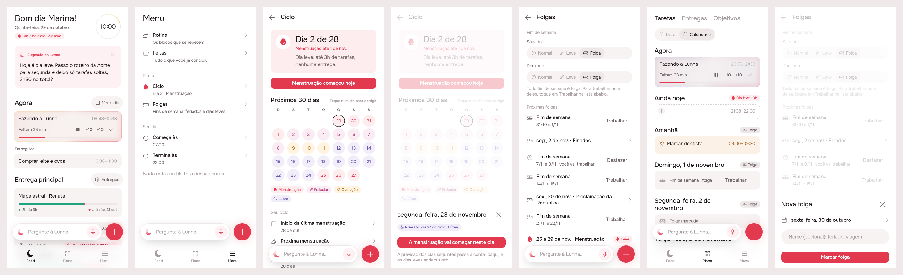
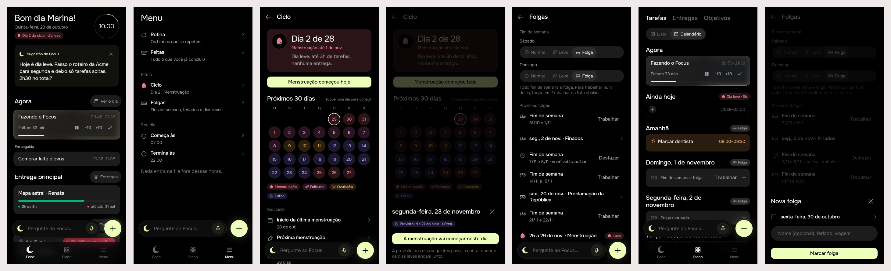

# Ciclo e folgas: the menstrual cycle and days off shape the day

> Issue [#73](https://github.com/pietroid/lunna/issues/73), mockup track.
> Designed unattended, changed once after the reply on the issue,
> approved there ("Approve"), and built unattended. Spec:
> [product/spec/cycle.md](../../spec/cycle.md).

## 1. The prompt

From the issue, verbatim:

> **Add menstrual cycle and time off**
>
> The intention of this app being synced to menstrual cycle of the woman, we need a way to input the four cycles stages for the next 30 days (based on research did here, talking about apple health).
>
> So the goal of this task is to show if there is any data, which calendar day of your cycle it is (if there is icon it's better), to have a way to add your next cycle (for now the menu).
>
> Now about how it affects the calendar: the cycle corresponding to the period must be very low work, some tasks can be done but usually not deliverables for client. So that enters the type of blocks that represents time offs or restrictions that also corresponds to weekends and so on.
>
> Remember on including that to also update the agentic layer because it should have access to the suggestions so on so forth.
>
> Also include this time off dynamic to the calculation of deliverables goals etc (where we calculate time related things)

The reply to the first design, on the issue:

> Don't integrate to apple health or anything like that, just a simple prediction is ok but the most important is the user able to change it.
>
> Also I didn't like the home page have two repeated badges, make it simpler. The rest seems great. Weekends are folgas unless they are removed (and one weekend can be specifically removed or something)

The reply to round 2, on the issue: "Approve".

The reply to the build, on the issue:

> Add spacing on próximas folgas

What round 2 changed for it:

- **The prediction is the person's to change.** Every day of Ciclo's
  grid can be tapped. A sheet says what the prediction makes of that day
  and offers one button: on today or a day gone, "A menstruação começou
  neste dia"; on a day ahead, "A menstruação vai começar neste dia".
  The cycles after it count from there. A new row, "Próxima
  menstruação", says when the next one is expected and whether the
  person corrected it ("prevista" / "corrigida por você"). Nothing reads
  Apple Health.
- **One tag on the Feed**, not two: "Dia 2 do ciclo · dia leve", in the
  phase's colour and icon. On a working day it names the phase instead
  ("Dia 9 do ciclo · Folicular").
- **Weekends are days off by default.** Folgas lists every weekend of
  the next 30 days, each with **Trabalhar** (that weekend alone goes back
  to work) or, once put back, **Desfazer**. On the calendar, a weekend
  day's rest row has **Trabalhar** too, for that one day.

The "research did here, talking about apple health" is not in the repo
(no RFC under `product/research/` mentions the cycle or Apple Health), so
the design follows how Apple Health's Cycle Tracking works: you log the
first day of a period, and it predicts the next periods and the fertile
window from your cycle and period lengths.

## 2. The design

The screens one by one, for a phone: [1](img/mockup-1.png) ·
[2](img/mockup-2.png) · [3](img/mockup-3.png) · [4](img/mockup-4.png) ·
[5](img/mockup-5.png) · [6](img/mockup-6.png). The pins are in
[board.json](board.json). The real app (Lunna) draws them through
`app/lib/cycle_preview.dart`, on the demo's day and deliveries. Screens 1
to 5 are on Thursday 29 Oct at 10:00, the second day of a period that
began on the 28th. Screen 6 is on Friday evening, so the weekend is in
sight. Round 2 changed screens 1, 3, 5 and 6 and added 4.

### The rule

**A day is one of three kinds: work, light or off.** The kind is the
server's to work out. It comes from three sources. **A date the person
wrote down wins**; otherwise the strictest of the other two (off over
light over work):

| Source | Sets | Default |
|--------|------|---------|
| A date (Folgas, the calendar) | that date: Folga, or Trabalho for a weekend day put back to work | none |
| The weekend (Folgas) | Saturday and Sunday, each Normal / Leve / Folga | **Folga** |
| The cycle (Ciclo) | every predicted day of the period | Leve |

A date written as Trabalho undoes the weekend only: the cycle is applied
over it, so a weekend put back to work that falls in the period is still
a light day.

- **Off**: the queue puts nothing there, as it does outside the working
  day. Fixed blocks and routines stay where they are (a meeting on a
  Saturday is still a meeting). What the person drops or writes there by
  hand stays there too: the queue keeps off the day, but the person
  does not have to.
- **Light**: the queue puts on it at most the light budget (3 h unless
  changed) of **loose tasks**. A delivery's tasks (the client work) hop
  over the day to the next working day, the way the queue already hops
  over a fixed block. An anchored task keeps its hour: the person put it
  there.
- **Time math counts working days.** A delivery's red bar (`paceTime`)
  and its lag, a goal's "what its days ask by now", and the agent's
  `fits` (work owed against free hours) all count the share of
  **working** time that has gone, not calendar time. An off day counts 0.
  A light day counts 0 for deliveries, since none of their tasks go
  there. So a week of rest no longer turns a delivery red.

### The cycle

Four phases, predicted the simple way, from the first day of the last
period, the cycle length (28) and the period length (5). **The person
corrects the prediction by hand**: a tapped day says the period began
there (a new start) or will begin there (the cycle's `nextStart`); from
a corrected start the cycles count again at the set length, and "Voltar
à previsão" drops the correction:

| Phase | Days (28-day cycle) | Icon (Phosphor) | Colour token |
|-------|--------------------|-----------------|--------------|
| Menstruação | 1 to 5 (the period) | `drop` (fill) | `cycleMenstrual` (the brand's red) |
| Folicular | 6 to 12 | `plant` | `cycleFollicular` (a rose) |
| Ovulação | ovulation day ±1 (day 14 = length − 14) | `sun` | `cycleOvulatory` (amber) |
| Lútea | 16 to 28 | `moon` | `cycleLuteal` (lilac) |

Every phase has a `…Fill` token too, in both brands.

### References

I drew these from patterns I already know, not from browsing (Mobbin was
not opened in this unattended run):

- **Apple Health, Cycle Tracking**: you log the period's first day, and
  the next periods and the fertile window are predicted. The phases on a
  calendar of dots, one colour per kind of day. This is where the 30-day
  grid on screen 3 comes from.
- **Clue / Flo**: today's cycle day and phase in one line at the top
  ("Dia 2 do ciclo"). This is where the Feed's tag comes from.
- **Motion / Reclaim**: days off and "focus-light" days as rules the
  scheduler honours, not as blocks you draw. This is where the light day
  as a budget comes from, instead of a block that fills the calendar.

### Decisions

| Pin | Decision | Chosen |
|-----|----------|--------|
| A | Where today's cycle shows | Under the Feed's date, **one tag**: the cycle's day and what the day is ("Dia 2 do ciclo · dia leve"), in the phase's colour and icon; on a working day the phase ("Dia 9 do ciclo · Folicular"). Without a cycle only a day off or a light day is tagged ("Folga"). Nothing on a plain working day. |
| B | Does the agent know | The suggestion and every turn read the day's kind and the cycle: here it offers to move a delivery's task off the light day |
| C | Entry point | Menu, a new section **Ritmo** with **Ciclo** (today's phase icon and "Dia 2 · Menstruação") and **Folgas** (couch) |
| D | Today on Ciclo | A card in the phase's fill: the icon, "Dia 2 de 28", "Menstruação até 1 de nov.", and what that does to the day |
| E | Add the next cycle | One primary button, **Menstruação começou hoje**. It starts a new cycle today, and every prediction moves with it. |
| F | The next 30 days | A month grid, Sunday first, each day in its phase's colours, today ringed, a legend of the four phases. "Toque num dia para corrigir" beside the heading: **every day can be tapped** |
| G | What the cycle is worked out from | Under the grid: the last period's start, **the next period (prevista / corrigida por você, pen)**, the cycle length (28), the period length (5), and **Na menstruação** Normal / Leve / Folga (default Leve) |
| N | Correct a day | A sheet: the day, what the prediction makes of it (its phase tag), one primary button ("A menstruação vai começar neste dia" ahead, "…começou neste dia" today or before), and "Voltar à previsão" once corrected |
| H | Weekend | Saturday and Sunday, each Normal / Leve / Folga (the same segmented control as G), **Folga by default**, and a line saying one weekend can be put back to work below |
| J | The next 30 days off | Every weekend (couch), the dates written down, and the cycle's next period with its kind, in date order, then + |
| O | One weekend back to work | **Trabalhar** on a weekend's row puts both its days back to work for that weekend alone; the row then says "Você vai trabalhar" (clock icon, grey) with **Desfazer** |
| I | The light budget | "Tarefas num dia leve · 3h", and a line on what a light day does (no delivery tasks, deadlines count working days). Moved to the foot of Folgas: the weekend is what most people change |
| K | The calendar's day heading | The same `DayMarkTag` after the day's name, in Lista and Calendário |
| L | A day off with nothing on it | One quiet row, `RestDayTile` ("Fim de semana · folga"), not 15 hours of free stretch. A tap still writes there. On a weekend it also offers **Trabalhar**, for that one day |
| M | A day off with a fixed block | The block stays; no free stretches are drawn around it |

### Decided unattended

- **Weekends are Folga by default, for every account**, as the reply
  asks. This moves every queue that runs into a weekend the day the build
  ships: tasks the queue had put on Saturday or Sunday go to Monday. A
  task the person anchored there by hand keeps its hour.
- **"One weekend can be removed" is a date written as Trabalho.** Folgas
  writes both days of the weekend; the calendar's rest row writes one.
  Desfazer deletes them. They are rows of the same `day_off` table as a
  holiday, with `kind` `work` instead of `off`.
- **A date the person wrote wins over the weekend; the cycle still
  applies over a weekend put back to work.** A worked Saturday in the
  period is a light day, not a full one.
- **Correcting the prediction is one date, `nextStart`.** A day ahead
  moves the next period there, and the cycles after count from it at the
  set length. A day gone (or today) is a logged start, as the Ciclo
  button is. There is no per-day "this is / is not a period day" yet:
  the period's length stays the setting. Once the corrected day comes,
  "Menstruação começou hoje" (or the day passing with a start logged)
  makes it the last start and the correction is dropped.
- **A period day defaults to Leve, not Folga**, per the issue ("some
  tasks can be done but usually not deliverables").
- **Light means loose tasks only, up to 3 h.** "Not deliverables for
  client" is read as "no task that belongs to a delivery". The queue sends
  them to the next working day. A delivery task the person drags onto a
  light day by hand stays there.
- **Only the period changes the day.** The other three phases are shown
  (Feed, Ciclo, the agent reads them) but set no restriction. A later
  issue can let the luteal days, say, be light too.
- **No Apple Health, no HealthKit**, as the reply says: a simple
  prediction from one logged start and two lengths, which the person
  corrects. The server keeps every logged start (`cycle_start` rows), so
  it could average past cycles later.
- **The data is health data.** It stays in Postgres, behind the session
  like everything else, and is **never sent to PostHog** (the route →
  event table logs only that the rhythm changed, never what to). The
  agent sees the phase and the kind of day, never the dates of past
  periods.

### Open questions

1. Should the luteal phase (or the days just before the period) be light
   too, or is the period the only phase that changes the day? (Not
   answered in the reply nor after the approval; built as drawn: the
   period alone.)

## 3. What was built

### The real build, both brands

Lunna, the seven scenes (Feed on a period day, Menu, Ciclo, a day ahead
corrected, Folgas, the calendar on a Friday evening before a weekend off,
a date off written down):

Focus, the same scenes:

Drawn by the real app through a preview entry point (deleted afterwards)
over the demo's day, with the real `CycleCubit` behind a canned rhythm.

### The contract

**Every date is work, light or off**, and the server alone says which
(`server/src/time/day-kinds.ts`). A date written down wins; otherwise the
strictest of the weekend (off by default) and the period (light by
default). The queue puts nothing on a day off, and only loose tasks up to
the budget on a light day; a delivery's task hops to the next working
day. Anchored tasks, events and routines keep their hours. A delivery's
red bar, a goal's "what its days ask by now" and the month's free minutes
count working time only.

### Server

- `time/day-kinds.ts`: the kinds (`markOf`, `marksOf`), the phases
  (`cycleDayOf`, `nextPeriodOf`), the share of working time gone
  (`capacityShare`, `deliveryShare`, `goalShare`). Pure, tested in three
  zones.
- `time/scheduling.ts`: `relayout` takes the marks. A queued task that
  would land on a day that will not take it hops to the next one that
  does, stands in the way there like an anchor, and **leaves the queue's
  cursor where it was**, so the loose tasks after it still fill the light
  day it hopped.
- `rhythm/`: `RhythmStore` (`PgRhythmStore`, `MemoryRhythmStore`),
  `RhythmService` (the rules, refusals in Portuguese), `RhythmController`:
  `GET /api/rhythm`, `PUT /api/rhythm/cycle`, `POST /api/rhythm/cycle/start`,
  `PATCH /api/rhythm/rest`, `POST /api/rhythm/days-off`,
  `DELETE /api/rhythm/days-off/:id`. Every route answers the whole rhythm.
- Migration `drizzle/0019_rhythm.sql`: `rhythm` (one row per person, the
  weekend's rule, the budget, the cycle's lengths, `next_start`),
  `cycle_start`, `day_off`.
- `events/timeline.service.ts`: reads the rhythm, lays the queue out over
  it, answers `days` (a mark for every day drawn that is not a plain
  working day or that has a cycle).
- `artifacts/artifacts.service.ts`: `timeGone` on each delivery and goal,
  `freeMinutes` on working days only.
- `analytics/events.ts`: five rows, all `rhythm_changed`, carrying nothing
  but the route.
- Agent: the board's date table marks each day and the cycle's day; a
  line says the weekend, the budget and the next period. The prompt says
  what the kinds mean. `at_hour` refuses a delivery's task on a light day
  or a day off unless `rest_day` (the person confirmed it). The suggestion
  turn is told when today is light or off. Four actions in
  `agent/actions/rhythm.ts` (`period_started`, `predict_period`,
  `set_weekend`, `day_off`), drawn as `set_rhythm` lines, undone by
  writing the rhythm back whole. `fits` and `pace` read the working-day
  math. Eval case `light-day-delivery-task`.

### App

- `packages/cycle`: the pages now do what their rows say. The last start
  and the lengths open wheels (`AppWheelPicker.date` and `.count`, new in
  `app_ui`), the light budget the hours wheel, Folgas' + opens
  `DayOffSheet` (day and name), a date off tapped opens
  `RemoveDayOffSheet`, and a failed write says so in red under the page.
- `main.dart` provides `CycleRepository` and one `CycleCubit` for the
  app. Its writes read the timeline and Entregas again. `/ciclo` and
  `/folgas` are routes in `app.dart`, each reading the rhythm as it opens,
  each with the agent's bar. The calendar's **Trabalhar** reaches the same
  cubit through the shell's `WorkOnDay`.
- `packages/timeline`: a drop on a day off's rest row lands at the day's
  first hour, and the + aims there too.
- `packages/artifacts`: `Artifact.timeGone` and `Goal.timeGone` from the
  server; a delivery whose deadline or start changed on the phone counts
  calendar time until the next read.
- `packages/agent`: `PlanChangeKind.setRhythm`, the line with the couch
  and "Ciclo e folgas".

### Tests

Server: 427 in 30 suites (`npm test`), 21 of them new or changed for this:
the kinds and phases (`time/day-kinds.spec.ts`, 7 plus 2 in each of three
zones), the queue over the kinds (`scheduling.spec.ts`, 4), the routes and
what they do to the day end to end (`rhythm/rhythm.controller.spec.ts`,
15), the Postgres store on PGlite (`rhythm/pg-rhythm.store.spec.ts`, 4),
and the agent's day off proposed, applied and undone, and its refusal on
a light day (`agent.controller.spec.ts`, 2). The pinned schema test now
accounts for `rest_day`.

App, every package touched, under both brands: cycle 14 (the phases, a
35-day cycle, the wire, Ciclo's button and both buttons of the day sheet,
Folgas' order, Trabalhar, Desfazer, removing and writing a date off),
timeline 6 new (`day_mark_test.dart`), artifacts 1 new (`timeGone`),
agent 1 extended (`set_rhythm` line), app 4 new Feed tag tests and 2 Menu
tests. `.tool/check`: see below.

`.tool/check` passed every step: `app-analyze`, the tests of agent,
analytics, api_client, app_ui, artifacts, cycle, notifications and
timeline under Focus and under Lunna, `server-eslint`, `server-tsc`,
`server-test`. The root app's tests (`flutter test`, 62) passed under both
brands too, run by hand since the check does not list them.

No test was flaky in these runs.

### Where the build differs from the design

- **The weekend's rule and the cycle's lengths are in a `rhythm` table,
  not columns on `user`.** The user table is Better Auth's, and a row of
  our own needs no change to its additional fields. With no row, the
  weekend is off, as the brief says.
- **A start written down always clears the correction** (the brief said
  "on or after `next_start`"). A start before a corrected day would
  otherwise leave a two-day cycle between them.
- **Anchored tasks count against a light day's budget.** Three hours put
  there by hand leave no room for the queue.
- **Working time is the working day's hours, not whole days.** The red
  bar no longer grows overnight either. A delivery begun Friday morning
  and due Monday is half gone on Friday night, and still half gone on
  Sunday.
- **The day sheet's correction and the rows' pickers** were stubs on the
  board (`onTap: () {}`). They are real now, with two new wheels in
  `app_ui`.
- **A bug on the board, fixed.** Folgas' **Trabalhar** captured the
  loop's `saturday` and put the last weekend of the 30 days back to work,
  whichever was tapped. The new widget test caught it.
- **One scene added** to the prints: the sheet that writes a date off
  down (scene 7).
- The rhythm's routes do not take `CatchUpInterceptor`: none reads the
  day.

### After the build's review: spacing on Próximas folgas

The rows of Próximas folgas were packed unevenly: a row with a chevron
had the tappable row's padding, one with **Trabalhar**, **Desfazer** or
the period's tag had none, so the weekends sat on top of each other.
Now every row is at least 56 px tall (a two-line row with its padding),
centred in it, with 8 px between rows (`DaysOffPage._dates`). The
strips above are re-shot with it (scene 5; scene 7 is the same page
under the sheet). `.tool/check` passed: `app-analyze`, the cycle tests
under Focus and Lunna.

### Decided in the build, unattended

- The only open question (the luteal phase) is unanswered: **only the
  period changes the day**, as drawn.
- The agent may put a delivery's task on a light day or a day off **only
  after the person confirmed it** (`rest_day`), otherwise it asks.
- The agent's tests and the eval world keep the weekend at work (their
  cases were written for a world without the rhythm). A case or a test
  changes the rhythm itself.

## 4. How to turn it on

Nothing to set: the migration runs on the server's boot, and the app
needs no new define. From the moment it ships **every account has its
weekend off**. Tasks the queue had put on Saturday or Sunday move to
Monday. A task someone anchored there keeps its hour. Someone who works
weekends sets Sábado and Domingo to Normal in Menu → Folgas.

Without a cycle written down nothing about the cycle shows (the Feed has
no tag, Menu's Ciclo says what it is for). The first "Menstruação começou
hoje", or the last start picked on Ciclo, begins it.

## 5. Cost and time

Measured by the queue: see the pull request. No spend outside Claude:
the agent's eval case was written but not run (it calls a real model).
