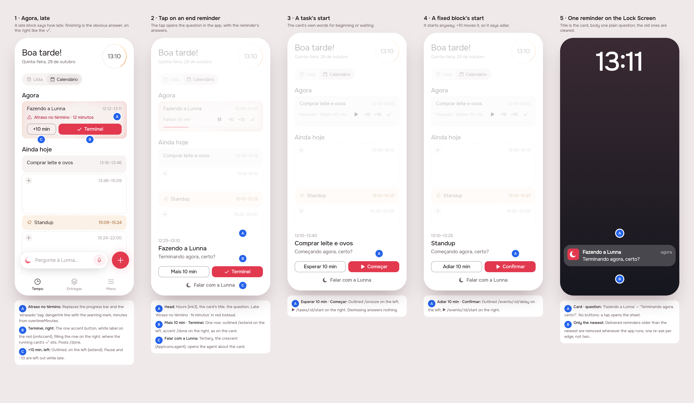
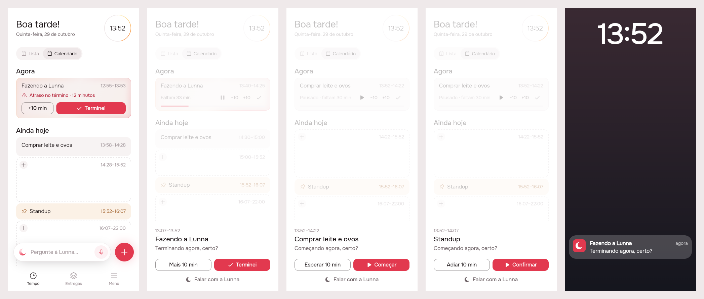
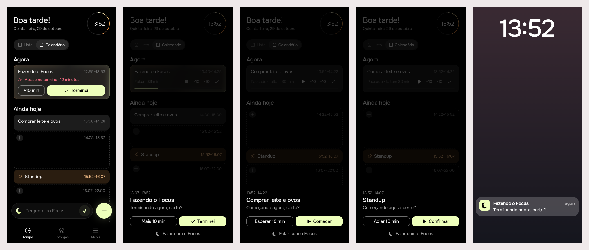

# Reminders, back to the basics

Status: **built** (issue
[#65](https://github.com/pietroid/lunna/issues/65)), design approved on the
issue. Mockup track: the reminder opens a sheet in the app, the late card
changes and the copy changes, all of it something the person sees.

## 1. The prompt

Issue #65, *Fix notifications interaction*:

> Notification interaction is less exciting than I thought. Let's stick to the basics again and treat properly the following scenarios:
>
> 1. A task that was delayed: we should show "atraso no término - x minutos" and remove the bar, and have a more evident button "finish it"
> 2. Cancel previous notifications: very often I see lunna have dozens of notifications. Usually notifications are timeline, so we can actually cancel the previous ones when sending one
> 3. Remove live activity for now: we should not be showing live activity, becase it is mostly confusing
>
> Because iOS is very limited in showing actions, we will do the following instead:
>
> 1. When user taps, it will open a popup in the app with the same actions we had (confirm, +10min, falar com lunna), the actions i mentioned are exampes but you should use the ones that we have for each case.
> 2. Improve texts because title and subtitle are a little confusing. For example: my slow morning..... subtitle: se ainda não, ganhe mais 10 minutos. What? It should be always like "tite of the task" - terminando agora, certo?

Worked unattended by the queue; the decisions it took alone are listed
under *Decided unattended*, and the person approves on the issue.

The first board was reviewed on the issue, and the person replied:

> ok great, but adjust the look of it, the contrast is awful, it is black above red. Also invert 10 min at the left and terminei at the right to maintain consistency with the done button

Second round: the labels on red are white now, and +10 sits on the left
with the answer on the right, on the card and in the sheet. The design was
then approved on the issue, and the build was asked for as:

> build reminders-basics
>
> The design was approved on the issue. Do Phases 3 and 4 unattended. .tool/check must pass before you finish; a failure your change didn't cause is proved (stash, rerun) and named in the README. In section 5 write "Measured by the queue: see the pull request." instead of .tool/cost tables.

## 2. The design

Drawn by the real app (`app/lib/reminders_preview.dart` on the demo's day,
Lunna). Each screen alone: [1](img/mockup-1.png) ·
[2](img/mockup-2.png) · [3](img/mockup-3.png) · [4](img/mockup-4.png) ·
[5](img/mockup-5.png). Pins in [board.json](img/board.json).

### The flow

1. **Agora, late.** A begun block past its end with no answer loses its
   progress bar (it would be full and say nothing). In its place, in the
   danger ink: **"Atraso no término · 12 minutos"**, and under it one row:
   **+10 min** outlined on the left, and the one accent button of the card,
   **Terminei** (✓, white on the red), filling the rest on the right, where
   the running card's ✓ closes its controls. Pause and −10 are left out while it is late: a late block is
   not being measured any more, only closed. Replaces the "atrasado N min"
   tag.
2. **A tap on a reminder opens a sheet** over Tempo, the same question the
   reminder asked, read again from the day (so "12 minutos" is what it is
   now, not what it was when the reminder fired): the hours, the title, the
   question, and three answers: the ten minutes and the answer side by
   side (ten minutes left, answer right, as on the card), the agent under
   them. A task's end: **Mais 10 min** | **Terminei** · **Falar com a
   Lunna**.
3. **A task's start**: **Esperar 10 min** | **Começar** (▶) · Falar com a
   Lunna.
4. **A fixed block's start** (it starts anyway): **Adiar 10 min** |
   **Confirmar** (▶) · Falar com a Lunna. A fixed block's end is the
   task's end (Mais 10 min | Terminei).
5. **The Lock Screen keeps one reminder**, titled with the card and asking
   one plain thing. Every new reminder takes the place of the one before.

### The answers, per case

They are the routes the reminders' buttons post today
(`NotificationAnswer.of`), unchanged; only where they are drawn moves.

| Case | Outlined (left) | Accent (right) | Quiet (below) |
|---|---|---|---|
| task, start | Esperar 10 min → `/tasks/:id/snooze` | Começar → `/tasks/:id/start` | Falar com a Lunna |
| task, end | Mais 10 min → `/tasks/:id/extend` | Terminei → `/tasks/:id/done` | Falar com a Lunna |
| fixed block, start | Adiar 10 min → `/events/:id/delay` | Confirmar → `/events/:id/start` | Falar com a Lunna |
| fixed block, end | Mais 10 min → `/events/:id/extend` | Terminei → `/events/:id/done` | Falar com a Lunna |

Falar com a Lunna opens the agent's sheet about the card, as the button
does today. Dismissing the sheet answers nothing.

### The copy

The title is **always the card's title**; the body asks one thing.

| Kind | Today | New |
|---|---|---|
| `askStart`, task | Café · "Está na hora. Começamos?" | Café · **"Começando agora, certo?"** |
| `askStart`, fixed block | "Café começou" · "Até 08:30" | Café · **"Começando agora, certo?"** |
| `askEnd`, first ask | "Café terminou?" · "Se ainda não, ganhe mais 10 minutos." | Café · **"Terminando agora, certo?"** |
| `askEnd`, re-asks (+10, +20) | same as the first | Café · **"Atraso no término · 10 minutos"** (20) |
| `headsUp` | "Almoço em 15 minutos" · "Das 12:00 às 13:00" | Almoço · **"Começa em 15 minutos, às 12:00"** |
| `morning`, `evening` | unchanged | unchanged |

### References

Drawn from known patterns, not browsed: **Structured**'s "Did you finish?"
sheet when a task's time is up (the answer in the accent, more time
beside it), **Apple Reminders / Clock** keeping one live alert per thing
rather than a pile, and **Things**' quiet notifications that open the item
they are about.

### Decisions (the pins)

| Pin | Decision | Why |
|---|---|---|
| 1A | Late: the line "Atraso no término · N minutos" in `dangerInk` with the warning mark, where the bar was | the issue's words; the bar at 100 % says nothing |
| 1B | **Terminei** is the card's only accent button, on the right, filling the row, its label and ✓ white (`onAccent`) | "a more evident button"; the right is where the running card's ✓ is (the review); white on red reads, black did not |
| 1C | **+10 min** outlined on the **left**; pause, −10 and the "atrasado" tag go while late | the review: ten minutes left, the answer right; one way to read the state, two answers |
| 2A | The sheet's head: hours (ink3), the title, the question | the title is what the reminder was about; the hours say which one |
| 2B | One row: outlined **Mais 10 min** left, accent ✓ **Terminei** right; tertiary **Falar com a Lunna** with the crescent under it | the same three answers the reminder's buttons had, ranked, and in the card's order |
| 3A | A task's start: **Esperar 10 min** \| ▶ **Começar** | the card's own words (`controlStart`, `controlWait10`) |
| 4A | A fixed block's start: **Adiar 10 min** \| ▶ **Confirmar** | +10 on a fixed start moves it (`delay`), so it says *adiar* |
| 5A | Title = the card's title; body = one question | the issue's example: "Café — terminando agora, certo?" |
| 5B | One reminder of the app on the Lock Screen at a time | the issue's 2: the day is a timeline, the old ones are stale |

No new icon: ✓ (`AppIcons.check`), ▶ (`AppIcons.play`), ⚠
(`AppIcons.warning`), the crescent (`AppIcons.agent`).

### Decided unattended

- **The reminders lose their buttons on iOS.** The issue says the sheet
  comes *instead* of iOS's actions, so the `ask` category, its three
  buttons and the background engine that answered them
  (`answerReminderInBackground`, the plugin registrant in
  `AppDelegate.swift`) go. A tap is the only way to answer, and it is the
  same on Android, which closes #56 by the simpler road. `X-Lunna-Via:
  notification` stays, sent by the sheet's answers.
- **The sheet replaces the tap's card page and Android's start sheet**
  (`_startSheet`). A reminder about an edge already answered (the task
  begun, the block closed) opens Tempo without a sheet; a `headsUp`, a
  morning or an evening opens Tempo too.
- **"Cancel the previous ones" is done whenever the app runs**, since iOS
  runs no code when a local notification is delivered in the background:
  on launch, on resume, on every sync and in the background refresh, every
  delivered reminder older than the newest is removed
  (`getActiveNotifications` + `cancel(id)`); a sync after an answer
  removes them all. On Android each ask also carries `timeoutAfter` until
  the next one is due. To make the pile itself smaller, the re-asks go
  from two to **one** (`ASKS_PER_EDGE` 3 → 2: at the hour and +10), and
  every reminder of one card shares a `threadIdentifier`, so what is left
  stacks as one. See the open question about push.
- **The Live Activity is switched off, not deleted.** The app stops
  starting it and ends any one running at launch; the `BlockActivity`
  extension and `live_activity.dart` stay in the tree, unused, behind one
  constant (`kLiveActivity = false`), so turning it back on is one line.
  `product/spec/live-activity.md` says so.
- **The contrast is fixed in `AppButton`, for every button.** The black
  on red came from `AppButton._onColor`, which drew a filled button's
  label in `AppColors.ink` whenever the fill was dark: on Lunna that ink
  is near black, so every red primary button in Lunna had a black label
  (its icon, passed in as `onAccent`, was already white). Now the accent's
  label is `onAccent` (white on Lunna's red, black on Focus's lime, as
  before) and any other fill picks black or white by its luminance. Focus
  looks the same; on Lunna every red button gets a white label, not only
  these. The late card keeps its tint.
- **The sheet follows the card's order too.** The reply named the card's
  buttons; the sheet's two answers were stacked, so they are now one row,
  ten minutes left and the answer right, with the agent under them, so the
  answer sits on the same side wherever it is asked.
- **Wording**: "Atraso no término · 12 minutos" with the app's middle dot
  rather than the issue's hyphen; the late button says **Terminei**, the
  word the Live Activity already used, rather than "Concluir".

### Open questions

- **Real replacement needs push.** A reminder can only take the place of
  the one before *at the moment it arrives* if it is a remote push with
  `apns-collapse-id` (or a local one reusing an id, which iOS allows only
  one of in the queue at a time). That means APNs keys and a server that
  sends on time, which today runs no timer at all (Neon's compute). This
  delivery clears on every app run instead; push is a separate RFC if the
  pile is still there.

## 3. What was built

### Prints of the real build

Drawn by the real widgets over the demo's day (a preview entry point,
deleted after the shots), the same five scenes as the board: the late card,
the sheet on a task's end, on a task's start, on a fixed block's start,
and the Lock Screen's one reminder.

**Lunna**

**Focus**

### The contract

**A reminder asks one thing, and a tap answers it in the app.** It is
titled with the card and carries no buttons; a tap reads the day again and,
if the edge is still open, opens `ReminderSheet` with the card's own
answers, posted to the card's own routes (`X-Lunna-Via: notification`).
**One reminder on the Lock Screen at a time**: whenever the app runs, the
ones already shown are cleared but the last. **The Live Activity is off**.

### Server (`server/src/notifications/`)

- `notification-copy.ts`: the title is the card's title; bodies
  `STARTING_BODY` ("Começando agora, certo?"), `ENDING_BODY` ("Terminando
  agora, certo?"), `lateBody(n)` ("Atraso no término · 10 minutos") and
  `headsUpBody` ("Começa em 15 minutos, às 12:00"). The old titles
  ("Café começou", "Café terminou?") and bodies are gone.
- `notifications.service.ts`: `ASKS_PER_EDGE` 3 → 2; the re-ask of an end
  says how late it is (`asks({ late })`). No route changed.

### App

- `packages/notifications`: no Darwin category, no actions, no background
  handler (`BackgroundAction`, `askCategory` gone). `QueuedNotification`
  carries `thread` (iOS `threadIdentifier`, the card's id) and `timeout`
  (Android `timeoutAfter`, until the next reminder is due, `nextOf`).
  `NotificationQueue.delivered()` over `getActiveNotifications`, and
  `NotificationScheduler.clearDelivered({keepNewest})`, run at the start of
  every sync; the payload now carries `fireAt`, which `newestOf` reads.
  `answer(NotificationAnswer)` posts, clears every reminder shown, and
  syncs. `NotificationTap` lost `action`/`answer` and gained `asks`.
  `NotificationsRepository.answer` posts with `via: 'notification'`
  (`ApiClient.post` takes a `via` now; the header interceptor keeps a
  request's own).
- `lib/notifications/view/reminder_sheet.dart`: `ReminderSheet` and
  `ReminderAsk.of`, the rule of when an edge is still open (a task's start
  while it waits; a fixed block's start while it runs; an end from its
  hour on, unless given more time).
- `RemindersListener`: a tap (or the launch tap) reloads the day, asks
  `ReminderAsk.of`, opens the sheet, and answers through the scheduler or
  opens the agent. Gone: the Android start sheet, the open-on-launch
  question, `_buttonsAnswer`.
- `lib/notifications/reminder_answers.dart` deleted; `main.dart` and
  `AppDelegate.swift` lose the background handler and its plugin
  registrant.
- `live_activity.dart`: `kLiveActivity = false`; `LiveActivity(enabled:)`
  defaults to it, and a disabled `sync` sends "nothing runs", once.
- `packages/timeline`: `NowLate` in place of the bar and the "atrasado"
  tag (from the design).
- `packages/app_ui`: `AppButton` labels the accent `onAccent` and any other
  fill black or white by luminance (from the design); its label now
  ellipsizes rather than overflowing a narrow button.
- `l10n`: gone `timelineLate`, `remindersNextBlock`,
  `remindersStartTitle`, `remindersStartBody`; `remindersAskBody` no longer
  promises answering "ali mesmo".
- Docs: `product/spec/notifications.md` (the sheet, the copy, clearing,
  two asks), `live-activity.md` (switched off), the Reminders section of
  `AGENTS.md`.

### Tests

- Server: `notifications.service.spec.ts`, 23 tests: two asks per edge,
  the new titles and bodies, the late re-ask's body.
- `packages/notifications`, 25 tests: no buttons; the thread; Android's
  timeout; clearing all but the newest (and a payload with no hour counts
  as oldest); an answer clears every reminder shown; the route table.
- App, `test/notifications/reminder_sheet_test.dart`, 12 tests: the four
  cases' labels and the answer each returns, ten minutes left of the
  answer, the late line; `ReminderAsk.of` for each edge (late, due, given
  more time, gone, waiting, delayed, a heads-up); `RemindersListener` from
  a tap to `/tasks/c/done`, and a tap on an answered edge opening no sheet.
  `live_activity_test.dart` + 1: switched off, it ends once and sends no
  block.
- `packages/timeline/test/overtime_test.dart`: the "atrasado" test
  rewritten for the late card (no bar, no −10, +10 min left of Terminei,
  both answer), the singular.
- `packages/app_ui/test/app_button_test.dart` (new), 3 tests: the
  accent's label is `onAccent` (white on Lunna), other fills by luminance,
  a long label does not overflow.
- `.tool/check` passed, every step (app analyze; agent, analytics,
  api_client, app_ui, artifacts, notifications and timeline under both
  brands; server eslint, tsc and tests), and was run again green after
  the last edit. It does not run the app's own `test/`, so that was run by
  hand: 43 tests, all passed, under Focus and under Lunna. No flaky test,
  and no failure that had to be proved someone else's.

### Where the build differs from the design

- **The thread is the card's id on the app side**, not a new `thread`
  field on the plan: `eventId` already is the card's id, so the wire
  format did not change.
- **`kLiveActivity` switches `LiveActivity.sync` itself**, rather than the
  listener no longer calling it: every caller (the listener, sign-out)
  then ends the activity, once, and the tests can still turn it on.
- **`AppButton`'s label ellipsizes.** The late card's Terminei overflowed
  under the test font; a narrow button now cuts its label instead of
  drawing stripes, for every button.
- **The "Atraso no término" re-ask is the end's only one**, since the asks went
  from three to two; a start's re-ask repeats "Começando agora, certo?".

### Decided unattended (build)

- When the sheet's answer fails (no network), it is logged and the day
  reloaded; the card on Tempo still shows where the block stands and asks
  the same. No new error copy.
- An end is "still open" when the block is late or ends within the next
  minute; a fixed block's start while it runs. A tap on a reminder whose
  card is paused opens Tempo.

## 4. How to turn it on

Nothing to set: no env var, no migration, no new route. The server's new
copy and two asks reach every phone on its next sync. A new app build is
what removes the buttons and the Live Activity; an old build keeps its
buttons, which still post the same routes. Reminders shown by an old
build carry no `fireAt`, so the first sync of the new one clears them all
but one.

Not run here: a device. The sheet, the clearing and the switched-off
activity are proved by the tests and the prints above; how iOS stacks a
`threadIdentifier` and Android's `timeoutAfter` were not seen on a phone.

## 5. Cost and time

Measured by the queue: see the pull request.
