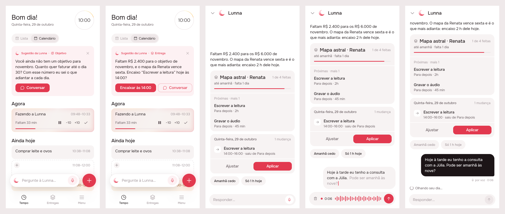
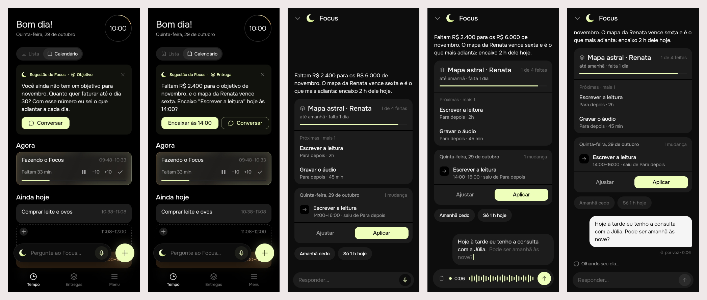

# Suggestion: the goal first, a chat to answer it

Delivered ([issue #67](https://github.com/pietroid/lunna/issues/67)).
Mockup track: it changes the card on Tempo, the conversation's frame
and how a recording ends. The spec is in
[product/spec/agent.md](../../spec/agent.md#the-suggestion).

## 1. The prompt

> Suggestion
>
> After the introduction of home, the suggestions are kind of messy. I want to structure it around what is the goal of Lunna for this product:
>
> Lunna is meant for the user to achieve her goals, the rest comes as means to that.
>
> The first thing the agent will always watch is her goals, if there is no goals or no tasks, or nothing related, the first suggestion should always be in regards to fill that.
>
> # Implementation constraints
>
> 1. Suggestion has some validity for the user, so the agent knows when to create a new suggestion without requesting it everytime the user opens the App
>
> 2. Suggestion must consider always first 1. The goals of the user 2. The deliverables to reach that goal and 3. The routine.
>
> 3. The suggestion has an option to open a chat or do an action directly (this action is optional)
>
> 4. When we open the chat, the user must be able to see the first message related to the action. If there is complex genui attached, the user can already see it also on the chat.
>
> 5. The user must be able to respond in a fluid way. Today the user still needs to do two actions: record and tap to send. When finish recording, must already send it.
>
> 6. The chat will respond naturally in a structured way as it is today. I would love to have a chat in a fullscreen instead of a modal.
>
> 7. The intelligence of suggestion will be done by another research, for now lets just consider this thin layer above suggestion

## 2. The design

[board.json](img/board.json) · each screen: [1](img/mockup-1.png),
[2](img/mockup-2.png), [3](img/mockup-3.png), [4](img/mockup-4.png),
[5](img/mockup-5.png).

The flow, left to right: Tempo with nothing to aim at (the suggestion is
to set a goal, and it only talks); Tempo with a goal short of its mark (a
delivery that reaches it, with an action on the card); Conversar opens the
chat full screen on that same suggestion, its plan and the delivery
already drawn; answering by voice; the recording sent the moment it stops.

### References

Drawn from known patterns (Mobbin was not browsed in this run):

- **ChatGPT / Claude apps**: the conversation is a page of its own, full
  screen, the composer pinned at the foot; a voice note is sent when it
  stops.
- **WhatsApp voice notes**: recording ends in a send, with a trash to
  drop it; nothing to review in between.
- **Sunsama / Motion's daily nudge**: one card at the top of the day,
  about the week's objective before the day's tasks, with one action and
  "not now".

### Decisions

| Pin | Decision | Why |
|-----|----------|-----|
| 1A | The card names what it is about: **Objetivo**, **Entrega** or **Rotina**, with that tab's icon (target, stack, repeat), beside "Sugestão da Lunna" | the order the agent looks in (goal, deliveries, routine) is visible, and the person sees why it is the goal being asked about |
| 1B | No goal (or no deliveries / tasks under it) → the suggestion is always about filling that, and has **no action**: **Conversar** is the one accented button | a goal needs a number only the person can say; the chat opens with quick answers (R$ 6.000, R$ 8.000) |
| 1C | **✕** in the card's corner replaces "Agora não" (same rule: put away for 24 h on the device) | frees the button row for the action and the chat; the ✕ is quieter than a word |
| 2A | With an action, it is the accented button and says its verb and hour ("Encaixar às 14:00"); it makes the plan with no conversation, and Desfazer takes it back as today | constraint 3: the action is optional and direct |
| 2B | **Conversar** (chat icon, outlined) is always there; a tap anywhere on the card does the same | the action is the shortcut, the chat is the way in |
| 2C | The suggestion **holds until `validUntil`** (here the action's hour, 14:00) or until goals, deliveries or routines change; the server keeps it, so opening the app makes nothing new | constraint 1 |
| 3A | The chat is a **full-screen page** that comes up from the dock (`fullscreenDialog`), not a sheet; a caret ⌄ on the left takes it back down | constraint 6; plans and peeks get the whole height |
| 3B | Opened from a suggestion, the chat **starts with the agent's first message** (`opening`); the keyboard stays down so it can be read | constraint 4 |
| 3C | The opening carries its **surface**: the delivery's peek, the plan card, quick answers, drawn as any turn's | constraint 4: complex GenUI is already in the chat |
| 3D | The plan card is the same plan as the card's action: Aplicar there is the action, Ajustar answers it | one plan, two ways to take it |
| 4A | While recording, the accent round on the right is **send (↑)**, not stop (■ "Parar e revisar") | constraint 5: stopping is sending, one tap |
| 4B | The trash on the left is the only way not to send | nothing to review in between |
| 5A | The message lands as her bubble and the agent starts answering at once | holding and letting go already sent; now tapping does too |
| 5B | It keeps "por voz · 0:06" | as a held-and-released message already did |

### Decided unattended

- **Track: mockup.** The card, the chat's frame and the recorder change.
- **Stopping always sends**, with no review step. To correct what was
  heard, the person says it again or discards it before stopping. The
  "Parar e revisar" button goes away.
- **The full-screen chat replaces the sheet everywhere** (Tempo's dock,
  every page's dock, the reminders' "Falar com a Lunna"), not only from
  the suggestion: two frames for one conversation would be one too many.
- **Validity is the server's**: the suggestion is stored with
  `validUntil` and a fingerprint of what it read (goals, open deliveries,
  routines); `GET /agent/suggestion` returns the stored one until it
  expires or the fingerprint changes. The app asks on Tempo's open as
  today, which is one cheap read, never a model call.
- **The goal comes first, by rule, not by model**: this delivery writes
  the thin layer (which tier, which text, which action) with arithmetic,
  as the current suggestion does; how the agent chooses better is the
  separate research of constraint 7.
- **Taking the action or Aplicar in the chat retires the suggestion**;
  opening the chat does not (the card stays until it is answered,
  dismissed or expires).

Decided unattended in the build (the design was approved on the issue
with the two open questions unanswered):

- **Aplicar in the chat still closes it**, as it did as a sheet: the
  point of applying is to see the day changed, and Desfazer is on Tempo.
- **The ✕ rests every suggestion 24 h**, the goal's included. The card
  comes back the next day, still asking for the goal while there is none.
- **"Behind" is strict**: the goal tier hands over to a delivery as soon
  as the goal's green is short of its red (`done < target × time gone`),
  without the 15 % slack the goal's tag uses: the agent watches the goal
  before anything else.
- **No dismiss route**: the ✕ stays on the device, as before.
- **An offer with an action holds at least five minutes, at most two
  hours** (the life of its plan), so an offer of "now" is not remade on
  every opening and Aplicar never meets an expired plan.
- **A delivery already on today is skipped**: its next part is in hand,
  so the next delivery, or Para depois, is offered instead.
- **Merged with main's Feed (#lunna-home)**: main moved the suggestion
  from Tempo to the top of the Feed tab. The only conflict was in
  `product/spec/agent.md`, where both sides rewrote the paragraph after
  the dock table; it keeps this branch's full-screen conversation and
  main's "drawn at the top of the Feed". The card, `AGENTS.md` and the
  spec's "The suggestion" now say Feed where they said Tempo. The mockups
  and prints above still show it on Tempo; the card itself is the same.

## 3. What was built

### Prints of the real build

Lunna, scenes 1–5 (no goal; a goal behind with an action; Conversar on the
opening; recording; sent on stop):

Focus:

### The contract

**The goal first, then the deliveries that reach it, then the day; one
suggestion held until it runs out.** `GET /agent/suggestion` answers the
stored one while it is valid, the hash of what it read is the same and it
was not taken; otherwise it works out a new one by arithmetic (no model)
and stores it in place of the last.

| Tier | When | Card | Action |
|------|------|------|--------|
| Objetivo | no goal running today | "Você ainda não tem um objetivo. Quanto quer faturar até 30/11?" | none; choices say an amount |
| Objetivo | a goal short with no open delivery due in it | "Faltam R$ X … nenhuma entrega aberta vence até lá" | none; choices name priced kinds |
| Entrega | the goal's green behind its red | the delivery due soonest (then worth most) not already on today: "Encaixo “Y” hoje às 14:00?" | `at_hour` of its next task in today's first free room |
| Rotina | nothing above | the first of three Para depois tasks that fits today | `at_hour`, as before |

`validUntil`: the end of today without an action; the action's hour with
one (≥ 5 min, ≤ 2 h). Applying its plan, from the card or from the
conversation, marks it taken.

### Server

- `src/agent/suggestion.store.ts`: `SuggestionStore` and the memory store;
  `pg-suggestion.store.ts` the Postgres one; table `agent_suggestion` (one
  row per person), migration `drizzle/0016_agent_suggestion.sql`.
- `AgentService.suggestion` (hold or make), `_offer` (the tiers),
  `basisOf` (goals, open deliveries with deadline, value and open tasks,
  routines, Para depois, today's tasks, hashed).
- The opening is a turn's reply (`ui`, `reply`, `plan?`): a caption, the
  delivery's `ArtifactPeek`, the plan block (the action's own plan) and the
  choices.
- `POST /agent/turn` takes `suggestionId`: the server puts the stored
  opening's words in front of what the model reads (in place of what the
  app sent back) and writes them first in a new conversation.
- `apply` calls `takeByPlan`. No new write route, so no analytics row.

### App

- `AgentSuggestion` `{ id, text, focus, validUntil, action?, opening? }`
  (from the design); `SuggestionCubit.load` asks nothing while the held
  one is valid.
- `showAgentSheet(suggestion:)` and `AgentCubit.open(suggestion:)`: the
  page starts on the opening, and every turn sends `suggestionId`; entries
  with no words (an opening drawn only by its surface) are not sent.
- The page, the caret ⌄, stop-sends and the card are as designed;
  `_spoken` is gone from `AgentSheet`.

### Tests

- Server: `agent.controller.spec.ts` "the suggestion", 7 cases (the goal
  first even with a backlog; no delivery towards the goal; the delivery's
  action, its validity, its opening, applied → taken → the next tier, and
  undone; a delivery already today falls to Para depois; holds until a
  goal is added; the conversation opens on the stored opening; nothing to
  offer with the goal reached), and `pg-suggestion.store.spec.ts`, 2 cases
  in PGlite. The agent's suites: 72 tests passing.
- App: `agent_test.dart` (holds while valid; the conversation opens on
  the opening and sends `suggestionId`), `voice_test.dart` "SuggestionCard"
  (the goal's card only talks; Conversar opens the page on the opening, plan
  and all). Agent package: 73 tests passing.
- `.tool/check` passes: app-analyze, test-agent-focus, test-agent-lunna, server-eslint, server-tsc, server-test (exit 0).

### Where the build differs from the mockup

- The action places an **existing** task of the delivery (`move_task`,
  "saiu de Para depois") where the mockup drew a new two-hour piece:
  making new tasks is the conversation's job.
- Screen 2's copy names the task ("Encaixo “Escrever a leitura” hoje às
  14:00?") rather than "2 h dele".
- The opening has no quick answers beyond a goal's amounts or kinds
  ("Amanhã cedo", "Só 1 h hoje" in the prints are the preview's): a
  delivery's opening offers its plan, and Ajustar.

## 4. How to turn it on

Nothing to set. The migration runs on boot (`migrateDatabase`); the old
app keeps working against the route only in part: its `AgentSuggestion`
read `text` and `plan`, and the route no longer sends `plan` at the top,
so an old build shows no suggestion until it updates.

## 5. Cost and time

Measured by the queue: see the pull request.
