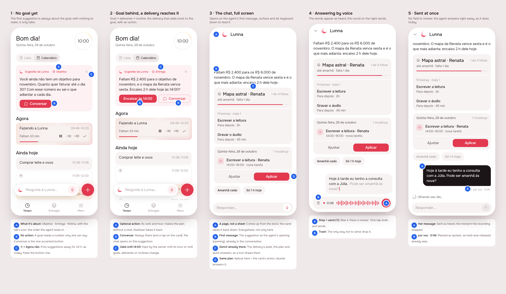

# Suggestion: the goal first, a chat to answer it

Draft, design session ([issue #67](https://github.com/pietroid/lunna/issues/67)).
Mockup track: it changes the card on Tempo, the conversation's frame
and how a recording ends. The build starts from the **Build brief** at
the bottom.

## 1. The prompt

> Suggestion
>
> After the introduction of home, the suggestions are kind of messy. I want to structure it around what is the goal of Lunna for this product:
>
> Lunna is meant for the user to achieve her goals, the rest comes as means to that.
>
> The first thing the agent will always watch is her goals, if there is no goals or no tasks, or nothing related, the first suggestion should always be in regards to fill that.
>
> # Implementation constraints
>
> 1. Suggestion has some validity for the user, so the agent knows when to create a new suggestion without requesting it everytime the user opens the App
>
> 2. Suggestion must consider always first 1. The goals of the user 2. The deliverables to reach that goal and 3. The routine.
>
> 3. The suggestion has an option to open a chat or do an action directly (this action is optional)
>
> 4. When we open the chat, the user must be able to see the first message related to the action. If there is complex genui attached, the user can already see it also on the chat.
>
> 5. The user must be able to respond in a fluid way. Today the user still needs to do two actions: record and tap to send. When finish recording, must already send it.
>
> 6. The chat will respond naturally in a structured way as it is today. I would love to have a chat in a fullscreen instead of a modal.
>
> 7. The intelligence of suggestion will be done by another research, for now lets just consider this thin layer above suggestion

## 2. The design

[board.json](img/board.json) · each screen: [1](img/mockup-1.png),
[2](img/mockup-2.png), [3](img/mockup-3.png), [4](img/mockup-4.png),
[5](img/mockup-5.png).

The flow, left to right: Tempo with nothing to aim at (the suggestion is
to set a goal, and it only talks); Tempo with a goal short of its mark (a
delivery that reaches it, with an action on the card); Conversar opens the
chat full screen on that same suggestion, its plan and the delivery
already drawn; answering by voice; the recording sent the moment it stops.

### References

Drawn from known patterns (Mobbin was not browsed in this run):

- **ChatGPT / Claude apps**: the conversation is a page of its own, full
  screen, the composer pinned at the foot; a voice note is sent when it
  stops.
- **WhatsApp voice notes**: recording ends in a send, with a trash to
  drop it; nothing to review in between.
- **Sunsama / Motion's daily nudge**: one card at the top of the day,
  about the week's objective before the day's tasks, with one action and
  "not now".

### Decisions

| Pin | Decision | Why |
|-----|----------|-----|
| 1A | The card names what it is about: **Objetivo**, **Entrega** or **Rotina**, with that tab's icon (target, stack, repeat), beside "Sugestão da Lunna" | the order the agent looks in (goal, deliveries, routine) is visible, and the person sees why it is the goal being asked about |
| 1B | No goal (or no deliveries / tasks under it) → the suggestion is always about filling that, and has **no action**: **Conversar** is the one accented button | a goal needs a number only the person can say; the chat opens with quick answers (R$ 6.000, R$ 8.000) |
| 1C | **✕** in the card's corner replaces "Agora não" (same rule: put away for 24 h on the device) | frees the button row for the action and the chat; the ✕ is quieter than a word |
| 2A | With an action, it is the accented button and says its verb and hour ("Encaixar às 14:00"); it makes the plan with no conversation, and Desfazer takes it back as today | constraint 3: the action is optional and direct |
| 2B | **Conversar** (chat icon, outlined) is always there; a tap anywhere on the card does the same | the action is the shortcut, the chat is the way in |
| 2C | The suggestion **holds until `validUntil`** (here the action's hour, 14:00) or until goals, deliveries or routines change; the server keeps it, so opening the app makes nothing new | constraint 1 |
| 3A | The chat is a **full-screen page** that comes up from the dock (`fullscreenDialog`), not a sheet; a caret ⌄ on the left takes it back down | constraint 6; plans and peeks get the whole height |
| 3B | Opened from a suggestion, the chat **starts with the agent's first message** (`opening`); the keyboard stays down so it can be read | constraint 4 |
| 3C | The opening carries its **surface**: the delivery's peek, the plan card, quick answers, drawn as any turn's | constraint 4: complex GenUI is already in the chat |
| 3D | The plan card is the same plan as the card's action: Aplicar there is the action, Ajustar answers it | one plan, two ways to take it |
| 4A | While recording, the accent round on the right is **send (↑)**, not stop (■ "Parar e revisar") | constraint 5: stopping is sending, one tap |
| 4B | The trash on the left is the only way not to send | nothing to review in between |
| 5A | The message lands as her bubble and the agent starts answering at once | holding and letting go already sent; now tapping does too |
| 5B | It keeps "por voz · 0:06" | as a held-and-released message already did |

### Decided unattended

- **Track: mockup.** The card, the chat's frame and the recorder change.
- **Stopping always sends**, with no review step. To correct what was
  heard, the person says it again or discards it before stopping. The
  "Parar e revisar" button goes away.
- **The full-screen chat replaces the sheet everywhere** (Tempo's dock,
  every page's dock, the reminders' "Falar com a Lunna"), not only from
  the suggestion: two frames for one conversation would be one too many.
- **Validity is the server's**: the suggestion is stored with
  `validUntil` and a fingerprint of what it read (goals, open deliveries,
  routines); `GET /agent/suggestion` returns the stored one until it
  expires or the fingerprint changes. The app asks on Tempo's open as
  today, which is one cheap read, never a model call.
- **The goal comes first, by rule, not by model**: this delivery writes
  the thin layer (which tier, which text, which action) with arithmetic,
  as the current suggestion does; how the agent chooses better is the
  separate research of constraint 7.
- **Taking the action or Aplicar in the chat retires the suggestion**;
  opening the chat does not (the card stays until it is answered,
  dismissed or expires).

## Build brief

### Files the design session wrote (uncommitted on its own; kept for the build)

- `app/lib/suggestion_preview.dart`: the preview entry point, scenes 1–5.
  Delete it at the end of Phase 4.
- `app/packages/agent/lib/src/models.dart`: `AgentSuggestion` is now
  `{ id, text, focus, validUntil, action?, opening? }`, with
  `SuggestionFocus` (goal, delivery, routine) and `SuggestionAction
  { label, plan }`.
- `app/packages/agent/lib/src/view/suggestion_card.dart`: the new card.
- `app/packages/agent/lib/src/agent_cubit.dart`: `open(opening:)` seeds
  the conversation with the agent's first message.
- `app/packages/agent/lib/src/view/agent_sheet.dart`: `showAgentSheet`
  pushes a full-screen page (`fullscreenDialog`), takes `opening`; the
  header's caret ⌄ closes it; `AgentSheet(focus:)`; stopping a recording
  sends (`_stop` is gone, `_say` does both).
- `app/packages/agent/lib/src/view/voice_bar.dart`: `stopIcon`.
- `app/packages/agent/test/agent_test.dart`,
  `app/packages/agent/test/voice_test.dart`: the suggestion's new shape;
  "stopping sends what was said, at once" replaces the review test.
- `app/test/landing/landing_page_test.dart`: with the chat a page, Tempo
  is off-stage behind it, so the chapter titles and the phone's tab are
  scrolled into view before they are tapped.
- Verified in this session: `flutter analyze` (nothing new), the agent
  package's and the app's tests under both brands (69 + 43, and 112 under
  Lunna), all passing.
- `app/lib/demo/data/demo_agent.dart`, `app/lib/demo/view/demo_app.dart`:
  the demo can be offered a suggestion (`DemoApp(suggestion:)`), and its
  Tempo now draws `SuggestionCard` (empty on the landing, offered nothing).
- Re-shoot: `.tool/preview suggestion 1 2 3 4 5 --board
  product/delivery/2026-10-29-suggestion/img/board.json` (its `png` paths
  point at the design session's scratch output).
- `app/packages/l10n/lib/arb/app_pt.arb` (+ gen): `agentSuggestionTalk`,
  `agentSuggestionGoal|Delivery|Routine`; `agentSuggestionAccept` removed.

### Server

- A `suggestion` table (one live row per person): `id`, `user_id`,
  `focus`, `text`, `plan_id?` (the action's plan, in `PlanStore`),
  `action_label?`, `opening` (the answer's blocks, bound like a turn's),
  `basis` (a hash of goals, open deliveries with their deadlines and
  values, routines), `valid_until`, `taken_at?`, `dismissed_at?`.
  Migration with `npm run db:generate`.
- `GET /agent/suggestion` → `{ suggestion: { id, text, focus,
  validUntil, action?: { label, plan }, opening?: { ui } } | null }`.
  Return the stored row while `now < valid_until`, the basis is the same
  and it is not taken; otherwise make a new one. **The tiers, in order:**
  1. **Goal**: no current goal, or a goal with no open delivery due
     inside it → "set a goal / add a delivery", no action, opening with
     `choices` that `say` answers.
  2. **Delivery**: the current goal is behind its pace (the goal bar's
     red over green) → the open delivery due inside it that adds most
     value soonest, with an action that places its next task today
     (`at_hour` in the first free room, as the current backlog rule does).
  3. **Routine**: nothing above → today's routine or backlog (the
     current "Para depois fits today" rule becomes this tier).
  `validUntil`: the end of today for tiers 1 and 3, the action's hour for
  tier 2 (an offer of 14:00 is stale at 14:00).
- `POST /agent/suggestion/:id/dismiss` (optional: the app's 24 h rest can
  stay on the device) and taking the action marks `taken_at` (applying
  its plan is enough: `apply` looks the plan up).
- `POST /agent/turn` takes `suggestionId?`: the server puts the opening
  in front of the conversation as the agent's first message, so the
  model reads what it offered. The app already sends the opening in the
  history as an assistant turn; the id makes it trusted, not just text.
- Analytics rows for the new routes (`server/src/analytics/events.ts`).
- Specs: tiers in order (no goal → tier 1 even with backlog), validity
  (same basis before `valid_until` → same id; a new goal → a new one),
  the action's plan applies and undoes.

### App

- `AgentRepository.suggestion()` parses the new shape (`opening` from
  `ui` through `AgentSurface.decode`, as a turn's reply).
- `SuggestionCubit`: keep the 24 h rest; hold the suggestion and skip the
  request while `validUntil` is ahead and nothing on the day was changed
  by hand (constraint 1, on the device too).
- `showAgentSheet` callers keep working (same name); check the landing's
  demo, which pushes it on its own `Navigator`, and the reminders'
  "Falar com a Lunna".
- The `DockHero` no longer has a sheet over it but a page: check the
  hero doesn't fly into the chat.
- `_spoken` in `AgentSheet` is now only reset, never set: remove it.
- Specs: the card's two shapes (with and without action), Conversar opens
  on the opening with its plan, stop sends.
- Update `product/spec/agent.md` (suggestion section, the sheet →
  page, voice) and the AGENTS.md "The agent" pointer.

### Open questions

- Should **Aplicar** in the chat close it (as today) or keep the person in
  the conversation, now that it is a page and not an overlay?
- Is "put away for 24 h" still right when a suggestion is about the goal?
  A person with no goal could dismiss it forever by habit.

### Cost and time (design session)

Measured by the queue and written in the PR.
