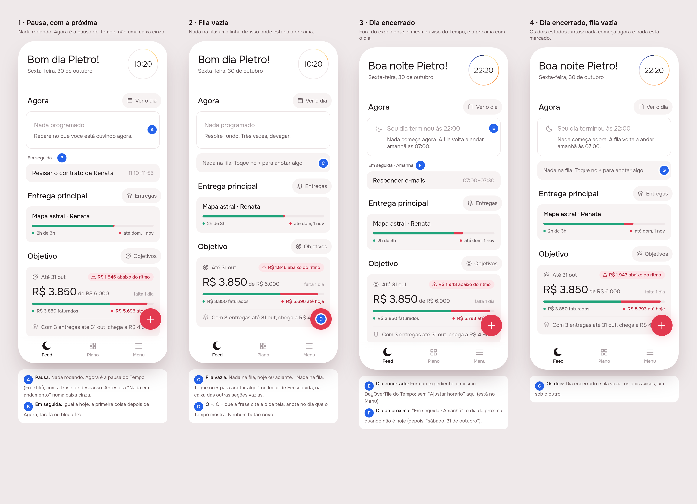

# Feed: Agora as Tempo draws it, and an empty queue said

Draft from the design session (mockup track), for issue
[#75](https://github.com/pietroid/lunna/issues/75). Sections 3–5 come
with the build.

## 1. The prompt

> Preparing for MVP - Simplifying and fixing bugs and traps
>
> Feed:
>
> 1. Time empty state must reflect that to timeline: a message

## 2. The design

Pins and screens in [board.json](board.json); each screen alone:
[1](img/mockup-1.png) · [2](img/mockup-2.png) · [3](img/mockup-3.png) ·
[4](img/mockup-4.png).

**The trap today.** With nothing running, the Feed's Agora is a grey box
saying "Nada em andamento", and with nothing queued nothing else is drawn:
the Feed doesn't say what Tempo says (the break, or the day being over), and
an empty day looks the same as a quiet minute between two tasks. At 23:00 the
Feed still offers the next task under "Em seguida" as if it came next today.

**The proposal.** Agora on the Feed uses Tempo's own tiles, and the queue's
emptiness gets one line.

| Pin | Decision |
|-----|----------|
| A | Nothing running, inside the working day: Agora is Tempo's break (`FreeTile(now: true)`), with its rest line, instead of the grey "Nada em andamento". |
| B | "Em seguida" is unchanged: the first card after Agora, task or fixed block. |
| C | Nothing queued, today or ahead: **"Nada na fila. Toque no + para anotar algo."** where "Em seguida" would be, in the same box as the other empty sections (Entrega, Objetivo). |
| D | The + the line names is the screen's own `AppFab`, which already writes on the day Tempo shows. No new button. |
| E | Outside the working day: Tempo's `DayOverTile` ("Seu dia terminou às 22:00…" / "Seu dia começa às…"), without "Ajustar horário" (it lives in Menu, and the Feed is a summary). |
| F | When the next card isn't today it says its day, as Tempo's headings do: "Em seguida · Amanhã", "Em seguida · sábado, 31 de outubro". |
| G | Both together: day over and nothing queued, the two lines one under the other. |

**References.** Drawn from known patterns, not browsed: Structured's and
Sunsama's "today" views, which show an empty day as a message pointing at the
add button rather than a blank; and Tempo's own Agora, which this mirrors on
purpose so the two screens never disagree.

**Icon.** None new: `FreeTile` and `DayOverTile` keep theirs (`AppIcons.dayOver`).

### Decided unattended

- **Read "reflect that to timeline" as "mirror Tempo's Agora"** and say the
  empty queue in a line; the alternative reading (only a message replacing
  the grey box) is the smaller half of this.
- **New string `feedQueueEmpty`** rather than reusing `timelineEmpty`
  ("Nada marcado. Toque no + para anotar algo."), which nothing in the app
  draws today; "Nada na fila" says why the Feed has no next. The build may
  delete `timelineEmpty` as dead copy.
- **The empty line counts the whole queue, not today only**: if tomorrow
  has a task, scene 3 draws it under "Em seguida · Amanhã" instead of
  saying the queue is empty. The backlog ("Para depois") isn't counted or
  mentioned.
- **No tap on the break or on the line**: the Feed has no write-down sheet
  of its own; the + and "Ver o dia" are the ways in.
- "Ajustar horário" left off the Feed's `DayOverTile`.

## Build brief

The design session already wrote the view layer to the build's standard;
the build is mostly checking it in both brands and shooting it.

**Files (uncommitted in the worktree until the queue commits):**

- `app/lib/feed/view/feed_page.dart`: `_NowAndNext` rewritten (running →
  `EventTile`; closed → `DayOverTile`; else `FreeTile`; next or
  `feedQueueEmpty`; `_nextLabel` adds the day).
- `app/packages/l10n/lib/arb/app_pt.arb` (+ `gen/`): `feedBreak` removed;
  `feedNextOn`, `feedQueueEmpty` added.
- `app/test/feed/feed_page_test.dart`: the empty test checks the break and
  the line; new tests for the break before a next task and for the day over
  with tomorrow's task (15 pass under Focus and Lunna).
- `app/lib/feed_empty_preview.dart`: the preview entry point, scenes 1–4
  (`?s=`), a fixed clock at 10:20 or 22:20. Delete after Phase 4.

**Server:** nothing.

**App, left for the build:**

- Run `.tool/check`.
- Decide whether the "closed" check should follow the day's kind (a day off
  inside working hours): today it follows the hours alone, like Tempo's
  Agora (`_closedAt`).
- Remove the unused `timelineEmpty` string if nothing else claims it.
- Mention the Feed's Agora in `product/spec/home.md` (it mirrors Tempo's).
- Shoot both brands with `.tool/preview feed_empty 1 2 3 4 --brands lunna,focus`.

**Open questions:** none blocking; the reading of the issue (first
decision above) is the one to confirm.

**Cost of the design session:** measured by the queue and written in the PR.
