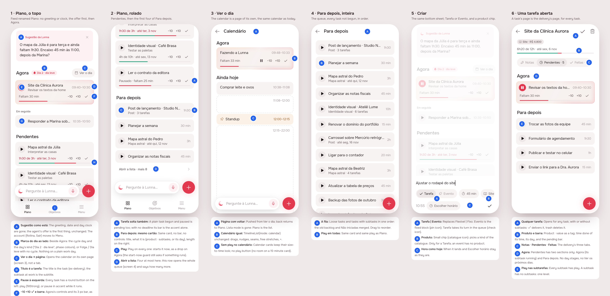
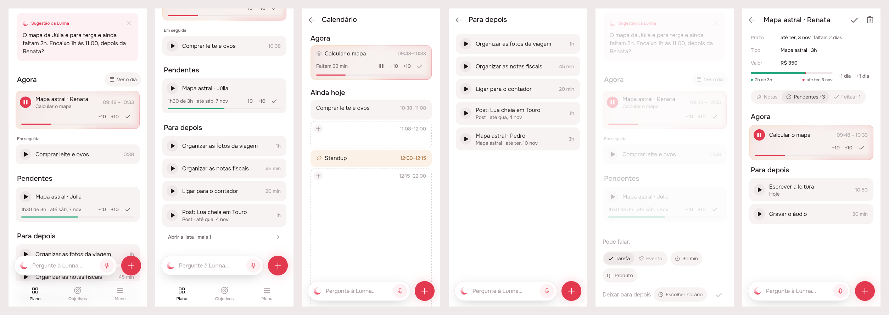
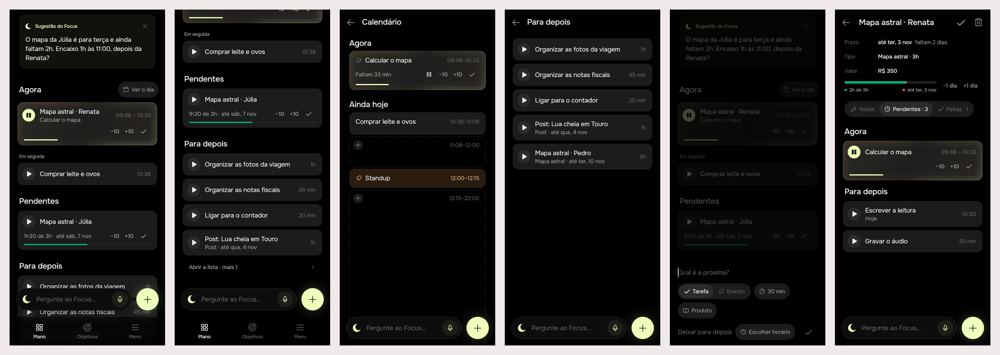

# One kind of task: deliveries become tasks, and Plano is the home

> Issue [#77](https://github.com/pietroid/lunna/issues/77), **mockup track**
> (it changes the home, the tabs, every card, the creation sheet and the
> task's page). Designed and built unattended; the design was approved on
> the issue ("approve"), with its two open questions unanswered. Spec:
> [product/spec/home.md](../../spec/home.md).

## 1. The prompt

From the issue, verbatim:

> **Unify tasks and deliverables, restructure feed**
>
> The major goal of this task is to unify deliverables and tasks. Both are useful for different context, but there is such an amount of overlap between them that we can just consider they the same. What this means:
>
> 1. A deliverable has x amount of time, such as a task
> 2. A task of a deliverable can be in progress. That is the same to say that a deliverable can be in progress as well
> 3. Deliverables contain tasks. Nothing says that tasks could also contain tasks? The name can be confusing, but in nature they should be the same.
> 4. Tasks can be fixed and deliverables are associated with products. Thats where our cut goes: tasks are fundamentally different from fixed events (so it is a different entity). Deliverables and tasks being associated to certain product or value? No problem at all.
>
> Also, the app will be reorganized to solve this merge, those are the things we gonna need to change:
>
> 1. There is no feed, plan and menu. There is a plan, goals, and menu. Goals are separated now again
> 2. The feed is the same just changed names. We will make the following modifications: 1 remove the clock with greeting, suggestion as it is, then "now" section with indication of period/time off by the side of it. The "ver dia" button leads to a new page that is just for a calendar, reflecting the same thing we have for calendar view today, the next task remain the same thing. 3 next is the "pending" section, which replaces the entregas em andamento. They are basically all tasks that have started but havent finished yet. 4 next is the "Para depois" which are programmed things to do that are on a queue. We can have four of them and a "open the list" that leads to a page.
>
> 3. The card for deliverables and tasks should have the same style, only the "pending" section that will have the bar, para depois remains the same
>
> 4. The title of the now card should be of that task, not its subtask. The subtask can appear as subtitle
>
> 5. Play pause: now all tasks should have the play button to the left of it, including the now one )when it is being played, show a pause). Tapping play is the same effect as dragging to the now area
>
> 6. Make the pending tasks look very much like the agora one, that way we can fit the +10 -10, the done button to the side and the bar should be below (following the same style and thickness)
>
> About the creation, lets preserve the bottom sheet, and when creating a task it will ask if it's event or not (instead of fixed and flexible), and have a small chip to select the product. We will improve that later but for now thats it.
>
> About task, when opening it, it will have the same behavior of deliverable (notes, pending done). The only thing is that we have "now" and "later" sections only, and the play buttons will also should all be available.
>
> The question is: should a task support infinte recursion of subtasking? No, only the first level. Because it is not going to be used.
>
> Why not keeping deliverable and task? Because both are conceptually the same. So this separation doesnt make sense

## 2. The design

The screens one by one, for a phone: [1](img/mockup-1.png) ·
[2](img/mockup-2.png) · [3](img/mockup-3.png) · [4](img/mockup-4.png) ·
[5](img/mockup-5.png) · [6](img/mockup-6.png). The pins are in
[board.json](board.json). The real app (Lunna) draws them through
`app/lib/unify_preview.dart`: the new widgets on canned data, the calendar
on the demo's day, at 10:00 on a light day (day 2 of the cycle).

### The rule

**There is one kind of thing to do: a task.** A delivery is a task that
has tasks of its own. Anything a delivery had (a day it is owed by, a
product, a value, notes, begun, delivered) a task can have, and anything a
task had (a length, a place in the queue, play, pause, ±10, ✓) a
delivery has. **One level only**: a task of a task has no tasks. The cut
is between **tasks** and **events**: an event has an hour that is the point
of it, nothing moves it, and it has no product.

So the home has no separate Entregas: a task begun and not finished is
**Pendente**, whether it has tasks of its own or not; a task not begun is
in **Para depois**.

### The screens

| # | Screen | What it shows |
|---|--------|---------------|
| 1 | Plano, the top | The agent's offer as it is; **Agora** with the day's mark beside it and *Ver o dia*; the running task titled by the task (the subtask under it) with pause on the left; *Em seguida* with play. |
| 2 | Plano, scrolled | **Pendentes**: tasks begun and not finished, drawn like Agora (status, −10 +10 ✓, a 3 px bar under it). **Para depois**: the first four of the queue, then *Abrir a lista · mais 8*. |
| 3 | Ver o dia | The calendar as Tempo draws it today, on a page of its own. |
| 4 | Para depois | The whole queue, each with play. |
| 5 | Criar | The same sheet: **Tarefa \| Evento** instead of Flexível \| Fixo, and a **Produto** chip. |
| 6 | A task's page | Any task opens the delivery's page: Notas · Pendentes · Feitas, and Pendentes has only **Agora** and **Para depois**, play on each. |

### Decisions (the pins)

| Pin | Decision | Chosen |
|-----|----------|--------|
| 1A | Header | Greeting, date and day clock removed; the offer is first. The account menu (Rotina, Sair) moves to Menu. |
| 1B | Period / time off | One tag after "Agora": `Dia 2 · dia leve` in the phase's colours; with no cycle, the day's own tag (Folga, Dia leve); nothing on a plain day. |
| 1C | Ver o dia | A pill on Agora's heading, opening a pushed page. |
| 1D | Agora's title | The task (ex-delivery); its subtask at work is the subtitle. A loose task has no subtitle. |
| 1E | Play / pause | A 32 px round button left of every task: play on `fillStrong`, pause on the accent while it runs. Play = a drop on Agora (`start: true`). |
| 1F | Agora's controls | −10 +10 ✓ and the 3 px accent bar, as today. |
| 1H, 2A | Pendentes | Same card as Agora without the glow. Status `1h30 de 3h · até ter, 3 nov` (red when behind, the old Urgente), −10 +10 ✓ beside it, bar under it at 3 px: red time gone, green work done. A loose task paused halfway is pending too; its bar is the accent. Agora's task is not repeated here. |
| 2B | Para depois | The same card, no bar, no controls: title, a subtitle that says what it is (`Post · 3 tarefas`, or its day), its length on the right. |
| 2D | Abrir a lista | A quiet row under the four, with the count of the rest. |
| 1I | Tabs | **Plano · Objetivos · Menu**. Icons: `plan`, `goal`, `menu`. |
| 3B, 3C | Calendar | `TimelineList(mode: calendar)` as it is, on a page with a back arrow, titled *Calendário*. Calendar cards get **no** play button: a 15-minute card has no room for it, and a drag to Agora still starts one. |
| 4A | The queue | Loose tasks and tasks with tasks in one order (the old backlog and Não iniciadas, merged). |
| 5A | Tarefa \| Evento | Segmented: Tarefa (check icon) or Evento (pin icon, the mark fixed cards already carry). |
| 5B | Produto | A pill with the catalogue icon after the length; tapping it lists the catalogue's kinds. Hidden for an Evento. |
| 6A–C | Task page | The delivery's page for any task: ✓ (deliver / tick off), trash, product · value tag, the pending bar, Notas · Pendentes · Feitas. |
| 6D, 6E | Its Pendentes | Two sections, Agora and Para depois; no day stages, no "Ver os próximos dias". Play on every subtask. |

### References

Drawn from known patterns, not browsed (no Mobbin session here):
**Things 3** (a project is a to-do with to-dos, one level of headings,
and the same row everywhere), **Todoist** (sub-tasks under a task, and
"Upcoming" as its own view, which is our *Ver o dia*), **Toggl Track /
Session** (a play button at the left of every row: starting is one tap,
and the running row turns it into stop).

### Decided unattended

- **Plano's icon** is `AppIcons.plan` (it was the crescent on Feed). The
  crescent stays the agent's, on the bar.
- **The account** (Rotina, Sair), which hung off the greeting, goes into
  Menu, which already opens Rotina.
- **"Para depois" is everything not begun, in one order**: loose tasks
  waiting in the backlog and tasks with tasks that were *Não iniciadas*.
  The day's hours for the queue are on *Ver o dia*.
- **Em seguida** still shows the next card with an hour (task or event);
  an event gets no play (events are never begun by hand).
- **Agora's task is left out of Pendentes**, so the same task is not
  drawn twice.
- **Lista mode is dropped**: Plano is the list, and *Ver o dia* the
  calendar. `TimelineModeCubit` and the switch go.
- **Entregas goes as a tab.** Its catalogue (shelves and kinds) moves
  under Menu, as *Produtos*, since the creation chip picks from it.
- **The task's own page** replaces both `EventPage` (for a task) and
  `ArtifactPage`; an event keeps `EventPage`.
- **A subtask's ✓ and its parent:** ticking off the last subtask does not
  deliver the parent (delivering, and its value, stay a deliberate ✓, as
  with a delivery now).
- **Play on a pending task with tasks** starts its next subtask.
- The product chip lists kinds by name only; the shelf is not shown.

### Open questions (answered in section 3, "Decided unattended (build)")

1. **Products and value on a loose task.** The chip sets a product on any
   task; should a task with no subtasks but a product (one post) also
   carry value and count for Objetivos when ticked off? The design says
   yes (it is the same thing), which means goals count ticked-off tasks
   with a value, not only delivered deliveries.
2. **A deadline on a plain task.** The data allows it (the same columns);
   the creation sheet has no field for it yet ("we will improve that
   later"). Fine to leave it to the task's page for now?

## 3. What was built

### The prints, real build

Lunna, scenes 1–6 (Plano, Plano scrolled, Ver o dia, Para depois, the
creation sheet, a task with tasks opened on Pendentes):

Focus, the same scenes:

One by one, Lunna: [1](img/build-1.png) · [2](img/build-2.png) ·
[3](img/build-3.png) · [4](img/build-4.png) · [5](img/build-5.png) ·
[6](img/build-6.png). Drawn by the real pages and cubits on the demo's
repositories at 10:00; a preview entry point fed them and was deleted.

### The contract

**One kind of task, to the person.** Every task is one card (`TaskCard`):
play on its left (pause while it runs; none for an event), the task's name
as title (a delivery's task at work as subtitle). **Play is a drop on
Agora**: a loose task posts `move { index: 0, start: true }`; a task with
tasks posts the new `POST /api/tasks/of/:id/play`, which begins its next
task. Both go through `EventLayoutService.moveTask`, so the guard asks
when something else runs, and the time rules hold.

**What did not change: storage.** A task with tasks is still an
`artifact` row and its tasks `task.artifact_id`. See "Where the build
differs" below for why.

### Server (`server/src/`)

| Piece | What |
|-------|------|
| `events/event-layout.service.ts` `playArtifact` | the delivery's next task: the one the queue reaches first (by its laid-out hour), else the first of its backlog, else a new task of its name for what its time still owes (30 min when it owes nothing), then `moveTask(start: true)`. Refuses a delivered one ("Essa entrega já foi entregue.") or one gone; outside the working day, the usual refusal; one already running is left alone |
| `events/tasks.controller.ts` | `POST /tasks/of/:artifactId/play?days=` → the timeline, with `guard` when it asks |
| `analytics/events.ts` | `artifact_played` |

### App

| Piece | What |
|-------|------|
| `lib/shell/` | three tabs, **Plano · Objetivos · Menu**; the + writes a goal on Objetivos, a task elsewhere |
| `lib/plan/home_page.dart` | `HomePage`: the offer, Agora (+ `TodayTag`, *Ver o dia*), Em seguida, Pendentes, four of Para depois and *Abrir a lista · mais N*; the guard over it; `MinuteRefresh` |
| `lib/plan/plan_items.dart` | `PlanItems` (what Plano draws, from the day and the deliveries), `PendingCard`, `LaterCard`, `openCard`, `playCard` |
| `lib/plan/later_page.dart` | `LaterPage`, the whole of Para depois |
| `lib/plan/write_task.dart` | `writeTask`: the sheet with the catalogue's kinds on its Produto chip; a task with a product is written as a delivery of that kind |
| `lib/tempo/tempo_page.dart` | `DayPage` (Ver o dia, the calendar) replaces `TempoPage` |
| `lib/menu/` | Produtos (`AllArtifactsPage`), Novo produto (`TypeSheet`), Sair |
| `packages/timeline` | `TaskCard`'s ±10/✓ wired; `NowTaskCard` (Agora as a task card, falling back to `EventTile` for events, a task waiting and overtime); `ArtifactPlayed` → `TimelineRepository.playArtifact`; `writeDownOnTimeline(products:, withProduct:)` |
| `packages/artifacts` | the delivery's Pendentes: Agora + Para depois with play, the guard over the page; `ArtifactsCubit.addMinutes` (±10 of a pending task, never under what is done or 10 min) |
| `packages/app_ui` | the sheet's controls wrap, so the Produto chip goes under on a phone instead of off its edge |
| gone | `FeedPage`, `PlanPage` and their tests |

### Tests

- Server: `events.controller.spec.ts` gains 5 end to end (*play on a task
  with tasks*: queue's first and the delivery begun, backlog's first, a
  task written for what it owes, the guard, a delivered one refused).
  Server total 393, all passing.
- App: `test/plan/home_page_test.dart` (4: empty, Agora titled by the
  task with pause and nothing repeated in Pendentes, Pendentes' status,
  controls, bar and play, Para depois's four, loose first, play on each
  kind and the two ways out); `menu_page_test.dart` +1; root 50 tests in
  both brands.
- Packages: `task_card_test.dart` (4), the bloc's `ArtifactPlayed` (1),
  the cubit's `addMinutes` (1), the delivery page (one rewritten, one new:
  Agora with pause over Para depois).
- `.tool/check` passes (app analyze, every package's tests under both
  brands, server eslint, tsc, tests). No flaky test met.

### Where the build differs from the design

- **The storage merge is not in this delivery** (decided unattended).
  The brief proposed moving every `artifact` row into `task` with a
  `parent_id` and dropping `artifact`. That rewrites `ArtifactStore`, the
  agent's delivery actions and their evals, Work Quality, goals and
  analytics, and its migration cannot be taken back; done in the same run
  as the whole app restructure it was the largest risk for the smallest
  visible gain. Everything the person sees is unified on top of the two
  tables, and the merge is the next step. Two things follow from it:
  - **A product on a task** writes it as a delivery of that kind (a task
    with no tasks yet), so it has its value and counts for Objetivos once
    delivered: open question 1 is answered *yes*, by the existing rule.
  - **A loose task's page is still `EventPage`**, and a loose task cannot
    get tasks of its own yet. Only a task with tasks opens the delivery's
    page (Notas · Pendentes · Feitas).
- **Pendentes holds the deliveries begun.** A loose task begun and not
  finished is the one on Agora (running or paused), so it is drawn there;
  one put back in the queue owing time carries no mark to tell it apart.
- **Agora keeps `EventTile`** for a fixed block, a task waiting to be
  begun and a task in overtime: their buttons (Começar, +10 de atraso,
  Terminei) answer what `TaskCard` has no room for.
- **±10 on a pending delivery** changes its total time, not its next
  task's length: the bar and "1h30 de 3h" read the total.
- **Para depois is not reorderable** on its page yet, and its order is the
  loose backlog first, then the deliveries not begun (the two tables have
  no common order).
- **The Produto chip** lists kinds by name; a new kind is written from
  Menu › Novo produto. With no catalogue the chip is not drawn.
- **The landing's demo** keeps its old shell (Tempo, Entregas, Menu): the
  landing has three chapters built on it.
- `ArtifactsPage`, `ArtifactRow`, `DeliveryTile`, `TimelineModeCubit` and
  Lista stay in the packages, drawn only by the demo.

### Decided unattended (build)

- Open question 1 (value on a task with a product): **yes**, through the
  delivery a product writes. Open question 2 (deadline on a plain task):
  **on the task's page**, which for a task with a product is the
  delivery's page with its Prazo.
- The storage merge deferred, as above.
- Play's route is keyed by the delivery (`/tasks/of/:id/play`): the server
  picks the task, so a card with no tasks still plays.
- What play writes when a delivery has nothing left: a task of its name
  for what its time owes, 30 minutes when it owes nothing.

## 4. How to turn it on

Nothing to set: no env var, no migration. Deploy the server before (or
with) the app: an app on this build against an older server gets 404 on
play of a task with tasks; every other route is the same.

## 5. Cost and time

Measured by the queue: see the pull request. No spend outside Claude: the
build never called a model.
