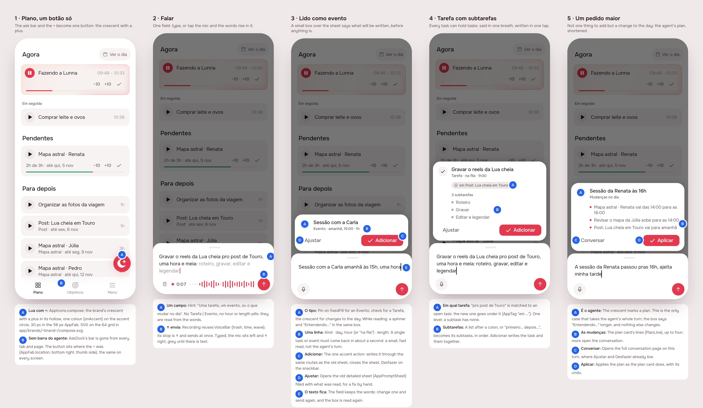

# One button, one field: write or ask (the composer)

> Issue [#81](https://github.com/pietroid/lunna/issues/81), **mockup track**:
> it changes the input surface on every screen (the button, a new
> sheet, a summary box). Designed unattended and **approved on the
> issue**, with the + kept as it was (round 2) and both open questions
> answered (round 3). This is the hand-off:
> sections 1 and 2 and the Build brief. `/create build composer` takes it
> from here.
>
> **Built in #85** ([UI and UX, part 4](../2026-11-03-ux-part-4/README.md)):
> its build session never ran here, so that delivery built this brief, and
> says where the build differs from it.

## 1. The prompt

From the issue, verbatim:

> **Improve UX and UI: Part 2**
>
> Improve the input experience:
>
> I wanted a flexible bottom part where I can both add a task but also talk with the agent. I feel too confusing having two ways of manipulating lunna, and one of them is completely deterministic.
>
> I feel we should have just a single button where I open a bottom sheet with a single text, where I can record as voice or type in.
>
> When I finish typing or talking it will load above this bottom sheet a very small box with the summary (event, duration, associated task if any). This should be very fast to load, unless the request is too big.
>
> Also, I realized that anything that is added is just a task without subtasks. I dont know why. Tasks should always have support of subtasks.
>
> Also about the add icon, create a kind of moon with an add on top of it instead of just a + button

The design was reviewed on the issue, and the person replied:

> Thats aboslutely perfect. I just want you to make a better look on the + icon , i think we can revert that to + that was before. lets go for it.

So the button keeps the app's own `+` (round 2 re-shot screen 1 and the
board); everything else is as drawn in round 1.

Round 3, the person's answer to the two open questions:

> Open question 1 from round 1 still stands: when a task that has already started gets its first subtask, it should go to the last subtask item so the in progress will not be affected.
>
> Open question 2 from round 1 still stands: should the fast read use a small OpenRouter model (the same key as the agent) with a 2 s timeout that falls back to the agent's turn, or something else (a different provider, or parsing simple cases on the phone)?
>
> we can use the same model for now.

So a begun task given subtasks keeps running untouched, and every new
subtask goes at the end of the list; and the fast read runs on the
agent's own model. Nothing drawn changed: round 3 only re-wrote pin 3B
and re-laid the board.

## 2. The design

The screens one by one, for a phone: [1](img/mockup-1.png) ·
[2](img/mockup-2.png) · [3](img/mockup-3.png) · [4](img/mockup-4.png) ·
[5](img/mockup-5.png). The pins are in [board.json](board.json). The
real app (Lunna) draws them through `app/lib/composer_preview.dart`: the
real `HomePage` on the demo's day at 10:00, and the new widgets on canned
reads.

### The rule

**There is one way in: the crescent button opens one field.** Whatever is
typed or said there is read once, and comes back as **one small box above
the sheet** saying what will be written: an event, a task (with the task
it goes under and its subtasks), or, when it is more than one thing,
the agent's changes to the day. **Nothing is written until Adicionar**
(or Aplicar), and the field keeps the words, so a correction is changing a
word and sending again.

**A single task or event is read fast**: one short read on the agent's
own model (one forced tool over a short context) that only fills a
summary. Only a request that changes several
things goes through the agent's whole turn, and says "Entendendo…" for
as long as that takes.

**Every task can have subtasks.** Said in the same breath ("…: roteiro,
gravar, editar"), they are written with it. A task with none can get them
later on its page. One level, as in #77.

### The screens

| # | Screen | What it shows |
|---|--------|---------------|
| 1 | Plano | No agent bar. One button at the foot, the same + as before, where it was. |
| 2 | Falar | The sheet: one field, the mic on the left, ↑ on the right. Recording, the words rise in the field and the recorder's stop is ↑ (it sends). |
| 3 | Lido como evento | The box over the sheet: the kind's mark, the name, "Evento · amanhã, 15:00 · 1h", Ajustar and Adicionar. |
| 4 | Tarefa com subtarefas | "Tarefa · na fila · 1h30", the tag "em Post: Lua cheia em Touro", "3 subtarefas" listed. |
| 5 | Um pedido maior | The crescent: "Mudanças no dia" and the plan's lines, Conversar and Aplicar. |

### Decisions (the pins)

| Pin | Decision | Chosen |
|-----|----------|--------|
| 1A | The icon | The `+` that was there: `AppFab` unchanged (`AppIcons.plus`, `onAccent` on the accent circle, 56 px). It now opens the composer instead of the form. The round-1 crescent-with-plus (`AppIcons.compose`) was dropped on review, with its SVGs. |
| 1B | The bar | `AskDock`'s bar goes from every tab and page. The button sits where the + was (`AppFab.location`, bottom right, the thumb's side), the same on every screen. |
| 2A | The field | One field, hint "Uma tarefa, um evento, ou o que mudar no dia". No Tarefa \| Evento, no hour or length pills: they are read from the words. |
| 2B | Voice | `VoiceBar` as it is (trash, time, wave); its stop is ↑ and sends. Typed: mic left, ↑ right, grey until there is text. |
| 3A | The kind | A 32 px mark: check on `fill` for a Tarefa, pin on `fixedFill` for an Evento (the fixed cards' mark), the crescent on `accentWash` for changes. While reading, the same box shows a spinner and "Entendendo…". |
| 3B | One line | Kind · day, hour (or "na fila") · length, from one short read on the agent's model (round 3). |
| 3C | Adicionar | The one accent action: writes through the same routes the old sheet used, closes the sheet, with Desfazer on the snackbar. |
| 3D | Ajustar | Opens the old detailed sheet (`AppPromptSheet`) filled with what was read, for a fix by hand. |
| 3E | The words stay | The field keeps the text; editing it drops the box, sending reads again. |
| 4A | Under a task | "pro post de Touro" is matched against the open tasks with tasks (deliveries); the new task goes under it, shown as `AppTag` "em …". |
| 4B | Subtasks | A list after a colon (or "primeiro… depois…") becomes its subtasks, in order, written together on Adicionar. |
| 5A | The agent | Only here does the request take the agent's turn; the box simply waits longer. |
| 5B | The changes | The plan card's own lines (`PlanLine`), up to four; more go to the conversation. |
| 5C, 5D | Conversar, Aplicar | Conversar opens the conversation page on this turn (where Ajustar and Desfazer already live); Aplicar applies as the plan card does, with its undo. |

### References

Drawn from known patterns, not browsed (Mobbin was still connecting and
the run is unattended): **Todoist's Quick Add** (one line with natural
language, the parsed date and project highlighted before adding),
**Things 3's Quick Entry** (one field, nothing written until confirmed),
and **ChatGPT's composer** (one field, mic on the left, send on the right;
dictation that becomes text in the field).

### Decided unattended

- **The calendar's tap on empty room, and its +, keep the old sheet**
  (`AppPromptSheet` at that hour): a tap on an hour is already a precise
  gesture, and typing it again would be slower. Everything else writes
  through the composer.
- **On Objetivos the same button opens the composer**, and the read may
  come back as a goal ("Objetivo · R$ 10.000 até 30 nov"), a fourth kind
  of box, not drawn here. The goal sheet stays behind Ajustar.
- **On a task's or a delivery's page** (the notes), the button opens the
  composer about that task (`about`): a new task goes under it unless said
  otherwise. The notes' **dictation mic stays** beside it: it writes into
  the notes, not to Lunna.
- **The fast read is its own small call**, not the agent's turn: one
  forced tool with the fields of the box, given only today's date, the
  zone, the working day and the names of the open tasks with tasks. When
  it answers "plan", the text goes to the agent as an ordinary turn.
- **A task with subtasks is written as a delivery** (storage is still
  `artifact`, as #77 left it): its title and length, its subtasks as its
  tasks splitting the length evenly unless each was given one.
- **A loose task gets subtasks on its page**: "+ Subtarefa" on its page;
  the first one turns it into a task with tasks (see Build brief).
- **Ajustar** opens `AppPromptSheet` filled from the read; it does not
  carry the subtasks (they are added on the task's page).
- **No new icon** (round 2): the person asked to keep the `+`, so the
  crescent stays the agent's alone (the plan box's mark, 3A), and the
  button reads as "add" as it always has.
- After Adicionar the sheet closes; the new card is on Plano with a
  snackbar "Adicionado · Desfazer".

- **Round 3, read of the answer to question 1**: "it should go to the
  last subtask item so the in progress will not be affected" is read as:
  the begun task's row stays exactly as it is (running, its hour, its
  `event` row) and becomes the task with tasks' first item, and the new
  subtask (and every later one) is appended **at the end** of the list,
  after the running one. Nothing is paused, refused or re-laid. If the
  intent was the reverse (the begun work moved to the last slot), the
  only change is the position the first subtask is written at.
- **Round 3, the model**: the fast read uses `OPENROUTER_MODEL`, the
  agent's own, with no model of its own and no new env var. It keeps a
  timeout (8 s) after which the text goes to the agent's turn, as a
  failed read does; the latency is measured in the spec and in
  `eval:agent`, so a smaller model can be swapped in later on numbers.

### Open questions

None left: both were answered on the issue (round 3, above).

## Build brief

### Files the design session wrote (uncommitted, kept for the build)

| File | What |
|------|------|
| `app/lib/composer_preview.dart` | the preview entry point, `?s=1..5` (delete at Phase 4) |
| `app/packages/agent/lib/src/compose_cubit.dart` | `ComposeKind`, `ComposeDraft`, `ComposeState`, `ComposeCubit(read:)` |
| `app/packages/agent/lib/src/view/composer.dart` | `ComposeButton`, `showComposer`, `ComposerSheet`, `ComposeSummary` |
| `app/packages/agent/lib/agent.dart` | exports both |
| `app/packages/l10n/lib/arb/app_pt.arb` (+ `gen/`) | the `compose*` strings |

Round 2 removed the icon: `compose.svg` (app_ui and both brands),
`AppIcons.compose` and `AppFab.iconSize` are gone, and `ComposeButton` is a
plain `AppFab`. `app_ui` is back to `main`.

### Server

- `POST /api/agent/compose { text, about? }` → `{ draft }` with `kind`
  (`task` \| `event` \| `goal` \| `plan`), `title`, `start?`, `minutes?`,
  `parent?` (`{ id, title }`, resolved by the server from a ref),
  `subtasks[]`, and for `plan` the agent's turn (`conversationId`, the plan,
  its lines). The fast path is one forced tool on **the agent's own model**
  (`OPENROUTER_MODEL`, the same OpenRouter client and key; no new env
  var) over a short context (date, zone, `WorkDay`, open deliveries by
  ref); it asks nothing back. Past 8 s, or on a failed read, the text
  goes to the agent's turn as `plan`. `plan` runs the existing agent turn. Refusals in
  Portuguese. Measure the latency (p50 and p95, on the agent's model) in the spec and in
  `npm run eval:agent` (a few compose cases).
- No new write route for Adicionar: the app posts what the draft says
  through the existing ones (`POST /tasks`, `POST /events`,
  `POST /artifacts` with its tasks, a goal's route), so the time rules
  hold.
- Subtasks on a loose task: `POST /api/tasks/:id/subtasks { title,
  minutes? }`: the first one makes an `artifact` from the task (title,
  notes, minutes, its place in the queue) and keeps the task's own row as
  its first task, untouched (a begun one keeps running, its `event` row
  and hour as they were); the new subtask, and every later one, is
  appended **at the end** of its tasks (round 3). Through
  `EventLayoutService`; undoable.
- `analytics/events.ts`: `compose_read` (kind, ms; never the text) and the
  subtasks route.

### App

- Shell, pages and notes: replace `AskDock` (bar + `AppFab`) with
  `ComposeButton` (the same `+`) at `AppFab.location`; keep `DockHero` so it stays still
  across pages; on notes pages keep the dictation mic beside it.
- Wire `ComposeCubit.read` to `AgentRepository.compose`; on Adicionar post
  through `TimelineBloc` / `ArtifactsCubit` / the goals cubit by kind;
  Ajustar → `writeDownOnTimeline` prefilled; Conversar → the conversation
  page on the returned turn; Aplicar → `applyPlan`.
- Editing the field after a read drops the box (`ComposeCubit.edit`,
  done); a read that comes back after an edit is ignored (done).
- The task's page: "+ Subtarefa" on a loose task.
- Tests: `ComposeCubit` (send, stale read ignored, edit drops), the
  summary per kind, the shell has no bar and one button; server e2e for
  the compose route on a fake model and for subtasks on a loose task.
- Update `product/spec/agent.md` and `home.md`, and the "app shell"
  paragraph of `AGENTS.md` (the bar is gone).

### Cost of the design session

Not recorded here: the queue measures every run and writes the figures in
the PR.
