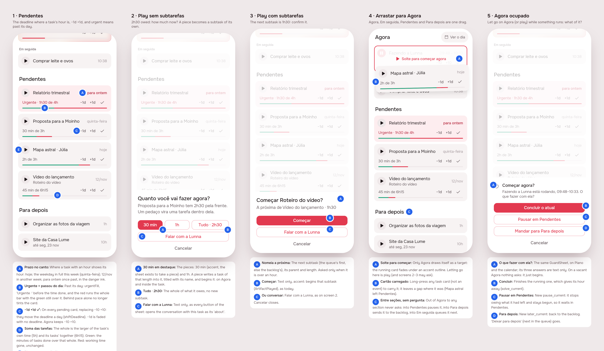

# Pendentes: the day in the corner, a piece at a time, one drag between all

> Issue [#83](https://github.com/pietroid/lunna/issues/83), **mockup track**
> (it changes the pending card, adds a sheet on play, a third answer to the
> guard and drags between Plano's sections). Designed unattended; the
> person approves on the issue. Draft: sections 1, 2 and the Build brief.

## 1. The prompt

From the issue, verbatim:

> **Improve UI and UX: part 3**
>
> This task is focused on pending tasks
>
> Tasks will be created according to the time it has. If we fill in more subtasks that actually increase the total time, we just consider the sum of the subtasks.
>
> This should reflect on the bar of pending tasks. We just consider green those sum of time which were done. The red bar stays the same about the proportion of the end time.
>
> If a task is delayed, we should label it as urgent and the bar will always be red, and the color will change, etc.
>
> The deadline must be at the top right as the time is for tasks. And we should be like 05/Nov when the week is not this one or quinta-feira/terca feira, etc for the same week (or today), or if delayed "para ontem". Also, pending tasks should have +1 day and -1 day always.
>
> Also, when hitting play on a pending task, if the previewed task is longer than 1 hour, it should ask how much I want to tackle with a dialog, 30 min, 1h or talk to lunna.
>
> # Management of partial task completion
>
> Here the logic splits: If I have a task that has no subtasks, we should be able to split it as much as we can. The mechanism basically is that it will automatically create a subtask for that time that will fill in the time that I have asked. That way we can see the block in the in progress and also inside the task. If I take the full task, it will not create a subtask.
>
> For things that already have a subtask the dialog will actually confirm if I want to do X next subtask.
>
> # Moving between pending and now
>
> I should be able to drag between pending and now, as well as para depois too (and even em seguida). They are all interchangeable. But with some caveats:
>
> - When moving something to in progress (or tapping play, the same thing) and something is already in progress it will ask what should I do with the current task (finish or move that to later or pending)
> - When moving something out of in progress and to any other place, it is clear what this means so no popup
> - When moving to in progress or hitting play when the agora is vacant, it will just play along

The design was reviewed on the issue, and the person replied:

> Remove the icons from the buttons, they are too ugly

## 2. The design

The screens one by one, for a phone: [1](img/mockup-1.png) ·
[2](img/mockup-2.png) · [3](img/mockup-3.png) · [4](img/mockup-4.png) ·
[5](img/mockup-5.png). The pins are in [board.json](board.json). The real
app (Lunna) draws them through `app/lib/pending_tasks_preview.dart`: Plano
on the demo's day at 10:00 (a Tuesday), with five canned tasks.

### The rules

- **A task's time is the larger of its own and its tasks' together.**
  Written down with 5 h, given tasks of 45 min + 1h30 + 2 h + 2 h, it is
  6h15. The green of the bar is the minutes of the tasks done over that
  whole; the red is the share of its working days gone, as today.
- **Urgent means past its day.** The card takes `urgentFill`, the corner
  says *para ontem* in the danger ink, the line under the name starts with
  *Urgente*, and the red fills the whole bar (the green still drawn over
  it, so what was done shows). Behind pace but not past its day is no
  longer urgent: the red showing past the green already says it.
- **The day is in the corner**, where a task with an hour shows its hour:
  *hoje*; the weekday in full in this week (Monday to Sunday),
  *quinta-feira*; the date in another week, *12/nov*; *para ontem* once
  it is past. No deadline, nothing in the corner.
- **−1d +1d ✓** on every pending card, replacing −10 +10. The length
  follows the tasks now, so the step that matters on a pending card is
  its day. −1d is faded with no deadline.
- **Play asks when what would begin is over an hour.** With no tasks of
  its own (what it still owes, say 2h30): *30 min*, *1 h*, *Tudo · 2h30*,
  *Falar com a Lunna*. A piece writes a task of that length into it and
  begins that, so the piece is on Agora and inside the task; *Tudo*
  writes nothing. With tasks: *Começar Roteiro do vídeo?*, its parent and
  length, *Começar* or *Falar com a Lunna*. An hour or less begins at once.
- **Agora, Em seguida, Pendentes and Para depois are one drag.** Let go on
  Agora is play (and the sheet above may ask); out of Agora to any other
  section never asks. Let go on Agora while something runs asks what of
  the running one: *Concluir o atual*, *Pausar em Pendentes*, *Mandar para
  Para depois*. On a vacant Agora it just begins.

### Decisions (the pins)

| Pin | Label | Decision |
|-----|-------|----------|
| 1A | Prazo no canto | Where a task with an hour shows its hour: hoje; the weekday in full this week (quinta-feira); 12/nov in another week; para ontem once past, in the danger ink. |
| 1B | Urgente = passou do dia | Past its day: urgentFill, 'Urgente ·' before the time done, and the red runs the whole bar with the green still over it. Behind pace alone no longer tints the card. |
| 1C | −1d +1d ✓ | On every pending card, replacing −10 +10: they move the deadline a day (shiftDeadline). −1d is faded with no deadline. Agora keeps −10 +10. |
| 1D | Soma das tarefas | The whole is the larger of the task's own time (5h) and its tasks' together (6h15). Green: the minutes of tasks done over that whole. Red: working time gone, unchanged. |
| 1E | Play pergunta > 1h | Play begins at once when what would begin is an hour or less; over that, the sheet of screens 2–3. |
| 2A | 30 min em destaque | The pieces: 30 min (accent, the sheet exists to take a piece) and 1h. A piece writes a task of that length into it, titled with its name, and begins it: on Agora and inside the task. |
| 2B | Tudo · 2h30 | The whole of what it owes, no new subtask. |
| 2C | Falar com a Lunna | Text only, as every button of the sheet: opens the conversation with this task as its 'about'. |
| 3A | Nomeia a próxima | The next subtask (the queue's first, else the backlog's), its parent and length. Asked only when it is over an hour. |
| 3B | Começar | Text only, accent: begins that subtask (ArtifactPlayed), as today. |
| 3C | Ou conversar | Falar com a Lunna, as on screen 2. Cancelar closes. |
| 4A | Solte para começar | Only Agora draws itself as a target: the running card fades under an accent outline. Letting go here is play (and screens 2–3 may ask). |
| 4B | Cartão carregado | Long-press any task card (not an event) to carry it; it leaves a gap where it was (Mapa astral left Pendentes). |
| 4C | Entre seções, sem pergunta | Out of Agora to any section never asks: into Pendentes pauses it, into Para depois sends it to the backlog, into Em seguida queues it next. |
| 5A | O que fazer com ela? | The same GuardSheet, on Plano and the calendar; its three answers are text only. On a vacant Agora nothing asks: it just begins. |
| 5B | Concluir | Finishes the running one, which gives its hour away (solve_current). |
| 5C | Pausar em Pendentes | New pause_current: it stops owing what it had left and stays begun, so it waits in Pendentes. |
| 5D | Para depois | New later_current: back to the backlog. 'Deixar para depois' (next in the queue) goes. |

### References

Drawn from known patterns, not browsed (no Mobbin session here):
**Things 3** (the deadline flag in the row's corner, *Today* and weekday
names this week, a date beyond), **Sunsama** (on starting a task, the
"how long are you working on this now?" prompt, and dragging tasks between
*Today* and the backlog), **Toggl Track** (the running entry replaced by a
new one asks nothing; here it asks because a task in progress has work it
owes).

### Decided unattended

- **Urgent = past its day** only. The issue's "delayed" read as late on
  the deadline; behind pace stays visible in the bar but no longer tints
  the card. Sorting keeps urgent ones first, then the most behind.
- **−1d +1d replace −10 +10** on Pendentes ("always"); the length is
  edited on the task's page or follows its tasks. Agora keeps −10 +10.
- **The week runs Monday to Sunday**, as `weekdaysShort` does. Tomorrow
  is its weekday's name, not *amanhã*, as the issue lists.
- **The piece is a task of the task, titled with its name**
  ("Proposta para a Moinho"), the length picked; it takes its turn
  first in the task's tasks. Once the task has a piece it has tasks, so
  its next play is the second kind of sheet.
- **Over an hour** counts the next task (with tasks) or what is owed
  (without), never the whole task.
- **30 min is the accented choice**: the sheet exists to take a piece.
- **The guard's three answers** replace the two (*Deixar para depois* is
  gone): pause keeps it begun, so it waits in Pendentes; Para depois puts
  it in the backlog. The same sheet answers on the calendar.
- **Only Agora draws itself as a target** while a card is carried (the
  outline and *Solte para começar agora*); the other sections open a gap
  where the card would land, as Lista did.
- **No icons on the sheets' buttons** (the review's reply): *Começar*,
  *Falar com a Lunna*, *Concluir o atual*, *Pausar em Pendentes* and
  *Mandar para Para depois* are text only, the accent alone marking the
  one offered. Read as the buttons of the two sheets: the guard's heading
  keeps its timer (it is not a button), the cards keep their play and ✓
  (controls drawn on every card, not buttons with a label), and *Solte
  para começar agora* keeps its play (a label).
- **Falar com a Lunna** opens the conversation with the task as its
  `about`, as the notes' bar does.

### Open questions

1. A loose task that is **not** pending (in Para depois, 2 h): does its
   play ask too? The design asks on any play over an hour, wherever it
   is, since the issue's rule is about what begins.
2. Dragging a card out of **Pendentes into Para depois**: does it stop
   being begun (it leaves Pendentes, keeping what was done), as the old
   Entregas did when dragged down? The design says yes.

## Build brief

### Files the design wrote (uncommitted, kept for the build)

- `app/lib/pending_tasks_preview.dart`: the preview entry point (delete
  in Phase 4).
- `app/lib/plan/view/play_sheet.dart`: `PlaySheet`, `PlayChoice`
  (`PlayPiece`, `PlayWhole`, `PlayTalk`), `playPending` (asks over
  `kPlayAsksOver`). `PlayPiece` and `PlayTalk` are not wired yet.
- `app/lib/plan/view/plan_items.dart`: `PendingCard` on the new rules.
- `app/lib/plan/view/home_page.dart`: `NowDropZone`, `HomePage.carrying` (the carried card leaves its place).
- `app/lib/plan/plan.dart`: exports the sheet.
- `app/packages/timeline/lib/src/widgets/task_card.dart`: `TaskStep`
  (minutes | days), `TaskCard.fill`, `.trailingInk`, `.step`,
  `TaskBar.late`.
- `app/packages/timeline/lib/src/widgets/guard_sheet.dart`: three answers,
  text only (`AppButton`, no `AppButton.icon`).
- `app/packages/timeline/lib/src/models/timeline_event.dart`:
  `TimingDecision.pauseCurrent`, `.laterCurrent`.
- `app/packages/artifacts/lib/src/view/artifact_format.dart`: `dueLabel`.
- `app/packages/l10n/lib/arb/app_pt.arb` (+ gen): `dueToday`,
  `dueYesterday`, `weekdaysLong`, `dueDate`, `controlDayEarlier`,
  `controlDayLater`, `stepDayLess`, `stepDayMore`, `pendingUrgentStatus`,
  `playPiece*`, `playWhole`, `playNext*`, `guardBusyBody`,
  `guardToPending`, `guardToLater`, `planDropStart`.

### Decided in review

- Every button of `PlaySheet` and `GuardSheet` is a plain `AppButton`
  with no icon; keep it so when wiring them (round 2, the issue's reply).

### Server

- **The whole**: an artifact's `minutes` on the wire becomes
  `max(own, Σ tasks)` (and `doneMinutes` stays the tasks done), wherever
  it is read: the bar, the queue's share, goals' pace, the suggestion's
  Work Quality. Keep the own minutes stored.
- **Urgent** (`isUrgent` in the app, the server's ordering if it has
  one): past its day only.
- **Play with a piece**: `POST /tasks/of/:id/play { minutes }`; with no
  open task, writes a task of that length into it (its title) and begins
  it; without `minutes`, as today (no new task).
- **The guard's answers**: `pause_current` (a running task stops, owing
  what it had left, keeps `started_at` on its delivery, so it stays
  pending; a fixed block stays and the task waits, as `postpone_current`)
  and `later_current` (the running task goes to the backlog). Keep
  `postpone_current` for old clients or drop it.
- **A loose task is pending** when begun and not done: today Pendentes is
  deliveries only. A paused loose task needs to show there (with its
  minutes done), or `pause_current` on a loose task has nowhere to land.
  This is the biggest piece of the build.
- Analytics rows for any new route or body.

### App

- Wire `PlayPiece` (minutes on `ArtifactPlayed`) and `PlayTalk` (the
  agent's conversation with `about` the task).
- Drag between Agora, Em seguida, Pendentes and Para depois on Plano
  (`LongPressDraggable` on every `TaskCard` but events, `DragTarget`s per
  section; `NowDropZone` while over Agora). Out of Agora: a pause (into
  Pendentes) or the backlog, no sheet. Into Agora: `playPending` for a
  pending task, the move with `start: true` otherwise.
- `PendingCard` for a loose begun task (no subtitle, no tasks).
- Tests: `dueLabel` (hoje, this week, next week, past; under several
  `TZ`), `PendingCard` urgent / not, `playPending` asks over an hour and
  not under, the guard's three answers; server specs for the piece and
  the two decisions.

### Design session cost

Measured by the queue for this run and written in the PR (`.tool/cost` is skipped unattended).
