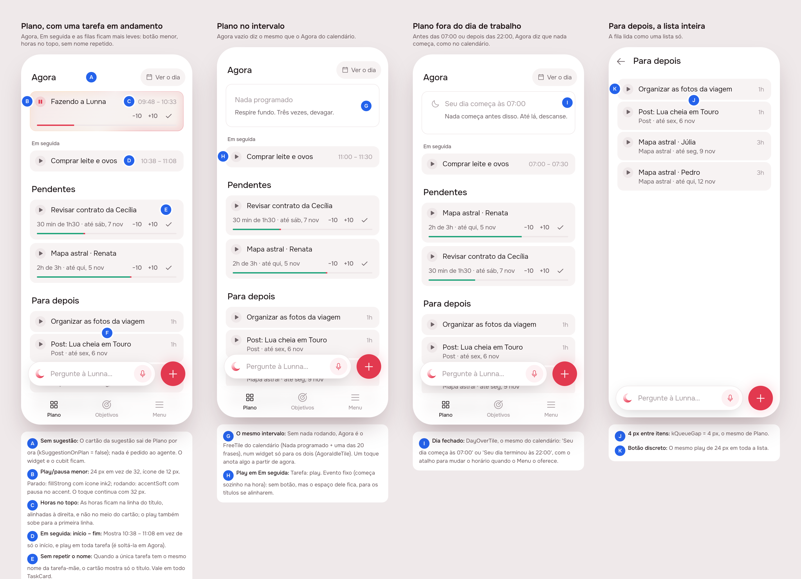

# UX e UI, parte 1 (#79)

Draft, from the unattended design session (mockup track). Sections 1 and
2 are the proposal; the **Build brief** is what `/create build ux-part-1`
starts from, and Phase 4 replaces it with sections 3–5.

## 1. The prompt

Issue [#79](https://github.com/pietroid/lunna/issues/79), *Improve UX and
UI: Part 1*:

> - Agora on home page should actually reflect what is on the calendar (if empty state show the same messages, etc)
> - Em seguida should also show a play button and the time label should be start time - end time.
> - Play/pause button should be smaller and more discrete
> - The playing in now should have the time right aligned with the top
> - If there is no subtask, does not show repeated title and subtitle. Just show the title.
> - Disable suggestions for now (we will come to that later)
> - Make the items in the queue with less spacing between each other

## 2. The design

Drawn by the real app (Lunna) through `app/lib/ux_part_1_preview.dart`,
on the demo's fakes; the pins are in [board.json](board.json). Screens:
[1](img/mockup-1.png) a task running, [2](img/mockup-2.png) the break,
[3](img/mockup-3.png) before the working day, [4](img/mockup-4.png) Para
depois whole.

**References** (from known patterns; Mobbin was not browsed in this
session): Structured's timeline rows (hours on the title's line, a small
leading control), Things 3's list density (rows close together, one list
read as one block), Apple Reminders' small round leading control that
doesn't compete with the title.

| Pin | Decision | Chosen |
|-----|----------|--------|
| A | Suggestions | Plano draws no `SuggestionCard` and asks the agent nothing (`kSuggestionOnPlan = false` in `home_page.dart`). The card, its cubit and the server stay; turning it back on is that line. |
| B, K | Play/pause | 24 px (was 32), 12 px icon. Waiting: `fillStrong` with `ink2`; running: `accentSoft` with the pause in `accent`. The tap still lands in 32 px. No new token or icon. |
| C | Hours on Agora | On the title's line, right-aligned (baseline with the title), not centred on a two-line card; the play button rises to the first line too. Applies to every `TaskCard`. |
| D | Em seguida's hours | `start – end` (10:38 – 11:08), as Agora writes them. |
| D, H | Em seguida's play | Every task has play (a drop on Agora). A fixed block, which starts by itself, has no button but keeps its room (`keepPlaySlot`), so the titles line up. |
| E | Repeated name | `TaskCard` drops a subtitle that only repeats the title (trimmed, case-insensitive). A delivery whose one task is itself shows its name once, everywhere the card is drawn. |
| G | Agora empty | The calendar's break, the same widget: `AgoraIdleTile` (new, in `timeline`) is `FreeTile(now: true)` from now to the next card (*Nada programado* and one of the twenty lines), and a tap writes a task from now. Lista's break now draws through it too, so the two can't drift. Replaces *Nada em andamento*. |
| I | Agora outside the day | `DayOverTile`, the calendar's: *Seu dia começa às 07:00* / *terminou às 22:00*, with the Menu's hours when the shell offers them (`OpenDayHours`). |
| F, J | Queue spacing | 4 px between Para depois's cards (was 8), on Plano and on its page (`kQueueGap`). Agora, Em seguida and Pendentes keep 8. |

What Agora draws when something is in it was already the calendar's:
`NowTaskCard` hands a fixed block, a task waiting to be begun and one in
overtime to `EventTile`. The difference was only the empty state.

### Decided unattended

- **"The queue" is Para depois** (the list on Plano and `LaterPage`), not
  Pendentes, whose cards carry a bar and controls and stay at 8 px.
- **Play for a fixed block in Em seguida: none.** An event starts at its
  hour by itself (AGENTS.md, "Events never wait"); the slot is kept so the
  title aligns.
- **The play button's look**: smaller *and* quieter (no solid accent
  while running, a 14 % tint instead), since "more discrete" read as both.
- **The repeated-name rule lives in `TaskCard`**, not in each caller, so
  Pendentes, Agora, Em seguida and Para depois all follow it.
- **Suggestions are switched off on Plano only**: the landing's demo
  keeps its offer (it is the agent's chapter), and the server keeps
  making suggestions (`SuggestionTimer` still fires; nobody sees them).

## Build brief

**Files the design session wrote or changed** (uncommitted by the
session; the queue commits them):

- `app/packages/timeline/lib/src/widgets/agora_idle_tile.dart` (new),
  exported from `widgets.dart`.
- `app/packages/timeline/lib/src/view/timeline_list.dart`: Lista's break
  draws `AgoraIdleTile`.
- `app/packages/timeline/lib/src/widgets/task_card.dart`: top-aligned
  row, hours on the title line, `_subtitle` (no repeat), `keepPlaySlot`,
  `TaskPlayButton.size` = 24 px.
- `app/lib/plan/view/home_page.dart`: `kSuggestionOnPlan`, `_NowCard`
  with `AgoraIdleTile`, `_NextCard` with `start – end` and play,
  `_Pad(gap:)`.
- `app/lib/plan/view/plan_items.dart`: `kQueueGap`;
  `app/lib/plan/view/later_page.dart` uses it.
- `app/test/plan/home_page_test.dart`: the empty day expects `FreeTile`.
- `app/lib/ux_part_1_preview.dart`: the preview entry point (scenes 1–4);
  delete it in Phase 4.

**What the build must still do** (app only; nothing on the server):

1. Calendário's own empty Agora (`timeline_list.dart`, the `(null, null)`
   cases near line 1782) draws `DayOverTile`/`FreeTile` from its free
   room; move it onto `AgoraIdleTile` too if the room's slot can be
   passed in, or leave it and say why.
2. Remove `feedBreak` from `app_pt.arb` if nothing reads it any more
   (only the old `_Quiet` did), and regenerate l10n.
3. Tests: `task_card_test.dart` for the dropped repeat subtitle,
   `keepPlaySlot` and the 24 px button; `home_page_test.dart` for
   Em seguida's `start – end` and play, no `SuggestionCard` on Plano, and
   `DayOverTile` outside the working day.
4. Check that the smaller button still reads on Focus (lime `accentSoft`
   on dark) in the build prints, and on Agora's `NowSurface` glow.
5. AGENTS.md "The app shell" says Plano opens with "the agent's one
   offer": say it is off for now (`kSuggestionOnPlan`), and point
   `product/spec/home.md` at the same.

**Open questions**: none blocking. If "the queue" meant Pendentes as well,
it is one `gap:` on its `_Pad`.

**Cost**: the queue measures every run and writes the figures in the PR.
