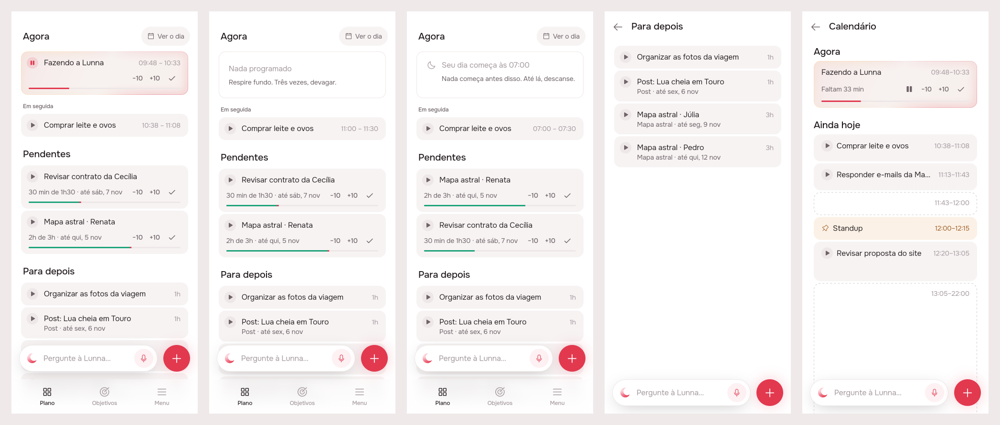
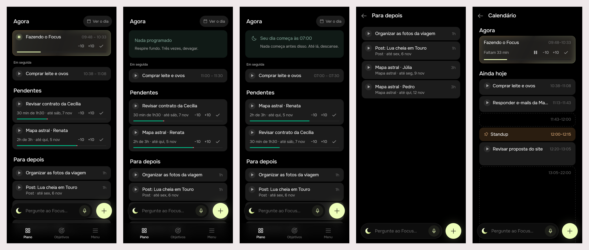

# UX e UI, parte 1 (#79)

Mockup track, designed and built unattended by the queue. App only:
nothing changed on the server.

## 1. The prompt

Issue [#79](https://github.com/pietroid/lunna/issues/79), *Improve UX and
UI: Part 1*:

> - Agora on home page should actually reflect what is on the calendar (if empty state show the same messages, etc)
> - Em seguida should also show a play button and the time label should be start time - end time.
> - Play/pause button should be smaller and more discrete
> - The playing in now should have the time right aligned with the top
> - If there is no subtask, does not show repeated title and subtitle. Just show the title.
> - Disable suggestions for now (we will come to that later)
> - Make the items in the queue with less spacing between each other

The design was reviewed on the issue, and the person replied:

> We should also have play buttons on calendar view

The build was reviewed on the issue. Asked whether Pendentes should be
tighter too (only Para depois was at 4 px), the person replied:

> yes, they should all follow the same spacing

## 2. The design

Drawn by the real app (Lunna) through `app/lib/ux_part_1_preview.dart`,
on the demo's fakes; the pins are in [board.json](board.json). Screens:
[1](img/mockup-1.png) a task running, [2](img/mockup-2.png) the break,
[3](img/mockup-3.png) before the working day, [4](img/mockup-4.png) Para
depois whole, [5](img/mockup-5.png) the calendar (Ver o dia), added after
the review.

**References** (from known patterns; Mobbin was not browsed in this
session): Structured's timeline rows (hours on the title's line, a small
leading control), Things 3's list density (rows close together, one list
read as one block), Apple Reminders' small round leading control that
doesn't compete with the title.

| Pin | Decision | Chosen |
|-----|----------|--------|
| A | Suggestions | Plano draws no `SuggestionCard` and asks the agent nothing (`kSuggestionOnPlan = false` in `home_page.dart`). The card, its cubit and the server stay; turning it back on is that line. |
| B, K | Play/pause | 24 px (was 32), 12 px icon. Waiting: `fillStrong` with `ink2`; running: `accentSoft` with the pause in `accent`. The tap still lands in 32 px. No new token or icon. |
| C | Hours on Agora | On the title's line, right-aligned (baseline with the title), not centred on a two-line card; the play button rises to the first line too. Applies to every `TaskCard`. |
| D | Em seguida's hours | `start – end` (10:38 – 11:08), as Agora writes them. |
| D, H | Em seguida's play | Every task has play (a drop on Agora). A fixed block, which starts by itself, has no button but keeps its room (`keepPlaySlot`), so the titles line up. |
| E | Repeated name | `TaskCard` drops a subtitle that only repeats the title (trimmed, case-insensitive). A delivery whose one task is itself shows its name once, everywhere the card is drawn. |
| G | Agora empty | The calendar's break, the same widget: `AgoraIdleTile` (new, in `timeline`) is `FreeTile(now: true)` from now to the next card (*Nada programado* and one of the twenty lines), and a tap writes a task from now. Lista's break now draws through it too, so the two can't drift. Replaces *Nada em andamento*. |
| I | Agora outside the day | `DayOverTile`, the calendar's: *Seu dia começa às 07:00* / *terminou às 22:00*, with the Menu's hours when the shell offers them (`OpenDayHours`). |
| L | Play on the calendar | Every task with an hour that has not begun draws the same 24 px `TaskPlayButton` before its title (`EventTile.onPlay`). A tap is a drop on Agora (`EventMoved(start: true)`), so with something running it asks first (`GuardSheet`). A delivery's block on the calendar draws it in place of the folders and plays its next task (`DeliveryTile.onPlay`). Tapping it never opens the card nor starts a drag (it sits under the card's `actionsKey`). |
| M | Events on the calendar | No play: an event begins at its hour. The pin stays; no empty slot is kept, since calendar cards are not a column of titles. |
| N | Agora on the calendar | Unchanged: the running card already has pause, −10, +10 and ✓. |
| F, J | Queue spacing | 4 px between Para depois's cards (was 8), on Plano and on its page (`kQueueGap`). After the build's review, every card on Plano (Agora, Em seguida, Pendentes too) keeps the same 4 px. |

What Agora draws when something is in it was already the calendar's:
`NowTaskCard` hands a fixed block, a task waiting to be begun and one in
overtime to `EventTile`. The difference was only the empty state.

### Decided unattended

- **"The queue" is Para depois** (the list on Plano and `LaterPage`), not
  Pendentes. Superseded by the build's review: every section follows the
  same spacing.
- **Play for a fixed block in Em seguida: none.** An event starts at its
  hour by itself (AGENTS.md, "Events never wait"); the slot is kept so the
  title aligns.
- **The play button's look**: smaller *and* quieter (no solid accent
  while running, a 14 % tint instead), since "more discrete" read as both.
- **The repeated-name rule lives in `TaskCard`**, not in each caller, so
  Pendentes, Agora, Em seguida and Para depois all follow it.
- **Play on the calendar is for tasks not begun, off Agora and off the
  backlog** (`_plays` in `timeline_list.dart`): the same set a nudge
  reads. Lista (only the landing's demo draws it) gets none; the card in
  the air while dragged draws none either.
- **An event on the calendar keeps no empty play slot** (unlike Em
  seguida's `keepPlaySlot`): its pin already sits where the button would.
- **Calendário's empty Agora draws through `AgoraIdleTile` too** (build
  brief item 1): the tile takes the calendar's free room (`slot`) and its
  aim (`targeted`), so Plano, Lista and the calendar draw an empty Agora
  with one widget.
- **Suggestions are switched off on Plano only**: the landing's demo
  keeps its offer (it is the agent's chapter), and the server keeps
  making suggestions (`SuggestionTimer` still fires; nobody sees them).

## 3. What was built

The real build, Lunna then Focus, five scenes each: a task running (with
Em seguida's `start – end` and play), the break on an empty Agora, before
the working day (`DayOverTile`), Para depois whole (4 px apart), and the
calendar with play on each task not begun and none on the Standup event.
Re-shot after the build's review: every card on Plano, Agora's, Em
seguida's and Pendentes' included, is now 4 px from the next.
The 24 px button reads on both: `fillStrong` with `ink2` waiting, and on
Agora's glow the pause on `accentSoft` (lime on Focus's dark, rose on
Lunna's).

**The contract**: play is always a drop on Agora (`EventMoved(start:
true)`, a delivery's `ArtifactPlayed`), wherever it is drawn (Plano, Para
depois, Em seguida, the calendar), so with something running it asks first
(`GuardSheet`). An event never has play: it begins at its hour.

**Server**: nothing.

**App**:

| Piece | Where |
|-------|-------|
| `TaskCard`: top-aligned row, hours on the title's line, the subtitle that only repeats the title dropped, `keepPlaySlot`, `TaskPlayButton.size` 24 px | `packages/timeline/lib/src/widgets/task_card.dart` |
| `AgoraIdleTile` (new): the empty Agora, the break (`FreeTile(now: true)`) or `DayOverTile`; takes the calendar's `slot` and `targeted` | `packages/timeline/lib/src/widgets/agora_idle_tile.dart` |
| Lista's break and Calendário's empty Agora draw `AgoraIdleTile`; `_plays` wires play on the calendar | `packages/timeline/lib/src/view/timeline_list.dart` |
| `EventTile.onPlay`, `DeliveryTile.onPlay` | `packages/timeline/lib/src/widgets/event_tile.dart`, `delivery_tile.dart` |
| `kSuggestionOnPlan = false`, `_NowCard`, `_NextCard`, `_Pad(gap:)` | `app/lib/plan/view/home_page.dart` |
| `kQueueGap` (4 px) under every card on Plano (`_Pad` has no other gap) and on `LaterPage` | `app/lib/plan/view/plan_items.dart`, `home_page.dart`, `later_page.dart` |
| `feedBreak` ("Nada em andamento") removed, l10n regenerated | `packages/l10n` |

**Tests** (all passing):

- `packages/timeline/test/task_card_test.dart`: 7 (3 new: the name said
  once, the 24 px button and `keepPlaySlot`'s alignment, the hours on the
  title's line).
- `packages/timeline/test/timeline_list_test.dart`: 3 new (play on the
  calendar begins a task without opening it, none on an event, a delivery
  block plays its next task). The timeline package: 186.
- `app/test/plan/home_page_test.dart`: 6 (2 new: `DayOverTile` outside
  the working day; Em seguida's `10:40 – 11:25` and its play; and the
  empty day now also checks that no `SuggestionCard` is drawn and the
  agent is never asked). Run under both brands.
- After the review's spacing change: `.tool/check` green (`app-analyze`,
  the step it chose for the change), and `test/plan` passed by hand under
  Focus and Lunna (6 each).
- `.tool/check`: every step passed (`app-analyze`, the tests of every
  package under Focus and Lunna). No flaky test seen.

**Where the build differs from the mockup**: one spacing on Plano, as
the review asked (the mockup kept 8 px outside Para depois). Otherwise, the
one change behind it is Calendário's empty Agora, which now draws through
`AgoraIdleTile` like Plano and Lista instead of its own copy of the same
two widgets.

## 4. How to turn it on

Nothing to set: it ships with the app. The agent's offer on Plano comes
back by setting `kSuggestionOnPlan = true` in
`app/lib/plan/view/home_page.dart`; the server never stopped making
suggestions.

## 5. Cost and time

Measured by the queue: see the pull request.
