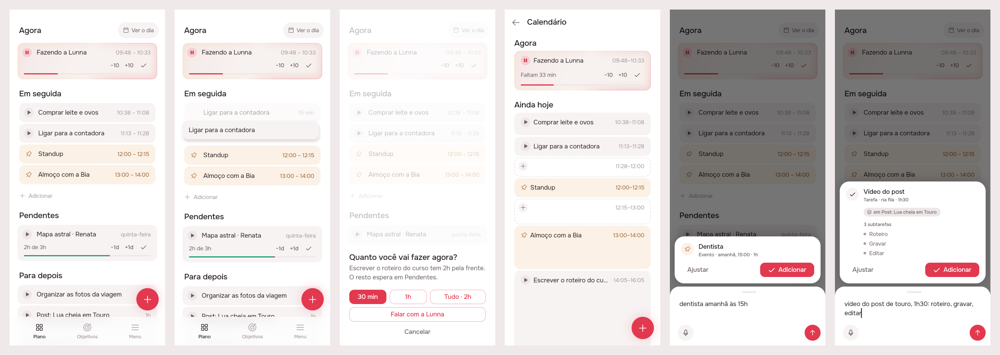
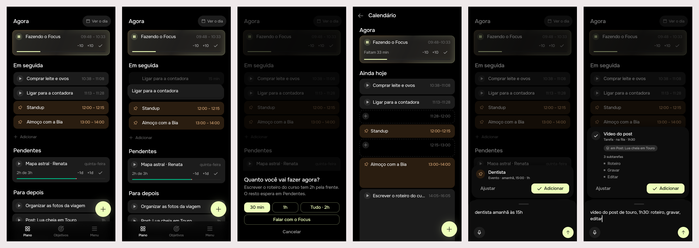

# Plano as one queue: Em seguida, play everywhere, a quiet drop, the composer at last

> Issue [#85](https://github.com/pietroid/lunna/issues/85), **mockup track**
> (it changes Em seguida, the drag's preview, the play sheet and the
> calendar's Agora, and ships the composer #81 designed). Designed
> unattended; **approved on the issue** after round 3 (Adicionar
> tightened), and **built** unattended: server, app, specs and prints
> of the real build in both brands (section 3).

## 1. The prompt

From the issue, verbatim:

> UI and UX improvements: part 4
>
> - The changes asked a couple of tasks earlier about making addition cleaner (just an add button and the better input and preview of tasks) https://github.com/pietroid/lunna/issues/81 they dont appear. Was it even implemented?
> - Calendar view should have the play button the same way the tasks and the now task do.
> - Em seguida should have the same hierarchy as agora and it should allow for thinngs to be dragged, like a queue. The tasks should have also play in all of them
> - The dragging should not show "solte aqui". It should be just a discrete preview of the task in the future position
> - When playing a task that is greater than 1h im not asked about the dialog as should be here https://github.com/pietroid/lunna/issues/83. I doubt this is imlpemented to the end

The design was reviewed on the issue, and the person replied:

> The events on the home page should have the same color and the pin icon  to maintain consistency. Also, remove the "Mais 4 hoje" and add instead a + adicionar, very similar to what we had before

The design was reviewed again, and the person replied:

> just decrese the spacing of adicionar, the rest approved

## 2. The design

The screens one by one, for a phone: [1](img/mockup-1.png) ·
[2](img/mockup-2.png) · [3](img/mockup-3.png) · [4](img/mockup-4.png).
The pins are in [board.json](board.json) (its `png` paths are the pinned screens; the build re-shoots from the preview). The real app (Lunna) draws them
through `app/lib/ux_part_4_preview.dart`: the real `HomePage` and
`DayPage` on the demo's day at 10:00, with a fuller morning seeded.

### The two answers first

**#81 (the composer) was never built.** PR #82 merged the design
session's hand-off only: its README ends at the *Build brief*, and
`ComposeButton`, `ComposerSheet` and `ComposeCubit` are in
`app/packages/agent/` but nothing opens them, and the server's
`POST /api/agent/compose` does not exist. The queue merged the design PR
and the build session was never started. **This delivery builds it**,
as #81 approved it (its [board](../2026-11-03-composer/README.md) and
build brief, unchanged); scene 1 shows its button on Plano.

**#83's play sheet was built, but only for a delivery.** `playPending`
asks before playing a task *with tasks of its own* (a delivery) on
Pendentes or Para depois. Every other play (`playCard`: Em seguida, a
loose task in Pendentes or Para depois, the calendar, a drop on Agora)
went straight to the drop, so a loose task of two hours began whole.
Here **every play of a task over an hour asks**, wherever it is pressed.

### The rules

- **Em seguida is a section, headed as Agora is**, and a queue: the rest
  of the day's cards in order, up to four, then **+ Adicionar**
  (`AppAddRow`, as Lista's day ended, but dense: close under the last
  card, its + in line with the cards' edge), which writes a task right after
  the last one drawn. Every task plays. **An event is drawn as the
  calendar draws it**: the sand fill (`fixedFill`) and the pin in the
  play's room, its hours in `fixedInk` (a routine's day: `routineFill`
  and the repeat). A
  card is held and carried to **a place** in it (before a card, or after
  the last) or to another section; a drop between two tasks is that
  place in the queue (`move { index }`), counted as a move counts.
- **A drop shows where the card lands, and nothing else.** No outline,
  no "Solte aqui", no "Solte para começar agora": the carried card's own
  copy, quiet (40 % ink), opens at the place it would take and the cards
  under it make room; its old place closes. On Agora the copy takes the
  place of what runs.
- **Play over an hour asks how much**, for any task that has not begun:
  30 min, 1 h, *Tudo · 2h*, or *Falar com a Lunna*. A delivery's piece
  becomes a task inside it (#83, unchanged); **a loose task's piece
  begins that long and the rest waits in Pendentes**, owing what is left.
- **The calendar's Agora plays like Plano's**: the round play/pause
  before the title (the one every other card has), and the quiet row
  keeps −10, +10 and ✓. A task waiting to be begun begins from it. An
  event keeps its quiet row, since it has no play.

### Decisions (the pins)

| Pin | Decision | Chosen |
|-----|----------|--------|
| 1A | Heading | Em seguida is a section heading, the same size as Agora and Pendentes, no longer a caption. |
| 1B | Play on all | Every task in the queue has the round play on its left; over an hour it asks first (3). |
| 1C | Event, as on the calendar | An event has the calendar's sand fill and its pin where the play would be, so titles line up; it is not carried. |
| 1D | + Adicionar | The rest of the day's cards, up to four, then '+ Adicionar', tight under the last card (`AppAddRow(dense: true)`: 4 px around it instead of 12), its + in line with the cards' edge: it writes a task right after the last one drawn. |
| 1E | Composer (#81) | The + opens #81's composer, built in this delivery: no agent bar on Plano. |
| 2A | Quiet copy | The carried card's own copy at 40 %, name and length, opens where it would land; the cards under it make room. |
| 2B | Under the finger | The lifted card, as today. |
| 2C | Old place closes | Its place closes while held, as in a list being reordered. A drop is that place in the queue (move { index }). |
| 2D | Every section | Pendentes, Para depois and Agora draw the same copy, at their top (Agora: in place of what runs). No outline, no words. |
| 3A | Any task | Asked for a loose task too, from Em seguida, Pendentes, Para depois, the calendar or a drop on Agora. |
| 3B | The rest waits | A loose task's piece begins that long; the rest is a loose task in Pendentes owing what is left. |
| 3C | 30 min first | The smallest piece is the accent; 1 h and Tudo · 2h beside it. |
| 3D | Talk | Falar com a Lunna opens the conversation about the task. |
| 4A | Round play | Agora's task: pause/play is the round button before the title, as on Plano; a waiting task begins from it. |
| 4B | Quiet row | −10, +10 and ✓ stay; the row's own pause is gone. An event keeps its row. |
| 4C | Play on cards | Each task not begun keeps its play; over an hour it asks (3). |
| 4D | Bar goes | The ask bar is replaced by the composer's + here too, with #81's build. |

No new icon: the round play and pause are `TaskPlayButton` (Phosphor `AppIcons.play`, `AppIcons.pause`), an event's mark is the calendar's `AppIcons.pin` (a routine's `AppIcons.repeat`), the + is `AppFab`'s and `AppAddRow`'s.

### References

Drawn from known patterns, not browsed (the run is unattended):
**Things 3** and **Apple Reminders** (a list reordered by holding a row:
the row lifts, the others close up and part where it will land, with no
words), **Todoist's Upcoming** (a queue of the day's tasks you drag
between, each with its own check), and **Structured's** day (the running
block's control on the left, where every block's is).

### Decided unattended

- **The track is mockup**: four screens change.
- **#81 is built here as approved**, not redesigned: its decisions and
  open questions (none left) carry over, in its own README.
- **Em seguida draws one day**: the first day after Agora that has cards
  (today while it has any left), at most four, then + Adicionar. Four
  keeps Pendentes in sight on a phone. The rest of the day is no longer
  counted there: *Ver o dia*, beside Agora's heading, opens it.
- **"Decrease the spacing" is read as the row's own padding**: `AppAddRow`
  gets `dense` (4 px each way instead of 12), used only in Em seguida, so
  the row sits right under the last card and its + lines up with the
  cards' left edge. Lista, Entregas and Folgas keep the roomier row.
- **Em seguida's + writes into the queue**, right after its last task
  (`Placement.queue`, counted as a drop after the last card counts), not
  into Para depois as the `AppFab` does: it ends that list, as Lista's
  day's + did. It opens the same sheet as the `AppFab` (`writeTask`:
  Tarefa | Evento, Produto).
- **The event's mark sits in the play's room** (centred in the 24 px a
  play takes) rather than before the title as on the calendar, so every
  title in Em seguida starts on one line.
- **Em seguida is drawn while a card is carried even when empty**, so a
  card from Pendentes or Para depois can be queued.
- **The drop's copy is the card at 40 %**, with its name and length and an
  empty play slot, not a dashed outline: the person asked for a preview
  of the task, not of a target.
- **The carried card's old place closes** while it is held (as a list
  being reordered), rather than staying as a gap.
- **A loose task's piece splits it**: the piece is the task, shortened
  and begun; the rest is a new loose task with the same name and notes,
  pending (in Pendentes). Not promoted to a task with tasks: a loose task
  becomes one only by a subtask (#81's "+ Subtarefa").
- **The calendar keeps its own card**, to scale, with the round button
  added; it is not swapped for Plano's `NowTaskCard`, whose height is not
  the hour's.

### Open questions

- When a loose task of two hours is played for 30 min, should the rest
  wait in **Pendentes** (begun) or go back to where it was in the queue?
  **Built as recommended (Pendentes)**, since the issue's approval did
  not say otherwise; going back to the queue is one line in
  `_splitRest` (`pending` false and a queue position).

## 3. What was built

### Prints of the real build

Drawn by the real app through the preview entry point (deleted after
shooting): the real `HomePage`, `DayPage`, `PlaySheet` and
`ComposerSheet` on the demo's day at 10:00, the composer's two scenes on
canned reads.

**Lunna**

**Focus**

| # | Scene |
|---|-------|
| 1 | Plano: Em seguida headed as Agora is, play on every task, lunch as the calendar draws it, + Adicionar, and the composer's one button (no bar) |
| 2 | A card of Em seguida carried: its quiet copy where it would land, its old place closed |
| 3 | Play on a loose task of two hours: how much now |
| 4 | Ver o dia: Agora's task with the round play/pause before its title |
| 5 | The composer (#81): "dentista amanhã às 15h" read as an event |
| 6 | The composer: a task under a delivery with its three subtasks |

### The contract

- **Play over an hour asks how much, for any task not begun, wherever it
  is pressed** (Em seguida, Pendentes, Para depois, `LaterPage`, the
  calendar's play and Agora's waiting task, a drop on Agora). A loose
  task's piece is `POST /tasks/:id/move { index: 0, start: true, minutes }`:
  **the server splits it**, the piece begins, the rest (same name and
  notes) waits at the top of Pendentes owing what is left. A piece at or
  over the length is the whole; outside 5–480 it is refused in
  Portuguese. The guard carries the piece and its answer posts it back.
- **Em seguida is a queue**: a drop is a place in the list of tasks
  (`move { index }`), counted as the server counts a move (the carried
  task taken out, the running one counted, an event skipped: before an
  event is right after the task above it). Its + writes there too
  (`queueEndOf`), also when the last card drawn is an event and when Em
  seguida is empty.
- **The composer reads, the person writes**: `POST /api/agent/compose`
  writes nothing; Adicionar writes through the routes the old sheet used,
  so the time rules hold.

### Server

| File | What |
|------|------|
| `events/event-layout.service.ts` | `moveTask`: with `start` and `minutes` under the task's length, `_splitRest` writes the rest at the top of the backlog (`pending_at` for a loose task) before the piece begins; the guard carries `minutes` |
| `events/request.ts`, `events/timing.ts` | `requireMove` reads `minutes` with `start` as a piece (5–480, refused in Portuguese); `requireTiming` takes it back from the guard's answer; `StartNowGuard.minutes` |
| `agent/compose.ts`, `agent/compose.controller.ts` | `POST /api/agent/compose`: the fast read (one forced `read_request` on `OPENROUTER_MODEL`, 8 s), `draftOf` (the server fills the facts), the fallback to the agent's turn |
| `agent/openrouter.client.ts` | `generate(…, { force })`: a named `tool_choice` |
| `artifacts/artifacts.service.ts`, `artifacts.controller.ts` | `POST /api/tasks/:id/subtasks`: the first subtask makes a loose task a task with tasks, keeping its row as the first; later ones at the end |
| `analytics/events.ts` | `compose_read` and `subtask_created` rows; `compose_kind` (kind, ms, fast) from the service |
| `agent/evals/compose.ts` | `npm run eval:compose`: five lines on a real model, p50/p95 |

### App

| Piece | What |
|-------|------|
| `lib/plan/view/compose.dart` | `openComposer` (the cubit on `AgentRepository.compose`, Adicionar / Ajustar / Conversar) and `writeDraft` (each kind through its route) |
| `packages/agent`: `ask_bar.dart` | `AskDock` is one button: the composer's + by default (`ComposeLauncher`), the screen's own when handed one, the notes' mic `beside` it; the bar, `AskRecorder` and the hold-to-record dock are gone; `DockHero` draws the arriving button |
| `packages/agent`: `compose_cubit.dart`, `view/composer.dart` | `ComposeDraft.fromJson`, `ComposeKind.goal`, `ComposeSubtask`, a failed read; the summary's goal line, no Aplicar when the turn proposed nothing |
| `packages/artifacts` | `createWithTasks` (a task with subtasks), `addSubtask` |
| `packages/timeline` | `TimelineList.onPlay` (the calendar's play and Agora's waiting task go through the app's play); `DeliveryTile` gets Agora's round button as `EventTile` has, and both put it under a key the list's tap test leaves alone (`leadKey`: without it a tap on Agora's pause also opened the card, a bug the design session's change had and its tests caught); `EventPage.onAddSubtask` (+ Subtarefa); `StartNowGuard.minutes`; `writeDownOnTimeline(initialText:)` |
| `lib/plan/view/plan_drag.dart` | a drop on Agora is `playCard` |
| `lib/main.dart`, shell, pages | `ComposeLauncher` above the router; every `AskDock` that wrote a task is now the composer's |
| From the design session (kept) | Em seguida as a `PlanQueue` under a heading, `PlanDropGhost`, `TaskCard.mark`, `AppAddRow.dense`, `PlaySheet.task`, `EventTile`'s round button |

### Tests

- **Server** (`npm test`): 12 new: the split (piece begins and the rest is
  pending, the whole, refused over 8 h, kept through the guard), subtasks
  (a loose task made a task with tasks, its begun row untouched; later
  ones appended; 404), the compose route on a scripted model (an event in
  the person's zone in one forced call, a task under a delivery with
  subtasks, a goal, a plan handed to the turn, the fallback on a failed or
  untrustworthy read, an empty line refused).
- **App**: `home_page_test` 17 (Em seguida's four cards, play on each, the
  pin, the dense + Adicionar, its sheet, play over an hour asking and
  posting the piece, `queueEndOf` after a task, after an event, empty;
  the two that failed after the design fixed), `compose_test` 7 (the
  cubit: send, a stale read dropped, a failed read; the draft's JSON; the
  goal's line; no Aplicar without a plan; the failure), `agora_play_test`
  5 (the round button pauses, begins a waiting task, none for an event or
  in overtime; `TaskCard.mark` in the play's room), the dock (one button
  and no bar, the screen's own button, the notes' + about the page, the
  hero), and the tests that measured the bar now measure the +.
  `timeline_list_test`: five tests written before Agora's round button
  now find it (the pause and a waiting task's begin are the round
  button; Agora's pause counts beside a later card's play), and "an empty
  Agora is as tall as a running one" allows one pixel, the round button
  being a hair taller than the title's line.
- `.tool/check`: the first full run passed app-analyze, server eslint,
  tsc and tests, and every package under both brands **except timeline**
  (5 tests in `timeline_list_test` written before Agora's round button,
  and the tap bug above). Both are fixed, and `timeline_list_test` passes
  (60). **The final full run passed**, every line ✓: app-analyze,
  every package (agent, analytics, api_client, app_ui, artifacts, cycle,
  notifications, timeline) under Focus and Lunna, and the server's
  eslint, tsc and tests. The app's own tests (`app/test`, not run by CI) pass
  under Focus and Lunna (63 each).

### Where the build differs from the design

- **Conversar opens the conversation with the words in its field**, not on
  the turn the read already had: the app's conversation always starts a
  new one (`AgentCubit.open`), and reopening a server conversation is not
  something it can do yet. The turn the read took is in the history above
  it.
- **No "Desfazer" on the "Adicionado" snackbar**: a task, event or goal
  written from the composer is undone as any other (deleted on its page);
  a plan keeps its `UndoChip`.
- **The compose evals are their own script** (`npm run eval:compose`),
  not cases in `eval:agent`, whose harness grades the day a plan leaves;
  the fast read has no day to grade. **It was not run** (it costs money
  and the run is unattended), so the spec has no latency figures yet.
- **Undoing a subtask** is deleting it; the delivery the first one made
  stays (the brief asked for "undoable": there is no single undo route).
- **A delivery's task over an hour on the calendar** begins whole, as
  before: the play sheet asks for loose tasks and for deliveries (through
  `playPending`), and a delivery's run on the calendar plays its next
  task through the day's own play.

## 4. How to turn it on

Nothing to set: the composer uses the agent's `OPENROUTER_MODEL` and key.
Without them `POST /agent/compose` answers 503 ("A Lunna ainda não está
conectada a um modelo."), and the composer says it could not read the
line, keeping the words. No migration (the split and the subtasks use
the columns there were).

## 5. Cost and time

Measured by the queue: see the pull request.
