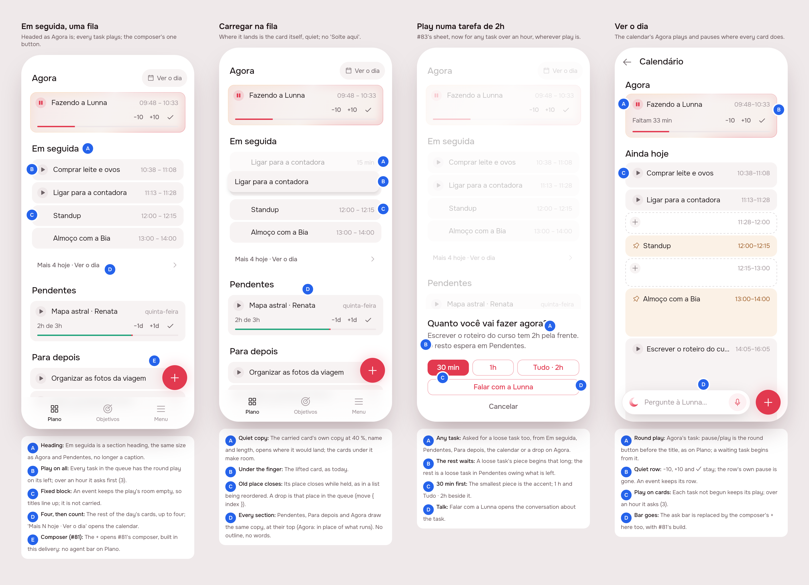

# Plano as one queue: Em seguida, play everywhere, a quiet drop, the composer at last

> Issue [#85](https://github.com/pietroid/lunna/issues/85), **mockup track**
> (it changes Em seguida, the drag's preview, the play sheet and the
> calendar's Agora, and ships the composer #81 designed). Designed
> unattended; the person approves on the issue.

## 1. The prompt

From the issue, verbatim:

> UI and UX improvements: part 4
>
> - The changes asked a couple of tasks earlier about making addition cleaner (just an add button and the better input and preview of tasks) https://github.com/pietroid/lunna/issues/81 they dont appear. Was it even implemented?
> - Calendar view should have the play button the same way the tasks and the now task do.
> - Em seguida should have the same hierarchy as agora and it should allow for thinngs to be dragged, like a queue. The tasks should have also play in all of them
> - The dragging should not show "solte aqui". It should be just a discrete preview of the task in the future position
> - When playing a task that is greater than 1h im not asked about the dialog as should be here https://github.com/pietroid/lunna/issues/83. I doubt this is imlpemented to the end

## 2. The design

The screens one by one, for a phone: [1](img/mockup-1.png) ·
[2](img/mockup-2.png) · [3](img/mockup-3.png) · [4](img/mockup-4.png).
The pins are in [board.json](board.json) (its `png` paths are the pinned screens; the build re-shoots from the preview). The real app (Lunna) draws them
through `app/lib/ux_part_4_preview.dart`: the real `HomePage` and
`DayPage` on the demo's day at 10:00, with a fuller morning seeded.

### The two answers first

**#81 (the composer) was never built.** PR #82 merged the design
session's hand-off only: its README ends at the *Build brief*, and
`ComposeButton`, `ComposerSheet` and `ComposeCubit` are in
`app/packages/agent/` but nothing opens them, and the server's
`POST /api/agent/compose` does not exist. The queue merged the design PR
and the build session was never started. **This delivery builds it**,
as #81 approved it (its [board](../2026-11-03-composer/README.md) and
build brief, unchanged); scene 1 shows its button on Plano.

**#83's play sheet was built, but only for a delivery.** `playPending`
asks before playing a task *with tasks of its own* (a delivery) on
Pendentes or Para depois. Every other play (`playCard`: Em seguida, a
loose task in Pendentes or Para depois, the calendar, a drop on Agora)
went straight to the drop, so a loose task of two hours began whole.
Here **every play of a task over an hour asks**, wherever it is pressed.

### The rules

- **Em seguida is a section, headed as Agora is**, and a queue: the rest
  of the day's cards in order, up to four, then *Mais N hoje · Ver o
  dia*. Every task plays (a fixed block keeps the play's room, as now). A
  card is held and carried to **a place** in it (before a card, or after
  the last) or to another section; a drop between two tasks is that
  place in the queue (`move { index }`), counted as a move counts.
- **A drop shows where the card lands, and nothing else.** No outline,
  no "Solte aqui", no "Solte para começar agora": the carried card's own
  copy, quiet (40 % ink), opens at the place it would take and the cards
  under it make room; its old place closes. On Agora the copy takes the
  place of what runs.
- **Play over an hour asks how much**, for any task that has not begun:
  30 min, 1 h, *Tudo · 2h*, or *Falar com a Lunna*. A delivery's piece
  becomes a task inside it (#83, unchanged); **a loose task's piece
  begins that long and the rest waits in Pendentes**, owing what is left.
- **The calendar's Agora plays like Plano's**: the round play/pause
  before the title (the one every other card has), and the quiet row
  keeps −10, +10 and ✓. A task waiting to be begun begins from it. An
  event keeps its quiet row, since it has no play.

### Decisions (the pins)

| Pin | Decision | Chosen |
|-----|----------|--------|
| 1A | Heading | Em seguida is a section heading, the same size as Agora and Pendentes, no longer a caption. |
| 1B | Play on all | Every task in the queue has the round play on its left; over an hour it asks first (3). |
| 1C | Fixed block | An event keeps the play's room empty, so titles line up; it is not carried. |
| 1D | Four, then count | The rest of the day's cards, up to four; 'Mais N hoje · Ver o dia' opens the calendar. |
| 1E | Composer (#81) | The + opens #81's composer, built in this delivery: no agent bar on Plano. |
| 2A | Quiet copy | The carried card's own copy at 40 %, name and length, opens where it would land; the cards under it make room. |
| 2B | Under the finger | The lifted card, as today. |
| 2C | Old place closes | Its place closes while held, as in a list being reordered. A drop is that place in the queue (move { index }). |
| 2D | Every section | Pendentes, Para depois and Agora draw the same copy, at their top (Agora: in place of what runs). No outline, no words. |
| 3A | Any task | Asked for a loose task too, from Em seguida, Pendentes, Para depois, the calendar or a drop on Agora. |
| 3B | The rest waits | A loose task's piece begins that long; the rest is a loose task in Pendentes owing what is left. |
| 3C | 30 min first | The smallest piece is the accent; 1 h and Tudo · 2h beside it. |
| 3D | Talk | Falar com a Lunna opens the conversation about the task. |
| 4A | Round play | Agora's task: pause/play is the round button before the title, as on Plano; a waiting task begins from it. |
| 4B | Quiet row | −10, +10 and ✓ stay; the row's own pause is gone. An event keeps its row. |
| 4C | Play on cards | Each task not begun keeps its play; over an hour it asks (3). |
| 4D | Bar goes | The ask bar is replaced by the composer's + here too, with #81's build. |

No new icon: the round play and pause are `TaskPlayButton` (Phosphor `AppIcons.play`, `AppIcons.pause`), the + is `AppFab`'s.

### References

Drawn from known patterns, not browsed (the run is unattended):
**Things 3** and **Apple Reminders** (a list reordered by holding a row:
the row lifts, the others close up and part where it will land, with no
words), **Todoist's Upcoming** (a queue of the day's tasks you drag
between, each with its own check), and **Structured's** day (the running
block's control on the left, where every block's is).

### Decided unattended

- **The track is mockup**: four screens change.
- **#81 is built here as approved**, not redesigned: its decisions and
  open questions (none left) carry over, in its own README.
- **Em seguida draws one day**: the first day after Agora that has cards
  (today while it has any left), at most four, then the counting row to
  the calendar. Four keeps Pendentes in sight on a phone.
- **Em seguida is drawn while a card is carried even when empty**, so a
  card from Pendentes or Para depois can be queued.
- **The drop's copy is the card at 40 %**, with its name and length and an
  empty play slot, not a dashed outline: the person asked for a preview
  of the task, not of a target.
- **The carried card's old place closes** while it is held (as a list
  being reordered), rather than staying as a gap.
- **A loose task's piece splits it**: the piece is the task, shortened
  and begun; the rest is a new loose task with the same name and notes,
  pending (in Pendentes). Not promoted to a task with tasks: a loose task
  becomes one only by a subtask (#81's "+ Subtarefa").
- **The calendar keeps its own card**, to scale, with the round button
  added; it is not swapped for Plano's `NowTaskCard`, whose height is not
  the hour's.

### Open questions

- When a loose task of two hours is played for 30 min, should the rest
  wait in **Pendentes** (begun, as recommended here) or go back to
  where it was in the queue?

## Build brief

### Files the design session wrote (uncommitted, kept for the build)

| File | What |
|------|------|
| `app/lib/ux_part_4_preview.dart` | the preview entry point, `?s=1..4` (delete at Phase 4) |
| `app/lib/plan/view/plan_items.dart` | `PlanItems.next` is a list (`kNextOnHome`, `nextMore`); `playCard` asks over an hour |
| `app/lib/plan/view/play_sheet.dart` | `PlaySheet.task` (a loose task), `playCardAsks`, `PlaySheet.show(context, sheet)` |
| `app/lib/plan/view/plan_drag.dart` | `PlanQueue` (a slot before each card and one at the end), `PlanDropGhost`, `queueDropper`, `dropOnPlan(before:)` with `_placeIn`; `PlanDropGap` gone; the carried card's place closes |
| `app/lib/plan/view/home_page.dart` | Em seguida under a `_Heading`, as a `PlanQueue`; ghosts on Pendentes, Para depois and Agora (`NowDropZone`) |
| `app/packages/timeline/lib/src/widgets/event_tile.dart` | Agora's task: `TaskPlayButton` before the title (`_leadingToggle`); `EventControls(play:)` |
| `app/packages/l10n/lib/arb/app_pt.arb` (+ `gen/`) | `homeNextMore`, `playPieceBodyLoose`; `planDropHere`, `planDropStart` removed |

### Server

- **The composer (#81)**: everything in
  [its build brief](../2026-11-03-composer/README.md#server):
  `POST /api/agent/compose`, the fast read on `OPENROUTER_MODEL` with its
  8 s fallback to the agent's turn, `POST /api/tasks/:id/subtasks`, the
  analytics rows, the eval cases.
- **A piece of a loose task**: `POST /tasks/:id/move { start: true,
  minutes }` on a task that has not begun and is longer than `minutes`
  splits it: the task takes `minutes` and begins (the guard still asks
  when something runs); a new loose task with the same title and notes
  and the rest of the minutes is written at the top of the backlog,
  `pending_at` set. Through `EventLayoutService`, undoable as a move. A
  `minutes` at or over the task's length is the whole (no split). Refused
  in Portuguese outside 5–480. Today `minutes` on a move only cuts a task
  to fit room; the split is only with `start: true`.

### App

- **Composer (#81)**: [its app list](../2026-11-03-composer/README.md#app),
  whole: the dock's bar goes, `ComposeButton` everywhere at
  `AppFab.location`, wired to the compose route, Adicionar / Ajustar /
  Conversar / Aplicar, "+ Subtarefa" on a loose task's page.
- **Em seguida**: as drawn. Check `_placeIn` against the server's move
  counting on a reorder downwards (the carried task taken out first) and
  around a fixed block in the queue; an event in Em seguida is not
  carriable.
- **Play everywhere**: `playCard` is the one play of a loose task (Em
  seguida, Pendentes, Para depois, `LaterPage`), and the calendar's play
  (`TimelineList._now`, through a callback the app hands in, since the
  sheet lives in `lib/plan`) and a drop on Agora of a task over an hour go
  through it too. `ArtifactPlayed` stays for deliveries.
- **The calendar**: `DeliveryTile` on Agora gets the same round button as
  `EventTile` (scene 4 shows a loose task only).
- **Tests**: the design's changes were not run against the existing
  tests; `test/plan/home_page_test.dart` still expects the old Em seguida
  (one card under a caption) and the old drop. Update it with
  `home_page_test` (Em seguida's heading, a card per task, play
  on each, a reorder posts the right index, the ghost and no "Solte
  aqui"), `play_sheet` for a loose task (piece, whole, talk, cancel),
  `event_tile` (Agora's round button pauses, begins a waiting task, none
  for an event or in overtime); server e2e for the split (piece begins,
  rest pending, whole, refused).
- Update `product/spec/home.md` (Em seguida, the drop, play),
  `product/spec/agent.md` and the shell paragraph of `AGENTS.md` (the
  composer), and the timeline paragraph (Agora's button).

### Cost of the design session

Not recorded here: the queue measures every run and writes the figures in
the PR.
