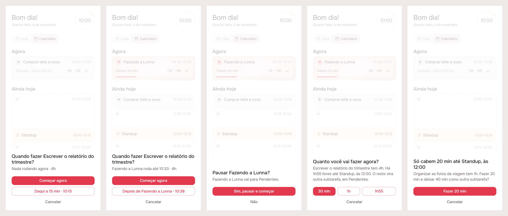
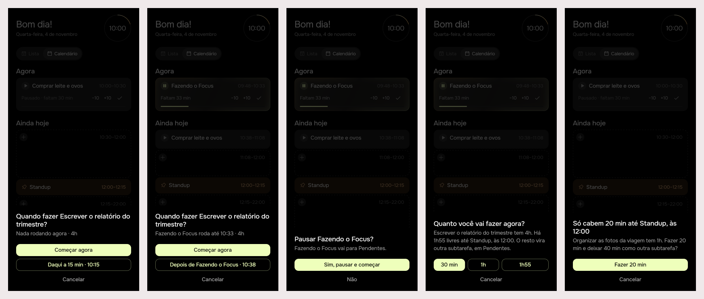

# Play by strict rules: when, how much, and the pause

> Issue [#89](https://github.com/pietroid/lunna/issues/89), **mockup
> track** (it changes the play sheets, the guard and what a drop asks).
> Designed and built unattended; the design was approved on the issue.

## 1. The prompt

From the issue, verbatim:

> Dialogs improvements
>
> Play button still has some inconsistencies and is not very smart. Those are the strict rules for it:
>
> ## First stage: when
>
> 1. When there is nothing in progress (now), it should ask anyways, with the following suggestions: start now, start in 15 minutes. This only works if its not already at least 15 minutes from now.
>
> 2. When there is something in progress, it also will ask: start now, start after the next one (if its already after the now task, it will not ask this of course). The time should be always the next available time, regarldess if that fits or not. So if the task is 4h, even if the space available doesnt have 4h, it will go through because the next step will precisely ask about how much of that you want to do.
>
> 3. Consider always at least 20 min of time available to fit something, if not, suggest always the next one available that meet this criterium, otherwise the user would be denied in the next asking
>
> ## Second stage: how much
>
> The measure time available used for the next rules should alawys consider when you have put the task on the queue.
>
> 1. If the task is greater than 1 hour, it should always ask about how much you want to do. It depends, so we break into smaller scenarios
>
> 1.1. It has all the time available: the task is 4h and there is 5h available, the options would be "30 min", "1h", "The entire task"
>
> 1.2 It has not all the time available: The task is 4h, and there is just 2h13 available. It will precisely ask "30 min", "1h", "2h13". If it has just 20 min available (under 1h), it will just suggest "20 min"
>
> 2. If the task is 1 hour or smaller, and fits, nothing gets asked. If it doesnt fit, then the available total time gets suggested
>
> ## Dragging
>
> By dragging, the effects are very similar. The only thing is that we already make our decision in regards to the first stage. When dragging for now section for example, we consider that we want that now, the only thing needs to be asked is about is how much (before the release takes effect). If we put in the queue, it will already know which part of the queue it will be.
>
> ## If there is already a task in progress
>
> We already have a dialog, lets just improve it:
>
> After the user already has confirmed that the new task he wants to play is for now (and not for later), there would be a conflict, so the user is confirmed if he wants to proceed (yes or no), and the task is moved for pending always, considering the amount of minutes he has already done (to avoid asking too much questions based on availability, etc)
>
> ## About subtasking and tasks
>
> We can play from inside the task, and the same would follow based on this mechanism. When, how much (but based on subtask timing, not on the whole task). If the subtask is too small and fits, it isnt even needed to ask as rule 2 of the second stage.
>
> If more of 1h of this subtask, it will ask the same thing and another duplicated subtask should be created that reflects the remainder based on how much time the user wants to invest. So if the subtask is 2 hours and there is 40 minutes to be used now (and the user confirms), there will be another duplicate subtask which will be created with 1h20 and is still todo.
>
> The same thing happens for tasks. If the user choose a path to go partial, there should be a subtask for it and a subtask for the remainder.
>
> If this task is interrupted via another task that started playing, also, there should be split, with the part already done as a subtask and the part to be done as another subtask.
>
> The reason for all of this is that the math for the pending tasks should be sound

The design was reviewed on the issue, and the person replied:

> you just dont need to overexplain on "Pausar fazendo a Lunna". Just to "Fazendo a lunna vai para pendentes" is enough

and then, on the revised board:

> approve

The two open questions were left unanswered, so the build kept the
design's answers (see *Open questions*, below, and section 3).

## 2. The design


The screens one by one, for a phone: [1](img/mockup-1.png) ·
[2](img/mockup-2.png) · [3](img/mockup-3.png) · [4](img/mockup-4.png) ·
[5](img/mockup-5.png). The pins are in [board.json](board.json). Drawn by
the real app (Lunna) through `app/lib/dialogs_preview.dart`: the new
sheets over the demo's day at 10:00 (*Fazendo a Lunna* runs until 10:33,
the Standup is at 12:00).

### The flow

```
play ─▶ 1. when? ──now──▶ (something runs?) 3. pause it? ──yes──▶ 2. how much? ─▶ begins
                └─later─────────────────────────────────────────▶ 2. how much? ─▶ queued
drop on Agora ─────────▶ (something runs?) 3. pause it? ──yes──▶ 2. how much? ─▶ begins
drop in Em seguida / on free room ──────────────────────────────▶ 2. how much? ─▶ placed
```

### The rules

**The room** of an hour is the minutes from it to the next thing that
does not move (an event, an anchored task, a begun task's hour) or the
end of the working day, less the 5-minute pause. It is the server's
(`TimelinePlan`), measured where the task would go. **An hour with under
20 minutes of room is never offered** (`kPlayMinRoom`): the next one with
20 is.

**1. When** (`PlayWhenQuestion`), on every task that waits, from every
play (Plano, Pendentes, Para depois, the calendar, a delivery's page):

| Agora | Offered |
|-------|---------|
| nothing runs | ***Começar agora*** · ***Daqui a 15 min · 10:15*** (that hour anchored); when 15 min from now has under 20 min of room, ***Às 13:00***, the first hour that has |
| something runs | ***Começar agora*** · ***Depois de Fazendo a Lunna · 10:38*** (first in Em seguida, at the first hour after it with 20 min of room, **whether or not the whole fits**); not offered when the task is already next |
| now has under 20 min of room | *Começar agora* is not offered; the later hour is the accent |

**3. The pause** (`PauseQuestion`, replacing `GuardSheet`'s three
answers): after *Começar agora* (or a drop on Agora) while something
runs, one question, ***Pausar Fazendo a Lunna?***, and one line under
it, *Fazendo a Lunna vai para Pendentes.* — *Sim, pausar e começar* /
*Não*. Yes always pauses into **Pendentes** and **splits** what ran: the
minutes done become a subtask ticked off, the minutes left another
subtask, not done. The sheet doesn't explain the split (review), and asks
nothing about where the rest goes.

**2. How much** (`PlayMuchQuestion`), measured at the hour chosen (now,
the later hour, or where it was dropped), on the task, or on **the
subtask** when play is a subtask's:

| Task | Room | Asks |
|------|------|------|
| over 1 h | ≥ the task | *30 min* · *1h* · *Tudo · 4h* |
| over 1 h | 1 h to less than the task | *30 min* · *1h* · *2h13* (all the room) |
| over 1 h | under 1 h | only the room, *Fazer 40 min* |
| 1 h or less | ≥ the task | **nothing** |
| 1 h or less | less | only the room, *Fazer 20 min* |

**A piece splits.** Choosing less than the whole makes two subtasks: the
piece (begun, or placed at its hour) and the rest, not done.

- A loose task becomes a task with subtasks (`addSubtask`'s road: its row
  is the first subtask, cut to the piece; the rest is a new subtask). A
  piece begun leaves the rest in Pendentes; a piece queued leaves it where
  the task was.
- A subtask over the piece is cut to the piece and a **duplicate** with
  the rest is written right after it in its task (2 h, 40 min now → a
  copy of 1h20, still to do).
- So every task's Pendentes sum is the sum of its subtasks still to do,
  and what was done is a subtask ticked off with its real minutes.

**Dragging** answers *when* by where the card is let go: on Agora it
asks the pause (if something runs) and how much at now; in Em seguida or
on free room, how much at that place's hour. The card is not posted
until the last answer; a dismissed sheet leaves the day as it was.

### Decisions (the pins)

| Pin | Decision | Chosen |
|-----|----------|--------|
| 1A, 2A | The line under the title | *Nada rodando agora · 4h*, or *Fazendo a Lunna roda até 10:33 · 4h* |
| 1B | Começar agora | always the accent; hidden when now has under 20 min of room |
| 1C | The later hour, idle | *Daqui a 15 min · 10:15*, an anchor; *Às 13:00* when 15 min from now has no 20 min of room |
| 2C | The later hour, busy | *Depois de … · 10:38*: first in Em seguida, the first hour with 20 min of room; hidden when already next |
| 3A | The guard | one yes/no, *Pausar …?*; *Concluir o atual* and *Para depois* go |
| 3B | The line under it | only *Fazendo a Lunna vai para Pendentes.* (review: no account of the split); the split into done + left subtasks still happens |
| 3C | Não | changes nothing (no Cancelar under it) |
| 4A | The room | from the chosen hour to the next fixed thing or the day's end, named in the body |
| 4B | Pieces | 30 min (the accent) and 1 h, always over an hour |
| 4C | The most | *Tudo · 4h* when it fits, else the room (*1h55*); only the room under 1 h |
| 5A–B | Short | one button, *Fazer 20 min*; an hour or less that fits asks nothing |

The icon: none new. The sheets keep `_SheetFrame` (the page's ground,
the card radius) and `AppButton`.

### References

Drawn from known patterns, not browsed: **Sunsama**'s "Start now / Add
to today" when a task is picked up, **Structured**'s "how long" chips
sized to the gap before the next item, and **Motion**'s split of a task
into chunks that fit the free blocks, each its own row.

### Decided unattended

- **"This only works if it's not already at least 15 minutes from now"**
  read as rule 3 for the soon hour: *Daqui a 15 min* is offered when that
  hour has 20 min of room; otherwise the first hour that has, *Às hh:mm*.
  See the open question.
- **Now with under 20 min of room** (10 min before a meeting): *Começar
  agora* is not offered, by rule 3, rather than offering a piece under 20.
- **Order of the sheets after *Começar agora*** while something runs:
  when → pause → how much, so the room is measured with the running task
  already out of the way.
- **The guard's other answers go** (*Concluir o atual*, *Mandar para Para
  depois*): the issue says the running task is "moved for pending
  always". Finishing it stays Agora's ✓. `solve_current` and
  `later_current` stay on the server for older apps.
- **A piece of a loose task makes it a task with subtasks** (a delivery,
  in storage), as `+ Subtarefa` does: the piece is the first subtask (its
  row, cut), the rest a new one with the same title.
- **The rest keeps the title** (no "(resto)" suffix): two subtasks with
  one name, one done or begun, one not.
- **The accent stays on 30 min**, as #87 had it; the single-option sheet
  has its one button as the accent.
- **A drop of a task over an hour on free room** now asks how much there
  too (the issue's "very similar"); today only Em seguida and Agora ask.
- **The pause's line after the review**: the title stays the question
  (*Pausar Fazendo a Lunna?*) and the body is only the person's sentence;
  the minutes done and left are not named anywhere on the sheet.
- **Falar com a Lunna leaves the how-much sheet**: the issue lists the
  options exactly. The composer's + stays the way to talk.

### Open questions (answered by the design's defaults)

- *Daqui a 15 min*: is it also hidden when the task is **already** queued
  15 minutes or more from now (it would pull it earlier), or is it
  offered then too? The design offers it always (with the 20 min rule).
- When a pause splits a running task that had done **under 5 minutes**,
  should the done subtask still be written, or the task simply paused
  whole? The design writes nothing under 5 minutes (no 2-minute rows).

## 3. What was built

### The prints

The shipped sheets (`timeline`'s `play.dart`), over the demo's day at
10:00, in both brands. Scenes as on the board: 1 when (idle), 2 when
(busy), 3 the pause, 4 how much (4 h, 1h55 of room before the
Standup), 5 an hour that does not fit.

**Lunna**



**Focus**



### The contract

**Play asks when, the pause, how much, and posts one move.** The room
of an hour runs to the next thing that keeps its hour (an event, an
anchored task, a begun task) or the day's end, less the pause; an hour
with under 20 minutes of it is never offered. **A piece, and a pause
after 5 minutes of work, split the task into subtasks**, so what a task
still owes is always the sum of its subtasks not done.

### Server (`server/src/events/`)

- `POST /api/tasks/:id/move` takes **`decision`** (`pause_current`, …)
  with `start: true` (`requireMove`, `MoveEventDto`): the guard answered
  before the move, so none is raised. Without `start` it is a 400; an
  unknown decision too.
- `EventLayoutService._withSubtasks`: a loose task becomes a task with
  subtasks (a delivery in storage: its title, length and notes, at the
  end of the open ones; begun when it ran, or when it waited in
  Pendentes). Used by both splits of a piece:
  - begun (`move { start, minutes }`): the piece begins, the rest is a
    subtask at the top of the delivery's Para depois (`_splitRest`), and
    the delivery is begun, so it is in Pendentes;
  - placed (`move { index, after?, minutes, split: true }`): the rest is
    a subtask where the task was.
  - A subtask (a delivery's task already) is cut and its rest written in
    the same delivery; no new delivery.
- `_pauseSplit` (`pause_current`, on the move or through
  `/tasks/timing`): a running task that ran 5 minutes or more is closed
  at this minute and ticked off with **the minutes it ran**
  (`ranMinutes`), and **what it owed** (`owedMinutes`) is a new subtask
  at the top of the delivery's Para depois. Under 5 minutes it pauses
  whole, pending, as before.
- `later_current`, `solve_current` and `postpone_current` are unchanged,
  for older apps.

### App

- `app/packages/timeline/lib/src/play/play.dart` (new, exported):
  `playRoomAt`, `playFirstRoom`, `playRunning`, `playWhenOf`,
  `playPieces`, and the flows `playTask` (when → `beginTask` or how much
  at the later hour), `beginTask` (the pause while a task runs, how much
  at now, one `EventMoved(start, minutes, decision)`), `askHowMuch`; the
  sheets `PlayWhenQuestion`, `PlayMuchQuestion`, `PauseQuestion`,
  `PlaySheetFrame`. In `timeline` so Plano, the calendar and a
  delivery's page share them.
- `EventMoved.decision` → `TimelineRepository.moveTask(decision:)`.
- `GuardSheet` is now the same yes/no (`PauseQuestion`), posting
  `pause_current` or dismissing; over a fixed block it asks *Começar
  depois de Reunião?* (`guardWaitTitle`, `guardWaitBody`,
  `guardWaitYes`).
- Plano: `playCard` is `playTask`; a drop on Agora is `beginTask`; a
  drop in Em seguida asks `askHowMuch` at that place's hour.
  `playPending` plays a delivery's next task through `playTask`, and
  with none asks only how much.
- Calendar (`TimelineList`): play is `playTask` when the app gives no
  `onPlay`; a drop at the top or on Agora is `beginTask`; a drop of a
  task not begun on free room asks how much there (`split: true`), where
  it used to offer to cut it to fit and drop the rest.
- A delivery's page: play on a subtask is `playTask`.
- Gone: `askPlay`, `PlayWhenSheet`, `PlaySheet`, `PlaceSheet`,
  `beginCard`, `queueFirst`, `nextSlotOf`, `playCardAsks`, and their
  strings (`playPieceTitle`, `playPieceBodyLoose`, `placePieceTitle`,
  `placePieceBody`, `playWhenNext`, `guardStartNowTitle`,
  `guardStartNowRunning`, `guardBusyBody`, `guardFinishCurrent`,
  `guardPostponeCurrent`, `guardToPending`, `guardToLater`).

### Tests

- Server, `events.controller.spec.ts`: a piece of a loose task begun
  as a subtask with the rest another, in a begun delivery; a subtask's
  piece and its rest in the same delivery; a placed piece split into two
  subtasks; the pause split (10 min done + 50 left = 60, the delivery
  begun at the task's start); a pause under 5 minutes whole; the guard's
  answer on the move with a piece; a decision without `start` refused.
  Server suites: 268 passed in `events`, `artifacts` and `agent`.
- App, `timeline/test/play_test.dart` (new, 15): every row of the
  how-much table; the room to an event, to the day's end, inside a block
  and with the pause; the 20-minute rule (a 15-minute gap skipped); the
  when question's shapes (idle, idle without room, busy, next already,
  no *Começar agora* in or 10 minutes before a fixed block); the sheets
  end to end (a short task asks only when; when → pause → how much →
  one move; *Não* posts nothing; a short task that does not fit offers
  only the room).
- Updated: `guard_sheet_test.dart` (the yes/no, the fixed block),
  `timeline_list_test.dart` (play asks when; a drop on free room asks
  how much), `artifact_page_test.dart`, `test/plan/home_page_test.dart`
  (the pause on the move, the later hours, a drop in Em seguida).
- `.tool/check`: all green: `app-analyze`, every touched package's
  tests under both brands (agent, analytics, api_client, app_ui,
  artifacts, cycle, notifications, timeline), `server-eslint`,
  `server-tsc`, `server-test`. The root app's tests (`flutter test`,
  which `.tool/check` doesn't list) pass too: 67 under Focus, 67 under
  Lunna. The first run failed only on a long line in the preview
  entry point (`app/lib/dialogs_preview.dart`); that file is deleted
  after the prints, as the flow says, and the rerun passed. No flaky
  test.

### Where the build differs from the design

- **The room is worked out on the phone**, from the cards the server
  laid out (`playRoomAt` over `TimelinePlan.nextFreeStart`), not by a
  new route: every hour it needs is already on the day, and the server
  still has the last word on the move. The brief allowed either.
- **The pause rides on the move** (`decision`) instead of a second
  request, so the order is the design's (when → pause → how much) and
  nothing is posted until the last answer.
- **The guard stays** for the roads that do not ask first: a delivery's
  play with no task left, and a drop while a **fixed block** runs.
  There it is the same yes/no; over a fixed block it says the task
  begins after it (new copy, not on the board).
- **With a fixed block running, *Começar agora* is not offered** by
  play: now has no room (rule 3), and the later hour is the accent.
- **A subtask's rest** goes to the top of its delivery's Para depois,
  which is next in that task, rather than a position right after the
  piece.
- **A drop on the calendar's free room** of a task not begun now asks
  how much and keeps the rest; a begun task or an event dropped there
  still offers to be cut to fit, as before.
- **Side effect worth knowing**: a loose task split once is a task with
  subtasks for good (a delivery in storage), so on a light day its
  subtasks hop to the next working day, as a delivery's tasks do.
- The prints are the shipped widgets over the demo's day with the
  numbers the rules give for it; the flows behind them are proved by the
  widget tests above, not by the prints.

## 4. How to turn it on

Nothing to set: no env var, no migration. The server change is
backward compatible (older apps never send `decision`, and get the
guard as before); a server deploy and an app release ship it.

## 5. Cost and time

Measured by the queue: see the pull request.
