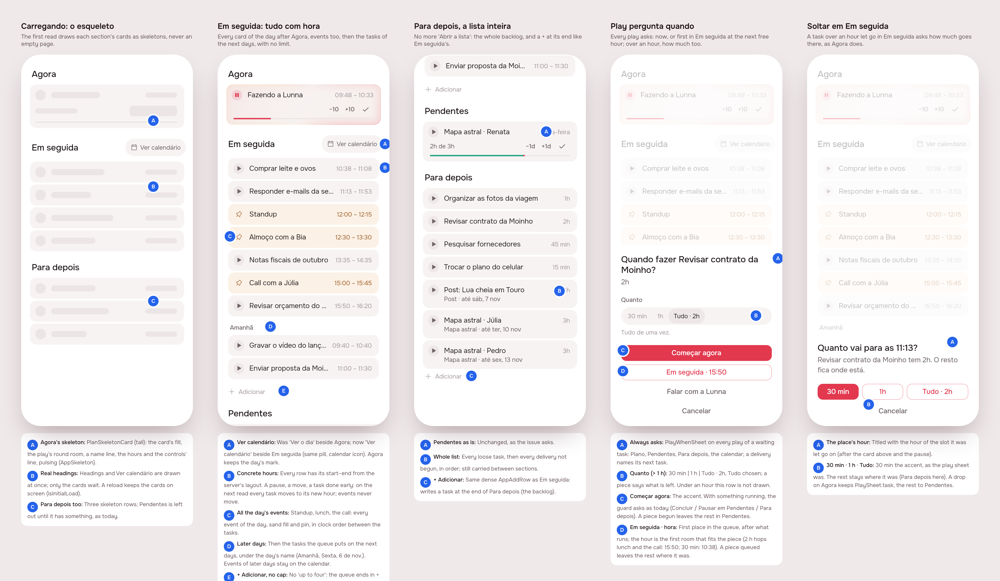
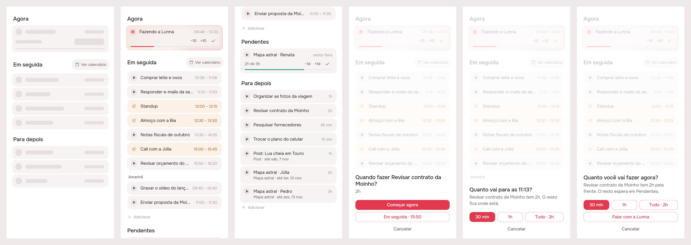
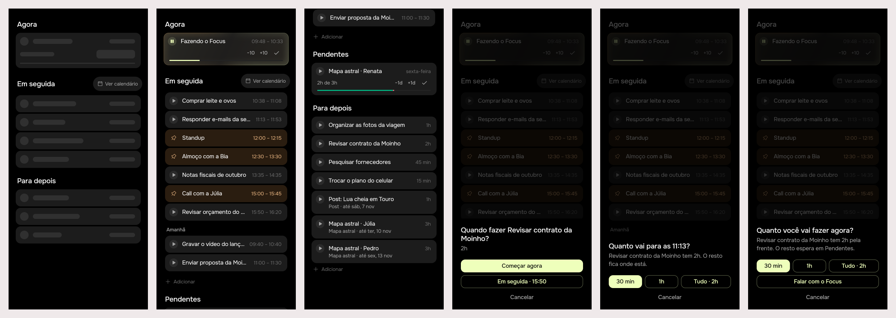

# Plano consistent: a skeleton, Em seguida with every hour, play asks when

> Issue [#87](https://github.com/pietroid/lunna/issues/87), **mockup
> track** (it changes what Plano draws while loading, Em seguida, Para
> depois, the play sheet and a drop in Em seguida). Designed and built
> unattended; the design was approved on the issue ("approve").

## 1. The prompt

From the issue, verbatim:

> Make the home consistent
>
> - Loading should be a skeleton on home instead of an empty screen
> - Review the calendar logic: when pausing a task, it should move the events (not the fixed one) to their proper scheduled times
> - "em seguida" events must have a concrete time and they are subject to changes based on any change on the schedule
> - Show all events of the day on "em seguida" and the next tasks that have a concrete time in the schedule too
> - When moving anything to "em seguida", we should have the same logic for tasks greater than 1 hour (to ask if we want to split or not). Also applies to moving to "agora"
> - When tapping play on any task we should ask if we want to move to the next available time on em seguida or if we want to start playing now, always for all of them. If there is an in progress task we are asked if the in progress is done or moved to later (as we have today)
> - Pending is working great, no complaints
> - Para depois should be a continuous list, without limiting. We should also have a + adicionar button to the end of it, similar to em seguida.
> - Em seguida should also have no limit.
> - change the "ver o dia" to "ver calendario" and move it to be on the side of "em seguida"

The design was approved on the issue ("approve"). Right after the build
began, a second comment changed the play sheet:

> actually just adjust the play, it should be easier. It should ask first, when, now or later (just those two options). The next modal asks about how much you want to do.

## 2. The design

The screens one by one, for a phone: [1](img/mockup-1.png) ·
[2](img/mockup-2.png) · [3](img/mockup-3.png) · [4](img/mockup-4.png) ·
[5](img/mockup-5.png). The pins are in [board.json](board.json). The
real app (Lunna) draws them through `app/lib/home_consistent_preview.dart`:
the real `HomePage` on the demo's day at 10:00, seeded with a fuller day
(a standup, lunch, a call, two tasks tomorrow, four in Para depois).

### The rules

- **Loading is a skeleton.** Until the day first arrives
  (`TimelineStatus.initial`, or `isInitialLoad`), Plano draws its headings
  and, under each, its cards' skeletons (`PlanSkeletonCard`: the card's
  fill, the play's round room, a name line, the hours; Agora's a line
  taller). A reload keeps the cards on screen, as the calendar does.
- **Em seguida is everything with an hour, with no limit.** Every card of
  the first day that has any (today, while it has some left) after Agora,
  **its events too**, in clock order, then **every task the queue puts on
  the days after it**, under the day's name (*Amanhã*, *Sexta, 6 de
  nov.*). Each row is its start and end as the server's layout gives
  them, so they are never stale: any change to the day (a pause, a move,
  a task done early, a play) moves every task on the next read, and
  events never move. It ends in **+ Adicionar**, as now.
- **Ver calendário** (was *Ver o dia*) sits beside Em seguida's heading.
  Agora keeps the day's mark. Em seguida is always drawn, with *Nada
  marcado daqui para a frente.* when it is empty.
- **Para depois is the whole list**, no *Abrir a lista*, and ends in **+
  Adicionar** (`AppAddRow(dense: true)`), which writes at the end of the
  backlog.
- **Play asks when, always** (`PlayWhenSheet`), for every task that
  waits, wherever its play is (Plano, Pendentes, Para depois, the
  calendar): ***Começar agora*** (the accent), which is today's play, the
  guard and all when something runs; or ***Em seguida · 15:50***, the
  first place in the queue, after what runs, at the first room that fits
  it. **Over an hour it asks how much too**, in the same sheet: *30 min |
  1 h | Tudo · 2h*, Tudo chosen; the hour on *Em seguida* follows the
  piece (2 h hops lunch and the call to 15:50; 30 min is 10:38). A piece
  begun leaves the rest in Pendentes (as #85); a piece queued leaves the
  rest where it was. **Changed after approval** (the comment in section
  1): the build asks **when** alone first, two buttons, and **how much**
  in a second sheet of its own; see section 3.
- **A drop in Em seguida of a task over an hour asks how much goes
  there** (`PlaceSheet`, titled with that place's hour): 30 min (the
  accent), 1 h, *Tudo*; the rest stays where it was. A drop on Agora
  keeps asking as play over an hour does today (`PlaySheet.task`).
- **Pendentes is unchanged.**

### Decisions (the pins)

| Pin | Decision | Chosen |
|-----|----------|--------|
| 1A | Skeleton shape | the card itself, its parts as pulsing bars (`AppSkeleton(onFill)`), Agora's taller |
| 1B | What waits | only the cards; headings and Ver calendário are drawn at once |
| 1C | Pendentes while loading | not drawn, as when it is empty |
| 2A | Ver calendário | same pill and calendar icon, beside Em seguida's heading |
| 2B | Hours | the server's layout, re-read every minute and after every write |
| 2C | Events | every event of the day, sand fill and pin, between the tasks |
| 2D | Later days | the queue's tasks, under a day caption; later days' events stay on the calendar |
| 2E | Em seguida's end | + Adicionar, no cap |
| 3B | Para depois | the whole list, loose tasks then deliveries not begun |
| 3C | Para depois's end | + Adicionar, writing into the backlog |
| 4A | Play | always asks, every task that waits, every surface |
| 4B | How much | a segmented row in the same sheet, over an hour only, Tudo chosen. **Built otherwise**: a second sheet, 30 min (the accent), 1 h, Tudo |
| 4C | Começar agora | the accent; the guard as today when something runs |
| 4D | Em seguida | first place after what runs; the hour of the first room that fits the piece |
| 5A–B | Drop in Em seguida | asks how much over an hour; 30 min the accent; the rest stays |

The icon: none new. Ver calendário keeps `AppIcons.calendar`; events keep
`AppIcons.pin` and `AppIcons.repeat`.

### References

Drawn from known patterns, not browsed: **Structured**'s day list (every
item, timed, events and tasks in one stream, the next days under their
date), **Sunsama**'s "Start now / Add to today" choice when a task is
picked up, and **Things**' skeleton-free but instant headings (the
headings come first, the rows fill in).

### Decided unattended

- **Pausing (the server).** Today a paused block's end is dragged with
  the clock (`catchUp`) and the queue after it follows; nothing caps that
  drag at the next fixed block, so a long pause can run the paused block
  into an event. The build reviews it with an end-to-end spec: a running
  task paused before an event, the clock moved past the event; expected:
  the event keeps its hour, the paused block's owed work and every queued
  and anchored task after it land after the event, each at its proper
  hour. The board states the rule (2B); the fix, if the spec shows one, is
  server-only.
- **"Next tasks that have a concrete time"** read as: every task the queue
  places on the days after the first one drawn (`TimelineState.tasks`),
  under their day. Events of those days are left to the calendar, so Em
  seguida does not become the calendar.
- **"Next available time on Em seguida"** read as the first place in the
  queue (right after what runs, `index: 1`, else 0), whose hour is the
  first room that fits. Not the end of the queue.
- **The rest of a queued piece stays where the task was** (Para depois,
  Pendentes, or its place in the queue); only a piece *begun* sends the
  rest to Pendentes, as today.
- ~~**Tudo is chosen by default** in the play sheet~~ (gone with the
  second sheet: its buttons are the choice).
- ~~**Talk stays** in the play sheet~~: the when sheet has only its two
  answers; *Falar com a Lunna* stays on the how-much sheet before
  beginning, as before #87, and the drop sheet has none.
- **`LaterPage` and *Abrir a lista* go**: Plano draws the whole list.

Decided unattended in the build:

- **A task already waiting on Agora begins** without asking when: it is
  next already, so *Em seguida* would put it where it is. Plano's Agora
  begins it from its card, as before; on the calendar, Agora's play goes
  through `beginCard` (over an hour it still asks how much).
- **A delivery with no task left** skips the when sheet (there is no task
  to queue) and asks only how much when it owes over an hour; a piece of
  its name is written and begun, as #85 did.
- **Play asks when, then how much, in two sheets** (the comment in
  section 1): `PlayWhenSheet` has only *Começar agora* and *Em seguida ·
  hh:mm*; over an hour the second sheet is `PlaySheet` after *Começar
  agora* (*Quanto você vai fazer agora?*, the rest to Pendentes) and
  `PlaceSheet` after *Em seguida* (*Quanto vai para as 15:50?*, the rest
  stays where it was), the same sheet a drop in Em seguida opens. The
  hour on *Em seguida* is where the whole fits, since the piece is not
  chosen yet; a piece may land earlier, and the server's layout says
  where.
- **A task already begun is not split** (`split` on a running task is a
  400, *Uma tarefa já começada não se divide*), and a running task let go
  in Em seguida does not ask how much: it owes what it owes.
- **The rest of a queued task split on its own place** goes right after
  the piece, so the two never share a position.
- **"Nada marcado daqui para a frente." stays while a card is carried**:
  hiding it made the page jump under the finger as the drag began (a test
  caught it); the card's copy opens under it instead.
- **The open question below was not answered** on the issue, so the build
  keeps the design: after the working day, Em seguida draws tomorrow's
  cards, events included.

### Open questions

- When the working day is over, Em seguida draws tomorrow's cards
  (the first day that has any), events included. Fine, or only tasks?

## 3. What was built

### The real build, both brands

Lunna:

Focus:

The six scenes, left to right: Plano while the day is first read (the
skeleton); Em seguida with every card and Ver calendário; Para depois
whole, ending in + Adicionar; play on a task of two hours, the first
sheet (when: *Começar agora* or *Em seguida · 15:50*); the how-much sheet
after *Em seguida* (also what a task of two hours let go in Em seguida
asks); the how-much sheet after *Começar agora*. Drawn by
`app/lib/home_consistent_preview.dart` (deleted after the shots): the
real `HomePage`, `PlayWhenSheet`, `PlaceSheet` and `PlaySheet` over
`DemoTimelineRepository` at 10:00.

### The contract

- **Em seguida is every card with an hour, as the server lays it out**,
  with no limit: today's (events too), then the queue's tasks on the next
  days under their date. Nothing is cached on the phone: the list is
  re-read every minute and after every write, so a pause, a move or a
  task done early moves every row, and events never move.
- **Play asks when, always, then how much over an hour** (`askPlay`):
  *Começar agora* is `move { index: 0, start:
  true[, minutes] }` (the guard as ever); *Em seguida · hh:mm* is `move {
  index: 1 while a task runs else 0[, minutes, split: true] }`.
- **`split: true`** (new on `POST /tasks/:id/move`): with `minutes` and not
  `start` or `backlog`, only that piece takes the place and **the rest, a
  task of its own with the same name, notes, checklist and delivery,
  stays where the task was**: its turn in the queue (right after the
  piece when it is the same place), its anchor, the backlog, or
  Pendentes. The piece is 5–480 minutes (refused in Portuguese); a piece
  at or over the task's length moves the whole; a task begun is not
  split.

### The pause review

The issue asked that pausing move the tasks, not the fixed blocks, to
their proper hours. An end-to-end spec now pins it (*lays out what
follows a pause after the next fixed block*): a task begun at 10:00,
paused at 10:10 owing 20 minutes, a meeting at 10:45, a queued task and
one anchored at 11:30, the clock moved to 11:05. The meeting keeps
10:45–11:15; the paused block owes its 30 minutes and ends at 11:25
(after the meeting); the anchored task keeps 11:30; the queued one moves
to 12:05. **It passed without a change**: the layout already treats the
paused block as an obstacle that grows with the clock and lays every task
out after it and around every event. No server fix was needed.

### Server

- `events/dto/move-event.dto.ts`, `events/timing.ts`: `split`.
- `events/request.ts` (`requireMove`): `split` must be a boolean, takes
  `minutes`, refuses `start` and `backlog`; the piece goes through the
  play piece's 5–480 rule.
- `events/event-layout.service.ts` (`move`): the rest is inserted with
  the task's place and written whole (`{ ...task, id, minutes }`); its
  position is nudged after the piece when both would share it.
- No new route, so no new row in `analytics/events.ts` (`task_moved`
  already counts the move).

### App

- `plan/view/home_page.dart`: the skeleton (`plan_skeleton.dart`), Ver
  calendário beside Em seguida, Em seguida always drawn and uncapped with
  the later days' captions (`_DayOf`), Para depois whole with its +;
  `onOpenLater` gone.
- `plan/view/plan_items.dart`: `PlanItems.next` uncapped; `playCard` asks
  when (`PlayWhenSheet`), `beginCard` for Agora; `queueFirst`,
  `nextIndexOf`, `nextSlotOf(day, minutes, id:)`.
- `plan/view/play_sheet.dart`: `askPlay`, the two questions in order:
  `PlayWhenSheet` (only *Começar agora* and *Em seguida*), then over an
  hour `PlaySheet` (begun) or `PlaceSheet` (queued), both drawing the
  pieces with `_Pieces`; `playPending` goes through it for a delivery
  (its next task, queued with `queueFirst`). `playAsks`, the delivery's
  old *Começar Roteiro?* sheet and the design's segmented row are gone.
- `plan/view/plan_drag.dart`: a drop on Agora is `beginCard`; a drop in
  Em seguida of a task over an hour not begun asks (`PlaceSheet`) and
  posts the split.
- `packages/timeline`: `EventMoved.split`, `TimelineRepository.moveTask(
  split:)`; `DemoTimelineRepository` splits too.
- Removed: `plan/view/later_page.dart`, its route in the shell and its
  analytics screen (`Para depois`); the strings `homeLaterOpen`,
  `feedSeeDay`, `playNextTitle`, `playNextBody`, `playNextStart`,
  `playPieceBody`, and the design's `playWhenHowMuch`, `playWhenWhole`,
  `playRestWaits`.
- Docs: `product/spec/home.md` (Plano's table, play, the drag, pages) and
  AGENTS.md's shell paragraph.

### Tests

- Server, `events.controller.spec.ts`: 139 (6 new: the pause review; a
  piece put in a place with the rest in the backlog; a pending rest kept
  in Pendentes; the rest of a queued task in its turn, and after the
  piece on its own place; the whole when the piece is all of it and no
  split of a begun task; the refusals).
- App, `test/plan/home_page_test.dart`: 21 (the six that asserted the
  old caps and play rewritten; new: the skeleton, the later days'
  captions, Para depois's +, play asking when with two answers and no
  pieces, then how much in its own sheet (now and Em seguida) on Em
  seguida, Para depois and a delivery; a delivery with no task asked
  only how much; the drop sheet). All of `app/test`: 67, under both
  brands.
- `.tool/check`: every step passed (analyze; every package's tests under
  Focus and Lunna; the server's eslint, tsc and tests). Its first run
  failed only server-eslint on two prettier lines in the new spec,
  fixed. It does not run `app/test`, which was run by hand (above). No
  flaky test.

### Where the build differs from the mockup

- **The play sheet is two sheets** (the comment in section 1): when
  alone (two buttons), then how much in its own sheet. The board's
  screen 4 drew both in one.
- Otherwise none in what is drawn. The *Decided unattended* list above names the
  rules the mockup did not show (Agora's waiting task, a delivery with no
  task, the quiet line kept while carrying).

## 4. How to turn it on

Nothing to set: no env var, no migration (`split` is a flag on an
existing route). An app older than the server never sends `split` and
keeps the old move. A server older than the app would ignore the flag
and cut the task to the piece instead of splitting it, so deploy the
server first.

## 5. Cost and time

Measured by the queue: see the pull request.
