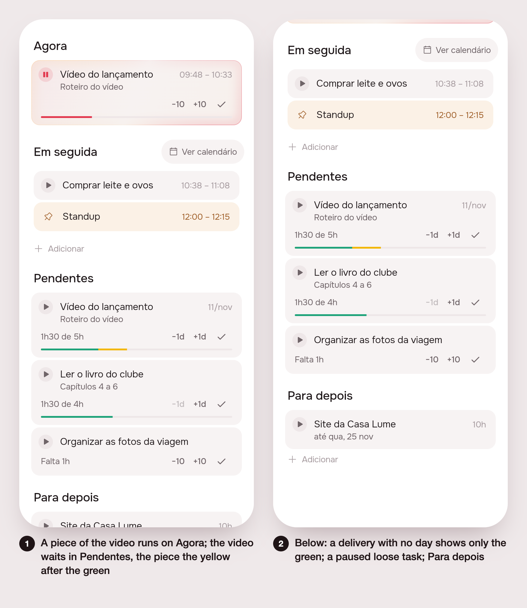
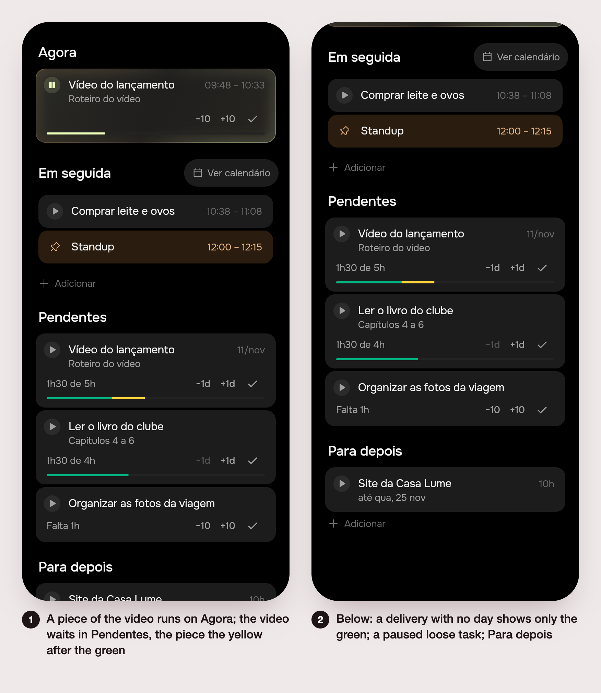

# Home: tarefa dividida, barras e Pendentes

Issue #92, part of #91 · ~2.5 pt of the week · impact: high.

## 1. The ask

> Server+app. A task in progress never leaves part of itself 'now': the
> rest of a split task always goes to Pendentes (task.pending_at). The
> task in progress is drawn as a small yellow bar after the green one,
> sized by the time of that subtask. A task with no deadline shows only
> the green bar in Pendentes. Add a way to move a task from Pendentes
> back to Para depois (move { backlog: true, pending: false }). Touches
> app/lib/plan/, timeline play.dart, server events/ layout.
>
> Unattended. .tool/check must pass before you finish; a failure your
> change didn't cause is proved (stash, rerun) and named in the README.

From #91: *"There should never be a task in progress and part of it now.
If we have divided it in blocks, the rest of it should always be on
pending. Because of that, any task that is in progress will be
represented by a small yellow bar after the green one, that will
represent the amount of time that subtask will take. There is no
possibility to move a task back from pending to Para depois. If there is
no deadline for a task, we will just have a green bar on pending."*

## 2. The plan

- **Server** (`events/event-layout.service.ts`, `moveTask`): a piece put
  at a place or an hour (`move { minutes, split: true }`) no longer
  leaves its rest in the queue where the task was. The rest is written
  the way a piece begun writes it (`_splitRest`: a subtask at the top of
  the delivery's Para depois, or a pending loose task on a server with
  no deliveries), and the delivery is begun (`_beginArtifact`), so it
  waits in Pendentes. The code that put the rest "right after the piece"
  is gone.
- **Pendentes ↔ Para depois**: the server already read
  `move { backlog: true }` without `pending` as Para depois. The app now
  says `pending: false` outright on every move into the backlog
  (`TimelineRepository.moveTask`), and dragging a pending card onto
  Para depois posts it (a delivery is stopped, as before).
- **App** (`app/lib/plan/`): Pendentes keeps the delivery whose piece is
  running on Agora (it used to be left out, so the rest was nowhere to
  be seen). Its bar draws the piece at work as a yellow run right after
  the green (`TaskBar.doing`, the running card's minutes over the
  delivery's), from a new token `AppColors.paceDoing`. A pending card's
  bar is always a pace bar (`TaskBar.pace`), so with no deadline it is
  the green alone, never Agora's accent.
- **Proof**: server specs in `events/events.controller.spec.ts` (the
  rest in Pendentes, the delivery begun, Pendentes → Para depois); app
  tests on the bar's fills and on Plano; prints of the real Plano over
  fakes in both brands.

### Decided unattended

- **The way back to Para depois is the drag that was already there**,
  made explicit (`pending: false`) and tested; no new button on the
  card. The card's row already holds −1d +1d ✓, and a swipe or a menu
  is #91's own item (the swipes that went missing).
- **The rest of a split goes to the delivery's Para depois and the
  delivery is begun**, which is how a split task reaches Pendentes since
  #89 turned a split loose task into one with subtasks; `task.pending_at`
  is set only on a server with no deliveries, where the rest stays loose.
- **Agora still titles the running piece by its delivery**, and the
  delivery is drawn a second time in Pendentes, with its yellow bar.

## 3. What was built

Two scenes in each brand: (1) a piece of "Vídeo do lançamento" runs on
Agora while the delivery waits in Pendentes, with the yellow run after
the green; (2) scrolled: "Ler o livro do clube", with no day, shows only
green; a paused loose task; Para depois.

**The rule**: a task in progress never leaves part of itself on the day.
The rest of a split always waits in Pendentes.

**Server** (`server/src/events/event-layout.service.ts`, `moveTask`): a
piece put at a place or an hour (`move { minutes, split: true }`) sends
its rest through `_splitRest` (a subtask at the top of the delivery's
Para depois; a loose pending task only on a server with no deliveries)
and begins the delivery (`_beginArtifact`). The code that put the rest
right after the piece is removed. `move { backlog: true, pending: false }`
already meant Para depois; it is now tested. No new route.

**App**:
- `TimelineRepository.moveTask` sends `'pending': pending` on every
  backlog move.
- `TaskBar` (`app/packages/timeline/lib/src/widgets/task_card.dart`)
  gains `doing` (0–1, yellow right after the green) and `pace` (a pace
  bar even with no day: green alone, never Agora's accent).
- New token `AppColors.paceDoing` (Lunna `0xFFF2B705`, Focus
  `0xFFFFD43B`).
- `PlanItems` keeps in Pendentes the delivery whose piece runs on Agora
  (`PendingDelivery.doingMinutes`); `PendingCard` draws
  `TaskBar(done, time, late, doing: doingMinutes / minutes, pace: true)`.
- Doc comments updated in `plan_drag.dart`, `play.dart`
  (`PlayMuchQuestion`) and `timeline_event.dart` (`EventMoved.split`).

**Tests**:
- Server `events.controller.spec.ts`: 145 pass. Split specs rewritten
  (rest in the backlog, delivery begun); new "never leaves the rest of a
  queued task on the day (#92)" and "takes a task out of Pendentes back
  to Para depois (#92)".
- App `timeline/test/task_card_test.dart`: 8 pass (new: yellow after
  green; fills line, `paceDoing`, `paceDone`).
- App `test/plan/home_page_test.dart`: all pass. Agora now expects the
  delivery in Pendentes with a yellow bar; new: green-only bar with no
  deadline; carrying a pending loose task to Para depois posts
  `EventMoved(backlog: true)`.
- `.tool/check` passed.

**Differences from the plan**: none. No mockup preceded this build.

## 4. How to turn it on

Nothing. It ships with the app and the server; no env vars or commands.

## 5. Cost and time

Measured by the queue: see the pull request.
