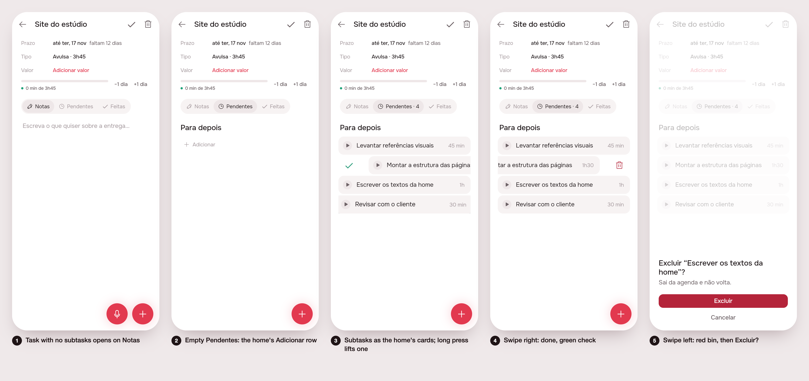

# Task view: notes, subtasks and dialogs

> Issue [#94](https://github.com/pietroid/lunna/issues/94), **mockup
> track** (draft; the build follows).

## 1. The prompt

From the issue, verbatim:

> Visão da tarefa: notas, subtarefas e diálogos
>
> Strip of 3-4 screens of the task page: empty state always shows Notas (same body as a delivery's 'notas pendentes e feitas', no title/text), no 'adicionar tarefa', empty Pendentes shows a button instead of 'nada esperando…', subtasks with the home's spacing, drag, swipe and confirm dialogs for done and delete.

## 2. The design

1. With no subtasks the page opens on **Notas**: the same body a delivery's
   Notas tab has (just the hint, no title or text field of its own).
2. An empty **Pendentes** shows the home's own `AppAddRow`, **Adicionar**, that
   opens the composer about this task; the "Nada esperando…" sentence is gone.
3. Subtasks are the home's `TaskCard`s with its spacing (`kQueueGap`, 4 px).
   A long press lifts one to drag it; swipe right ticks it off, as on the
   calendar: a green check in the corner, no label, **no dialog**.
4. Swipe left shows the red bin, as on the calendar.
5. Letting go asks *Excluir “…”?* (the existing `confirmDelete`).

Reply on the issue (verbatim):

> keep design consistent. You should only use the same components as the home one. the "escrever uma tarefa" should be just adicionar and the swipe to left and to right must be the same as the home. But I liked it the swipe.

Second reply (verbatim):

> adicionar should not have red button. The rest seems good.

Third reply (verbatim):

> Adicionar should be the exact same component as home.

Revised: the empty **Adicionar** is now `AppAddRow`, the very widget the home ends its sections with (a + and Adicionar in the quiet ink), not a button.

Decided unattended: the home's list has no swipe; the calendar (`timeline_list.dart` ~1196) does, so "same as the home" is read as that: right = done at once with a green check, left = delete after `confirmDelete`. This drops the done dialog the first brief asked for.
 "the task page" is `ArtifactPage` (a task with
subtasks); the "Nova tarefa" row/`artifactAddTask` is read as the
empty-state copy to drop, and the + dock stays as the one way to add.

## Build brief

Written in this session (kept for the build):

- `app/lib/task_view_preview.dart`: preview entry, `?s=1..5`.
- `app/packages/artifacts/lib/src/view/subtask_row.dart`: `SubtaskRow`,
  swipe right = done, left = delete, springs back; `offset`/`lifted` only
  seed previews.
- `app/packages/artifacts/lib/src/view/artifact_page.dart`: `_Tasks` uses
  `SubtaskRow`, gap `s1`, empty button (`ComposeLauncher`); `previewSwipe`
  and `previewLifted` on `ArtifactPage`.
- `app/packages/timeline/lib/src/widgets/confirm_sheet.dart`: `confirmDone`
  (now unused: remove it and `confirmDone*` from the arb).
- Empty state is `AppAddRow` (same widget as the home); `SubtaskRow` shows only the
  icon, as the calendar does.

The build must still:

- **Drag**: make `_Tasks` (`artifact_page.dart`, the `for (final task in
  later)` list) a reorderable list (long press, as the home's
  `plan_drag.dart`), writing the order through `EventMoved`; `lifted` is
  only the look.
- **Swipe**: check done/delete on a running or timed subtask; make the
  swipe not fight the page's back gesture or the drag.
- **Empty state always Notas**: where a task opens without Notas first (the
  remembered tab, `_restoreTab` at `artifact_page.dart`), open Notas when
  there is nothing pending; and on `EventPage` (`event_page.dart`) of a task
  with no subtasks show the same notes body, with no add-task row.
- Remove `artifactAddTask` and `artifactPendingEmpty` from the arb if
  unused; remove the preview-only `previewSwipe`/`previewLifted` params
  once the real gestures are tested.
- Tests: swipe past the threshold asks, no answer leaves the task; the
  empty button opens the composer.

Open questions: should the swipe also exist on the home's cards? Should a right swipe ask, as the first brief wanted? Should a
swipe-done on a running subtask be refused?
