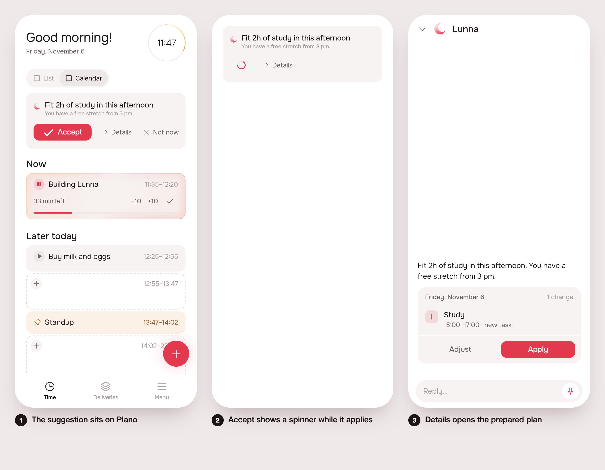

# Re-enable agentic suggestions (#120)

Status: draft (mockup).

## 1. The prompt

> Re-enable agentic suggestions
>
> Agentic suggestions were a major part of lunna, we disabled temporarily to take care of other stuff on home, but I feel we could take advantage of it again.
>
> But I want a new design, because the current one takes too much space. It should be a small height, beatiful card, with a appealing title and a succint description. We have three options: accept, deny, or details...
>
> If tapping details it should open the agentic screen with the full suggestion (A2UI) embedded on it (so we can keep the current way of having a prepared A2UI for the suggestion before opening the screen). User can talk and change anything or accept it by the chat page.
>
> The accept should have a small spinner on the card while the changes are taking place, and the deny should just dismiss the card and a new suggestion will come when there is time.
>
> Also, I think we can drop suggestions from 4h to 4h at least in the working hours, that way this is more often.

Review reply (revision 1):

> The card contrast against the button looks awful, can we have a highlight on accept? Also some icons with the button would be good. Also make the left spacing good enough so it aligns with the now task spacing.

Review reply (revision 2):

> adjust the card background, it could be gray.

The plan (by /create, ~2.5 % of the week):

- Turn the suggestion back on in Plano (`kSuggestionOnPlan = true`).
- Redraw `SuggestionCard` as a compact card: a title, a one-line description, and Accept, Deny and Details.
- Accept applies the plan through the existing apply route, with a small spinner on the card while it runs. The card goes away when it is done.
- Deny calls the existing dismiss route and removes the card. The next suggestion comes on the timer.
- Details opens the agent sheet with the prepared A2UI surface already embedded, so no new turn is needed.
- Server: follow-up default 4 h, clamp 1 to 4 h (was 3 to 24, default 24). `intoWorkDay` keeps it inside working hours.
- New strings in `app_pt.arb` / `app_en.arb`, regenerate l10n.
- One widget test for the card states and one server spec for `nextAtOf`.

Not doing: no change to how the model picks the content; no animation polish beyond the spinner; no change to the landing demo; no new routes or tables; no change to suggestion push notifications.

## 2. The design

1. The card sits at the top of Plano, two lines of text and three actions: **Aceitar** (filled accent button, check icon: the highlight), **Detalhes** (arrow icon), **Agora não** (x icon). The card is gray (`AppColors.fill`, not the pink wash). Its inner padding is `AppSpacing.s4`, so its text and mark line up with the Now card's.
2. Aceitar swaps for a small spinner while the plan applies; the card goes when it is done (on failure the button returns and a snackbar says why).
3. Detalhes opens the agent sheet already holding the prepared surface (preview, plan, Adjust/Apply), no new turn.

Decisions the screens don't show:

- Title = the first sentence of the suggestion's `text`; description = the rest, one line, ellipsis. No new field, so the model's content is untouched.
- A suggestion with no plan (a question, the welcome) shows Detalhes (and Agora não) only.
- Deny reuses `SuggestionCubit.dismiss()`.

## Build brief

Written in this session (kept for the build):

- `app/packages/agent/lib/src/view/suggestion_card.dart`: rewritten as the compact card (gray `AppColors.fill` container instead of `AgentWash`; Aceitar is an `AppButton.icon` with `AppIcons.check`; the pills carry `arrowRight` / `close`; inner padding s4); `_Offer` is stateful and holds the accepting flag (so the cubit needs no new state); `SuggestionCard(accepting:)` is test-only; `suggestionWords()` splits the text.
- `app/lib/suggestion_preview.dart`: the preview entry point (`?s=1|2|3`). Scene 2 is the card alone on a scaffold (the demo's apply is instant, so it can't show the spinner).
- `app/lib/plan/view/home_page.dart:20`: `kSuggestionOnPlan = true`.
- `app/packages/l10n/lib/arb/app_pt.arb` and `app_en.arb`: `agentSuggestionAccept`, `agentSuggestionDetails`, `suggestionPreviewTask`, `suggestionPreviewText` (the last two are for the preview only); gen/ regenerated.

Still to do:

- Server `server/src/agent/agent.service.ts:2283-2312`: `DEFAULT_FOLLOW_UP = 4`, `FOLLOW_UP_RANGE = { min: 1, max: 4 }`, update the doc comments (3–24).
- Server prompt `server/src/agent/work-quality.ts:182`: replace "3 when under way today, 24 when tomorrow's" with the 1–4 h range.
- `server/src/agent/suggestion.store.ts:29`: comment says 3–24.
- Check the `SuggestionTimer` and the AGENTS.md / `product/spec/agent.md` / `home.md` text that mention 24 h or the old card.
- Tests: one widget test in `app/packages/agent/test/` (card shows title/description, Accept spinner, Details, Deny) and one server spec for `nextAtOf` (4 h default, clamp 1–4, moved into the work day).
- Remove or drop `suggestionPreview*` strings if the build prefers; run `.tool/check`.
- Unused now in the card: `OfferActions` import was dropped (still used by the conversation); check no dead code (`kWelcomeAmounts` was removed with `_Answers`; grep for users).

Open questions: none. Decided unattended: a title/description split on the first sentence instead of asking the server for a separate title.
